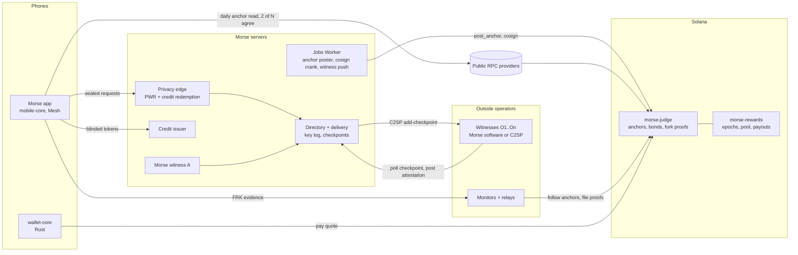

# Witness Network and Crypto Expansion: Complete Plan

Status: paused by explicit user request (2026-11-06); source and evidence checkpoints pushed, resume only when requested. Plan revised 2026-09-25; §22 (security and privacy gaps found by the
2026-09-26 review) added 2026-09-26; the bond counter, the phone bounty,
checkpoint gossip and plaintext types (§6.16–6.18, Phases 0.6 and 6) added
2026-09-27. Nothing in it is built unless §2 says so. The
protocol design it implements is
[protocol/witness-network-v1.md](mesh-private-messenger/protocol/witness-network-v1.md)
(status: proposed). This file is the build plan: what exists, what gets built,
in what order, with which formats and numbers, how each piece is tested, and how
production keeps running at every step, including with **no outside witnesses at
all**.

All dollar figures assume SOL at $150 and USDC at $1. They are starting points,
revisited at each phase gate.

**Contents**

1. Goals, non-goals and invariants
2. Where things stand today (verified in code)
3. Architecture
4. Trust profiles and bootstrap: production with no outside witnesses
5. Design decisions
6. Specifications
7. Numbers
8. Phases
9. The operator program
10. What users see
11. Environments, feature flags and testing in production
12. Observability and alerting
13. Security
14. Incidents and runbooks
15. Testing strategy
16. Rollout and migration
17. Documents, landing page and pitch deck
18. Budget and staffing
19. Timeline
20. Risks
21. Decisions
22. Security and privacy gaps outside the witness network

---

## 1. Goals, non-goals and invariants

### Goals

1. Make it **publicly detectable** when anyone, Morse included, shows one person
   a different key log from everyone else.
2. Make it **expensive**: every party able to sign such a log has a bond that an
   on-chain proof slashes.
3. Move the witnesses that phones trust to **operators outside Morse**, with a
   strict-majority threshold Morse can't reach.
4. **Pay** witnesses from a Morse-funded floor, then from anonymous credit sales.
5. Add **anonymous credits** for extras, paid in USDC, SOL or BTC, that the
   servers can't link to a buyer.
6. Launch the **Morse token** as the bond and the thing credit purchases burn.
7. Keep production **fully working at every step**, including before any outside
   witness exists.
8. **Pay the person a fork targets.** The phone that catches a fork names a
   one-time address in its proof and receives the finder's share (§6.3, §6.9).
9. Make every phone a **witness for its contacts**: each message carries the
   sender's view of the key log, so a split view has to fool everyone a person
   talks to (§6.16).
10. **Show the money.** The bonds, the slashes and the age of the last public
    checkpoint are shown live from the chain, in the app and on the site (§6.17).
11. Make sending plaintext anywhere but a seal **a compile error** in Mesh (§6.18,
    Phase 6).

### Non-goals

- Wallet addresses as identities, username NFTs, or anything that ties a wallet
  to an account.
- Rewards for in-app activity, airdrops by usage, or any measurement of it.
- Anything on-chain per message, per contact or per account.
- Token governance over security: pinning, thresholds, cryptography or the
  judge program.
- Replacing safety numbers. They remain the check that works even if everything
  else colludes.

### Invariants (hold in every phase and profile)

| # | Invariant | Enforced by |
|---|---|---|
| I1 | The phone verifies. Security never depends on the chain being up or the token having value | Phone code: chain reads can only add warnings or remove trust |
| I2 | The chain can take trust away (a slashed key), never grant it | Phones read `service_slashed` and witness status only to refuse |
| I3 | Releases pin trust: witness keys, threshold and issuer origin ship in the native security config | Security config v2 (§6.1); OTA can't change it |
| I4 | Threshold is a strict majority, `k = ⌊n/2⌋ + 1` | Config parser rejects anything else |
| I5 | Privacy is unchanged: witnesses, chain, monitors and relays see checkpoints and proofs only | Wire formats (§6) carry nothing else; privacy-contract tests |
| I6 | Messaging never needs a wallet, credits or the token | Proof of work (`PWR`) stays the free path; credits are only ever an alternative |
| I7 | Morse never receives slashed funds | Judge program: 10% to submitter, 90% locked or burned |
| I8 | Morse's own witness is never paid from the pool | Rewards program `excluded` flag |
| I9 | Nothing claims more independence than exists | Trust profile shown in-app and on the site (§4.4) |

---

## 2. Where things stand today (verified in code)

| Area | Today | Where |
|---|---|---|
| Checkpoint | 188-byte `KTK` wire form. The service signs a 146-byte statement: `"mesh-key-transparency-v1"`, version u16, sequence u64, tree size u64, root, previous checkpoint hash, timestamp u64, service key. `checkpoint_hash = SHA-256("mesh-msg/v1/transparency-checkpoint" ‖ statement ‖ signature)` | `packages/messenger-protocol/transparency/merkle.mpl:182`, `wire.mpl:416` |
| Witness signature | Ed25519 over `"mesh-msg/v1/transparency-witness" ‖ witness_id ‖ checkpoint_hash`; ID 1–64 bytes, pinned to one key | `merkle.mpl:276` |
| Witness logic | Run-once or 15-second pull loop; verifies service signature, rollback, consistency, clock skew, time progression and adjacent hash links; atomically persists before signing; retains rejection evidence | `services/transparency-witness/main.mpl`, `witness/history.mpl`, `witness/state.mpl` |
| Witness hosting adapters | Cloudflare witness adapters and scheduled `/attest` calls exist; standalone pull-mode deployment is also supported. These source checks do not establish the current live host inventory or independent operators | `ops/cloudflare/witness.mjs`, `ops/witness/README.md` |
| Directory's witness list | SQL registry with pinned/shadow/retired states and current-key admission. Empty registries bootstrap A/B; populated registries control membership | `migrations/017_witness_registry.sql`, `storage/witness_registry.mpl` |
| Attestation storage | `witness_signatures(checkpoint_sequence, witness_id, checkpoint_hash, …)`, primary key (sequence, witness_id) | `migrations/004_transparency.sql:30` |
| Phone threshold | Configured strict majority over 1–16 distinct native pins; v1 maps to legacy 2-of-2 | `packages/mobile-core/mobile/transparency.mpl`, `transparency/config.mpl` |
| Phone pinning | Canonical config v6 wraps an exact v1–v5 frame with a new-session suite minimum; existing bytes/defaults stay valid. Migration policies, judge identity and relay pins remain native resources. Legacy and versioned MPR2 receipt filing are connected locally; asset movement and native UI qualification remain open | `mobile-core/mobile/platform.mpl`, `mobile-core/mobile/session_policy.mpl`, `mobile-core/mobile/fork_filing.mpl`, `apps/mobile/plugins/security-config.cjs` |
| Groups | Native v2 binds set ID and threshold in welcomes, snapshots and key packages; signed policy updates migrate joined groups. Native v1 preserves legacy wires | `mobile-core/mobile/groups.mpl`, `groups/welcome_wire.mpl` |
| Limits | `verify_witnesses` accepts at most 16 pinned keys and 16 attestations | `merkle.mpl:388` |
| Proof size | v2 compact paths and incremental stored nodes implemented; v1 remains the default until native rollout. Compact mode verified at 1,000,001 leaves | `transparency/merkle.mpl`, `storage/transparency_tree.mpl`, `key-transparency-v1.md` |
| Freshness | Phones reject evidence more than 5 minutes old; the directory re-signs an unchanged tree after 4 minutes | `transparency/client.mpl`, `directory-delivery/storage/transparency.mpl:211` |
| Fork evidence | F1 same-size conflicts, F2 authenticated inclusion contradictions and F3 rollback have codecs and verification; this does not imply every discovery path finds every kind | `transparency/fork.mpl` |
| Abuse control | Proof of work at the privacy edge, `MESSENGER_ABUSE_DIFFICULTY` 1–24 (default 16) | `services/privacy-edge/main.mpl:27,50` |
| Crypto available in Mesh | Ed25519, X25519, SHA-256, HPKE, ML-KEM, blind RSA, BOLT11 verification and opaque one-time payment preimages are implemented locally. The reviewed public release and exact app pin remain open | mesh-lang public runtime and compiler; Phase 4A evidence below |
| Health | `/health` reads bounded cached job health, ages it and reports quorum, signature ages and anchor lag; it does not start signers | `ops/cloudflare/routing.mjs`, `storage/witness_registry.mpl` |
| Operator recruiting | Landing page `witnesses.html` (terms, lifecycle, FAQ) and a public GitHub issue form | `apps/landing/witnesses.html`, `.github/ISSUE_TEMPLATE/witness-application.yml` |
| Checkpoint gossip | Direct and linked-device encrypted hints/control exchange; group message v5 carries the same hint and addressed controls. Signed conflicts retain FRK and pause new trust | `mobile-core/mobile/gossip.mpl`, `group_gossip.mpl` |
| Public anchors | Local judge anchor/cosign subset, native verification, scheduled writer and receipt APIs implemented; chain deployment pending | `programs/morse-judge`, `mobile-core/mobile/anchor_check.mpl`, `directory-delivery/storage/anchor_receipts.mpl` |
| Monitor | Native Mesh polling, durable comparisons and cached status implemented locally; deployment pending | `clients/mesh-cli/monitor` |
| Relay | Mesh admission, Kit signing, SQLite progress/ownership, finalized RPC recovery, durable scheduler, HTTP/manual entry points, bounded retention and witness-package integration implemented locally. Durable mixed-asset execution and phone filing now share permanent MPR1/MPR2 receipt authentication; published distribution, native UI and funded qualification remain pending | `transparency/relay_admission.mpl`, `transparency/permanent_receipt.mpl`, `ops/relay-mpr2`, `ops/relay`, `mobile-core/mobile/fork_filing.mpl` |
| Rewards | Local Mesh policy, isolated custody program, authenticated reader, durable v1 funding/settlement/claims, v2 settlement/asset claims, bounded multi-epoch scheduling and continuous directory/current-attendance grace assessment implemented; deployment and live funding qualification pending | `transparency/rewards_operator.mpl`, `programs/morse-rewards`, `ops/rewards`, `ops/token-v2/reward_operator.mpl` |
| Credits, payments and token | Credits and USDC/SOL/Lightning paths have local implementation and execution evidence; token swaps/burns have local SBF proofs. Native dogfood, keeper/rewards integration, review, deployment and live exit gates remain open | Implementation progress below; Phases 4–6 |

### Current continuation status — 2026-11-06

This table is the current continuation reference, through source checkpoint
`bd8d1d4`, with the separately verified language checkpoint `9b844dba` pushed.
Candidate `a0511fd` composes view-once Core/UI for qualification; it is not adopted.
Detailed entries below retain the history of implementation and proof;
an older candidate or pending note does not override a later adoption record.
Local source, local execution, native UI qualification and live production
acceptance are separate states. No live deployment inventory was refreshed by
these local checks.

Maintain this table and the affected phase/§22 rows at each adopted checkpoint,
alongside the detailed evidence entry. Record the adopted commit, what actually
ran, any reused evidence, and the next unmet gate. Work in an isolated worktree
is in progress until adopted and checked on the combined branch; a design or a
passing local fixture does not close a native-device or production gate.

| Workstream | Adopted or verified now | Next required work |
|---|---|---|
| Mesh error conversions | Pushed `8256d5d3`; generic and builtin `From` handling qualified, with a retained optimized local compiler/runtime family | Reviewed public release and exact app dependency pin |
| Quorum source identity | Shared Mesh and writer host checks adopted through `f4c21c2`; seven Mesh and 28 native/writer checks pass, including mapped/nonmapped IPv6 controls | Independent-provider and live RPC qualification; different names alone do not establish different operators |
| V2 rewards | Bounded scheduling plus directory/current-attendance grace assessment adopted (`cee839c`); 47 composed local Node/native/Kit/SBF checks pass | Deployment, funded operation, independent providers and live duration gates; finite requests stop at their configured bound |
| Desktop private services | Actual root, native ownership, retirement, files and backups connected through `311146f`; prior 800 app checks remain recorded. Current TLS/body composition passes 126 native checks and the default Debug build. A certificate-signed actual-store probe still refuses with `-34018` | Matching macOS profile/entitlements and provisioned bundle, then unlocked native UI/provider acceptance; Windows/Linux ownership adapters; D4/D6 remain open |
| Native effects after suspension | Language checkpoint `9b844dba`, after test-only `8998522a`, is reviewed, clean and pushed. Parent verified all 19 source hashes and 44 retained artifacts and freshly replayed five generated-ABI controls. Final owner qualification passes 31 actual generated-ABI cases and default-parallel runtime/integrations 1669/0 with 20 ignored; R4/R5 accept the bounded source | Only synchronous-sink capability mask 1 is advertised. The app still uses its retained 8256 toolchain; no protected activation or serializer removal. Native policy, complete effects, SDK/IPC publication, service provenance and fresh-owner scheduling require separate implementation and qualification |
| Native lifecycle prerequisite | Adopted `bd8d1d4` after `f814681`/`fccdcdd`: optional native domain pins distinct root, sentinel and owner nodes, retiring the original node before deferred Main cleanup. Same-root successor/capture replacement defect was reproduced and fixed. Independent R2/R3 reviews and fresh parent compilation/replay pass eight actual generated HTTP/SQLite cases, 71 existing Swift groups plus three retirement groups, image lifetime, and support-only iOS simulator typecheck | The app remains unbound. Actual UIKit/Expo destruction, accepted iOS runtime integration, framework identity writers, SDK/IPC publication and full native policy remain unqualified. Mask1; no protected activation, serializer removal or Android claim |
| Observed native owner loss | Adopted `caf670e`: the bound macOS ProcessOwner retires exact runtime authority before returning observed loss or close, retaining OS exclusion only through accepted local settlement. Independent review and parent replay pass 25 cases, two existing controls and two negative controls | Runtime loader provenance/lifetime, actual protected app integration, off-Main mobile teardown and framework writers remain open; no activation or capability expansion |
| Public envelope storage | Adopted `25e31b3`: caller keys use a separate envelope namespace, so public writes cannot select native record labels. The actual facade regression fails before and passes after; two optimized cases pass, full Mesh lint is empty, and optimized Main preserves all 176 exports and 69 disclosure sites | Existing rows are not migrated or removed. This does not establish legacy view-once completeness; fresh-account epoch admission and authenticated migration remain separate |
| Plaintext propagation | Presentation and outgoing body labels adopted through `4eaed22`; three raw storage/fanout-target/triple-payload parsers are private in the native facade at `b59eaf1`. Existing proofs cover seven content exits, eight import refusals and the unchanged 69-site gate | A new compile-only audit accepts five decoded direct/group/timed/history body HTTP sinks; an explicit-label control refuses all five. Shared semantic body labels and coordinated consumer closure are now assigned. Raw decrypt/unseal bytes, general decoding, mobile targets and release qualification remain open |
| Bootstrap acceptance | Scoped native RPC TLS adopted through `748270a`; retained fresh compiled-Core fixture exits zero with 37 checks and `consistent`. Parent verified its source/artifact hashes; the combined product Main build passes with 69 sites, 176 exports and exact generated bindings | Full phone/UI and platform packaging, real production-clock next-due controls, broader bootstrap acceptance and all eight scheduled production checks remain open |
| Witness outage qualification | Tooling adopted through `fc0e701`. Exact owner source `a66889a` passed 900.056500333 seconds with 155 native lookups and C's retained 1→31 catch-up; parent verified retained provenance and freshly rebuilt the combined sources for a passing 60-second control | Hosted B1 deployment, seven-day observation and the scheduled production outage drill remain open. The 900-second artifact predates TLS/body composition; the composed artifact has the separately recorded short control |
| View-once receive | Core source checkpoint `bd24a8a` is committed after record checkpoint `924d24f` and existing envelope isolation. Parent rehashed all 40 snapshot files, 31 test logs/92 passing cases, seven privacy controls and the 176-export optimized staticlib. R7 source/R8 fixture reviews pass. App candidate `600a909` carries the refreshed exact-Core ordinary/Pending fixture; its focused parser test passes | Separate disclosure review found three public admission helpers that release caller-supplied private classifications. Correction `e199c469` passes independent R3 source review. Composed candidate `a0511fd` passes Main176/unchanged bindings, 838 app tests, typecheck and two web placeholder widths. Adoption/inventory remain held for a separate sibling-account authority and restored-session provenance defect; real receive regression work is assigned. Combined Core evidence now covers 114 passing cases across 40 baseline files and a focused two-file rerun after correcting imported fixture assertions; no full-cohort rerun is implied. The real backup export excludes selected view-once bytes with zero object requests. Independent inventory review remains held (43 unchanged, 25 shifted, 10 additions, one changed display annotation). Existing accounts without an authenticated clean epoch cannot admit new VOR until migration. Groups, native fetching/opening and actual effect authority remain open |
| Monitor acceptance | §4.3 now matches §6.8: verify every consecutive posting from the retained observation baseline, with full catch-up and no gaps. Five current monitor test files pass locally | Scheduled live coverage and preserved observation history; fresh local tests do not establish the production window |
| Mixed-asset fork filing | Phone FFS2 persistence and 16-field display plus shared operator/phone permanent receipt authentication adopted through `1ab2a78`. The combined source matches the qualified 80-packet SBF proof and 20-group native replay, including 13 refusal vectors and three production relay admissions. Parent verified 619 source files and 80 artifacts; Main keeps 176 exports and 69 reviewed disclosure sites | Bounty movement/recovery is separately adopted through `57f0db8` with real signer/bank proofs. Shared native effect admission, whole-app/device UI, optimized phone release, independent providers and live qualification remain unfinished |
| Per-asset bounty movement | Reviewed implementation adopted through `57f0db8`: independent asset journals, exact-signature submission, scoped native selectors and per-asset UI. R4 resolves all 14 findings. Parent freshly passes 830 app tests, typecheck, Rust/Swift/Kotlin request validation, optimized Main with 176 exports/69 unchanged sites, the actual mixed Core/SDK/SBF flow and stale-host correlation | Native owner admission, actual SDK/IPC final delivery, provisioned/device UI, independent providers and live operation remain open. The ten owner matrix configurations and parser opt0/2 proofs remain exact-source retained evidence; the parent freshly rebuilds/runs opt2 after envelope composition |
| Weekly credit check | Acceptance now uses the standard $5 / 100-credit pack, matching fixed pricing in §7 | Actual live weekly purchase and redemption of each deployed extra |

The unadopted history UI checkpoint `75fb777` is also pushed on
`t3/view-once-history-codec`; it remains paired with the pending direct Core
admission work. Group view-once requires a separate versioned carrier and native
selector that authenticate the full 32-byte group identity. VOR1's 16-byte
conversation and ordinary ATG reconstruction cannot supply that binding. The
existing direct `02HST` contract is unchanged; group design and execution are
still open.

All eight §4.3 production checks remain pending. B1 shadow/outage observation,
anchor/quorum duration gates, external operators/reviews, funded deployments,
live slashing/finder payments and executed weekly burn/purchase drills are not
established by the local proofs. The full §22 work remains part of this plan.

### Public envelope storage isolation — 2026-11-06

Source checkpoint `25e31b3` separates public envelope keys from internal record
labels before keyed indexing. A caller holding valid previously sealed local
ciphertext could previously replace the selected native row through
`mesh_messenger_store_envelope`. The real public-facade regression reproduces
that overwrite; after the correction, native ciphertext stays unchanged while
repeated caller keys still update their own envelope row and binary keys remain
accepted. The original canonical-envelope API control also passes.

Two optimized test cases pass. The fresh optimized product Main has 330
source-verified modules, the same 176 ABI exports and the same 69 reviewed
disclosure sites; only `Storage.Records` has a changed reported source hash and
it contains no disclosure site. Full Mesh lint and scoped formatting pass.
Independent source/evidence review found no verified defect and did not repeat
runtime execution. The two compiler assertion warnings remain in both red and
green logs; the protected-row assertion demonstrably failed in the baseline.

The [qualification receipt](mesh-private-messenger/ops/bootstrap/evidence/20261106/envelope-storage-isolation.json)
binds sources, tools, logs, Main artifacts and review. The failed test's sole
12,288-byte synthetic database was removed after hashing and two open-handle
checks; current artifacts and evidence remain. Existing raw-address records are
untouched. This prerequisite does not migrate old view-once state or establish
completeness for unknown legacy aliases. The unadopted Core epoch design enables
new admission only after fresh account creation/link atomically clears old rows
and inserts its sealed account/device epoch; existing users need a separate
authenticated completeness/migration process.

### Native lifecycle prerequisite adoption — 2026-11-06

Commits `f814681` and `fccdcdd` adopt the bounded Main-thread retirement
correction and the [57-row predicate matrix](mesh-private-messenger/tests/native-effect-authority-unit0/PREDICATES.md).
The production dispatcher now retires iOS sentinel/owner authority before a
Main-thread teardown returns. Off-Main teardown still queues exact-identity
cleanup and is explicitly not immediate retirement.

Parent freshly ran all 17 replay commands: 71 existing Swift host groups,
three retirement groups and two real macOS ProcessOwner controls pass. The
always-deferred dispatcher fails the two Main cases with the Main queue held.
The filesystem controls show why held descriptors and `flock` cannot substitute
for current named-path identity: external replacement preserves the old descriptor
and lock while production currentness refuses, and a replacement inode has its
own independent lock. The original anchor still refuses successor acquisition.

The [composition receipt](mesh-private-messenger/ops/bootstrap/evidence/20261106/native-effect-unit0-composition.json)
records source/binary/log hashes and the reviewed native inventory change. Only
`mesh-messenger` changes (52 to 53 collected sources, no connection sites); all
other package, desktop and network-control pins stay identical. The full collector
passes with 36 packages and 5,903 native source files. The earlier lifetime cap of
64 generations was rejected; the runtime implementation now uses separately
retained generation nodes with bounded ancestry, still under qualification.

These are Foundation/controller and actual local OS controls, not UIKit/Expo,
Android lifecycle, Tauri or device acceptance. The owner separately passed six
Android configuration checks; its Android runtime suite could not run without
the generated Gradle project/cache. Framework before-mutation hooks, off-Main
retirement and external filesystem authority remain open. A focused architecture
follow-up must resolve those boundaries before protected activation; cached
predicates or asynchronous observations are insufficient substitutes.

### Native effect design and active implementation — 2026-11-06

The [selected design](.morse/continuation-20261106/native-effect-authority-design/README.md)
uses synchronous native admission at concrete runtime sinks. It preserves
SQLite callbacks and lock semantics: each mutating primitive and commit needs
admission; arbitrary callback execution is not one authorized effect. Explicitly
protected embeddings require captured authority, while standalone V1 behavior
and its nine-callback host table remain compatible. Account transitions retain
their legitimately authorized network operations.

Mesh admission/context implementation, a real generated-ABI HTTP/SQLite baseline,
and native predicate-to-retirement qualification have separate owners. Runtime
scheduling and actual SDK/IPC publication are later gates. Existing native/Core
serializers remain until a replacement proves fresh-owner progress while old
work is suspended. The design itself ran no runtime/native proof. A separate [runtime baseline](mesh-private-messenger/ops/bootstrap/evidence/20261106/native-effect-baseline.json)
now confirms the gap using generated C ABI, loopback HTTP and actual SQLite.
Parent verified its artifacts and freshly replayed current-owner and retired-owner
success cases: retirement precedes the released response, the root still commits,
and a spawned actor commits after export return, while outer publication refuses.
A concurrent export returns BUSY during the HTTP hold. The retained HTTP500/reset
cases produce no write because the fixture only commits successful responses;
they do not demonstrate runtime retirement enforcement. These are synthetic
embedding controls, not actual app owners or native policy. iOS mount/deinit
ordering, Android identity replacement and desktop filesystem-owner policy
remain substantive qualification obligations; cached epochs cannot substitute
for their actual predicates.

### Independent bounty movement adoption — 2026-11-06

Commits `ceb87c5` → `78dc7de` → `a8cd370` → `64b05f0` → `10ef2fb` →
`bd52013` → `57f0db8` adopt the seven reviewed bounty commits. Each asset keeps
its own immutable entitlement and durable attempt; a completed USDC transfer
cannot hide, replace or replay the MORSE leg. Submission binds the exact signed
attempt, so a stale host continuation cannot send a newer transfer under the
same leg identity. Scoped native validators parse the closed asset frame before
choosing the database. The app uses the captured service database and renders
both asset states separately.

Independent R4 review resolves all fourteen prior findings with no new finding
in its bounded scope. The owner retains ten passing opt0/opt2 Core/SDK/SBF
configurations, including both asset orders, genuine zero combinations, old
BWJ1 recovery/migration and exact-attempt correlation. Parent rehashed those
inputs and artifacts and freshly rebuilt the combined optimized Main and native
fixture. The composed Main has 330 source-verified modules, 176 unchanged exports
and 69 unchanged reviewed disclosure sites; only the four bounty modules differ
from the preceding envelope-isolation Main.

Fresh parent runs pass 830 default app tests, typechecking, catalog validation,
22 Rust request tests plus Swift/Kotlin scoped validation, the 43-case actual
Core parser, an unequal-amount mixed SDK/SBF flow and the real Rust-host/Core/SDK/
SBF stale-submission regression. The mixed run checks durable packets before
send, lost acknowledgements, restart, finalized-failure retry/archive and both
exact payouts. Parent additionally normalizes one pass-through arm in a test
fixture; its optimized test passes and full Mesh lint is now empty. The original
full-lint failure remains recorded. Native inventory
review changes source hashes only: connection sites, package counts and all
controls remain unchanged.

The [composition receipt](mesh-private-messenger/ops/bootstrap/evidence/20261106/bounty-movement-composition.json)
separates fresh parent execution from retained owner evidence and records the
small composition delta. These are local synthetic custody, signer and bank
proofs. Private-owner admission at concrete effects, final native/JS delivery,
Keychain/device UI, real provider independence, validator finality, live funding
and release remain open. The fixture's three loopback origins are not independent
providers, and the legacy migration proof is not a new paid MPR1 movement.

### Resumed combined qualification — 2026-11-06

Candidate `a0511fd` combines the reviewed view-once record, receive correction
and history UI with the existing TLS and bounty branch. Parent freshly built
Main with the retained `8256d5d3` family: 176 exports and all five legacy binding
files match. All 838 app tests and typechecking pass. A fresh Expo web export
passes the placeholder workflow at 420 and 1160 pixels with no attachment calls;
this uses literal contract frames and synthetic native I/O, not native-device
or authenticated receive execution.

The [candidate receipt](mesh-private-messenger/ops/bootstrap/evidence/20261106/view-once-composed-candidate.json)
retains the failing disclosure-inventory gate. It has not been bypassed or
regenerated. Independent inventory review and combined Core tests are running.
A separate self-sync source review found an inherited trust defect: matching
the local account ID while validating a credential under a packet-supplied key
does not establish sibling authority. A separate isolated owner is proving and
correcting the actual initial-receive counterexample and handling existing or
restored same-account session provenance. This blocks adoption and the proposed
self-sync releases. No runtime exploitation or production incident is claimed.

### Active candidate review checkpoints — 2026-11-06

The bounty checkpoint below is adopted as described above. The bounded language
checkpoint is pushed separately; view-once remains unadopted. None is a release claim.

- **Bounty `4d25881`:** the [parent preflight](mesh-private-messenger/ops/bootstrap/evidence/20261106/bounty-candidate-preflight.json)
  verifies the current 34 owned files, 718 compile inputs, both libraries and
  ten retained successful Core/SDK/SBF configurations. Parent independently
  reran the actual Core request parser: 43/43 cases pass at opt0 and opt2.
  Malformed reserved tags create no database/custody files; valid legacy and
  versioned controls still reach their intended path. This closes the reproduced
  parser failure in the candidate. The 17-key locale fallback correction retains
  old-key completeness checks and leaves translator files unchanged; the owner's
  default app suite passes 830 tests. Final R4 review subsequently passed and the
  seven commits were adopted through `57f0db8`. The source
  inventory retains its earlier `bba5d9f` head field; parent matched every exact
  current input hash rather than treating that field as a current-head claim.
- **View-once Core:** R5 real receive controls refuse malformed/raw-reference
  captions and changed duplicate fields after history eviction. Both sealed
  identity rows now include a content digest. R6 found arbitrary extensions
  retained in VO history; the actual decrypted-history regression now passes
  after VO-only stripping, with ordinary extensions preserved. R7 reviewed the
  frozen source without a new finding. The committed checkpoint `bd24a8a` now
  passes 92 cases in 31 files, seven compiler privacy controls, exact-source
  captioned backup/restore with zero loopback requests, lint and formatting.
  R8 accepts the corrected test-only epoch-fence argument. Parent rehashed the
  sources, logs, controls and optimized staticlib; no combined build is claimed.
  The [preflight receipt](mesh-private-messenger/ops/bootstrap/evidence/20261106/view-once-core-preflight.json)
  distinguishes retained `8256d5d3` tools from the ambient Mesh checkout recorded
  by the original manifest. The subsequent [disclosure review](mesh-private-messenger/ops/bootstrap/evidence/20261106/view-once-disclosure-review.json)
  found an authority mismatch in three public admission helpers: epoch validity,
  write admission and pending-reference validity release decisions on caller-built
  inputs. Two exported compiler probes accept that finite output; the third is
  source-level evidence. Reference bytes and privately selected account controls
  remain refused. This is a checker-policy finding, not an executed leak or
  receive-authorization bypass. The other authenticated message/history/group
  sites match their finite reasons. Correction `e199c469` keeps helper decisions
  private and places the three finite releases in private authenticated receive.
  Its exact-source qualification passes 89 cases in 29 affected files plus the
  attachment-inclusive backup case with zero object requests. All 11 privacy
  controls refuse with E0093, including the same epoch/write probes, a new live
  pending-reference compiler probe and the public write-parts decision. These
  are compiler controls, not executed leaks. Parent verified 65 source/evidence
  files, matched the three-file committed delta and unchanged 176-entry ABI,
  and freshly read all 176 defined symbols with compatible Rust LLVM tooling.
  The initial Apple nm read failed on newer Rust bitcode; that error is retained.
  The [correction preflight](mesh-private-messenger/ops/bootstrap/evidence/20261106/view-once-disclosure-fix-preflight.json)
  records the verification limits. Independent R3 accepts the bounded source
  correction. It corrects two synthetic witness inputs; compiler refusals are
  not executed leak demonstrations. Combined candidate `a0511fd` passes Main
  compilation with 176 exports and exact bindings, 838 app tests, typechecking,
  and two web placeholder widths with synthetic native I/O. Inventory approval
  and adoption remain held: the separate self-sync review found that initial
  sibling admission trusts a packet-supplied account key with the local account
  ID. Trusted local authority and existing/restored session provenance require
  correction before these sibling-path boundaries can be accepted.
- **Mesh runtime `9b844dba`:** R4/R5 accept the bounded source after actual
  SQLite hot-journal, terminated-registration, V1 error-provenance, timer and
  pending-HTTP cleanup regressions. The final default-parallel runtime/integration
  gate passes 1669/0 with 20 ignored, and all 31 generated-ABI cases pass. The
  distinct peer-name correction is isolated in `8998522a`; its actual two-test
  overlap red/green explains the earlier parallel failure. Earlier failure and
  serial-pass logs remain separate. Parent verified all 19 changed source hashes
  against the committed tree, all 44 retained family artifacts and final logs,
  queried mask 1 from the library, and freshly replayed control, retired write,
  hot-journal, accepted-commit and unsupported-capability cases. Both commits are
  pushed to the development branch. The [language checkpoint receipt](mesh-private-messenger/ops/bootstrap/evidence/20261106/native-effect-unit1-language.json)
  separates fresh parent execution from retained owner qualification. The app
  toolchain is unchanged. No complete-effect, scheduler, publication, service or
  native-policy capability is advertised or activated; observing a queued reply
  remains insufficient to prove final native handoff.

The native closure design is complete with fresh R2 and R3 `PASS_WITH_GATES`
reviews. Parent verified all 50 manifest artifacts. It keeps exact native
receiver predicates and live filesystem samples, adds retirement before
source-controlled replacement or observed loss, and requires original-request
delivery at the final platform handoff. The [progress receipt](mesh-private-messenger/ops/bootstrap/evidence/20261106/native-authority-closure-progress.json)
separates design approval, retained baseline evidence and implementation work.

The isolated ProcessOwner unit has ten expected baseline failures, an unchanged
owner control and two existing OS controls. They reproduce post-loss SQL/send
and premature flock release while an admitted commit remains in flight. Parent
rehashed seven retained sources, 16 logs and the native driver/control artifacts;
this audit did not rerun the tests. R3 now releases the bounded implementation:
retire and set logical-closed before taking the mutex, retain the flock on an
observed false predicate, and dispose exact descriptors once only after the
reviewed local-settlement and native-fence conditions. Implementation `73edf69`
is now adopted as `caf670e` after independent implementation PASS and a fresh
parent replay of all 25 cases, two unchanged controls and two expected-failure
final-latch controls. Parent verified all source bytes against the adopted tree,
19 runtime source hashes and 44 retained artifacts. The independent reviewer
also reproduced all ten baseline failures and checked actual symbol linkage.
The [adoption receipt](mesh-private-messenger/ops/bootstrap/evidence/20261106/process-owner-retirement-adoption.json)
separates these executions. The native embedding must still establish coherent
runtime image visibility, provenance and lifetime through the last cleanup;
this wrapper does not pin the image. Product integration, off-Main mobile
teardown, framework writers, SDK/publication, scheduling and activation remain
unqualified. Existing app callers remain unbound and keep their prior behavior.

The sole Mesh writer is prototyping `fix/native-owned-invocations` from
`9b844dba`. Its fresh baseline records fresh status/load returning BUSY while
old HTTP is held; retirement still refuses the old continuation. Independent
API rounds 1 and 2 required explicit lifetime/disposal, complete status rules,
callback-reentry refusal and preservation of standalone V1 init/registration.
Amendment 3, SHA-256 `544325a5`, resolves those design findings in independent
R3. Parent releases implementation of that exact contract; G1–G8 qualification
and activation remain held. It specifies process-lifetime code pinning,
scheduler-only shutdown, final context disposal and complete status/state rules.
The companions use a separate, unincluded `.invocations.h` because the
actual desktop consumer interprets legacy header declarations as three-argument
exports. This is API design acceptance, not implementation qualification.
Generated native companions may preserve logical exports while adding physical
symbols, which must be
inventoried separately. Shared services, channels/timers/supervisors,
distribution and other workers require source-derived qualification or explicit
refusal; refusal alone does not qualify real Core mailbox/filing operations.
Only mask 1 is advertised. No app activation, native serializer removal,
publication or scheduler pass is claimed.

The implementation's second independent review requires two further ownership
corrections: a child reply can retain a cycle through its root's borrowed heap,
and an HTTP builder cancelled before send can remain in the pending registry.
Both have retained failing tests; fixes and a fresh review are in progress.
The R2 family is retained but unqualified. Actual protected Core progress is
also blocked by its schema configuration: R1 denies all SQLite PRAGMAs. The
separate finite-configuration proposal remains unapplied. Its first design
review requires busy-handler cleanup even after a setter's prepare fails, and
stable authorizer state restoration that does not expire prepared statements.
Neither proposal nor intermediate runtime test counts close activation gates.

Sibling authority candidate `3fc654fba83cc405e79572f9a76cc7a58affa8c4` is pushed
to `t3/f897514f` for independent review, and is **not adopted**. It binds the
actual initial credential to the local account root and decrypted profile,
checks captured witnessed membership, and validates an encrypted marker over
the exact sealed sibling ratchet snapshot. Receive, fanout and sibling gossip
refresh that marker with the snapshot under existing captured-source commits.
Six authority cases and the linked conversation/control case pass on the
frozen source. An immutable earlier baseline fails the missing-marker,
old-snapshot/current-marker and revoked-member controls. The Main library has
176 exports and unchanged bindings in all five languages. The disclosure
inventory gate still refuses; review, additional race/recovery controls and
decoded-body composition remain open. The candidate's source and evidence
pins are recorded in
`mesh-private-messenger/ops/bootstrap/evidence/20261106/sibling-session-provenance/`
on that branch. No authentication/VO ownership handoff is inferred from this
checkpoint.

Work is now paused at the user's request. The interrupted sibling review
reported a fanout gap between validating one loaded snapshot and re-reading it
before encryption; this finding and unfinished freshness/capacity concerns are
retained for resumption. No fix or final review verdict is claimed. Runtime
work is saved as unqualified checkpoint `c8205680`; the SQLite amendment and
Inbox baseline diagnosis also remain unfinished. See the
[pause checkpoint](mesh-private-messenger/ops/bootstrap/evidence/20261106/pause-checkpoint/PAUSED.json)
for branch pins and retained evidence. All active workers were stopped.

### Decoded content ingress continuation — 2026-11-06

The [frozen audit](mesh-private-messenger/ops/plaintext/evidence/20261106/decoded-content-ingress-audit.json)
uses the real public inner-envelope, group, timed-group and direct-history
parsers, including an actual history-unseal composition. All five body projections
currently compile into an HTTP request body. Applying an explicit label only in
the scratch control produces five E0093 refusals; a public literal remains
accepted. The functions are typechecked but uncalled and removed from emitted
IR, so this is compiler-policy evidence, not executed HTTP or a runtime leak.
Parent verified all 894 frozen source files and the retained logs; the six
selected ingress sources still match the current bounty-composed branch.

The next implementation owns `InnerEnvelope.body`, `GroupPayload.body` and
semantic codecs, then closes real consumers in the same adoption unit. It must
preserve allowed seals and deliberate display behavior without publishing whole
bodies or arbitrary errors through a new policy helper. CLI body display needs
an explicit documented boundary. View-once-owned message/history/types/group
files stay frozen until that unit's prerequisite is adopted; the content owner
will coordinate the dependent changes afterward. A protocol-only candidate is
not a completed application closure. Raw decrypt results, group history and
history-specific unseal remain explicit follow-ups, while existing portable
backup restore labels are preserved. No current disclosure inventory changed.

The current implementation reproduces all five accepted body sinks at `a48963b`.
Two shared field labels expose consumer work in Main and CLI; this is not a
qualified partial adoption. The existing private CLI device-b fixture deliberately
prints `display:<body>` and fixed invalid-inner/UTF-8 messages, including captured
stdout. Parent approved a narrowly scoped two-site proposal for that existing
boundary. Local CLI checkpoint `5614847`, following protocol checkpoint
`2246b94`, now retains exact baseline/current 25-line stdout, unchanged ACK
counts 5/7/7, six verified captured ACK signatures and five private-input/control
compiler refusals. Its separate CLI report has 191 modules and 27 sites: the
two approved Main sites plus 25 unchanged dependency kinds/reasons. Parent
verified the receipt/report and committed source hashes; it did not repeat that
execution. The recording loopback collector is not production service or
persistence qualification. Both checkpoints remain unadopted pending full
consumer closure. Invitation and gossip helper disclosures are held: public
helpers accept constructed envelopes, so an authenticated-receive reason alone
does not establish authority. Their
finite decisions must remain private until the actual authenticated receive
boundary. The held invitation patch is now disproved by an isolated actual
public-API control: the current helper refuses 19 private-input effects, while
the proposed helper compiles the same labeled-body call. This is compile-only
evidence and the patch remains unapplied. No Bounty helper or general body
getter is widened. The self-sync parser work retains private results and a closed
three-error contract. Independent review rejects its concrete two-site private
receive proposal until sibling authority is bound to the locally trusted account
key and existing/restored same-account session provenance is addressed. Matching
account IDs and packet-key credential validation do not establish that authority.
The proposed five-field tuple is bounded sender-supplied metadata, not a finite
classifier; body, message ID and timestamp remain private. The proposal is
unapplied and uncompiled. A separate isolated owner is correcting authentication
with real public-receive regressions; reserved consumer ownership remains held.
A proposed typed-recursion replacement
for history metadata lookup avoids an additional disclosure, but its reserved
history hunk remains unapplied while the view-once correction is reviewed.

### View-once app candidate review — 2026-11-06

Parent review of isolated app head `75fb777` matched all 25 recorded file hashes
and freshly passed 63 focused codec, attachment, notification, reaction, reply,
receipt and community-control tests. No verified defect was found in the bounded
direct-history parser and placeholder change. Its actual synthetic Core fixture
covers ordinary and Pending entries; literal tests cover the other finite tags.
This review did not rerun the owner's 818-test suite or web rendering, and does
not qualify group history, native opening, clock-driven expiry or physical UI.
The candidate remains unadopted until the matching Core unit is ready.

Evidence is retained in
`.morse/continuation-20261106/view-once-ui-review/{source-check,result}.json`
and `focused-tests.log`. A separate cleanup receipt at
`.morse/continuation-20261106/checkpoint-cleanup/cleanup.json` records removal of
seven superseded parent CLI/proof executables, 208,865,192 logical bytes, after
hashing and fresh open-handle checks. Sources, reports, databases, current native
artifacts and shared compiler/runtime families were preserved. Concurrent disk
activity prevents attributing a net free-space gain to this pass.

The next bounded cleanup removed nine obsolete, untracked Mesh SQLite example
test executables, 663,997,000 logical bytes. Each was older than 24 hours, hashed
and checked for open handles twice. Source fixtures, databases, reports and all
compiler/runtime families remain; the language worktree stayed clean. The
receipt is `.morse/continuation-20261106/checkpoint-cleanup/language-cleanup.json`.

A later recovery-first pass archived 24 inactive desktop red-test source
snapshots from October 31. It verified all 70,341 entries, including exact file
bytes, modes and symlink targets, before removing the expanded copies. Their
886,388,620 logical file bytes are retained in a 256,981,592-byte archive with
per-file hashes and restore instructions. Logs, qualification reports and current
artifacts remain in place; historical replay requires restoring those snapshot
paths first. The [archive receipt](mesh-private-messenger/ops/bootstrap/evidence/20261106/obsolete-proof-archive.json)
records the two open-handle checks and unchanged Git heads. Available space
measured 17,368,832 KiB afterward; concurrent activity prevents a net-gain claim.

The retired parent `d1ce2537` compiler/runtime family has now been recovery-archived
separately. All 25 files (748,278,102 logical bytes) matched the archive's byte
hashes, sizes and modes before the expanded target was removed; the compressed
archive is 227,441,814 bytes. Two fresh open-handle checks were empty and tracked
Git state was unchanged. The [receipt and restore instructions](mesh-private-messenger/ops/bootstrap/evidence/20261106/retired-compiler-archive.json)
identify the local archive. Historical proofs using that old absolute target
require restoration; current `8256d5d3` pins and the active runtime target remain
untouched. Available space measured 34,456,168 KiB afterward, with concurrent
activity preventing a net-reclaimed-space claim.

### Continuation checkpoint — 2026-11-06

The outstanding local source is committed and pushed on
`checkpoint/witness-network-2026-11-06` in both repositories: Morse
`646d30a7dd4af746710d6a353ef0bc6ad9feef43` and Mesh
`d1ce2537a1656c2de969f0af09a71991fe81c422`. Local build/proof scratch data remains
outside Git; the two required Mesh vendor patches are included. These are source
checkpoints, not release qualifications. Continuation uses the clean Morse branch
`t3/witness-network-clean`; the earlier acceptance-runner correction on
`t3/continue-witness-network-plan` belongs to the older implementation and is
retained separately.

The bound helper completion path used by backup file services now rejects
private errors after session retirement and erases refused byte results. This
also covers synchronous helpers that retire the session during their call.
Three focused regressions failed before the fix; all four controls pass after
it, preserving exact bytes and error identity for an active session. All 716
normal mobile tests and 39 focused backup/resource checks pass locally. Full
application typechecking passes after excluding the generator's raw fixture
text from the application program; all nine generator fixture tests still pass.
No native ABI, Mesh disclosure inventory or deployment changes are part of this
unit. Native backup/provider and physical-device qualification remain open.

### Explicit v2 rewards execution — 2026-11-06

The v2 rewards planner now has an executable path through the existing operator
CLI, Kit signer, SQLite journal and finalized RPC recovery. One journal binds
one explicit epoch settlement or one fixed USDC/MORSE claim. Mesh authenticates
the snapshot and chooses each operation; the Node adapter admits the versioned
instruction shapes, bounded account roles and packet size. Exact signed bytes
survive restart and lost acknowledgments. Missing transaction history retains a
conservative fee/rent charge, including for v1: an append may have landed before
its visible effect disappeared during cancellation.

The adopted implementation was qualified through a disposable SBF bank with
fresh signed transactions: 16 Node and two Rust checks passed, including restart
between cycles, lost acknowledgments, expiry, pruned history, 22 append packets,
finalization, both asset payouts and cancellation. The bank reuses a recorded
custody fixture with documented initialization adaptations; three loopback
origins share that bank. Adoption verified 53 relevant source hashes and all 22
retained proof logs, rebuilt the Mesh executable with source `d1ce2537`, and
independently passed 11 focused Node/native checks. This did not repeat the full
SBF build or establish independent RPC providers or live finality. The local
receipt remains `.morse/rewards-v2/receipt.json` in the implementation worktree;
`ops/rewards/README-v2.md` and `scripts/prove-rewards-v2.sh` define reproduction.

A subsequent independent review found that a trailing DNS dot let one hostname
count twice. Both Mesh reader and Node writer now normalize the host identity
before any request. Both regressions failed before the fix; 11 rewards checks
and the writer alias/control test pass after it. The v1 proof entry point now
selects its four original test files explicitly, so adding v2 tests does not
silently require v2 fixtures in the legacy job. Both proof commands include the
shared writer hostname regression. The separate legacy SBF job and hosted CI
have not been rerun during this continuation.

The composed app checkpoint `9333896` was then rebuilt and passed all 12 focused
native/Node checks, including the hostname regression. The exact executable,
compiler/runtime and log hashes are recorded in
`.morse/continuation-20261106/rewards-final-evidence.json`; this reuses the
recorded custody fixture and does not repeat SBF execution.

This explicit-intent checkpoint is extended by the bounded scheduling and grace
assessment units below. Governance activation, pool funding, deployment, public
compiler release and live-duration gates remain open.

### Bounded v2 rewards scheduling — 2026-11-06

Settlement now accepts an immutable range of 1–256 epochs. Mesh authenticates
each completed epoch before proposing its successor. One durable journal retains
the cursor, finalized context, lease, cumulative transaction/debit limits and
pending signed bytes across epoch transitions and process restarts. Unknown
outcomes must reconcile before advancement. `--watch` continues across completed
epochs and stops at the configured bound; explicit v1 operations and earned
USDC/MORSE claims retain their separate behavior.

The baseline completed its first epoch after 25 signed attempts and stopped,
reproducing the missing schedule. The new native executable → CLI/Kit → SQLite →
HTTP → disposable SBF path passes 23 Node and five bridge checks. These cover
lost acknowledgments, unresolved earlier packets, stale leases, cumulative caps,
external completion, cancellation/replanning, and empty/all-excluded carry-forward.
Three focused Mesh cases, full messenger lint, scoped formatting and bridge
Clippy also pass. This is fresh SBF execution with a reused custody snapshot and
documented bank initialization; three loopback origins share one bank.

Adoption verified all 460 recorded source hashes and 26 logs from
`.morse/rewards-scheduler/receipt.json` in worktree `t3-81bd2113`; the composed
source at adoption matches those inputs exactly. The parent rebuilt the executable and passed
13 focused Node/native checks. Independent review of that scheduler checkpoint
found no verified defect. Its freshly rebuilt operator passed those 13 checks,
seven additional journal/restart/lease probes and 13 executable range cases;
the owner SBF runs were verified by hashes but not repeated. The subsequent unit
below connects permissionless assessment. These checks do not establish
independent providers, live finality, deployment, funding or continuous operation.

### Continuous rewards grace assessment — 2026-11-06

The operational keeper now assesses the directory and current attendance set
before and during collection, including week-end, cosign-window and reserve
waits. Permissionless tag 45 updates grace without applying pending collateral
or synthesizing tag 36 activation. A durable rotating cursor prevents repeated
changes to one subject from starving later witnesses. No-op assessments do not
continually change eligibility revisions; genuine changes trigger authenticated
cancellation and replanning. Assessment shares the existing journal, exact
signed-packet recovery, finalized context, leases and aggregate spending limits.
Finite completed requests retain their configured stopping bound.

The owner proved 29 Node/native/Kit/SBF checks, five bank tests, focused Mesh
checks and v1 signed-SBF compatibility. Parent adoption verified 488 source
hashes, 39 logs and nine retained artifacts, then rebuilt the composed Mesh
operator and passed 47 Node/native/Kit/SBF checks. This execution reuses the
owner's verified SBF programs, bridge and custody snapshot, with fresh signed
transactions against disposable local banks. The five source differences from
the owner's receipt are the separately qualified shared host validator and its
operator/writer tests. Local source and execution receipts are retained under
`.morse/continuation-20261106/grace-adoption`. This covers the directory and
current attendance set, not all historical bonded identities or indefinite
maintenance after a finite request completes. Deployment, independent providers,
live finality, governance activation and funding remain unqualified.

### Shared anchor quorum source identity — 2026-11-06

The shared anchor account and clock readers now reject public-host aliases
before HTTP: changing a port, path or final DNS dot cannot add a quorum source.
The monitor and phone anchor paths inherit that check. The v2 rewards executable
uses the same validator, preserving its stricter loopback setting when local
fixture mode is disabled. Separate exact loopback origins remain available for
owned local banks; distinct hostnames alone do not prove independent operators.

The new regression fails against the clean baseline and passes after the fix.
Five focused Mesh cases pass, including the actual loopback account-quorum test
and monitor configuration, as do 13 Node/native rewards and writer checks using
a freshly rebuilt operator. Full messenger lint and scoped formatting pass.
Exact source, compiler, binary and log hashes are retained under
`.morse/continuation-20261106/anchor-hosts`. This is local source qualification;
the current eight-check scheduled bootstrap acceptance runner and its live
production windows remain open.

Independent review exposed two remaining aliases: `localhost.` could evade the
local fixture comparison, and canonical IPv4-mapped IPv6 could duplicate an IPv4
source. Both Mesh and the Node writer now fold the local final dot before the
fixture exception and refuse mapped IPv6. A follow-up positive control caught
over-rejection of nonmapped IPv6 sharing the prefix; refusal now requires the
exact canonical mapped shape. Seven Mesh and 28 native executable/writer checks
pass on the composed source, preserving ordinary IPv6, explicit local ports and
strict production mode. Receipts are under
`.morse/continuation-20261106/anchor-host-final`.

### Native bootstrap runner adoption — 2026-11-06

The local runner is adopted in `355b378` and `4b2953a`:
[`ops/bootstrap/README.md`](mesh-private-messenger/ops/bootstrap/README.md)
documents reproduction, and the
[retained owner receipt](mesh-private-messenger/ops/bootstrap/evidence/20261106/receipt.json)
records the original failure. Parent adoption verified 716 source hashes and
seven retained evidence files, then rebuilt and reran the actual C ABI fixture
on `4b2953a` using the qualified optimized Mesh `8256d5d3` family.

The fresh run passes six local controls: explicit-root readiness of all three
owned HTTPS peers, actual directory lookup and verified cache publication,
forged-signature refusal with byte-identical prior cache, process-restart lookup
continuity, persisted anchor result/reservation, and refusal of HTTP RPC pins.
The combined acceptance still **fails**: `mesh_messenger_anchor_check` returns
`rpc_unavailable`, with zero RPC HTTP requests. The persisted result is that
failure, not a successful daily check. OHTTP is explicitly off; one synthetic
canary and three loopback origins do not qualify independent providers or a
native phone. Fresh evidence is under
`.morse/continuation-20261106/bootstrap-adoption/current`; the runner removed
its owned temporary library, databases, certificates and keys after hashing.

The accepted next design uses explicit URL/root pairs and a refusal-only
current-context guard, captured from an immutable native RPC resource and
applied through public `Http.trust_root_pem`. Existing public Mesh APIs suffice;
no global trust override or JavaScript-selected root is used. This design is now
adopted in the scoped TLS checkpoint below; the original unavailable result is
retained as its red evidence. Broader bootstrap controls and all eight §4.3
production checks remain pending.

### Scoped native RPC TLS adoption — 2026-11-06

The complete implementation and review corrections are adopted through
`748270a`; `c49561a` migrates the remaining relay proof helper. Explicit
`RpcTransport` values pair each RPC URL with its exact-origin root policy and
a refusal-only current-context guard. The native resource is bound to the
security frame and captured by ordinary and bounded operations. Only exact
`0100` selects absent/default WebPKI. Native read errors and present-empty
resources refuse. Directory proof traffic never receives RPC roots.

The fresh owner run at `3293d90` exits zero with 37 checks and a `consistent`
native anchor result, making 81 RPC HTTP requests. It exercises actual Core
functions inside the fixture library: lookup/cache admission, corrupted
signature refusal, process restart, exact-origin/frame/CA/PEM controls,
two-of-three agreement, redirect and root-pool isolation, resource/account
replacement across successful and failed HTTP completions, and retained
budget/floor/slash/mismatch state. Its 185 exports include the unchanged 176
production symbols plus nine fixture exports. Both independent reviews pass
after correcting swallowed fatal filing errors and desktop present-empty
resource handling. The retained r3 run is a failure despite its old raw pass
label; the runner now marks provenance exceptions as failures.

Parent adoption verified 346 input hashes, 11 artifacts and the 49-file shared
migration closure. A fresh combined product Main build with optimized Mesh
`8256d5d3` passes the reviewed 69-site gate, reports 327 modules, targets macOS
12.0, and matches all five generated bindings plus scoped-binding metadata.
The two services and relay proof helper also compile. Rebuilt service reports
retain every disclosure site unchanged and add only a zero-site transport
module. Evidence is under `.morse/continuation-20261106/rpc-tls-adoption`; the
[tracked owner receipt](mesh-private-messenger/ops/bootstrap/evidence/20261106/rpc-tls-implementation.json)
distinguishes its fresh local executions from parent source/artifact checks.

Parent native composition caught one old test-only `Mesh::load` call missing
the TLS resource argument; supplying the explicit absent value restores the
build. The full native boundary suite passes 126 cases with its required
isolated fixture directory, and the default Debug application builds. An
earlier runtime attempt omitted that fixture environment and failed; its log is
retained separately. Fresh packaging checks pass 19 cases, actual Objective-C
callback checks pass 24 cases, and Kotlin/JNI plumbing passes its local controls.
No unlocked UI or platform Keychain success is claimed.

The native network inventory was stale from before the desktop integration.
Independent source review classifies all 11 newly listed desktop entries:
WebKit references, local private-image replies and the existing guarded wallet
handoff. It finds no new uncontrolled HTTP exit. The reviewed inventory now
records 36 linked packages, 52 local mobile native sources and 83 desktop
sources, with unchanged JS lockdown and `connect-src 'none'`. Fresh collection,
the inventory gate and its 12 checks pass. This source inventory does not prove
WebKit process behavior or an external wallet application's behavior.

OHTTP is explicitly off in the Core TLS fixture. The next-due proof uses
injected time through the public Mesh checker; production C ABI next-day and
retained-mismatch retry under real wall time remain open. Phone/UI, full native
platform packages, exact internal dispatch/receive pause points, three-canary
bootstrap coverage and independent/funded/live qualification are not inferred.
All eight production checks remain pending.

### Local witness outage prerequisite — 2026-11-06

The runner and fixture are adopted through `fc0e701`. Three actual unchanged
witness pull processes use distinct synthetic keys and durable state, while a
separate native process calls the compiled Core resolver. The directory is a
synthetic persisted Mesh log. Anchors/RPC are disabled and OHTTP is off.

On exact owner source `a66889a` (base `661a585`), witness C was absent for
900.056500333 monotonic seconds. The resolver completed 155 lookups over 30 new
checkpoints, with a maximum gap of 20.091857333 seconds. C kept checkpoint 1
unchanged, restarted with the same key and state, verified the exact 1→31
consistency range and signed checkpoint 31. Zero/one-witness, forged-checkpoint
and forged-witness responses were refused without changing verified cache.
All five native/witness processes exited zero. Independent final review passed.
Parent verified 725 source hashes against the recorded Git revisions, 11
retained artifacts and 129 evidence files; it did not rerun this 900-second
interval.

The combined TLS/body sources were rebuilt and exercised separately. After
normalizing fixture formatting and removing one pass-through lint arm, the final
`fc0e701` run passed 60.228649834 seconds of C's absence, eight native lookups,
two new checkpoints and retained 1→3 recovery. All four negative controls and
clean process exits passed. Its 327 compiler-reported module hashes match the
353 captured inputs; the fixture contains 176 production plus seven fixture
exports. The deadline regression, scoped formatting and full messenger lint
pass. The earlier composed run also passed, but its superseded binaries were
removed after hashes were retained.

The [owner report](mesh-private-messenger/ops/bootstrap/witness-outage/qualification-20261106.md)
and [composition receipt](mesh-private-messenger/ops/bootstrap/evidence/20261106/witness-outage-composition.json)
separate the two execution scopes. Native artifacts, frozen sources, public
state and logs remain available; duplicate copied toolchains were removed.
This closes the local integration prerequisite only. It does not establish a
native phone, TLS in this fixture, independent operators/software, remote
hosting, seven-day B1 observation or any scheduled production acceptance check.

### Durable mixed-asset relay — 2026-11-06

The isolated `2f5fa66` implementation is adopted at `27b4e2b`. The production Mesh
executable now supplies authenticated MPR2 operations to the existing Kit signer,
durable SQLite journal and scheduler. The journal preserves exact signed packets,
one global pending fence, context floors, spending totals and legacy jobs across
restart and version migration. Permissionless legacy-bond migration, preparation,
settlement and receipt-backed stage/table cleanup use the same path. Permanent
MPR1/MPR2 reads bind the judge release, immutable log, derived receipt address and
operator asset pins; current oracle, bond and registry lifetimes cannot
erase an earned receipt. Prepared is explicitly unpaid.

Independent review found a prepared-winner recovery gap: a second relay could
not finish after the winning preparer stopped. The corrected path authenticates
the winner's canonical intent and pays that winner while retaining the second
relay's original accepted wire, requested finder and cleanup ownership. The
reviewed correction and explicit RPC transport migration are included; fatal
TLS/current-authority errors cannot become missing receipts or absent effects.

Parent verified all 457 captured sources and 30 retained artifacts, then rebuilt
and executed the combined source. The fresh local proof executes 80 signed SBF
packets: 14 for two targets, 52 for sixteen targets, and 14 across the competing
preparer/finisher/cleanup case. Both assets settle; lost acknowledgement with
pruned history retains the full conservative reservation, and cleanup does not
repay. MPR1 permanent receipt replay signs nothing. All 108 Node tests, six Mesh
tests, 17 compiled CLI checks over 72 RPC requests, scoped formatting and full
messenger lint pass. The [composition receipt](mesh-private-messenger/ops/relay/evidence/20261106/mpr2-composition.json)
records exact hashes, retained unit vectors, the initially misconfigured test
command and the corrected passing cohort.

The initialized custody fixture, programs and bank bridge are reused after
source/artifact checks; the packets and Mesh execution are fresh. Three loopback
origins share each bank. This does not qualify independent providers, validator
finality, funded deployment, phone receipt presentation or mixed-asset bounty
movement. The separate full legacy SBF suite was not rerun. The later phone and
shared-reader adoption below supersedes this unit's phone-integration status.

### Phone filing and shared permanent receipts — 2026-11-06

The five phone commits and shared-reader migration are adopted through
`1ab2a78` from qualified owner `94c541f`. Phone filing authenticates permanent
MPR1/MPR2 receipts with native-pinned judge release, immutable log, proof address
and both assets. Prepared receipts remain unpaid and retryable. Encrypted FFS2
observations bind cached payouts to those pins; changing a token/mint cannot
relabel a retained amount. FFS1 and the original 12-field view stay readable;
the versioned 16-field view displays both assets and the actual finder.

The relay now calls the same `Transparency.PermanentReceipt` reader and types.
Its full operator-pin and exact-three-source checks remain at the adapter, as
do byte-compatible reports and the existing quorum error class. Fatal TLS and
retired-authority errors propagate. A real compiled-HTTP regression reproduced
the former duplicate reader accepting a wrong witness PDA; the shared reader
refuses it. Mutable bonds, governance and oracle state do not erase earned
permanent receipts.

The final combined owner source passed 80 fresh signed SBF packets, 21 compiled
CLI cases, six operator tests, and common-reader tests at opt0 and opt2. Fresh
phone/Core replay passed 20 groups, 13 negative vectors, three production Node
service/verifier admissions and all six legacy scripts, with zero database-lock
retries. Independent source and final-delta reviews passed. Parent adopted the
exact bytes and verified 619 source files plus 80 artifacts against the retained
proofs. Actual Main has 176 unchanged export records, 330 verified modules and
the same 69 reviewed disclosure sites. Parent typechecking, full Mesh lint and
12 focused filing/report checks pass; retained SBF/native executions are not
represented as a second parent execution. Fresh parent HTTP replay passes all
21 compiled CLI cases through 92 authenticated RPC requests using the qualified
operator and retained bank accounts. The [composition receipt](mesh-private-messenger/ops/relay/evidence/20261106/phone-shared-composition.json)
pins the source/artifact audit, actual Main gate, ABI comparison and parent logs.

This is a bounded receipt/authentication unit. Phone/Core artifacts are opt0;
optimized release, whole-app/device UI and the separately identified native
intra-export owner/effect gate remain unqualified. Bounty production is unchanged:
new MPR2 movement still refuses before signing, while historical signed MPR1
recovery retains its exact packet under present v2 pins. Separate per-asset
movement, funded operation and production acceptance remain open.

### Monitor acceptance contract — 2026-11-06

The earlier §4.3 phrase "every anchor pair" is clarified to mean every
**consecutive** pair, as already specified by §6.8. The monitor authenticates
each checkpoint and verifies each growing-tree consistency link in posting
order; unchanged-size roots must match, and rollback/conflict paths remain
subject to fork verification. Prefix consistency is transitive, so a verified
ordered chain establishes consistency between its endpoints without requesting
a separate proof for every non-adjacent combination. This does not excuse a
missing link, an unverified checkpoint or a lost observation interval.

Acceptance requires a current healthy report with no issues, complete catch-up,
and retained coverage from the baseline established before the observation
window. A new database's oldest visible ring entry is only its starting
baseline; it cannot prove overwritten history or replace a lost monitor record.
Pending comparisons, missing proofs, history gaps, stale status and retained
forks do not pass. The existing monitor checks were rerun at `e83be03` with the
qualified optimized Mesh `8256d5d3`: all five test files passed, covering policy/
posting order, durable state, status age, ring-wrap batches and the signed
F1/F2/F3 HTTP fixture for both log versions. The frozen fixture changed only
loopback ports to avoid concurrent workers. Its copied sources were removed;
hashes, exact adaptations and logs remain under
`.morse/continuation-20261106/monitor-acceptance`. This rerun did not execute a
separate-process restart, a live monitor or the production duration gate.

### Desktop native service connection — 2026-11-06

The actual desktop root now mounts private React content only after native
page/session admission and constructs captured scoped services. Core calls,
clipboard, file intake, previews, export, notifications and backups use that
authority. Lock, page replacement and committed account changes retire old
resources; late private replies refuse and unreturned bytes are erased. Native
legacy-key cleanup retains its finite obligation across page replacement and
checks account identity before removal. A waiting Core call rechecks private
admission after cleanup, so lock/unlock cannot resume a mutation under its old
epoch.

The adopted source passes 800 app tests, 121 native tests, 16 desktop script
tests, application typing and a development-configured web build. Parent
adoption independently reran those checks after verifying all 127 changed
source hashes and 68 owner logs. The owner also passed focused-test typing and
the default native Debug build with 176 matching Core exports and no test ports
in the product. The final independent source review found no verified defect
and confirmed the cleanup/admission race is closed; the fresh composed Core
report matches all 325 source modules and 69 reviewed sites. Actual native startup failed closed at Data Protection
Keychain provisioning (`-34018`); unlocked WK/React and real picker/clipboard/
backup UI remain unqualified. Windows/Linux private routes fail closed, and
cleanup obligations currently survive only within the app lifetime. Remote
removal tests execute actual Core erasure at the network-operation seam, not a
fresh end-to-end HTTP removal proof. Evidence is retained under
`.morse/continuation-20261106/desktop-adoption`; this supersedes the earlier
unadopted desktop candidate notes without closing D4/D6 or release qualification.

A subsequent signing qualification at `e83be03` linked the actual production
`Storage.m`/`Policy.m` to macOS Security calls. The existing development runner
produced a certificate-signed executable with the development identifier and a
stable designated requirement, but no entitlements: a new synthetic service
returned `-25300` on lookup and `-34018` on creation. The real
`MDNativePolicyOpen` also refused and issued no current owner. Merely claiming
an application-identifier entitlement passed on-disk signature verification but
still failed the real Keychain call. No matching macOS profile was found in the
standard local profile directories. The next qualification needs an authorized
profile/entitlements and properly provisioned bundle; release signing is a
separate gate. No storage fallback, certificate/profile installation or user
record change was made. Parent verified the retained probe/source/log hashes
in `.morse/continuation-20261106/desktop-adoption/keychain-provenance.json`; it
did not rerun those Keychain probes. Unlocked UI remains unqualified.

### Presentation privacy continuation — 2026-11-06

Presentation validation, internal storage reads, message framing and body
projection now introduce or retain `Plaintext` labels. The actual-source proof
refuses 14 content/getter/native-wrapper HTTP flows and three policy-helper
oracles; removing the corresponding content labels admits those 14 flows again.
The protected production core compiles. Its reviewed development inventory is
69 sites (41 finite values, 12 result tags, 16 native exports), and the disclosure
gate passes against the exact artifact. Both service reports were rebuilt from
current sources; their earlier tracked reports were stale.

Independent review found that generic permission helpers could disclose a
caller-supplied private identity. They now return private decisions; disclosures
sit in local operations that load the account principal, or after received-commit
signature/transcript/key validation. The recheck refuses all 17 permanent probes
and eight additional probes. Its actual received-commit cases preserve identical
stored ciphertext on rejection, accept the same commit after authorized ownership
handover, and reject its replay. No new verified production findings remain in
that scoped review. Native receive C signatures are unchanged; display permission
is a host boundary and does not constrain subsequent host behavior.

Focused runtime checks pass for presentation, community roles, multi-device
fanout, group payload/encryption, session suites, bounded history helpers and
braid journals. Synthetic test assertions now explicitly observe only their
Boolean outcomes. The forgotten-group error assertion was stale on the unchanged
base and now expects `group_not_found`. A further 23 receive-caller test files
now pass all 62 cases. Three failures reproduced on the unchanged base: the
joined-group migration copied a v2 wire version into a v3 configuration, and
both safety-QR cases omitted authenticated native/witness setup. The fixtures
now provide those prerequisites without weakening assertions or production
admission. Additional stale fixtures now advertise the current capability mask,
provide witnessed device sets for direct/contact traffic and maintain coherent
views while exercising fork gossip. The OHTTP fixture now admits the directory
lookups that precede prekey claims; its four native cases verify no direct
fallback and preserve exact stored claim bytes on retry. These changes affect
test setup and observations only. Per-file logs and hashes are indexed by
`.morse/continuation-20261106/receive-cohorts-final.json`.
Full message/request-field labeling, native app/device
and release qualification remain open; this does not close Phase 6 or D4/D6.
The existing 67 Mesh lint findings were also removed; full messenger lint passes.

The outgoing-body checkpoint is adopted as `3852e78` and `4eaed22`. Actual
direct, fanout, group-send and self-sync parsers now introduce body labels;
native fanout separates message content from invitation control data. The raw
invitation parser is private to its operation. On the combined branch, the
qualified optimized Mesh `8256d5d3` family refuses seven actual-source HTTP
exits and both forbidden parser imports. Removing the body labels admits the
content probes, and the protected production build passes. All 707 captured
inputs stayed unchanged during this proof. Three focused invitation/fanout test
files, four report-verifier checks and empty full messenger lint pass.

The 69-site disclosure inventory has no new or removed sites, kinds or reasons;
all 14 moved expressions are byte-identical. Parent verification is retained at
`.morse/continuation-20261106/content-ingress-adoption`. The owner's separate
23-file/62-case receive run is retained evidence, not a repeated parent run.
At that checkpoint, the exported generic triple-payload parser accepted a
synthetic frame also accepted by direct/group parsers and returned an unlabelled
projection. No production message caller was observed choosing it. The named
raw-parser follow-up below supersedes that API exposure; general byte decoding,
remaining semantic parsers, decrypted body types and restored history stay open.

The raw-parser follow-up is adopted at `b59eaf1`. The same synthetic message
frame also passed storage and fanout-target parsers. All three raw HTTP-sink
probes compiled before the change; the runtime overlap control passed. Their
parser bodies are now byte-identical private helpers in the native facade.
The compiled proof rejects each named public/private import, retains all seven
content refusals and passes label-removal and production controls. Eighteen
existing facade cases pass across six files. The fresh Main report verifies 327
module hashes, 69 unchanged disclosures and 176 unchanged export entries.
Only 16 existing display spans move; no reason or disclosure is added.

Independent review accepted the source move and found a proof-matcher bug: an
available-export list could satisfy a substring check for a rejected name.
The regression fails before the exact-subject correction and passes afterward;
the stronger checker also accepts all eight hash-verified compiler refusals.
That validator replay reuses the retained compiler logs, with unchanged
production/fixture sources. Independent round 2 re-executed the matcher tests
and retained-log controls and resolved the finding with no new defect. The bounded receipt is
`ops/plaintext/evidence/20261106/raw-parser-closure.json`. Obsolete red and
label-removal libraries totaling 158,283,592 logical bytes were removed after
hashing and checking open handles. Current artifact, sources and logs remain.
This local API restriction does not close Phase 6 or qualify native app UI.

A separate compiler defect was isolated: implicit `From` error conversion lost
privacy shape precision. The application uses the exact equivalent explicit
constructor match without adding a disclosure. The generic compiler correction
is committed and pushed as Mesh `bb593b1b` on `fix/plaintext-try-from`. Its core
and public compiler checks pass. The separate FIFO test-harness marker race is
fixed in pushed successor `8eba1691`; the previously failing runtime gate now
passes (1,661 library cases and six integration cases, with 20 ignored probes).
The retained new debug compiler also passes the actual-source 17 negative and
14 label-removal controls, protected production build and 69-site disclosure
gate. All 347 captured production inputs matched at qualification. These are local compiler
and app proofs, not published-release or native-device qualification. A first
independent review was unavailable because its provider flagged the request.
The replacement Grok review completed 32 probes with no verified plaintext
leak; all 102 retained source/report/log receipts match. It found a conservative
builtin conversion mismatch: private `Int` → `String` through `?` is refused,
while the equivalent explicit conversion works. The public implicit form also
failed to link through a pre-existing builtin-lowering gap. Pushed Mesh
`8256d5d3` corrects all four builtin pairs using shared primitive identities and
ordinary runtime calls, retaining private payload/control dependencies and
user-defined conversion effects. Its 17 local gates and 34 retained probes pass,
including actual binaries at optimization levels 0 and 2. Twenty runtime tests
and one PostgreSQL e2e remain ignored; fuzz targets were built, not fuzzed.
Independent source review found no defect. Parent adoption verified all 150
receipt files and 1,482 source hashes, then passed six fresh public/tag/private
payload/effect and original implicit/explicit probes. This is local macOS ARM64
compiler qualification; the new artifact is not a published release or a fresh
native-app qualification. The 5.2 GB owned build target was removed after proof.

An optimized local compiler/runtime family from the same clean `8256d5d3`
source now passes the conversion matrix at optimization levels 0 and 2,
private-payload and user-conversion-effect refusals, the original implicit
conversion, and the test runtime. All 1,482 source hashes match. Its compiler
SHA-256 is `19ef395b701a3c76ff006956597b6ec176810c78a6d07271a253199911ea4e85`;
the source, artifact and execution receipt is retained in Mesh at
`.tmp/builtin-try-from/release-evidence/receipt.json`. The 1.56 GB owned target
and 147 MB of superseded probe binaries were removed after hashing and checking
for open files. The retained installed family still passes its runtime test
after cleanup. These are apparent file sizes, not a claim of net disk recovery
while other builds run. The earlier shared compiler remains available to active
qualification work; no published release or app compiler pin changed.

### Progress summary — 2026-10-31

The owned Android emulator run passes the full OS-PIN app-lock scenario, including cancellation, background dialog retirement, locked restart and authenticated disable. All 31 runtime/cleanup/guard checks pass; this advances D6 qualification without closing it. The current iOS Simulator app now passes a genuine UI signup, OS biometric refusal/cancel/success, enabled-policy background cover and a locked process restart followed by successful unlock. Its exact name and enabled setting survive restart, with source/product guards and owned cleanup passing. These are simulated Face ID checks; passcode fallback, authenticated disable and physical-device checks remain open. The initial caught-error Debug overlay still appears after signup and is ordinarily dismissed.

An earlier two-device Android run passes real account creation and process persistence, exactly two backend registrations, the official RFC 6962 cutover with both running witnesses, both device refreshes, and the first message visibly present on sender and receiver. It completes in 376.512 seconds with all 14 cleanup checks passing. A subsequent run verifies all 33 message bodies in both genuine app histories, then stops because the expected export recovery screen is not observed. Two new one-message diagnostics stop earlier on an error control after Send. The second identifies the exact recipient-unavailable message with the sender still on the new-message form and no known peer or fixture body on either side. That message covers multiple native/backend refusal categories; the underlying cause and send outcome remain unknown. Cleanup and source guards pass, and no screenshot or code is created. Backup publication, import, archive pagination and interrupted-export recovery remain unqualified.

The isolated attachment-content codec passes 19 combined protocol checks, including legacy reads. The public Mesh parser fix is adopted locally after the required local language checks and all 19 combined Morse backup checks pass. The captured-key attachment reader passes 15 functional groups, including clock rollback; positional parsing passes seven. The typed encrypted attachment-backup envelope passes 13 optimized groups, including the full 16 MiB boundary and independent authenticated vectors. Its source disclosure report and private-output refusals pass. The pure attachment archive viewer now passes nine groups covering original record/slot association, revision-bound tokens, chunk boundaries and complete encoded-page budgets.

Attachment-content backup creation, viewing and pending publication are now adopted locally, with matching libraries for all four mobile targets. Canonical schema admission passes 17 combined Core groups, retaining legacy preview, pending-export races and guarded readers. Authenticated capture preflight passes eight groups covering 34 source probes; it authenticates manifests with retained device keys before omission and checks exact archive quotas. Captured retrieval now passes all seven functional groups, including 30 owned HTTP cases, authenticated direct/group assembly, source changes, quota checks and two real final-expiry pauses. It retains the final validated timestamp privately for publication. A public Mesh lint fix is adopted locally after its authoritative local checks; it preserves the necessary first identity-arm delimiter after an implicit multiline body. The app capture tests dogfood that corrected compiler. Preparation of the encrypted content export now passes a focused test using genuine held custody and the original key/reader; the test independently restores the authored MCA1 content and validates the original sealed 225-byte pending descriptor. The basic atomic writer also passes: fresh custody resumes the exact committed ciphertext with the original draft and creation time, and ten private clock/expiry controls pass. Transaction race and rollback coverage now passes across two preserved runs: seven original matrix groups plus a repaired basic-pair run after a test-clock setup correction. This covers source/native/TLS changes, a concurrent valid winner, rollback before retry, expiry checks and exact committed resume after source expiry. All three preparation/publication tests also pass through normal test discovery with no custom source injection. A compile-only positive control caught protected capture-result control reaching a proposed public constant write; the compiler refused it. The corrected producer now passes that unchanged control while retaining the same disclosure boundary. All 11 private-data/control rejection checks and the original seven runtime groups now pass against that correction. Whole-operation creation and Native routing now each pass four ordinary tests. Both content policies preserve authenticated content, pending publication and exact resume; damaged input refuses without pending rows, and Native legacy/malformed controls remain intact. A finite diagnostic confirmed that the initial whole-test failures came only from taking its row baseline before legitimate native revision setup. Correcting that fixture order preserved every strict acceptance predicate and all production bytes. The final 727-file Core composition is sealed. Its actual Main build passes with 321 source-bound modules and 49 reviewed sites: all 48 prior expressions remain exact, with only the approved attachment-action observer added. All six generated sidecars and the 175-export ABI remain exact. The canonical review and build-evidence gate pass using a separately reviewed inventory. Both final public-entry private-control checks now qualify through exact compiler attribution. All four native targets and packaging pass, and the [coherent 84-target adoption](.morse/d4-backup-content-composition-work-v1/adoption-preparation-v1/bound1/result.json) preserves surrounding source, wallets and bindings. Both full mobile apps now build and pass their scoped artifact qualification: Android verifies actual native inputs, ABI, Hermes sources and runtime fingerprint; iOS verifies the actual Core link, all 175 symbols, simulator entitlements and generated outputs. Authenticated backup/provider flows and device/release acceptance remain open. The three normal tests and checked CI fixture-directory setup are adopted; full CI remains unrun.

The fresh Android backup run reaches genuine account creation and restart, the official witness cutover and the first accepted message on both apps. It stops during later message creation with `sent_text_not_observed`; retained input counts place the attempted message at 32, but do not establish its delivery or which display condition failed. Export was not reached. All owned runtime cleanup checks pass. The prior first-request `recipient_unavailable` failure was not reproduced in this run; this does not establish its root cause.

The object store now supports `MESSENGER_BIND_ADDRESS` through public Mesh `HTTP.serve_on`. A real healthy-server test rejects the original wildcard listener, then accepts the configured loopback listener and verifies refusal on other interfaces. The two-file service/documentation change is adopted locally. The extended attachment backend is prepared; genuine file upload and backup/provider acceptance remain open. A three-message Android run confirms all three texts in both app histories and, with initially empty optional dates left untouched, passes backup selection into the stock Android document picker. It stops before typing a destination filename or Save. A separate stock-picker probe reproduces the failure; a public screenshot and targeted hierarchy show the location drawer still covering the filename field. Multiple Downloads labels made the driver selector ambiguous, and its fallback accepted the background label without closing the drawer. Scoped drawer selection passes the stock-Android check, and the corrected full driver now enters the filename and presses Save. After returning to Morse, its fresh-route fallback stops at a later destination/recovery wait. The driver correction now waits for asynchronous preparation, with 27 affected host checks passing. Its next full attempt and a separate no-app readiness diagnostic both stop before app installation because the owned emulator never reports boot completion. The readiness run records device-not-found, offline and successful-but-empty boot observations; its cause remains unknown. All task-owned resources are removed, with the original cleanup timeouts and additive cleanup receipt preserved. The attachment-bearing driver includes the corrections and passes 39 affected host checks, but its device run remains unstarted. Whole-app backup acceptance, message-32 delivery and 33-message archive paging remain unresolved.

View-once has the user-approved once-per-receiving-device offline promise (D22). The public Mesh checker correction is now adopted after ten focused regressions, all 1,614 compiler tests, workspace linking and 56 tooling tests. It preserves private-output and private-control refusals. The unchanged Core implementation passes all nine functional cases, the positive privacy build and exactly two negative sink controls. A genuine generated-C-ABI restart test commits consumption in one process and refuses a second opening after reopening with durable custody; ordinary attachment decryption still succeeds, and missing custody refuses. The three Core production modules and two permanent tests are adopted. Native exports, Android/iOS viewer wiring, transport and full-app acceptance remain open. The proof uses owned host custody callbacks, so it does not qualify OS Keychain or physical devices. No privacy label or disclosure reason was weakened. The isolated iOS UIKit viewer now passes all 11 component checks with the prior wire and decoder components and an injected Core producer. Its owned simulator and processes are removed. Integration with the actual native consume export and Expo module remains open.

Shared-service migration now includes the earlier 23-file and 14-file cohorts plus a three-file shared app-service assembler. File, range and avatar operations await native admission and completion. Unreturned bytes, previews and transfer handles are cleaned up, including native results arriving after local JavaScript disposal; cleanup retains the original epoch. Mobile synchronous native checks and the explicit overlay scope are preserved. The shared assembler exposes app operations without raw session authority and prevents legacy preference adapters from replacing the captured session check. The installed source passes all 686 normal JavaScript tests, application typing and strict typing for the new tests, with independent source review. Core/native artifacts, generated bindings and the 49-site disclosure inventory remain unchanged. Actual desktop web-service construction, native ownership integration and device qualification remain open. The shared range reader also now wipes a wrong-length native plaintext reply before rejecting it; valid reads retain their original bytes. Its regression and valid-read control pass, with 712 tests and typing checks passing in the composed candidate. A further five shared source/test files are now adopted after 49 focused and 703 normal tests, typing checks and independent review. They reject private results and errors when disposal occurs in the caller continuation, wipe unreturned bytes before deferred cleanup, and close returned or refused mailbox sockets. The inner mobile native ticket-cleanup path remains open.

The isolated desktop lock controller exposes a genuine cancellation/write race: cancelling or retiring the owner while an approved policy write is pending can restore disabled access prematurely. The fix makes policy authority explicit and all 17 component tests pass, including cancellation, hard retirement, verified reload and stale settlement during a pending write. The native authentication registry and ordered cover adapter pass 18 focused controls against the real macOS SDK. Corrections for keyboard focus, shared text editors and native callback reentry pass nine actual owned-window tests. Two additional native reopen checks keep the window hidden while private input refuses to release focus, then show only the lock cover. Native installation-policy storage now passes ten controls, including the macOS data-protection Keychain query, plus an isolated FIFO-marker refusal that prevents a blocking read. The Keychain adapter uses a recording test port; actual signing, entitlements and Keychain execution remain unqualified. The lifetime process-owner guard now passes six native controls and actual separate-process exclusion, close, exit and exec-release checks with owned test anchors. A distinct asynchronous desktop request layer now passes twelve host controls and strict typing. Independent review caught disposal between a helper and its caller continuation despite the initial ten passing tests; two new failures reproduce that race, and immediate local checks before dispatch and publication fix it. Stale bytes are wiped and stale private errors refuse. Separate negative controls verify that removing the OS lock admits a concurrent owner and removing anchor comparison admits a replacement identity. The composed native bridge now passes 26 Rust cases, with 13 exact native owned-window cases retained from the preceding run. The separate owner client passes 14 controls, including two regressions for asynchronous Tauri listener removal: cleanup observes that outcome while independently releasing its exact native owner. The wire parser passes eight groups and accepts four actual Rust-serialized public envelopes without losing full-width counters. Transport review identified that macOS Tauri postMessage returns JSON byte arrays. The corrected shared validator is now used by the current desktop app: it accepts strict byte arrays and ArrayBuffers, bounds replies, and erases copied array storage. The composed candidate passes 21 focused and 707 normal tests, plus application and focused-test typing; independent review finds no blocker. The same validator fixes the candidate private transports and preserves late-result wiping. These checks use the installed Tauri JavaScript API with a controlled native boundary. Actual private-service migration, public-shell activation and Tauri command/surface integration remain underway. Desktop support remains unavailable pending complete integration and qualification.

The separate Android view-once presenter now passes all 12 tests using actual SDK35 native bitmap decoding and AndroidX Back dispatch. Two regression tests reproduce missing system-Back handling and cleanup reentry while holding the viewer mutex; the fixes pass with the original ten cases unchanged. A third apparent race was traced to the test creating a replacement Activity during its pending-publication window; preparing that Activity first retains the assertions and removes the ambiguity. This isolated Android-library harness does not qualify the actual Expo module, consume-before-display Core path or physical-device behavior. Those integrations remain open.

The separate iOS view-once wire and decoder components now pass 11 and eight tests respectively. Actual ImageIO/CoreGraphics checks cover malformed images, dimensions, pixel limits, bounded decoded storage, lease retirement and image-provider lifetime. UIKit presentation, the native Core entry point and device qualification remain open. The public Mesh native-only export feature passes its local language checks; an older macOS deployment-target mismatch currently blocks full native artifact qualification and is being corrected in Mesh before Morse dogfoods it.

Guarded native viewing passes 25 cases, including 18 unchanged legacy cases. Eight actual Core encoder/parser frames agree with the app codec and scoped services, including an exact 65,537-byte two-chunk read. All 10 final-fence/native compatibility groups pass, covering 25 authority/source changes after private projection and six positive/recovery controls; removing the three fences causes exactly the three expected failures. The earlier viewer-only Main report matches 320 source modules and 48 reviewed disclosure sites. Exactly three approved display reasons change; the other 45 expressions and all six generated binding files for the 175-export ABI remain exact. Five direct private-output/private-control attempts are rejected at their compiler call sites. The [schema handoff](.morse/d4-backup-schema-admission-work-v1/handoff-v1/manifest.json) and [guarded viewer handoff](.morse/d4-portable-content-viewer-work-v1/guarded-integration-v1/handoff-v2/manifest.json) preserve these checks and their adoption boundaries.

The adopted mobile successor retains all 626 passing normal tests and full-app strict typing. These include archive browsing, scoped file saves, cancellation and lock cleanup, stale controls, abort callback races, translated counts/omission reasons, and content-creation policy controls. A reproduced stale omission-consent callback is fixed. Actual app-generated creation requests pass the new Mesh parser with all 18 legacy cases (22 total); its four new permanent checks also pass independently. With a verified optimized Rust runtime from the same source, the maximum-file host test completes all 256 native chunks, assembles exactly 16,776,847 bytes and verifies the final hash. This single read takes about 29 seconds without a cache or authority refresh. The earlier partial run used a debug Rust runtime and remains recorded separately. Native-bridge/device timing, protected file output, whole-app backup/provider flows and larger-file streaming remain open.

A direct native-export-to-edge test reproduces a proof-of-work expiry defect when the server clock is one second behind. The minimal expiry-margin fix passes four clock controls and both original submission/configuration controls; its independent permanent regression package also passes all four controls. A five-target handoff includes an explicit CI command with local YAML/source checks. The clock fix is adopted in the matching native libraries; CI execution remains open. The actual emulator clock difference and earlier Send failure cause remain unknown.

This table is the current status. The detailed evidence entries below preserve
the implementation history; later adoption records supersede earlier candidate
notes. Local checks and development adoption do not establish production rollout.

| Phase | Local implementation | Remaining exit gates |
|---|---|---|
| 0–3: witnesses, anchors, bonds and rewards | Substantial implementation and local integration proofs; direct native Settings bond/slash counter and checkpoint age adopted, with current development host checks | Native/production rollout, independent operators and review, funded/live qualification |
| 4A: public Mesh crypto | Blind RSA and supporting public runtime/compiler capabilities implemented and exercised in Morse | Published, reviewed release and exact dependency pin |
| 4: credits and payments | Native credit journal/actions, spending, wallet integration, treasury and Lightning proofs; direct HTTPS purchase/recovery and production React Native wallet handoff to an owned OS receiver qualified on iOS Simulator and Android emulator | Third-party wallet and remaining native action coverage, live conversion/funding, outside review and live drills |
| 5: token | Local token custody/rewards, burn carry and finalized reader/planner proofs archived; versioned issuer 20/30/50 accounting, actual CLI-to-SBF burn handoff and bounded durable burn scheduling/recovery qualified; default-off SOL and Kraken BTC conversion adapters adopted; both witness-output funding paths and combined BTC/SOL burn funding/expiry qualified in owned banks; public burn/collateral/slash readers, default-off minute snapshot publisher, bootstrap page, unsigned collateral/proof operator planning, durable bounded v2 settlement/claims and continuous directory/current-attendance grace assessment implemented | Mixed-asset relay/phone integration, public reporting activation/history qualification, deployment and live observation |
| 6: plaintext types and native networking | Native networking, account-bound journals, fanout and sealed-preference UI integration qualified; private attachment metadata, presentation and outgoing message-body labels are adopted. Three demonstrated raw request decoders are private in the native facade at `b59eaf1`. Scoped native RPC TLS is connected through shared Mesh readers. The combined Main build has 69 reviewed sites, 176 exports and exact generated bindings. Earlier four-target mobile qualification covers the historical 49-site/175-export source. Public Mesh GC and concatenation improvements retain their separately archived maximum-wallet, ACH3, funded-upload and app-regression proofs | Remaining raw semantic parser and decrypted receive/history labels, native/mobile qualification of the new closure, complete reviewed leak report, mobile performance and release qualification |
| §22: security tracks S1–S3 | Nine of 27 items are closed locally: W1, C2, M5, M6, M7, M8, M10, D1 and D2. Padded attachments and keyed indexes have matching development libraries and dual-native execution/upgrade evidence. M6 cleanup stays off until old writers are drained. Header encryption, guarded direct/group expiry and protected secret memory now have adopted development source and matching native libraries; their remaining qualification, separate push deployment, other cryptographic upgrades and safety QR remain in progress; ingress certificate policy has local tests but no qualified deployment topology | S1 deployment isolation and supported mTLS topology; OHTTP, separate push deployment, prekey cleanup activation, cryptographic upgrades and remaining device features. This is substantial local implementation work, not only release gates |

The 2026-10-22 closure audit includes §22 as part of this goal. Finishing the
witness-network phases does not finish the full plan. In particular, sparse
post-quantum ratcheting, header encryption, protected secret memory, session
healing, group expiry, backup UI, safety-number QR verification, app lock and
view-once remain open. C3 activation and C9 legacy-reader removal additionally
depend on their explicit release-age conditions; those dates must not be guessed.

The October 31 checkpoint still has nine locally closed §22 items. Current
work has adopted guarded backup export/import UI and matching native libraries.
The reviewed mobile app-lock source is adopted locally; a full
iOS Simulator app and Android APK link with the backup library, and
both pass startup and background/foreground checks. Android also passes OS-PIN
enable, unlock and authenticated disable; iOS passes simulated Face ID enable,
unlock and locked restart. Authenticated backup/provider flows and physical-device
acceptance remain open. Backup storage exposed a reusable Mesh SQLite limit:
the maximum encrypted history container is larger than the legacy 16-MiB
per-value limit. The public explicit-quota SQLite APIs are now adopted locally
after focused runtime/privacy/REPL checks, 1,595 core checks, 1,661 runtime checks
(with 20 existing cases ignored), 715 end-to-end checks, the public Solana
suite, fuzz-target compilation, formatting/lint and the local documentation
build. Morse's real canonical synthetic 16-MiB archive passes HCB2 sealing,
16,797,311-byte SQL storage, close/reopen and full byte recovery; a quota one
byte smaller refuses replacement and preserves the stored archive. Five
bounded-storage groups pass, including legacy BLOB/TEXT setup and rollback.
Public Mesh now also provides explicit IP-literal HTTP and WebSocket bind APIs,
adopted locally with their compiler, runtime, JIT, privacy and documentation
checks. The expanded authoritative end-to-end command passes 843 checks, with
one existing PostgreSQL-dependent case ignored. Morse's directory HTTP, mailbox
stream and privacy-edge callsites use these APIs. An actual local fixture verifies
all three listeners on `127.0.0.1`, their health responses and unauthenticated
mailbox rejection; its database remains empty of accounts, devices and log entries.
All fixture services and PostgreSQL are stopped and their owned state removed.
This qualifies local transport integration; genuine custody, witness quorum and
backup flows remain open. See the [bind-address adoption evidence](.morse/d4-genuine-backup-setup-v1/bind-address-work-v1/adoption-v1/result.json).

The guarded backup core, archive management and protected readers are now adopted
locally as one 26-file change. All 32 combined integration checks pass at
optimization level 2: 22 core checks, seven listing/removal checks and three
guarded-reader checks. They cover real current/legacy group snapshots, original
date ranges and omission counts, maximum 16-MiB import/read/retry, ownership,
capacity refusal, concurrent changes and rollback after deletion when the index
write fails. Removal can discard an authorized corrupt payload within the bounded
storage limits without opening it; both-absent retries do not write.

The adopted backup continuation and app-lock fixes pass 545 normal mobile tests;
strict full-app TypeScript and the actual native inventory check also pass.
Twelve permanent React lifecycle tests cover late owner results, stable bindings,
same-epoch activation retry, native retirement before event delivery and propagation
of component errors under a still-current owner.
The 175-export host library builds with 316 source-matched modules and
48 reviewed disclosure sites, and the complete Swift and Kotlin modules compile
against its actual generated bindings. Thirty combined pending-backup checks
pass, including maximum-size original-file resume and interrupted-publication
rollback. The final core qualification retains 43 distinct functional groups,
privacy controls and current-custody checks. These native backup changes and the
UI are now adopted locally; authenticated whole-app integration remains open.
The complete 175-export library links in the signed iOS Simulator app
with the pending-backup UI and exact installed dependencies. Its uninstrumented
startup reaches onboarding and returns there after a same-process
background/foreground cycle. React Native's supported production-JavaScript
mode avoids its development reload client's JavaScript transport without
weakening Morse's network guards. Native runtime testing exposed an undersized
repair reply boundary: its ABI limit is now 32 bytes to admit the fixed error
strings, while a successful repair reply remains exactly two bytes. Native C
checks now pass on iOS and Android in isolated synthetic custody fixtures: all
11 backup operations, original maximum archive operations and maximum pending
resume/repair controls. See the [dual-target backup evidence](.morse/d4-backup-app-native-work-v1/NATIVE-BACKUP-DUAL-TARGET-CHECKPOINT-v1.json).
The Android release-shaped APK also builds, including native linking, Hermes,
R8 and release lint. A one-line dependency visibility correction exposes the
existing Firebase service types to the app's compile checks; its genuine lint
failure and passing successor are retained. Artifact inspection passes. Actual
Android lifecycle testing exposed two further defects: the React root did not
retry activation after a same-epoch resume observation, and the native cover
could dismiss its window during the OS focus callback. The adopted fixes
pass eight focused React cases and 68 Android host cases. The resulting APK
reaches onboarding and returns there after a same-process background/foreground
cycle on a fresh API 37 emulator, without the previously observed crash. The
shared React fix also passes the corresponding iOS Simulator check. All four
production Core target archives now match the adopted 175-export bindings.
The coherent source/artifact adoption verifies every installed hash and
preserves surrounding source and native files. The reviewed native inventory
contains 36 packages and 5,901 source/build inputs; its narrow normalization
produces identical results before and after CocoaPods. A separate two-file
build-script regression fix refreshes Android ABI metadata and sidecars only
after both targets build successfully.
The first enabled-credential scenario enrolled and verified a real OS PIN on a
fresh owned Android emulator, then stopped after account creation because the
app remained behind its native lock cover. The retained stack identified a stale
React effect after native account-scope revocation; its uncaught refusal tore down
React before the replacement scope mounted. A protected-subtree retirement fix is
now adopted after 12 React cases, 40 existing session checks, strict typing and all
545 normal mobile tests passed. It keeps native checks and the Gate subscription
intact, while unrelated errors from a current owner still propagate. The successor
APK builds and passes artifact inspection. Its real Android retry reaches private
Chats after account creation, then loads the same account after force-stop and
relaunch in a different process. It reaches Settings but stops when the display-name
dialog closes before its value can be read. Settings shows the username fallback;
the saved presentation value remains unverified in the app. Source review traced
the closing dialog to the native focus policy for a separate modal window. Neither credential attempt reaches app-lock opt-in, unlock or disable
assertions. Both failed runs are retained; the successor's 17 setup, ownership,
source/artifact and cleanup checks pass, and its app, emulator and private ADB
process were removed. See the [latest credential scenario result](.morse/d4-backup-full-mobile-work-v1/android-enabled-lock-work-v4/runs/runtime2/result.json).
Source review also found that both native protected-file adapters expect a field-count
header absent from the real Mesh profile format; their host fixtures repeat that
mismatch. The corrected readers now pass 46 Swift and 71 Android host checks.
Atomic account/presentation storage passes 11 Core checks, and Android activity
overlays pass 14 React cases, including focus restoration and background-input
blocking. Their combined source passes strict typing and all 559 normal mobile
tests. All four matching Core libraries compile with the same 175-export ABI,
316 reached modules and 48 reviewed sites. The 16 source/inventory files and
12 native library/report files are now adopted together, with surrounding source,
wallets and bindings preserved. The successor Android APK now builds and passes
artifact inspection. A fresh owned-device run creates an account and shows the
selected name in both the Settings row and editor after a process restart; the
disabled-policy dialog stays open and closes normally. Two retained driver
failures identified clipped switch bounds and the current SystemUI keypad layout.
The corrected driver now passes all 31 runtime, cleanup and guard checks. Actual
OS-PIN cancellation preserves disabled policy, successful authentication enables
lock, background cover hides an unsaved dialog, and a fresh unlock retires it.
Enabled policy survives process restart, and disabling requires fresh OS
authentication. Its app, emulator, private ADB server and temporary custody are
removed; source and APK inputs remain exact. See the [current runtime result](.morse/d4-backup-full-mobile-work-v1/android-enabled-lock-work-v7/runs/runtime1/result.json).
The complete iOS native simulator build now passes compile/link and artifact
checks, including the exact new Core archive and all 175 exports. Its generated
JSI outputs and debug path maps are explicitly accounted for; the original strict
post-build guard failure is retained. Native inventory still passes at 36 packages
and 5,901 sources. The same Debug app launches current JS through owned Metro. Its initial signup error overlay remains preserved: exact React Native source and the linked native binary show that a caught error can display native Debug RedBox. A follow-up using ordinary Dismiss reaches the recovered app, preserves the chosen name across real process replacement, opens the actual OS passcode prompt, and returns to usable Chats with app lock off after cancellation. A same-process Home/foreground cycle also passes with policy disabled. No passcode or simulated success was entered. Both runs clean up their owned app/Simulator/Metro and retain exact inputs. Successful iOS authentication and enabled-policy behavior remain open.
Physical-device authentication, authenticated backup/provider flows,
portable attachments and release qualification remain open. The owned
Metro process and startup simulator were stopped; these results do not close D4
or D6. See the
[current app integration checkpoint](.morse/d4-backup-app-native-work-v1/CHECKPOINT-v90.json).

The protected desktop React root and session-service candidate now pass 805
normal app tests, application type checking and an actual Expo web export of
658 modules. Startup and file-read errors are translated in every supported
language. Native clipboard handling passes eight controlled component checks;
protected storage callback lifetime and cancellation fixes pass 18 component
checks. The desktop file/choice/preview/export component passes 48 checks with
real file descriptors and native session scopes. Export staging is encrypted,
and commit uses the retained native destination after authenticating every
chunk. Changed or replaced destinations refuse without overwriting them.
Startup cleanup now uses the native policy owner's directory descriptor and
preserves unknown cache contents. Native URL access stays owned through file
reads and final export writes. Backup and avatar selections now have separate
native state, cancellation and fresh-session claims. Five regression tests
reproduced incorrect recovery ordering after older choices were removed; stable
removal now preserves the newest pending choice and attachment selection order.
The dialog wrapper passes
seven controlled checks, and the preview handler passes eight. The combined
desktop Main and native SDK code compile, with unused-code warnings retained.
The reply handoff now passes four actual file-handle ownership cases after
reproducing premature handle cleanup. The native SDK run passes eight panel and
five avatar controls; a separate valid oversized-image fixture passes its one
extent-rejection case. Actual OS chooser, WK rendering, startup and running-app
integration remain open. The root candidate is still unadopted. The app's ABI-aware scoped generator and
native-build check are adopted: native installation now refuses a stale
JavaScript facade before target builds or artifact replacement. All ten focused
checks pass, and the existing 164-operation facade body is unchanged.

The normal macOS build path also exposed a deployment-target mismatch: bundled
C code used the installed SDK's minimum while Mesh selected macOS 11. The
workspace default and linker correction now pass eight focused checks,
including preservation of an explicit caller override. Runtime output wiping
and generated JNI ownership corrections now pass their focused checks; the
emitted C code passes all 17 ownership cases. The final runtime and embedding
suites pass eight and four tests; code generation, compiler and tooling pass
349, 82 and 56 tests. The ordinary workspace build and formatting check pass.
All five ordinary installed-layout checks also pass, including static and dynamic
C linking with no linker diagnostics, exact native-only binding behavior and
private-output refusal. The static library contains the exact ordinary runtime
objects. App integration checks remain separate.
The native desktop notification-permission component passes 13 controls,
including stale-session refusal, OS permission readback, callback retirement,
retirement reentry and C callback ownership. Bounded requests remain reserved
until the OS callback drains. Its fixed local opt-in preference now uses the
Mesh sealed journal and passes all six journal groups, including rejection of
delayed writes after disable or account replacement. Six retained-action controls
also pass after reproducing a superseded enable that still started an OS prompt;
the native callback now checks the original action revision. The notification
receipt passes seven native and three controller controls, and the captured
account accessor preserves the original account across replacement. The native
intent slot passes nine controls. The publisher passes 12, including opt-out
before enqueue, cancellation reentry, late OS completion and one-shot delegate
activation. Its closed command-input parser passes four controls. The actual
receiving commands now compile with the actual desktop Main, native bridge and
publisher, with zero errors and 26 retained warnings. Eight native bridge cases
also pass, including original-account tap handling, retirement reentry and
deferred cleanup outside the protection lock. Actual OS permission prompts,
notice delivery and running-app integration remain open.
The iOS Module SDK check now has zero owned-source warnings. Android mailbox ownership and process-wide Core
serialization now pass all six actual Module checks after reproducing the
cleanup and overlap failures. The iOS view-once producer passes 12 controlled
UIKit cases, including cancellation immediately before Core consumption.
The actual native iOS Module registration now passes 18 UIKit cases and 19
fixture admissions. A regression reproduced completion during registry teardown;
queuing that finite callback fixes it while keeping image removal immediate.
The shared view-once client passes ten new ownership controls alongside all 13
mailbox controls, with strict typing. Cancellation cleans up the original native
ticket even when preparation finishes after local disposal. The combined mobile
source candidate now passes all 861 normal tests and application typing. The
history successor adds 12 checks to the earlier 837-test composition; the next
shared-service and photo-opening successor adds three service checks and nine
React controls. The explicit Open photo action uses the authenticated action ID,
cancels its original ticket when the row or chat retires, and reloads current
history after completion. Two peer-discovered stale-press regressions reproduce
opening after a blocked-state change; captured lifetime tokens now refuse both
that press and its replay after the chat is enabled again. Product copy states
once per receiving device in all six languages. These app changes remain staged
pending actual producer/transport and native integration checks.
Android's dedicated Expo argument-conversion and Promise boundary also passes
six controls, including cancellation, replacement tickets and module destruction.
Actual Expo JavaScript transport, matching native targets and genuine Core
consume/display qualification remain open.
View-once sending, authenticated receive admission, history placeholders and
backup exclusion still need integration; the current Core unit consumes prepared
private local records. The receive contract records Pending in the original
message transaction before fetching image data, so an unavailable image cannot
hold session progress. It retains the stored chat route separately from the
authenticated action ID. The pure authenticated-context classifier now passes
all nine cases after three expected feature failures and six passing controls.
The separate durable Pending codec now passes all six cases after reproducing
three missing behaviors alongside three malformed-input and legacy controls. Actual
authenticated receipt, atomic storage, cache publication and the next-message
flow still need integration. The shared history decoder and placeholder callers
now pass all 12 checks, including the strict 21-byte frame, rejection of a
nonempty BOM-only body, empty ordinary content, legacy rows, safe quotes and
notifications. Its view-once type cannot carry an ordinary body or attachment.
Existing delivery receipts can acknowledge the placeholder; chat read watermarks
cannot present it as opened. The shared opening component passes nine controls,
including late native preparation and stale chat actions. Actual native opening
and Core-to-app interchange remain open.

The new ordinary public Mesh compiler/runtime artifacts pass their installed-layout
checks without runtime-path or macOS deployment-target overrides. Their first
full Morse Main replay reaches its 600-second limit during source checking,
with no artifact or diagnostic; this run adds no Main qualification.
A separately built standard release compiler/runtime passes all five strict
CLI checks. Its final composed Morse Core, including the sealed notification
preference, now compiles with 325 source modules and 51 reviewed disclosure sites.
The archive contains every member of the qualified runtime. The view-once
operation appears only in native bindings;
all 175 previous ABI rows and generated JavaScript remain unchanged. The two
new disclosure sites have source review and canonical candidate evidence.
Both iOS device and simulator Core libraries now build against their corrected
runtimes, preserving the previous ABI and all 51 reviewed sites. Android ARM64
Core now builds too. The x86_64 runtime initially exceeded its 900-second limit;
a separate continuation using the preserved cache now builds successfully in
164 seconds, with the original timeout retained. Matching x86_64 Core now builds
too. All four actual Core/Wallet target pairs link without diagnostics and have
one returned-buffer allocator provider. A separate host mixed image also passes
actual bounded Core and Wallet calls. The target link checks execute no foreign
image, so app/device runtime qualification remains separate.
The qualified compiler/runtime source and four-target native products are now
adopted in a reviewed 50-target change, with exact backups and a post-adoption
guard. It preserves Wallet, the public JavaScript interface and unrelated source.
The desktop native-only deny installs before the new products; existing iOS and
Android switches reject the unlisted operation. The new guard covers 2,861 files,
including the full enumerated public-language context. These are source, build
and integration results; app/device execution remains separate. Mobile mailbox
ownership passes its JavaScript and native component checks.
The iOS native-only C176 adapter passes seven owned-copy checks; removing its
wipe reproduces four failures. Actual Module/target integration is still pending.
Separate public Mesh runtime tests reproduced missing returned-buffer erasure;
the central allocator fix and generated JNI ownership correction now pass their
focused checks. Ordinary build and application target qualification continue.
These results do not close D4 or D6.

The earlier composed mobile-main host static library passed the existing CI
disclosure tool with 314 source-matched modules and 42 reviewed sites. The central
inventory is adopted with the matching source. Its previous 34-entry version
missed two existing hybrid-ratchet observations and had four stale source spans;
six reviewed backup/storage sites are also included by project compilation.
The original 35-site proposal correctly failed. The earlier scoped core report
and its unused-site/stale-report controls remain preserved. Every one of the 683
captured source inputs matches the live checkout after adoption. See
[combined qualification](.morse/d4-backup-v2-work-v1/actual-flow-work-v1/joint-backup-qualification-v1/QUALIFICATION.json)
and [adoption](.morse/d4-backup-v2-work-v1/actual-flow-work-v1/joint-backup-qualification-v1/adoption-v1/result.json).

Authenticated import preview is now adopted as a follow-up five-file change.
The original 32 checks plus four preview checks pass together at optimization
level 2. Preview restores and validates the complete archive against current
account custody, then checks that authority is still current before returning a
protected overview. It makes no archive-index admission decision; import still
revalidates the file, recovery code and confirmed ID independently. Four direct
file-write controls refuse disclosure of preview payload or overview metadata.
The updated actual mobile-main build retains 314 source-matched modules and 42
reviewed sites, and all 684 captured inputs match the adopted source. See the
[preview adoption receipt](.morse/d4-backup-v2-work-v1/actual-flow-work-v1/archive-preview-work-v1/adoption-v1/result.json).

The protected overview/page projection also retains its four functional checks
at both optimization levels and three direct privacy controls. Guarded-reader
message/validity controls and list ID/time/count controls refuse direct public
file writes with privacy diagnostics only. At that earlier checkpoint the native
ABI had 164 exports and no backup operations. The native backup adapter passes 16 scoped
codec/operation checks at optimization level 2 and four protected file-exit
controls. Its seven actual exports compile in a candidate 171-export host library,
preserving the previous 164 entries and limits; the matching disclosure check
passes with 315 exact modules and 46 reviewed sites. Scoped client codecs match
actual Mesh request/reply fixtures, including full-width timestamps and owned
copies of buffer-backed IDs. Matching iOS Simulator and Android ARM64 archives
now compile, and the same C ABI checks execute on both targets. They exercise
all seven operations, wrong-ID and tampered-file refusals, a maximum
16,796,864-byte portable file and independent SQLite reopening of ciphertext
larger than 16 MiB. Root rechecked 32 evidence files and eight artifacts. These
are controlled current-custody and storage checks; Expo module, app-lock,
provider, UI, physical-device and release acceptance remain separate. The
171-export candidate is not adopted; pending-export continuation is being built
as its successor. See the [native verification review](.morse/d4-backup-ui-work-v1/native171-review-v1.json).

The recovery-code screen now waits for an explicit destination-selection action
before preparing any archive or code. Actual native lifecycle checks showed why:
opening the Android system picker rotates the app-lock epoch. A fresh explicit
operation can use the retained destination metadata after unlock; old recovery
material and old authority are discarded. Ten controller checks and eight actual
React checks pass, including acknowledgement, cancelled selection without archive
creation, lock/unmount cleanup, repeated presses and terminal refusal of an
expired destination. Full composed-app TypeScript and 78 runtime translation
checks across six languages pass. See the
[picker-continuation qualification](.morse/d4-backup-ui-work-v1/picker-continuation-v1/QUALIFICATION.json).
The previous six-controller/five-React candidate and its receipts remain historical.
The dedicated backup file intents are now adopted locally in five files: the
iOS and Android protected file providers, the scoped client helper and two native
test files. The final Android account-generation race failed before the fix;
all 65 host controls now pass. The iOS provider retains its 35 checks and passes
eight new controls, and its complete current-SDK API check passes. Root rechecked
243 evidence files, 16,626 build inputs and 102 native context files before
adoption; 618 surrounding files and Git HEAD/index stayed unchanged. This proves
local provider behavior, not linked-app or actual OS-picker acceptance. See the
[file-intent adoption](.morse/d4-backup-ui-work-v1/file-intents-v1/root-adoption-v1/result.json).

The staged app now connects Settings to conversation/date selection, encrypted
export and authenticated read-only archive import, paging and removal. Its
composition passes 99 session, controller, React, navigation and file-helper
checks plus strict TypeScript; 17 additional archive-controller and React checks
pass against that same composed source. Twelve export-controller checks now
live in a staged normal-suite test file, including two disposal regressions that
failed before the fix. All 63 new messages are translated across six
languages; 468 translator calls and 78 label-formatting calls pass, preserving
all 960 existing entries per language. A review reproduced disposal during a
native scope check retaining newly returned export material. The shared session
fix is adopted; the companion export-controller fix remains in this staged UI.
Saving the recovery code in another app still needs a secure pending-export
resume flow across lock. The selected design retains only ciphertext and a small
encrypted ownership manifest; after unlock, the user re-enters the saved code to
authenticate and resume the same file. Recovery codes are never persisted.
The pending file remains until successful export or explicit discard; creation
time is display metadata, and every operation requires fresh current custody.
The core, scoped codecs and UI continuation are being implemented in parallel
under the [revised contract](.morse/d4-backup-ui-work-v1/root-pending-export-review-v4.md).
The UI is not adopted or connected to native backup operations yet. See the
[composed checks](.morse/d4-backup-ui-work-v1/app-integration-v1/runs/scope-green1/result.json)
and the [25-file candidate with its remaining work](.morse/d4-backup-ui-work-v1/app-integration-v1/candidate-v1/manifest.json).
Native bindings, portable attachment coverage, the complete
backup UI and device/release qualification remain unfinished.
An isolated full iOS Simulator app now builds and links. Actual Expo prebuild and
CocoaPods installation pass with the current app-lock plugins and candidate
171-export archive. Its wallet library was rebuilt from the captured current
source using the same Rust toolchain. The full build exposed an import-access
mismatch between the app-lock config plugin and Expo's generated provider.
The plugin fix passes 13 actual Expo hook checks; regeneration changes exactly
the AppDelegate import line and preserves the dependency lock. The complete
Debug build passes in 418.672 seconds with its captured inputs unchanged. The
190-file app bundle is recorded, including the linked debug library; the plugin
and normal regression test are adopted locally. This app uses the candidate
171-export library, not its pending-export successor. Application launch,
backup-flow acceptance, Android full linking and release qualification remain
open. See the [assembly checkpoint](.morse/d4-backup-app-native-work-v1/CHECKPOINT-v3.json).
Group snapshot custody is checked; generic legacy group history still cannot
retroactively prove its original local owner. The iOS app-lock bridge now refuses the reproduced stale-owner notification
submission, with the existing notification checks preserved. The candidate's full
TypeScript check, actual React owner-lifecycle controls and desktop preference
migration checks also pass. Earlier real native API compilation used SDK 27.1;
after Xcode changed externally to SDK 27.2, the pinned Expo source APIs were rebuilt
and the actual module, Objective-C wallet, mount adapter and generated AppDelegate
passed current-SDK API checks. Current host checks cover 31 owner/startup/publication
cases, 32 file-provider cases and 21 notification cases. The latest isolated
iOS successor adds the typed disabled background port and account-transition
barrier: 40 native host groups, 35 provider groups, 34 retained client checks and
two background-task checks pass, along with strict production TypeScript and the
current SDK Module, wallet and AppDelegate API checks. Root review found that its
proposed whole-app adoption used an older Android base. The corrected composition
now includes the latest Android lifecycle and notification fixes: 61 Android host
checks, 37 shared client checks, 11 actual config-plugin checks and strict production
TypeScript pass. The real Android release manifest merger confirms the owned
nonexported receiver and Firebase handler, removal of the stock Expo handlers and
disabled delegation. This includes the actual source bundle but no native linking,
APK or device execution.

The corrected 79-file mobile app-lock cohort is now adopted locally. Root verified
all 79 files against the reviewed candidates, all 380 surrounding source inputs,
and all 684 backup-core inputs; Git HEAD and index are unchanged. See the
[app-lock qualification](.morse/d6-app-lock-implementation-work-v1/complete-d6-composition-v2/QUALIFICATION.md)
and [adoption receipt](.morse/d6-app-lock-implementation-work-v1/complete-d6-composition-v2/root-adoption-v1/result.json).
The old 76-file proposal remains historical. Full native linking, OS authentication,
application/device acceptance, desktop lock and view-once remain open. Neither D4
nor D6 is closed by these results.

A two-file follow-up now rechecks local disposal after synchronous native scope
validation. Reentrant disposal therefore refuses new native calls and cleanup
registrations, and clears responses instead of returning them. The original 37
session tests stayed green while three new regressions failed before the fix;
all 40 now pass. The wider export review also changed from one passing control
and five failures to six passing checks. This is host evidence using a native
observation port; reachability through real Expo/OS callbacks is not established.
See the [session-disposal adoption](.morse/d6-app-lock-implementation-work-v1/session-disposal-followup-v1/result.json).

The normal mobile test command now enables the VM-module API used by the adopted
session tests. On the CI Node 24 major, those 40 tests changed from 19 passing and
21 constructor failures to all 40 passing. The catalog reporter also recognizes
double-quoted keys; actual catalogs report zero false missing translations while
the new CLI test still detects missing and unused keys. These three tooling files
are adopted locally. A subsequent 18-file test-only migration is also adopted:
the normal package test command passes all 466 discovered tests on Node 24,
without failures, cancellations or skips. It loads the actual app-lock session
and scoped service factories, preserves existing behavior assertions and adds
revocation coverage. Root rechecked 20,456 inputs; all 2,368 surrounding files
and Git HEAD/index stayed unchanged. This is host qualification, not a Linux
CI-runner or native-device result. See the
[tooling adoption](.morse/d4-backup-ui-work-v1/mobile-tooling-work-v1/root-adoption-v1/result.json)
and [normal-suite adoption](.morse/d4-backup-ui-work-v1/mobile-suite-followup-v1/root-adoption-v1/result.json).

The latest C3 integration enforces the configured new-session minimum through
guarded mobile admission and both CLI roles. Forty-eight scoped mobile checks,
six CLI checks and the CLI host build pass. Matching native/release qualification
and activation remain open, so this does not change the nine-item closure count.

M7's `029_minute_receipt_times.sql` rounds existing rows, changes the default and
enforces minute precision on explicit writes. The disposable-PostgreSQL proof
`scripts/prove-receipt-time-migration.py` first failed on the retained precise
legacy timestamps, then passed old/new rows, a non-UTC timezone, rejected precise
inserts/updates, preserved ACK/expiry/ciphertext/capacity, and replay through the
production migration runner. It is included in CI; no deployed database was
changed. Exact operational timestamps and bounded cleanup delays remain disclosed.

M6's 21 guarded source/test/documentation targets are adopted after root rehashed
all 8,955 records in `.morse/witness-proof/prekey-retention-local/manifest.json`
(`2c71813e84287b2e567335a42ad19ec8be25a787dc4cd87e9e083a2ef8316060`).
The final revision passed 18 PostgreSQL cases, 10 rollout phases, actual scheduler
failure/rollback and cold-process replay; removing the clock floor failed its
intended assertion. Cleanup removes consumption times, claim hashes and exact
responses after their inclusive signed usability horizon. Timestamp-free exact
retired IDs/public keys remain device-linked to prevent reactivation. Custom
signed expiries have no universal TTL; unverifiable legacy material remains.
The Cloudflare container now forwards the default-off flag; its missing forwarding
was reproduced before the fix, and 17 integration tests pass. Migration 029's
receipt/ACK/expiry preservation proof also passes with migration 030 present.
CI now runs the dedicated cleanup/scheduler and default-off rollout proofs.
The broad M9 directory test command enables cleanup only for its positive test
process; this does not activate the later service or a deployment. The local
macOS equivalent passed all 28 directory test files, the three dedicated
retention files, scheduler failure/recovery and cold replay, and default-off
rollout checks against the frozen pre-padding service closure. Its terminal
record is `.morse/prekey-retention-adoption/ci-run1/result.json`; this is not a
CI-server run or qualification of the later combined attachment changes.
Deployment must drain all old writers before activation; disabling cleanup later
does not make an old writer safe. No live database or deployment was changed.

C7 remains an isolated public Mesh runtime candidate. The release runtime suite
now passes 1,525 tests with 18 existing ignores, including the reviewed
failed-unmap cleanup fix and its failure-injection regression. The exact repeat
is recorded in the public checkout's
`.codex-work/c7-runtime/evidence/runtime-release-final2-result.json` with unchanged
candidate inputs; the latest 12 focused protection tests also pass.
The same candidate also passed 12 protection cases and the release-startup
check in an unprivileged Linux container with an 8-MiB memory-lock limit,
read-only source/root filesystems and no added capabilities. This is recorded in
`.codex-work/c7-runtime/evidence/linux-runtime-result1.json`; it does not replace
the separate Android workload gate.
Native allocator probes passed 4 MiB on iOS
Simulator but hit the normal 64-KiB hard memory-lock limit on both Android
emulator and physical Pixel. That capacity refusal is retained as evidence,
with no unlocked fallback or raised limit. Actual Morse workload qualification,
remaining platform checks and adoption are still pending; these probes are not
native app qualification.

The production-163 ABI's maximum 2,000-credit workflow now passes with the C7
runtime on both Android emulator and physical Pixel: preparation, cold recovery,
quote admission, finalization, duplicate replay and the delayed balance. Both
kept the normal 65,536-byte hard/soft memory-lock limits, with zero lock refusals,
no live locked mappings after each ABI call, core limit zero and dumpability
disabled. Root rehashed all 439 records in
`.morse/witness-proof/c7-android-wallet163/manifest.json`
(`fb5302cc68d4086116b75d09ad8d89d68cc43e097a916cb19ec4725b618a2c66`).
Issuer/checkpoint/payment responses are synthetic; this qualifies the native
memory/recovery workload, not real funding. The emulator's successful APK hash
is retained but its original container was overwritten during later packaging;
the shared native binary, sources and actual Pixel APK are retained. Ratchet,
aggregate app and other platform qualification remain open, and C7 is unadopted.
Both Android devices also passed generation of 64 new one-time prekeys and
exact signed-publication recovery after a cold restart, with the same memory
limits and no lock refusal. Root rehashed the separate 33-record
`.morse/witness-proof/c7-android-prekeys163/manifest.json`
(`698b1582f64271e1b64acfaf6dab07bff1269c7bcc874e04ef1b464238d35713`).
A synthetic empty-pool response establishes that workload's starting state;
this does not prove Core claim authentication or concurrent unsealing of all
64 individual private keys.

That native protocol workload exposed a public Mesh compiler bug: a callable
enum constructor could be lowered as a same-named nullary variant from another
module, producing `Unknown sum type`. The two-file public fix is adopted after
1,585 compiler checks, an actual opt0/opt2 multi-module regression, existing
variant regressions and root rehashing of 1,302 candidate inputs. The unchanged
Morse helper now compiles. Its first full group-map failure reproduced with both
the D1 and C7 runtimes: the fixture supplied a 30-byte storage context where the
unchanged public API requires a canonical 123-byte binding. The corrected fixture
retains all original checks and the malformed-context refusal. The maximum
64-skipped-key direct ratchet, full 64-sender/64-skipped-key map, three-member
group and intentional capacity-refusal/recovery cases now all pass on the
physical Pixel. Normal cases peak at 65,536 locked bytes with no lock refusals;
the intentional capacity case refuses exactly one extra allocation. All phases
finish with zero live mappings, core limit zero and dumpability disabled.
Root rehashed all 758 records in
`.morse/witness-proof/c7-android-protocol-pixel/manifest.json`
(`6071a51ee0680a1644680b8108b1e337bd17cb64194e7089a1bdc26d4043db80`).
The exact retained APK also passes all four cases on Android emulator with the
same normal limits, refusal counts and cleanup. Root rehashed the 17-record
supplement `.morse/witness-proof/c7-android-protocol-emulator/manifest.json`
(`0c8dae5d4919a60a1b6bf701672878b88ed9e30cdc71205c248d11628737a3c7`).
Combined-provider qualification remains open. The guarded compiler adoption is
`.morse/c7-root-review/constructor-adoption/result.json`
(`fcca91a6d1e82d86fd257d6f308b1b109f8414e604ad4e14b0837d1a9f787e80`).
Default compiler artifacts and the C7 runtime remain unadopted; the mobile
library adoption below still uses the separately qualified D1 runtime.

The isolated C7 successor now preserves the adopted C6 provider and passes the
exact final release host suite: 1,530 runtime cases and four embedding integration
tests, with zero failures and 19 inherited explicit ignores. All seven focused
protection cases are included. Root reviewed the allocator ownership, erasure,
resource-transfer and failure paths and rehashed all 999 records in
`.morse/witness-proof/c7-combined-c6-host-qualified/manifest.json`
(`0cd50588802d525c796dad9e4545cb89ba3470aa2bd7bf92df3c2b90de481992`).
Root also ran the exact sealed combined test binary's explicit OpenSSL 3.6.5
deterministic ML-KEM interoperability/implicit-rejection case: one passed;
`.morse/c7-root-review/combined-openssl/result.json` records the binary/tool hashes.
That predecessor qualifies the combined host candidate only.
The subsequent C4/C6/C7 composition now passes 1,533 runtime cases and four
embedding tests, builds four native runtime targets, and passes seven selected
iOS Simulator workloads and eight Android-emulator workloads, including the
2,000-credit wallet, 64-prekey state, protocol paths and Android capacity refusal.
Root rehashed all 1,540 records in
`.morse/witness-proof/c7-c4-c6-combined-native/manifest.json`
(`b9ae437f797e790ba5b643b2c78ab56f0d5b5c68eed8270a33400f1d7ecb5230`).
Its exact host test executable also passes the explicit OpenSSL ML-KEM
interoperability/implicit-rejection case; root rehashed the separate 12-record
`.morse/witness-proof/c7-c4-c6-openssl-successor/manifest.json`
(`419c8271a86484165776a5af1bd2719a3fff3240ce14b7311714fa544039c773`).
The other inherited ignored cases remain outside that claim.
The physical Pixel passed both prekey phases, then its ADB connection disappeared
during wallet preparation before any native result. Its remaining wallet/protocol
checks and temporary `app.morse.c7.workload.proof` cleanup await the user's later
reconnection; the cause is unestablished. All owned emulator/Simulator apps were
removed. These reused workloads do not execute C4's new XChaCha API. A separate
public-API fixture now executes its qualified and flat calls on iOS Simulator
and Android emulator, including exact authentication/nonce refusals and borrowed
key retry. Both exact wrong-expectation controls also pass through the generated
bindings. Input hashes and cleanup are verified in the 155-record archive
`.morse/witness-proof/c4-xchacha-native-api-v1/manifest.json`
(`b86e9b53c3b53c53242a6756e24651d98d5e14b92775a7e5ca8c1b20ecfcdbc2`).
This is native public-API execution, not an application ratchet or vector proof.
C4 application-native execution and shared-source/native development adoption
now pass as recorded below. Windows, deferred physical-device checks and release
qualification remain open.

The separate C7 Windows successor adds eight OS-observation cases and a blocking
native-MSVC CI job, with exact executed-test counts and post-assertion markers.
Its five gate regressions reject empty/ignored/non-executed results. Win64 GNU
test type-check passes after narrow Unix-only fixture guards; all 42 focused
host protection/handshake/poller cases still pass. Root rehashed all 1,087 records
in `.morse/witness-proof/c7-windows-successor/manifest.json`
(`f6bee8b53ef33fcdf22307a0952a30b01c1fdd92bb0214287e61cc5cc958aa15`).
These eleven test/CI/documentation targets remain isolated. Actual Windows and
PowerShell execution, required-check configuration and adoption are still open;
cross-compilation does not qualify Windows runtime behavior.

C6's libcrux ML-KEM replacement is adopted in public Mesh development source.
The adapter explicitly selects portable ML-KEM-768/SHA3, preserves the 64-byte
seed and existing key/ciphertext/secret wire sizes, validates canonical public
keys before entropy use, and wipes its owned expanded private-key buffer.
Root reviewed the 31 guarded targets, rehashed 3,101 source/tool/dependency inputs,
and compared all ten vendored Rust/F* bodies against the published core-models
crate. Only that proof package's hax dependency metadata changes; the audit has
zero vulnerabilities and zero warnings, with no policy ignore. Final runtime
tests passed 1,518 with 19 explicit ignores; all eight focused ML-KEM tests,
including the independent OpenSSL comparison, passed. The public Crypto V2
fixture passed all 51 existing expectations at optimization levels 0 and 2;
actual Morse hybrid and device-renewal suites passed three and six cases.
The guarded adoption is `.morse/c6-root-review/adoption.json`
(`508e5abcb9a541f430ae9ef4e9ca8b70cba3e36c3804304c1698e1b81588a6ff`).
This does not establish complete formal verification of libcrux or the adapter.
All four native release runtime targets now build with the selected provider;
root rehashed the 693-record public `native-work/manifest.json`
(`823f8b41bf1d17b25b675511413febb49de939cc92e7de20e93f7c21955f628a`).
The unchanged corrected Morse protocol helper also passes three workloads on
Android arm64 emulator and iOS arm64 Simulator: hybrid establishment with
65 messages/64 skipped keys and snapshot recovery, full 64-sender/64-skipped-key
maps, and the three-member MLS-inspired group workflow. Root rehashed the
485-record public `mobile-work/manifest.json`
(`6fb8aec9c65d46a37a1a47539a48a9a56e8ee74a84408b8854c9973f3ce56073`).
These six functional cells use the actual ML-KEM provider and explicitly assert
hybrid suite 2. The separate public-API vector matrix now passes all eight cells
across the same two platforms: official NIST key generation, independent OpenSSL
fixtures, 20 exact invalid-input refusals, nine implicit-rejection cases and a
deliberately wrong commitment as a negative control. Secrets remain opaque;
the native checks compare derived ciphertext commitments. Root rehashed all
206 records in public `native-vectors-work/manifest.json`
(`5f6df5047f919ee0f903bce0b130da7f41346e9118a3998953c6353f10e5229f`).
The unchanged sealed APKs also pass all seven protocol/vector/control cells on
the physical Pixel 8 Pro. Both owned proof apps were removed, and root rehashed
all 95 records in public `physical-android-work/manifest.json`
(`43608cd055b958348fa5cba3800780a451c43baad8ddb6734174227401aba7f0`).
This qualifies physical Android correctness, not timing or physical iOS.
Combined C4/C7 qualification, physical-iOS/performance and release gates remain
open; the mobile library adoption below does not include C6 yet.

D3 now has an isolated direct-history cleanup candidate. Empty-sync cleanup
failed against the original code and passes with guarded history replacement or
removal. Focused cases cover four stale source changes, inclusive/overflow-safe
expiry, byte-identical no-op repeats and cleanup before failed network setup.
The real conversation-policy workload additionally acknowledges a message that
expired in transit and verifies its removal directly from sealed storage before
display. A deliberate before-delivery-only cleanup variant fails that check;
the after-delivery variant passes. Existing mailbox HTTP checks also pass.
The seven-file review and five rehashed run records are retained in
`.morse/d3-disappearing-work/direct-review-v1/review.json`
(`98a514d3050ad8867f0724de8dda9752810d29f9749aa51bd4d3b0ac842dff4c`).
This is not adopted or closed: group support, attachment-preview cleanup,
concurrent HE/legacy writer integration, native qualification and large-history
sync cost remain. In particular, stale receive writers must be fenced so they
cannot restore entries deleted by a concurrent expiry pass.

The additional D3 host workload passes with 256 maximum-size direct text bodies
in a chunked encrypted history over 8 MiB, four linked-device aliases and a
separate untouched conversation. It checks partial expiry, byte-identical
no-op repeats and complete deletion. Alias deduplication now precedes history
decryption; the same stale-source checks still pass. The retained runs are
`expiry-history-capacity1` and `expiry-alias-dedup1` under
`.morse/d3-disappearing-work/runs/`. Their timing observations are host-only;
this is not maximum attachment/history-extension or mobile performance coverage.
The isolated group protocol also passes real GMS6 encryption/open, authenticated
version-downgrade rejection and replay rejection, alongside bounded GAP2 and
legacy payload checks. Root rehashed its 523 frozen crypto-test source files;
`.morse/d3-disappearing-work/group-protocol-review-v1.json` records the scoped
review. Group policy/history/ACK and app integration remain in progress.
The outgoing fanout review additionally found that a newly selected conversation
could write history absent from its earlier source snapshot. Both regression
cases failed before the fix; all nine focused commit/capture checks now pass.
The candidate preserves earlier sources while capturing the exact selected
history ciphertext or absence before reading it, and refuses uncaptured history
writes. The four-file review is
`.morse/d3-disappearing-work/fanout-history-qualified-v1/review.json`
(`97e0e88bc52375215813d38efd52574d24de4b370d02dc2d135ba6168c55d68d`).
The actual combined header-encryption fanout case now passes, including genuine
authenticated excessive-counter rejection followed by successful original-message
delivery. Root rehashed all 1,049 frozen sources and tool/log records in
`.morse/c4-header-encryption-work/runs/combined-fanout4/`. The subsequent legacy
upgrade/block case and real queued RAT2 delivery/replay case also pass. The later
receive-source guards and adoption still require combined qualification.

The direct policy review also reproduced a stale timer update overwriting a newer
blocked ratchet. Policy preparation now parses exact captured session ciphertexts;
its final transaction checks the original account, index, sessions and pending
contact rotation before changing anything. Two regressions failed before the fix;
all three focused tests and the existing real conversation-policy workload pass,
including a 513-session legacy index without a new aggregate limit. The isolated
three-file review is `.morse/d3-disappearing-work/policy-guard-review-v1/review.json`
(`7dbde5075fabcd69a18577807c81837645c24c2750a5c8f3415a0de2a7d7711c`).
The separate linked-device accepted-request overwrite was reproduced and its
receive-source guard is undergoing combined qualification. Review also reproduced
two actual initial-handshake races: a concurrent block or timer change could be
lost while admitting a new session. Both now refuse the stale transaction,
preserve the original row, index and unused prekey, and accept the exact queued
handshake after an explicit policy reset. Root verified both 1,057-source proof
closures and the separate 1,055-source legacy run; the scoped record is
`.morse/c4-root-review/initial-policy-race-evidence-v1.json`
(`99b0627d4be544e050f99d915c1b77329957c67f6fe854646aa3c90e11b382d1`).
The controlled scheduling hook exists only in the frozen proof copies.

Group send/policy, durable partial/complete cleanup, capability refusal and
permanent-message compatibility now have isolated host execution evidence.
The expired-receive proof now checks sealed storage before any cleanup getter:
expired attachment and presentation data are absent while ACK and ratchet progress
remain valid, and replay is refused.
The React candidate passes 354 unit tests and an actual exported-browser check
for visible and unopened conversations, preview release and late-result refusal;
native/platform I/O is mocked in that browser check. Root rehashed all 882 records
in `.morse/d3-group-expiry-work/checkpoints/functional-v1-intermediate/delivery-manifest.json`
(`f9df0631c6fcc56a3eb2c85c4f96ed938f7cb94ebd191f69ef9669f977a1313a`).
The intermediate checkpoint retains the original failing renewal fixture. Its
canonical successor, source lint, receive/index/presentation guards, lifecycle,
gossip and native renewal tests now pass. Root verified all 1,138 records and 50
source/live guards in the final isolated checkpoint:
`.morse/d3-group-expiry-work/checkpoints/functional-v2-final/manifest.json`
(`a9fb25b60ec4db072d662f2ce5f91e1421ce0dccce8c9cd5e8fba402ca620bf4`).
The host library has 164 exports: only group policy is added, all 163 existing
descriptors and 32 semantic disclosure policies are unchanged. The subsequent
root sync-hook regression failed before
integration and passes after adding group cleanup beside direct cleanup, after
delivery persistence and before network setup. It inspects encrypted rows before
any display getter and covers partial/no-op/full deletion and failed-network
setup; both existing direct-expiry cases pass in the same 1,025-source closure.
The review is `.morse/d3-disappearing-work/group-sync-review-v1/review.json`
(`2d554a596caa91f701ee238d92a09b84e4bee8ed090aa1f5934c4c72e09e1a83`).
The receive review also reproduced stale writers restoring deleted group history.
The guarded writer now checks the original account, group index, state and all
history/presentation destinations in one transaction; both regression cases pass.
The same frozen successor passes the two presentation-source cases and the actual
expired receive case. Its scoped review is
`.morse/d3-disappearing-work/group-receive-guard-review-v1/review.json`
(`fd986067f3660fd07056e638c044f150f56c90906f07ebe926b490e23505fe80`).
The presentation timing negative control fails at the intended stale-write
assertion. Indexed receive rejects orphan state and accepts the exact queued
message after restoring its original index. A separate combined C4/D3 renewal
regression failed on the group-only capability mask; all nine protocol tests now
pass with the combined signed mask, preserving older signed requests and existing
bits. Its record is `.morse/c4-d3-composition-work/combined-readers-review-v1.json`
(`22ac3c4231d2b062c7396601eb677885df1252dbc8b001797c5932bbb2909fb5`).
The assembled 1,098-file app candidate passes six actual host cases across
group send, expired/orphan receive and full fanout. Its device-renewal suite
exposed a missing ACH3 capability predicate and old fixtures attempting new
header-encrypted sends without current authenticated recipient sets. The
two-file successor adds the predicate and queues real old-bundle packets while
their authenticated sets are current. All seven renewal cases pass, including
a signed mask 29 requesting and confirming exactly 31. Root rehashed all 1,124
records in `.morse/witness-proof/c4-d3-device-renewal-successor/manifest.json`
(`9950b760ec88fbcdf3337ea92cf952634427a57757a136ec99113c78eee34961`).
The iOS and Android host dispatcher candidates now route the group policy export;
their existing contract checks failed before the fix and all three pass afterward.
The outbound orphan-state regression also failed as intended before the fix.
The guarded sender now requires membership in its exact captured group index;
four guard cases and both presentation/error-priority cases pass, with no writes
on rejection and a successful retry after restoring the same index. Its
1,122-record archive is
`.morse/d3-group-expiry-work/orphan-send-successor/delivery/manifest.json`
(`6a2aae51a659dcae144ecfef63b19a260fb9552ce65f80e70da4d4b433201e77`).
The 1,101-file combined successor includes these four narrow source/test changes
and three host dispatcher files. Direct-expiry sync passes both cases and group
expiry sync passes its actual empty/offline case with the renewal successor.
The conversation-policy fixture also needed authenticated current-set setup;
its one-file successor passes the original case with all 49 assertions retained
and production source unchanged. That evidence is sealed separately at
`.morse/c4-d3-composition-work/conversation-policy-fixture-successor/manifest.json`
(`8a16a0155b74d0c0938d4a45504e615af574e9a597fe497cbf33f8b4a108ba97`).
All five combined static libraries now build at opt2: macOS, iOS Simulator,
iOS device, Android arm64 and Android x86_64. Each has the same 276 modules,
164 exports and 34 reviewed disclosure sites, with identical generated bindings.
All 34 expression bodies match the prior reviewed source; seven spans moved.
The full React candidate type-checks with these bindings and passes 21 focused
codec, group-expiry and native-dispatch checks. The 1,456-record archive is
`.morse/witness-proof/c4-d3-combined-native-v2/manifest.json`
(`6effdf8f3ef8098ffc8fa112e102ef3d0ef43a7b0cb939ad9e9724db1b49d551`).
The later native-app proof executes 74 generated ABI calls on each of iOS
Simulator and Android arm64 emulator. Actual HE markers, restored bidirectional
text, exact pending-queue retries, witnessed membership completion and matching
timed-group histories pass with real Keychain/Keystore custody. Root rehashed
all 1,438 records and both references in
`.morse/witness-proof/c4-d3-fanout-native-v1/manifest.json`
(`f0a9610995fb300405415106112e553cab8f9b2ad31075b6d960e81008516771`).
Both proof apps were removed and the owned iOS Simulator returned to Shutdown.
Native legacy queued reads, routing exhaustion, elapsed expiry, full Expo UI and
physical-device/release checks remain outside this proof.
The final combined source also passes the actual CLI/mobile interoperability
case at opt2: authenticated hybrid session, opaque RAT4 and exact client wire.
Its scoped record is
`.morse/c4-d3-composition-work/combined-interop-review-v1.json`
(`0dc3a44c8990972d04bbb2cd85e50a2766184fcfcf822cafe8871e310088d45e`).
The guarded development integration now adopts 123 app source/document targets,
18 public-language targets, 12 native artifact/report targets and seven
repository-local tool/runtime artifacts. All 160 before/after guards passed,
original bodies are retained and unrelated live fixture changes are preserved.
All 276 native modules match the adopted source. The adoption record is
`.morse/c4-d3-composition-work/integration-v1/result.json`
(`e1e3cea86c298513a953317cfc2a0211e1c08294f54ea123e57363965cae8537`).
A normal public compiler build, with runtime overrides removed, selected the
adopted development runtime and executed XChaCha successfully. The live app
type-checks and all 25 affected UI/codec/native-dispatch tests pass. Eight protocol
documents now describe the combined mask31, GMS6 and 164-export development ABI.
C1 remains isolated; the nine-item local closure count is retained until the
remaining acceptance checks for these security items are finished.

The subsequent group elapsed-expiry proof now passes 86 native calls on each
owned iOS Simulator and Android emulator. After the real 60-second deadline,
sync removes the short-lived content despite a controlled mailbox HTTP failure;
a 3600-second message remains. Raw encrypted storage is captured after sync and
before history display: exactly one ciphertext shrinks, every other record is
unchanged, and the getter causes no further storage mutation. This last check
relies on the pinned production getter synchronously persisting expiry before
returning history. Both proof apps were removed and iOS Shutdown was restored.
Android's first attempt stopped before install on a missing local JNI copy;
the identical already-qualified library fixed setup without code changes.
The 48-record archive plus three provenance references is
`.morse/witness-proof/d3-group-native-expiry-v1/manifest.json`
(`23edb4665185f93f43130a4576c40d0bf3e9e9baa3f605fbcbd24c69c411112a`).
This is partial group-history expiry evidence. The subsequent direct-history
proof also passes on both owned platforms: 35 generated-ABI calls each, real
60-second authenticated timers on sender and recipient, and an untimed control.
After failed mailbox sync, exactly one encrypted row shrinks on each peer;
all other rows remain unchanged, and the pinned synchronously persisting history
getter causes no further writes. Both temporary apps were removed, and iOS
Shutdown was restored. Root rehashed 169 archive records and three provenance
references at `.morse/witness-proof/d3-direct-native-expiry-v1/manifest.json`
(`76772fcb43ccfb79706dfe897174098ab11058a88b72a035093da5785ea244f9`).
The complete-history successor now also passes on both owned platforms: 68
generated-ABI calls each, with authenticated invitation controls establishing
the session before any user history. One timed direct and one timed group
message expire after their real 60-second deadlines. Failed sync removes exactly
two rows per peer before either getter; all surviving ciphertext stays identical.
Both getters return empty without writes, and repeated sync/getters make no
changes. Session/group indices remain intact. Attribution relies on the pinned
getters' synchronous persistence. Root rehashed 327 records and three provenance
references in `.morse/witness-proof/d3-complete-native-expiry-v1/manifest.json`
(`ea75034af14a1acebfb9a9736983317611b35e737c998ff0c0dd11747f1cd68a`).
Two harness setup/observer-order failures and their corrections are retained.
Both temporary apps are removed and iOS Shutdown restored. Full app and
physical-device acceptance remain open; these harness-only proofs reuse the
adopted native libraries unchanged and establish logical row deletion only.

The subsequent five-file display fix is adopted in the development app. Cached
direct/group/community content expires without waiting for native history or
metadata reads; completions filter expired rows before publishing, including
offscreen and separately refreshed selected-sidebar arrays. Eleven actual React
scenarios, attachment cleanup, 18 focused units and TypeScript pass. Ten genuine
negative cases are retained. Root reviewed all five changes and rehashed the
937-record `.morse/witness-proof/d3-active-expiry-ui-v1/manifest.json`
(`9dadfa327ef203ffeaa868e8bf24fa80d3fb0a79877195468d38f6f88d8c0bea`).
These browser fixtures mock native/OS IPC; account replacement and pending-save
coverage is unit-only. They do not combine the React app with the separate real
native storage proofs. Full app, physical-device and release acceptance remain
open.

A later React Web-to-real-iOS-core run reaches the direct-message expiry,
raw-storage cleanup and exact delayed-response completion checks without
resurrecting the expired text. The overall run fails its zero-page-error check:
notification loading left direct-history rejection handlers unattached while
awaiting group history. The minimal notification batch fix is now adopted with
two regression files. Both early-rejection orderings fail on the original code;
all 13 affected tests and TypeScript pass with the fix. The failed native run
and its successful device cleanup are preserved. The next iOS Simulator run
completes the direct-message case with no page errors: real 60-second expiry,
raw-storage cleanup before the history getter, and release of the exact held
response without resurrecting the text. The overall run still fails before
the timed group send because the owned test server only supports username
lookups; the app also resolves group members by their canonical account IDs.
A new test-server copy uses the existing account-reference decoder and signed
identity. Its real HTTP regression fails before the fix and passes afterward,
including unchanged authenticated username/account results and malformed or
unknown-account refusal. The native libraries and expiry assertions are unchanged.
The cleanup review also finds and removes a suffixed synthetic test database;
the original run's cleanup flag is explicitly corrected, and two regression
cases cover the missed path and refusal to delete an unknown database.
The next group run exposed an owned assertion bug: the native encoder chooses
history version per entry, so its retained untimed control legitimately remains
v1 after the timed v2 entry expires. The strict checker now accepts the exact
canonical shapes; its regression uses the actual 195-byte native response.
With that harness correction, iOS8 passes both direct and group cases through
the real React Web app and native core: real 60-second expiry, raw-row cleanup
before the fresh getter, retained controls and rejection of the exact late
response. There are no page errors. Its 375 browser bridge replies are distinct
from the 389 total native queue-audit entries. Android1 completes direct expiry
but reaches the final group verification at the 300-second outer harness limit;
the resulting timeout is preserved as a failed run, not Android acceptance.
Root rehashed all 755 records and three references in
`.morse/witness-proof/d3-react-native-bridge-ios8-android1/manifest.json`
(`f5c87db2b1e3e9ddbabe5e52ed40799a66c4cdd81629aa06ef5ddccacc6fdee0`).
Both temporary apps and private fixture outputs are removed; iOS Shutdown is
restored. An Android-only successor extends the bounded overall wait to 600
seconds without changing expiry windows, assertions, native libraries or UI.
Its first retry passes direct expiry but fails the group's late visibility
sample. Timing review shows that a queued storage snapshot returned after the
real deadline, so the late sample could not observe the earlier visible row.
A bounded read-only DOM observer now starts before that wait and records the
actual visibility episode; six browser controls reject early removal, hidden
text, retained-control loss, reappearance and invalid observation state. It
does not alter product code, clocks, native bytes or storage assertions.
Android3 then passes both direct and group cases with retained controls, no
page errors and exact late-response rejection. Its 280 browser replies are
separate from the 297 total native queue entries. Both cases show one changed
history row after sync and zero matching history dispatches between capture
and raw observation; the controlled mailbox 404 remains an explicit error.
The temporary app, owned reverse, services and private fixture outputs are
removed. Root rehashed the 17-record, eight-reference compact archive at
`.morse/witness-proof/d3-react-native-bridge-android3/manifest.json`
(`b8c827549e5ae50203c0dd25067177a30d717e5bcb49062fd46dbc2d4e6020f2`)
and independently rechecked the emulator app, reverse and listener cleanup.
These are text-only React Web/native-core checks
through an explicit test transport; React Native surface, attachment,
physical-device, performance and release acceptance remain open.

The actual Expo React Native Android text-expiry runner is now prepared and
reviewed for an isolated emulator run. Its 455 original app/host inputs and 459
candidate inputs retain App and the ABI164 bindings unchanged; ten proof-host
overlays add packaging, native accessibility and bounded audit/refusal controls.
Twenty harness controls pass and three removed-guard controls fail as intended.
The runner uses the separately qualified 1,101-source native baseline and its
historical callback, with embedded JavaScript and OTA disabled. Its postcapture
history/mailbox barrier is a controlled background-sync fault. Actual Kotlin,
React Native and device acceptance are pending; Pixel work remains deferred.
The exact preparation is `.morse/d3-expo-native-work/prepared.json`
(`bcbffcc11152416aafb26123525b60d65a2c75109ee36e81202c42ed48be03fc`).
The first two actual Expo attempts stopped before installation because Gradle
dependencies were missing locally. Their failures and cleanup are retained;
neither is native UI acceptance. Normal dependency resolution now preserves the
unchanged project's repositories and version selection, with selected artifacts
recorded and an offline classpath replay passing. The third attempt reaches
JavaScript bundling but its sanitized environment omits the OHTTP plugin's
required parent configuration inputs. A proof-environment correction must
regenerate the exact reviewed native frames before another attempt. The reviewed
successor now derives the producer inputs from those exact frames, and the real
Expo configuration path plus 25 focused controls pass. Its preparation seal is
`.morse/witness-proof/d3-expo-native-environment-preparation-v2/manifest.json`
(`77756565d4341a56a1d5268d6f062a7cc1be721ad35c1cf916dddac68b3a7052`).
The fourth attempt passes JavaScript bundling and Kotlin/Java host compilation,
then stops because the isolated layout lacks the source paths required by the
unchanged Expo fingerprint configuration. That layout repair is in progress;
no APK has been installed by these four attempts. This is build progress, not
native expiry acceptance.

The later Android12 run builds and exercises the actual Expo React Native app.
Both direct and group one-minute text cases pass: visible removal follows the
deadline by 281 ms and 234 ms, retained controls remain visible, and explicit
failed mailbox sync shrinks exactly one encrypted history record before a fresh
getter. Other ciphertext entries stay identical and the getter makes no further
changes. Both expired texts remain absent after an actual process restart.
The run still fails the final whole-database snapshot comparison. Its restart
audit includes a genuine startup group announcement and outbox drain, but the
before/final restart snapshots were not retained, so the exact changed records
cannot be attributed. Cleanup and source/tool guards pass. The failed archive is
`.morse/witness-proof/d3-expo-native-android12-failure/manifest.json`
(`bc96d00182f35ed054871349fcf472d275709e59dc176ce90c34f5fe7420e608`).
A diagnostic successor retains hash-only restart snapshots before the same strict
comparison; full app acceptance remains open. Physical Pixel work is deferred.

Android13 retains those snapshots and reproduces both timed-case and restart UI
successes, followed by the same strict whole-database failure. The immediate
postlaunch snapshot is identical; the final snapshot has two additional records
and four changed ciphertexts. The known direct-history ciphertext stays identical.
The group-history ciphertext changes at the same length, while actual canonical
group-history replies before and after the startup announcement within the new
process are identical. The existing group-send path re-seals unchanged history
for empty announcements. These observations explain a plausible history write;
they do not identify other keyed records or establish an isolated getter window.
The exact pre-restart group reply hash was not retained. Cleanup and guards pass;
the original failure remains archived at
`.morse/witness-proof/d3-expo-native-android13-failure/manifest.json`
(`cd7d437234a8db9071db7122cf648adafca42a04438cdd74b8f557e8175a41a3`).
A successor must compare canonical history across restart and independently
isolate getter-only windows while retaining the full raw delta.

Android14 passes both actual one-minute expiry cases, with observed removal
170 ms and 165 ms after their deadlines and retained controls continuously
visible. Its new isolated fixture getter windows each preserve all 42 encrypted
records. The run then fails before restarting: reopening the same cached chat
does not change its selected ID, so the App performs no new history call after
the observation window is armed. Required App windows are therefore absent;
restart acceptance remains untested by this run. Cleanup and source/tool guards
pass. Root verified the 20-file archive and 11 references at
`.morse/witness-proof/d3-expo-native-android14-failure/manifest.json`
(`a3650548c707a3e124bb50d0da2ef1e811aa6587d0f31c665d959ddc80703d65`).
The successor must cause a genuine App selection/refresh, preserving the
required App-origin windows and the historical failures.

Android16 now passes the scoped actual Expo React Native text-expiry and restart
checks. Direct and group texts disappear 114 ms and 182 ms after their real
one-minute deadlines, while retained controls stay visible. Canonical histories
remain identical across process restart. Eight separately bound fixture/App
getter windows preserve every encrypted record; actual detour and target calls
prove that the App made fresh requests. The complete raw startup differences
remain archived, and whole-database equality remains false. Root verified the
25-file archive and 15 references and independently replayed its metadata checks:
`.morse/witness-proof/d3-expo-native-android16-success/manifest.json`
(`17f59f684254ca014afc194dec6670f0aa0c17b59173b3fe1d0df6d9490fdc81`).
The test package, reverse port and private fixture databases were removed.
This qualifies the frozen ABI164 emulator text workload; the current RequestRow
repair, later runtime changes, attachments, physical devices, performance and
release acceptance remain separate. Earlier failed runs retain their original
status. D3 remains open.

The conversation accessibility fix discovered by these runs is now adopted:
the stable label and selected state belong to the actual tappable row, replacing
an inert accessibility overlay. A real rendered direct-click regression fails
before the fix and passes after it; actual Android conversation activation also
passes. Existing unread UI checks now target that labelled button directly;
their syntax passes, but the full unread matrix was not rerun. The exact two-file
adoption is `.morse/d3-conversation-action-adoption-v1/result.json`. This fixes
conversation activation without closing the independent D3 acceptance gates.

The related pending-request row is also repaired in development source. A real
labelled open action and the Accept action are sibling buttons, preserving their
distinct handlers and the existing row contents. Six direct-pointer regression
cases fail on the old overlay; all ten keyboard/pointer/separation cases pass
at two browser widths after the repair, with no page errors. The repeatable
check is `npm run test:request-row` in the mobile app. Root verified 212 source
inputs and adopted four targets; evidence is
`.morse/witness-proof/request-row-action-v1/manifest.json`
(`fe7af20ed089a0e5eed5accd09ff0cfda7610fcdfc9e88ccd6a86a273e5daef7`),
with adoption in `.morse/request-row-action-adoption-v1/result.json`.
The scoped actual Android RequestRow check now passes on the frozen ABI164
emulator baseline. The historical overlay's actual click is rejected; the repaired
row opens its authenticated pending message with no acceptance side effect.
Accept then makes exactly one App policy update, preserves complete histories,
and leaves the user in Chats; the ordinary conversation row opens correctly.
Root replayed the 33-file archive and 18 references, including actual App
response bindings and APK/JS/JNI hashes:
`.morse/witness-proof/d3-expo-request-row-native-v1/manifest.json`
(`65f63850bafa145c305aca5700aa4e5a086c8d80ffab0eca27a0831268640707`).
Owned app/process/port/database cleanup passed. Current native/runtime changes,
the full unread/request matrix, physical devices and release checks remain open.

C4 header encryption is now adopted in the development source and matching native
libraries. Root's scoped key-schedule,
rollback, delayed-key erasure, snapshot and routing review accepts the two narrow
new admission/encryption-result disclosures as written. The requested initial
message boundary check found that HE initiation used the INI codec ceiling while
the transport's InitialPacket ceiling is lower. The regression failed before the
correction and all seven protocol cases now pass, including classical/hybrid
maximum-size encode/seal/receive and one-byte-over refusal. Only the HE bound
changes; legacy readers and disclosure reasons are unchanged. Root rehashed
both 1,044-input snapshots and the three exact tool artifacts; resolution is
`.morse/c4-root-review/initial-bound-resolution.json`
(`e3daccddafd680c65ebae217fd1a82a54724bf2a8fbe9808d988acd7f50eb721`).
The original frozen review is
`.morse/c4-root-review/manual-review-20261022/review.json`
(`fb16b0adc8099b0152e11561525c3d4feab67d05907313c6cc50f2d94973f5a3`).
Public-language checks, CLI parity and the scoped combined native execution now
pass. Native legacy/routing-boundary coverage, physical-device and release gates
remain separate requirements.

C1 now has an isolated incremental ML-KEM prerequisite in the public language
checkout. Its two-stage adapter matches the existing full KEM's ciphertext and
shared secret, rejects mismatched/noncanonical public parts, and preserves
implicit rejection and exact retry. The continuation retains 100 protected bytes;
its new-kind seal/open path authenticates in protected buffers while retaining
the existing storage frame and context binding. Two-output resource publication
now validates every quota before publishing either handle and rolls back failures.
The optimized runtime passes 1,550 tests, including all 17 new prerequisite cases;
19 existing tests remain ignored. Root rehashed all 1,055 archived records in
`.morse/witness-proof/c1-incremental-mlkem-runtime-prerequisite/manifest.json`
(`fda8154837f28fc900390a0d38e16e65869909f277fe499c989f43c4980f2a1c`).
This is an internal runtime candidate, not a completed sparse ratchet. The
additive compiler/FFI and affine ownership successor passes 685 type-checker,
328 code-generation and 1,554 runtime tests, with the same 19 inherited runtime
ignores. Root rehashed all 1,103 records in
`.morse/witness-proof/c1-incremental-mlkem-exposure-ab/manifest.json`
(`9f3906e590aee0c268fe6dda0a6ff4914f6ae5244dcda61b94e014362d066c5a`).
It adds six native symbols and typed public wrappers without weakening ownership
or exposing the opaque continuation as ordinary bytes. The exact rebuilt host
compiler now passes 16 compiled API steps and 14 unchanged regression steps at
opt0 and opt2, including all 51 CryptoV2 markers, imported constructors and BR1
cold storage. The JIT regression first identified precisely six missing runtime
registrations; after adding those registrations, both focused cases and all
66 REPL tests pass. A fresh child must execute the marked test and return its
expected result. Root rehashed all 1,251 records in
`.morse/witness-proof/c1-incremental-mlkem-compiled-stage-c/manifest.json`
(`025588789044ac6fa519c3a08429289c42dc57d179b3e91ad64e46f669b635bc`).
These are scoped macOS host API checks with no new ignored cases. The subsequent
Morse fixture now passes six groups using real saved PQ prekeys, encrypted
continuation/transcript pairs, monitored fresh-actor recovery, context refusals,
competing guarded writes and account replacement. Three unchanged account-guard
tests and the unchanged prekey test also pass with the exact Stage C tools. Root
rehashed all 1,153 records in
`.morse/witness-proof/c1-incremental-mlkem-morse-stage-d/manifest.json`
(`dd3ab7cc291578bec47853fe5e03a7a44906a8227fd44304ed47b2353e7cf9f4`).
This test-only seam uses an in-memory platform store; fresh actor recovery is not
cold OS process recovery. The exact Stage C source now also passes broad host
qualification: 2,509 workspace-library cases (19 existing ignores), whole-core
checks, 179 vendored HTTP cases, 728 selected compiled cases, six runtime
integration cases and all 13 public Solana package files. Totals overlap and are
not summed. The explicitly rerun OpenSSL control passes; PostgreSQL/TLS and
host-sensitive timing ignores remain unrun. Two corpus/setup failures and their
bounded corrections are retained. Root rehashed all 1,324 archive records in
`.morse/witness-proof/c1-incremental-mlkem-broad-host/manifest.json`
(`3588eeb25728e8d29827bced9bf8a7c29504849d382ec01035e0507aee2b59b4`).
The successor preserves the accepted C4 JIT execution marker and passes fresh
JIT/compiled-API checks plus four native runtime builds. Actual incremental API
and platform-sealed persistence now pass eight distinct OS processes on each
owned Android emulator and iOS Simulator, using Android Keystore and Keychain.
Cold restore, invalid context/tag, a genuinely wrong expected shared-key output
and exact recovery pass without modifying stored ciphertext. Protected memory
peaks at 64 KiB and returns to zero; Android retains its natural 64-KiB limit.
The test-host initialization-order failure and its host-only correction remain
archived. Root rehashed all 1,836 records in
`.morse/witness-proof/c1-incremental-mlkem-native-composition/manifest.json`
(`0b531fbd2d678a8ac281360b785b765fc8df50729386528f11990ebaa3d1f459`).
Both proof apps are removed and iOS Shutdown restored. This qualifies public
primitives, not a native Morse account journal or authenticated sparse ratchet.
Ratchet composition, physical/release qualification and application-ratchet
adoption remain open. The public incremental API source is adopted in the later
combined language change described below.
Older storage paths retain their separate limits.

The next isolated public-language prerequisite adds secret-salt HKDF,
consume-only secret splitting and full-length HMAC tags without exporting secret
bytes. All 38 new focused cases pass, including independent vectors, allocation
failure, actor exit, generation checks and atomic resource publication. The
allocator-under-lock regression is retained with its correction. Actual opt0/
opt2 binaries and both GC stress replays pass, along with existing C1/C4/OHTTP
controls. Root rehashed all 2,647 records in
`.morse/witness-proof/c1-secret-primitives-implementation-v1/manifest.json`
(`d424ce4aebe5a44a8838cd2908c8f311a7b2d30fb1ed4089a24ce83851c140fb`).
This is a staged focused host result; broad/native qualification, adoption and
the authenticated application ratchet are still open.

The responder prerequisite is now composed with the adopted OHTTP and corrected
test-runner source. A new storage purpose binds the responder's exact session,
revision and phase to a bounded protected secret map; existing storage purposes
and the separate KEM continuation retain their formats. The missing-capability
test fails on the primitive-only parent. The candidate passes ten new role cases
and the scoped storage, secret-primitive, splitting and incremental-KEM controls:
80 executions covering 75 distinct tests, with no failures or ignores. Root
rehashed all 2,452 records at
`../mesh-lang/.morse/witness-proof/c1-braid-public-runtime-v1/manifest.json`
(`f9f2315639214838700ba1d0929e13ed969c7e4949aaa81315151cec951eee29`).
The matching host compiler/runtime composition subsequently passes 61 scoped
tests: type/privacy/ownership, code generation, JIT execution, actual primitive
binaries at opt0/opt2 and the corrected Result-outcome runner. No cases fail or
are ignored; all 1,197 source inputs remain unchanged. Root rehashed the 1,329
records at `../mesh-lang/.morse/witness-proof/c1-braid-public-host-v1/manifest.json`
(`950bbc4a448392d1b1e8bdec5aecc110096a8b2875b0a94cb2b7bf7ff7d79733`).
These scoped host gates preserve the separate runtime result. Morse now
dogfoods the matched toolchain through an inactive complete-header responder
and its authenticated receive/send journal. The final source passes 15 focused
opt2 groups: four protocol, seven journal and four existing account controls;
the eleven new groups also passed opt0 before formatting. All 14 final
format/lint checks pass. Six compile/setup failures remain recorded separately.
Tests cover actual peer envelope/HE decryption, internal-MAC termination,
competing writers, exact pending-output recovery after a lost reply and account
replacement. Recovery is across actors in one host process, not a cold OS start.
Root rehashed all 849 host and 28 delivery records at
`.morse/witness-proof/c1-braid-app-host-v1/manifest.json`
(`422959030c0cc16f95ff24d2d6cbf79e95b6dafed9ae41bdb08c671577780ba8`)
and `.morse/witness-proof/c1-braid-app-delivery-v1/manifest.json`
(`93667d27a7dc9b2ef6b36e83d052b2612b9aa32fb05d455e2b46e68f2ca95206`).
Exactly 24 public-language and seven Morse files are adopted as development
source, with all 1,197 public and 582 app inputs checked after adoption.
Default/native binaries remain on their separate pins. This implements one
responder generation and pending output; bilateral progression, chunking,
root-key combination, production initialization/negotiation, broad release
gates and native qualification remain open. No sparse-ratchet mode is activated.

The initiating side's storage prerequisite is also adopted as six public Mesh
development-source files. Purpose 23 binds an opaque ML-KEM epoch private key to
a canonical session/revision context and keeps seed staging in protected memory;
the existing prekey, continuation and responder formats remain compatible.
The final host runtime passes 1,612 tests with zero failures and 19 existing
environment-dependent ignores. Ten focused cases cover ownership, allocation,
authentication, reentrant counter reservation and resource-limit refusal. The
compiled public API passes two cases at both opt0 and opt2; the same fixture
against the old runtime rejects the new purpose while its legacy control passes.
Four unchanged Morse responder cases pass with the new runtime. All 742 external
`mesh_*` symbols match the parent. Root rehashed 1,919 sealed records at
`.morse/witness-proof/c1-epoch-role23-host-v1/manifest.json`
(`819595884fad85bc70250d2542579cba45240fe1b034861cfbd1a3fba3034257`)
and verified all 1,200 public source inputs after adoption. The record is
`.morse/c1-epoch-role23-adoption-v1/result.json`. This is a storage prerequisite,
not bilateral or sparse-ratchet completion; default/native artifacts are unchanged.

The public validation prerequisite for bilateral progression is now adopted in
16 Mesh source/test/documentation files. `Crypto.mlkem_validate_public_parts`
checks exact header/vector widths, binding and canonical coefficients using the
existing provider, without entropy, encapsulation or a private resource. Private
input and caller-control labels remain private. The final runtime passes 1,614
tests with 19 existing ignores; codegen, REPL and type-checker unit suites pass
497 tests, with three additional type/flow cases. Real binaries pass at opt0 and
opt2, and both propagated-error controls fail as expected. Exactly one public
symbol is added. Root rehashed 1,358 records at
`.morse/witness-proof/c1-mlkem-public-validator-host-v1/manifest.json`
(`bda58d2617707c397fec00b94e34b57c4285d87275d4150407caf4367c05cfc0`)
and verified all 1,204 public source inputs after adoption. The record is
`.morse/c1-mlkem-public-validator-adoption-v1/result.json`. Default/native
artifacts and activation remain separate gates.

The bilateral Morse complete-carrier kernel is now adopted as five new protocol
files, dogfooding the public validator and typed key storage. Six groups pass at
opt0 and opt2, including two epochs with reversed roles, authenticated output
agreement, vector refusal/retry, all seven saved states and cross-stage storage
refusal. Four static ownership/type misuses are rejected and ten style checks
pass. Root reviewed the complete source, rehashed 822 sealed records at
`.morse/witness-proof/c1-braid-bilateral-host-v1/manifest.json`
(`33dde43db8514daa387f3788f543cf748a37f797a8ac5e5b747ccee559eefa7b`),
and verified 589 unchanged baseline inputs before adopting the five additions.
The adoption record is `.morse/c1-braid-bilateral-adoption-v1/result.json`.
The kernel emits one affine epoch output per transition; restored snapshots
contain no output to re-emit. This does not establish durable exactly-once
effects. Chunking, authenticated HE coordination, root mixing, native execution
and activation remain open; C1 is not complete.

C1's inactive Alice header coordinator is now adopted as four additive mobile
source/test files. It prepares a real recipient-sealed HE header once, committing
the typed epoch key, authenticator, metadata, pending ciphertext, HE session and
outbox together under the original account/source guards. Recovery returns the
exact committed envelope without resampling or requeueing a settled item. Seven
groups pass at opt0 and opt2, including competing prepares, lost replies in a
fresh actor, stale-source refusals and actual Bob admission tied to Alice's
restored key. Twenty existing compatibility cases, two copied-source component
abort controls and eight style checks pass. The same seven groups also pass at
opt2 with the exact adopted C3 configuration/admission changes, without a setup
patch. Root rehashed 2,151 successor records and its independently preserved
1,489-record frozen parent, then verified 617 current parent inputs before
adopting the four additions. The final seal is
`.morse/witness-proof/c1-braid-alice-header-v1/manifest.json`
(`5e96a8ca0b966f0d37c1ec7a3c488b3a4e4236ec2547d026911ce4de5e81300a`);
the adoption record is `.morse/c1-braid-alice-header-adoption-v1/result.json`.
This action emits no epoch output and exposes no native/public route. Full
bilateral coordination still needs an atomic SPQR output consumer, chunking,
native qualification and activation; fresh-actor recovery does not establish
OS/process-crash recovery.

C1's inactive SPQR key consumer is now adopted as four additive protocol/test
files. Six groups pass at opt0 and opt2, with independent KDF tags, actual
two-epoch Braid outputs, directional message-key agreement, bounded retained
epochs/skipped keys, replay and malformed-state refusals. Two ownership misuses
are rejected; six unchanged bilateral and seven header-encryption compatibility
groups pass. Root reviewed the final source, rehashed 2,154 sealed records and
verified 627 parent inputs, accounting for the separately adopted GF16/CBF1
changes. The seal is `.morse/witness-proof/c1-spqr-consumer-p1-v1/manifest.json`;
adoption is `.morse/c1-spqr-consumer-adoption-v1/result.json`. The profile and
scope/ownership limits are in `protocol/spqr-consumer-v1.md`. This consumer is
volatile: same-transaction coordination, root/chain integration and native
activation remain open. It does not close C1.

Public Mesh typed SPQR storage is now adopted in eight source/test/documentation
targets. Purposes 24 and 25 authenticate the canonical bounded slot/skipped index
metadata and exact protected map contents. Sealing reserves a nonce without
holding the process/resource locks and rechecks captured owners and contents
before encryption and publication; opening authenticates into protected memory
before publishing an owned map. Existing storage formats and APIs are preserved.
Twenty focused tests, 55 storage and 70 secret-resource compatibility tests pass.
Removing either content guard produces an actual regression failure. Public API
checks pass at opt0/opt2 with the exact sealed tools. The unchanged six P1 groups
and two real typed-storage continuation groups pass at both optimization levels,
including actual peer outputs, 64 restored skipped keys and consume-once replay
refusal. A stale-cache mutant attempt is explicitly invalid and retained.
Root rehashed the 5,573-record public and 718-record Morse archives, checked 1,060
live public inputs, and adopted the exact eight targets. The archives are public
`.codex-work/c1-spqr-storage-proof-v1/manifest.json`
(`43a70abf41b82c1756c287cc120e80ce283ddbb347d5a5f98af038a2153ff899`)
and `.morse/witness-proof/c1-spqr-storage-dogfood-v1/manifest.json`
(`e8322fb6b39ac37b62ddf1eafd3290f24a2ce69cddcaa48ff9dbadff5ff695cf`).
Adoption is `.morse/c1-spqr-storage-adoption-v1/result.json`. These are volatile
storage checkpoints using test descriptors; durable coordinator/CAS, native and
whole-workspace release qualification remain open. The first-output journal
uses this qualified host runtime.

The inactive first-output journal is now adopted as seven additive files. It
passes six mobile host groups at
opt0 and opt2, including actual recipient decryption, same-transaction kernel/P1/HE/outbox
storage and exact pending-message recovery. Its three typed-storage groups pass
at opt0 and opt2. Root reviewed all three production sources and rehashed the 645
captured inputs; the review is
`.morse/reviews/c1-spqr-journal-green3-source-root-review-20261023.json`.
Eight injected abort boundaries, nine concurrent-writer races and lost-reply
recovery after an actual commit now pass. Removing the source guard, reusing
either stale key map, or writing during recovery each produces the intended
regression failure. Recovery here uses a fresh actor, not an OS/process crash.
Three affine misuse probes are rejected, all 27 unchanged compatibility groups
and 14 style checks pass. Root verified the 20,109-record archive, its 2,778-record
preparation archive, all 30 historical input closures and 638 unchanged live
parents before adopting the exact seven targets. The seal is
`.morse/witness-proof/c1-spqr-journal-v1/manifest.json`; adoption is
`.morse/c1-spqr-journal-adoption-v1/result.json`. The milestone stops at L1/K0
first-output persistence. It neither activates the ratchet nor closes C1;
hybrid body integration and subsequent durable transitions remain open.

The CBF1 word helper is adopted and dogfoods the public erasure codec for all
five data kinds. Four helper groups and two real bilateral carrier groups pass
at opt0/opt2, including repair-only reconstruction, conflicting duplicates,
inconsistent surplus, scope checks and rejection of a forged reconstructed
header by the actual kernel. It provides no ACK or scheduling authority. The
four-source adoption is `.morse/c1-fragment-words-adoption-v1/result.json`.

The inactive CHP1/CHF1 composite-header codec is now adopted as two additive
protocol/test files. Four groups pass at opt0 and opt2 with independent header,
frame and AAD literals, exact transport/AAD bounds and malformed nested framing.
The tests first fail against refusing stubs; they also catch and retain the
implementation's 80-versus-81-byte domain-limit failure before its correction.
All 300 captured parent inputs remain unchanged. The seal is
`.morse/witness-proof/c1-triple-wire-v1/manifest.json`
(`e2cd6186379707185b96ad7b8221ebeb055cf9d92ae6915ea8748ff553f21884`);
adoption is `.morse/c1-triple-wire-adoption-v1/result.json`. The exact inactive
format is documented in `protocol/triple-wire-v1.md`. It establishes syntax and
AAD construction only; hybrid key/HE coordination, durable scheduling and native
activation remain open, and RAT4 is unchanged.

The separate inactive message-key combiner is now adopted as two protocol/test
additions. It consumes both opaque EC/PQ keys, uses PQ as HKDF secret salt and EC
as input, and binds the exact configuration/session domain. Six independent
fixed-seed vectors and malformed-scope controls pass in two groups at opt0 and
opt2; both input-reuse probes are rejected. The opt0 source differs from final
opt2 only by verified whitespace formatting; final formatting/lint pass. An
independent source review finds no issue. The genuine refusing-stub failures and
an earlier test-construction compile failure are preserved separately. Root
verified 302 unchanged parents and the 360-record archive with five references:
`.morse/witness-proof/c1-triple-kdf-v1/manifest.json`
(`88b2871e26d518ecc5f35d0c8bd0154049a8fc127c5b0e04db83e74a4729362d`).
Adoption is `.morse/c1-triple-kdf-adoption-v1/result.json`; the profile is
`protocol/triple-kdf-v1.md`. This helper gives no authentication or state-transition
authority. Integration with the shared HE lifecycle and durable coordinator is
still open.

The unchanged six-group hybrid HE candidate exposed a public Mesh AEAD bound
mismatch: the composite protocol permits 128 KiB of authenticated metadata,
but the runtime refused more than 64 KiB. Seven public source/test/documentation
targets now give ChaCha and XChaCha a dedicated 128-KiB AAD bound at both runtime
and provider layers; unrelated primitive limits remain unchanged. Four focused
regressions first fail, then pass. The crypto suite passes 131 tests with two
existing ignored tests; the compiled public API and all six unchanged Morse
hybrid groups pass at opt0 and opt2. Root verified 1,066 public parent inputs
and the 1,168-record public and 341-record dogfood archives before adoption.
The seals are public `.codex-work/c1-aead-aad-proof-v1/manifest.json` and
`.morse/witness-proof/c1-aead-aad-dogfood-v1/manifest.json`; adoption is
`.morse/c1-aead-aad-adoption-v1/result.json`. This qualifies the runtime correction
on the host. The subsequent hybrid HE failure-path/compatibility checks are
qualified below; native use and release qualification remain open. The default
toolchain is unchanged, and C1 remains open.

The complete inactive hybrid HE operations are now adopted as three exact
source/test targets. They combine opaque EC and PQ message keys, authenticate
the complete composite body, and return both original owners on any refusal.
Actual next-chain body authentication precedes sending-DH allocation; a failed
post-authentication finalization preserves both originals for a pristine retry.
Six hybrid groups pass at opt0 and opt2, and the final formatted opt2 source
passes those six plus thirty unchanged compatibility groups. All fifteen legacy
functions remain byte-identical. The single inherited header lint warning is
retained and reproduced on the baseline. Root verified 9,585 archived records,
nine references, 306 unchanged live inputs and all twelve positive runtime input
closures before adoption. The seal is
`.morse/witness-proof/c1-hybrid-he-v1/manifest.json`
(`f3454515e9f87a13da9e61702fb4220aaf74f8d8bd1f4589336dea1ccc5cb06a`);
adoption is `.morse/c1-hybrid-he-adoption-v1/result.json`. Session initialization,
durable coordination, fragment scheduling and native activation remain open.
The legacy HE counter-boundary successor is also adopted as three exact targets.
Five guard lines reject sender/receiver count and receiving-generation overflow
with the existing error; wire, snapshot and error ABIs are unchanged. Two genuine
baseline runs reproduce three overflows each. Four new groups pass opt0/opt2,
and all thirteen unchanged HE/hybrid compatibility groups pass opt2. Tests cover
independently authenticated maximum counters, real snapshot restoration, cached
messages at terminal generation, retained old headers and valid retries after
refusal. Root verified 2,620 archived records, six references and 311 unchanged
live inputs before adoption:
`.morse/witness-proof/c4-counter-v1/manifest.json`
(`66f14de25b4c37fa94eb9b86bb44ecf6aee7ba55920cf1050341d8885a1ef847`),
with adoption in `.morse/c4-counter-adoption-v1/result.json`. Native and release
qualification remain open; this does not close C1 or C4.

D4 now has an adopted public recovery-code prerequisite and Morse backup adapter.
Public Mesh generates fresh opaque 256-bit recovery material plus its deliberate
user-held display code, and imports the bounded canonical representation without
adding an existing-key exporter. The actual Morse backup tests seal a manifest
and chunk, destroy the original secret owners and restore from the code; wrong
valid codes fail authentication, malformed codes fail import and correct retries
succeed. Three groups pass opt0/opt2; the final shorthand-clean adapter passes
opt2. Existing backup tamper/index/size/KDF checks pass, alongside six focused
runtime cases, 76 secret-resource cases, five compiler cases, two compiled API/
ownership cases and all 719 typechecker tests. Root adopted thirteen public Mesh
targets and two Morse targets after independent source review and verification of
6,016 archived records and eight references:
`.morse/witness-proof/d4-recovery-code-v1/manifest.json`
(`3efb394e2945e80352bf14d3dba1a97a16f438cd6d40305815222d4f42942684`),
with adoption in `.morse/d4-recovery-code-adoption-v1/result.json`. The display
String may be copied and has no prompt-erasure guarantee; its checksum is not
account authentication or entropy validation. Portable content export/import,
UI, native and release qualification remain unfinished. D4 remains open.

D4's additive portable text-archive and encrypted-file framing codecs are now
adopted as four source/test files. Ten focused groups pass at opt0 and opt2,
with independent byte literals, full-width timestamps, canonical ordering,
duplicate rejection, exact 16-MiB payload and 256-chunk file boundaries. Review
found an aggregate record-budget check that ran too late; its new regression
failed before the fix, and scope counts now refuse before record parsing when
they exceed the remaining declared budget. Four unchanged backup/recovery
compatibility groups and eight formatting/lint checks pass. Root rehashed
4,003 archived records, six references and 316 unchanged live inputs before
adopting the exact four creates:
`.morse/witness-proof/d4-backup-p0-v1/manifest.json`
(`76689284ede474059fb1e0689eab7b5b0022c8eadc6df4f3f0ff635da291a782`),
with adoption in `.morse/d4-backup-p0-adoption-v1/result.json`.
These codecs confer no authentication or account authority. Guarded source
capture/export/import, archive storage, UI, portable attachments and native/
release qualification remain open; the nine-item closure count is unchanged.

That work also exposed a public Mesh trait-export bug: multiple conversions
for the same target lost all but one when imported. The compiler now matches
and deduplicates full trait arguments while excluding imported sibling impls.
All 719 typechecker tests, compiled regressions at opt0/opt2 and the exact
original Morse reproduction pass. Three public source/test targets are adopted
in `.morse/c1-trait-impl-export-adoption-v1/result.json`. Strict Clippy still
reports four warnings reproduced on the captured baseline; whole-workspace,
native and release qualification are not claimed by this scoped fix.

C3's configuration/protocol foundation is adopted as twenty guarded source and
test changes. Config v6 wraps an exact v1–v5 frame with minimum suite 1 or 2;
the embedded feature profile and authenticated peer-suite history remain
separate. Existing bytes and defaults are unchanged. Six new codec/handshake
tests and ten hybrid/header compatibility tests pass on the final style-clean
source, alongside 26 formatting/lint checks. The unchanged JavaScript producer
and parent-binding changes retain their 43 passing checks from the parent
checkpoint. Root rehashed 1,181 records in
`.morse/witness-proof/c3-suite-floor-stage-a-v2/manifest.json`
(`451cec581caaa619a2b02974264f293ebcdbb6329088862e35286c5e12fc6807`)
and verified all twenty before/after hashes at adoption. The record is
`.morse/c3-suite-floor-stage-a-adoption-v1/result.json`.

Mobile and CLI admission are now adopted as thirteen further guarded changes.
The mobile core captures the exact canonical native configuration before
cryptography and rechecks it with the original account/session sources inside
the final writer. Direct sends, fanout to peer and linked devices, and incoming
INITIAL packets enforce the minimum for each new session. Configuration or
account races retry without publishing stale state, acknowledging the inbox or
charging postage. Existing sessions and exact queued retry bytes remain valid.
Both CLI roles use the configured minimum through a shared admission module;
malformed supplied configuration fails closed. Forty-eight scoped mobile
checks and six CLI checks pass, as does the full CLI host build. Root rehashed
2,545 sealed records and five references across
`.morse/witness-proof/c3-suite-floor-stage-b-v1/manifest.json` and
`.morse/witness-proof/c3-suite-floor-stage-c-v1/manifest.json`, then verified all
thirteen before/after hashes. The adoption record is
`.morse/c3-suite-floor-admission-adoption-v1/result.json`. Two older fixture
repairs were excluded from that adoption: the initial-session baseline failed
its device-set transparency setup, and the last-resort fixture failed missing
native configuration. These scoped results are not a full-suite pass. Matching native
artifacts and rollout remain open. No activation date is inferred from the
implementation date; the renewal-release/adoption condition still applies,
and C3 is not complete.

Those two fixture gates are now resolved in a separate three-file test-only
adoption. A bounded helper builds canonical real account device sets, signs
their common service checkpoint with two witnesses, and installs own/peer
evidence through the public verifier. Both original suites retain every
behavioral assertion; their three runtime cases and six style checks pass.
No production trust check was weakened. Root rehashed all 1,195 records and
three references in
`.morse/witness-proof/c3-legacy-witnessed-fixtures-v1/manifest.json`
(`95d220e8d5592f42977aa8fce6238b28da5eae86bc7d4cdcb2410d25cb07df9e`),
verified the original assertions byte-for-byte, and adopted the three guarded
targets at `.morse/c3-legacy-witnessed-fixtures-adoption-v1/result.json`.
The earlier baseline/setup failures remain recorded separately.

M3 now has an adopted pure Mesh Binary HTTP prerequisite: bounded request and
response codecs, both framing modes, informational responses and ordered opaque
fields. All 14 cases pass at opt2, including independent RFC 9292 wire fixtures,
570,418-byte content and the complete 1-MiB boundary. Formatting and lint pass.
Root rehashed all 1,147 records in `.morse/m3-bhttp-work/delivery/manifest.json`
(`a1a7bd81a3be435e2e5d36713162fb3a7b5e198daf6ed1ea94ac48372fe44c85`)
and adopted exactly the three new files; existing source is unchanged. The
subsequent fixed prekey policy also passes seven cases at opt2 and formatting/
lint: canonical configured origins, exact POST/path, two fixed headers, no
credentials/forwarding/trailers, unchanged 120-byte stamped-request and 19,312-byte
response bounds, and preserved inner errors. It passes untrusted work bytes to
the existing admission boundary without verifying or spending them. Exactly two
new files are adopted from `.morse/m3-policy-work/delivery/manifest.json`
(`dd2d4eac360bac90684af409b3ad54e63c709ce8fc91bbd6c54ccc03c610efe4`),
with all 1,104 parent inputs unchanged. Public OHTTP crypto exposure, gateway
admission/dispatch and native transport integration remain separate work.
No traffic uses these helpers yet, and M3 remains open.

The inactive Cloudflare HTTP adapters now also pass 11 Node cases: fixed hops,
edge-owned credentials, client/response metadata removal, measured one-MiB
stream bounds, cancellation, a real five-second deadline and empty outer errors.
Review exposed retained abort reactions for tiny chunks; a failing 50,000-chunk
regression measured 19.7 MB of retained heap before the fix and 2.2 MB afterward.
Per-read cleanup and bounded empty progress now pass. The 47-record delivery is
`.morse/m3-relay-http-work/delivery/manifest.json`
(`8676a9db12a8bd51cf69576c95f13ed183132b4a5e249c3a4e0c4e8a52c49a4b`);
only the new adapter and its two test files are adopted. No Worker route calls
it yet. The corresponding opaque Mesh relay helper passes three opt2 cases
against a real local HTTP peer, including maximum-size request/reply, fixed
headers, redirect refusal and stripped outer errors. A missing-header panic
was reproduced and fixed with bounded lookup. Formatting/lint pass; all 1,106
parent inputs are unchanged. Its two new inactive files are adopted from the
39-record `.morse/m3-relay-mesh-work/delivery/manifest.json`
(`71a9f8a01a046ce0688cb19da09bf43267b144831487dc9fdcae0accc8373928`).
Gateway decryption/admission, route registration, native transport and deployment
qualification remain open.

The staged fixed prekey gateway now passes four real-PostgreSQL prekey cases
and the unchanged admission case at opt2 using the frozen public OHTTP host
preview. Encrypted inner refusals preserve admission ordering; fresh work after
a lost reply recovers the same reservation with one prekey consumption; an
injected database failure returns an encrypted empty inner500 and rolls back
the prekey mutation. A separate failing unsupported-suite case exposed and
fixed an outer503/400 mapping error. Formatting/lint and independent source
review pass; all five disposable database runs stopped cleanly. The two-file
candidate and RED/GREEN evidence are archived in the 53-record
`.morse/m3-gateway-work/delivery/manifest.json`
(`910aabbc6c38416dd0d6b3899f5c95127791e5d2793b38e4c1d14e77f94730b5`).
This candidate is not adopted: public-language broad/native/default integration,
HTTP route registration and native transport qualification remain open.

The same gateway source also passes all four prekey cases and the unchanged
admission case with the ownership-corrected public compiler (`7a28d296…`);
both additional disposable databases stopped cleanly. The separate evidence is
`.morse/m3-gateway-work/ownership-recheck/manifest.json`. No gateway source or
activation changed in this recheck.

The bounded pure key-configuration codec is now adopted as two new inactive
Mesh files. Seven compiled cases pass, including independent standard bytes,
canonical encoding, complete one/two-key collections, duplicate refusal,
malformed lengths and all-or-nothing rejection of an unsupported second key.
Formatting/lint and independent review pass; all 1,108 parent inputs are
unchanged. The 49-record `.morse/m3-keys-work/delivery/manifest.json`
(`153c48f234a17c0c3f2a3b1b363a31bef0b2145eeeff88b04ff8dd172e81848d`)
preserves the failing tests and final seven-case run. This codec supports the
bounded Morse X25519/ChaCha20 profile; authentication, validity, selection,
native configuration pins and transport are separate layers. The same seven
key-parser cases also pass with the corrected Result-aware compiler (`47dfebf7…`);
all 1,002 frozen source inputs and the tool hashes remain unchanged. This recheck
is recorded in `.morse/m3-key-outcome-requalification/result.json`.

The pure native-configuration companion and build-time encoder are also adopted
as four new inactive files. Six Mesh cases and five Node cases pass, with
independent review and formatting/lint. They bind the exact network and canonical
security frames, validate the complete one/two-key list, preserve full-width
revisions/timestamps and select only explicitly valid keys. Explicit off is
distinct from required mode with no active key. The 41-record delivery is
`.morse/m3-pins-work/delivery/manifest.json`
(`05d12ed23b474549d6d151e42b2ea35b5d46574dd241d5678eb657401c47fa47`).
All 1,110 isolated parent inputs remain unchanged; seven unrelated existing live
UI/test/proof/doc differences were reviewed, recorded and preserved. Persisted
revision enforcement and account/configuration guards are qualified separately
below; no route or default is activated.

Native release-resource wiring is now adopted in seven production and four test
files. The existing encoder supplies the exact companion to Expo resources and
desktop configuration; the native `messenger/ohttp/v1` callback returns only
that bounded immutable resource. Missing or invalid resources never synthesize
off at runtime. All 26 configuration tests, ten actual Apple callback cases,
eight Android/JNI host-JVM cases and one desktop callback test pass. Old-selector
controls fail as intended. Root verified all 534 records and four references in
`.morse/witness-proof/m3-native-ohttp-resources-v1/manifest.json`
(`44cc7f29a60461a4526718c0b7db23b275aa77c596ed746970b435082531b544`).
These host callback checks use macOS Foundation, Android metadata stubs and a
minimal desktop harness; combined native app builds remain open. Existing
native libraries and traffic are unchanged.

The required-mode prekey client is implemented in two new Mesh files. It encrypts the
fixed Binary HTTP request, posts only to the pinned edge, validates the bounded
outer response and consumes the one-use context to authenticate the inner
reply. Two compiled test groups exercise a real local HTTP peer, including
tampering, wrong context, inner/outer refusals, size limits and timeout. A 303
redirect to a valid encrypted reply fails the redirect-enabled mutant and
passes the intended redirect refusal; the earlier 307 control was insufficient
because the HTTP runtime already refuses redirected POST bodies. Formatting,
lint and independent review pass. The 45-record delivery with three references
is `.morse/m3-client-work/delivery/manifest.json`
(`87af26c249377a055197abbccb13653cca6b62346e8e40b3203f5f32d23efdf3`).
Its caller-side account, full-configuration, revision and completion-time guards
are now qualified and adopted with it, as described below. The later prekey
fanout integration also preserves the absence of a direct fallback.

A later composed client/relay/gateway negative control exposed a Mesh test-runner
defect: a test that propagates `Err` can be reported as passed. The independent
completion marker and PostgreSQL counts caught the incomplete execution. The
client's exact original 1,114-source snapshot has since been replayed with the
corrected final compiler (`47dfebf7…`): both groups pass and the owned HTTP
server stops cleanly. Root rechecked all source and tool hashes; evidence is
`.morse/m3-client-work/outcome-requalification/manifest.json`. The original
evidence remains preserved. The language fix also checks returned owned payload
cleanup and leaves the runtime ABI unchanged. Separately asserted native API
outputs and Rust/Node results were not affected by the runner defect.

The composed host path now passes with explicit error assertions at all three
test entrypoints and an independently required client completion marker. The
actual Mesh client calls the opaque Mesh relay and staged gateway against an
owned PostgreSQL database. Initial claim, exact-stamp replay refusal, fresh-work
recovery of the identical reservation and malformed paid-claim refusal complete;
independent SQL observes exactly three spent stamps and one consumed prekey.
Both service processes exit normally and the disposable database is stopped.
The source/tool-bound result is
`.morse/m3-roundtrip-work/runs/strict-normal1/result.json`.
The corrupted-response control also passes with the corrected compiler
(`0098f0a2…`). The client asserts the exact authentication refusal, records its
marker and deliberately returns that error through the test boundary. The
runner now fails the test as required; independent SQL observes one spent stamp
and one consumed prekey. Both servers and the disposable database stop cleanly.
Its source/tool-bound result is
`.morse/m3-roundtrip-work/runs/corrected-corrupt1/result.json`.
Root rehashed the 58-record composition archive and four references at
`.morse/m3-roundtrip-work/delivery/manifest.json`
(`7045d040fea3cbdaffd1f516f5c9d595d45659affcf69b35c8ba29fcf752f133`).
A later parser-only successor addresses nested setup rewriting; these
roundtrip fixtures have no setup or receive assertions, and the original
client replay above uses that final successor.
This is a test-only host composition; native app execution, production route
registration and deployment remain open. Prekey fanout integration is now
qualified separately below.

The native-context helper and bounded prekey client are now adopted as six
development source targets. Four strict context groups, one real HTTP group,
three existing AccountGuard cases and two targeted race groups pass with the
corrected compiler. Removing the configuration check before revision commit
incorrectly advances the stored revision; removing the final time check accepts
an actual reply after its used key expires during a SQLite writer wait. Both
guarded counterparts refuse those results. The context rederives native pins,
authenticates the encrypted account/revision state and checks exact original
ciphertexts around transport. Root rehashed 1,160 archive records, three references
and 1,002 source inputs at
`.morse/witness-proof/m3-native-ohttp-context-v1/manifest.json`
(`efceee682537d24186625a102e2a3f991cbcbe126136162d2a25d4753f5e7312`).
The six-file adoption is `.morse/m3-context-client-adoption-v1/adoption.json`.
The later fanout integration includes the original context snapshot in the final
reservation transaction; a successful preflight does not hold a database lock
through HTTP. The generic context check samples time before
its writer transaction; the fetch wrapper also checks after its final transaction.
This host qualification does not establish native app execution, cross-process
or operating-system rollback protection, route activation or complete M3 privacy.

The native prekey coordinator now captures this context once, selects the
configured direct/OHTTP mode and joins the original account/revision fence into
both new and idempotent reservation commits. A reproduced retry bug is fixed:
the existing-reservation lookup now uses the normalized published bundle while
equality still compares the full claimed prekey. Identical retries preserve
ciphertext; a different valid one-time prekey on the same bundle is refused.
Fifteen focused host groups pass, including ordinary/manual fanout and actual
HTTP failures. Three negative-control runs trigger four intended assertion
failures, including stale commits after removing the original-fence join.
Root rehashed all 1,139 records, three references and the frozen 1,003-file
source at `.morse/witness-proof/m3-native-fanout-prekeys-v1/manifest.json`
(`d3a980a1bdac3c0cd7c9ac864b30e3665af6e27d3707a01317dc894ff6383276`)
and adopted its exact three development files. This qualification uses the
separately pinned test-runner compiler, not the later C1 composition. Directory
lookups remain direct at this prekey-only checkpoint. The maximum of 15 claims and per-request remaining-time
calculation do not impose a strict 30-second total wall-clock bound; key validity
is checked at guarded HTTP completion, not the later database commit. Combined
native/default artifacts, endpoint coverage and deployment remain open.

The subsequent directory/proof slice is now adopted as eight production and six
test files. Native source paths retain one account/configuration context while
routing the five fixed lookup/proof operations through required OHTTP or explicit
off mode. Authenticated legacy cutover stays encrypted in required mode; stored
proof-origin compatibility remains in off mode. Original checkpoint, origin,
account and revision guards reach the final cache writer. A reproduced concurrent
checkpoint update now causes a bounded retry. The combined gateway preserves
prekey authority, work replay refusal and the availability check before spending
work. Thirty-five ordinary groups and fifteen copied-source writer groups pass;
four negative controls trigger eight intended assertion failures. The host build
compiles 288 modules with the exact existing ABI164 and 34 unchanged disclosure
identities. Root rehashed 1,366 records and two references at
`.morse/witness-proof/m3-native-lookups-v1/manifest.json`
(`0616968e9d3febbe2af02ff32e9664f23162e709a20d62ed922b06a0995efa3f`)
and verified all 1,047 source inputs after adoption. The record is
`.morse/m3-native-lookups-adoption-v1/result.json`. Matching native artifacts,
gateway route activation and deployment remain open, as do mailbox, object and
push routing. This does not close M3.

The HTTP route integration is now implemented in development source. Four new
Worker dispatch tests fail on the prior routes and pass after wiring the
explicit, default-off `MORSE_OHTTP` switch; all 45 scoped Node checks now pass,
including a separate test-first gateway environment/configuration check.
These exercise production Worker dispatch with fixture container/network
endpoints, including metadata stripping, independent certificate checks and
empty outer errors. A real Mesh HTTP gateway test also fails before registration
and passes afterward against owned PostgreSQL: the core authenticates its relay
credential, refuses malformed outer requests and encrypts a fixed lookup's
inner result. The actual Mesh privacy-edge entrypoint also has a failing-then-
passing composed test: a real encrypted lookup crosses the running relay and
gateway, and its encrypted reply authenticates. Both configured key IDs work;
relabeling a ciphertext with the other valid ID is refused without fallback.
Eleven gateway configuration cases cover off/unset, malformed configuration,
missing/mismatched seeds and two-key operation, including an invalid second
slot. Both service builds pass, as do three existing real-HTTP relay tests,
three production-startup refusal controls and twelve style checks. The public
HTTP server itself refuses bodies above 1 MiB before dispatch. Exact source,
logs and preserved setup failures are under `.morse/m3-route-work/runs`, with
scope recorded in `final-result.json`. The sealed host record is
`.morse/witness-proof/m3-http-routes-host-v1/manifest.json`
(`608e249104f2052a0c7555591fb933ba1b6e533adfd21c3cd44a5e3466eb3fcc`),
with 746 rehashed records and three pinned tool references.
The [operator contract](mesh-private-messenger/ops/cloudflare/OHTTP.md)
documents slot mapping, rotation and isolated routing. Matching native artifacts,
production ingress and a deployed end-to-end route remain open. The switch
remains off; this does not close M3.

The isolated public-language OHTTP runtime prerequisite now passes 13 focused
cases, 1,567 runtime unit cases (19 inherited ignores) and six integration
cases. Complete selected-suite request/reply bytes match a pinned independent
implementation; changing the request domain at both candidate endpoints fails
the independent vector as intended. The final run rebuilt after a preserved
stale-mutant cache failure. Root rehashed all 1,403 archive records at
`../mesh-lang/.morse/witness-proof/m3-ohttp-runtime-stage1/manifest.json`
(`6f338f28cc6bd0d92241af5fc9f84e14dea4d9917339799c05c132f7c0b31825`).
Contexts remain actor-owned, one-use protected resources. Generic crypto limits
are unchanged; the separate complete OHTTP wire limit is 1 MiB. This is an
internal host prerequisite, with no public API, native or traffic activation.

The public OHTTP API successor is now host-qualified and remains staged. It
exposes all four operations through qualified/flat names with borrowed gateway
keys and one-use response contexts. A reproduced ownership-shadowing defect
was fixed without changing unrelated ownership behavior. The successor passes
1,033 type/codegen cases, 67 REPL cases, actual opt0/opt2 execution and both GC
stress replays; original broader host results remain bound to their original
source. Root rehashed the 1,818-record
`../mesh-lang/.morse/witness-proof/m3-ohttp-public-host-stage2/manifest.json`
(`b9b5d9c7e4c6ca5e59b478df31ce52651fa68d968dc14a59a3e6f75a02124fbc`).
The same frozen public source now also passes the actual API and exact negative
expectation phases on the owned iOS Simulator and Android arm64 emulator. All
four native shutdowns succeed, both proof apps are removed and the Simulator's
initial Shutdown state is restored. Four runtime targets compile; physical iOS
and Android x86 remain compile-only. Root rehashed all 1,454 records and both
references in
`../mesh-lang/.morse/witness-proof/m3-ohttp-public-native-v1/manifest.json`
(`28daf102ad7650382a694381447a8064e118003c53e344c8eda9fccc35dc5043`).
This qualifies the isolated public primitives. Their public source is now
adopted together with the qualified incremental-ML-KEM prerequisite and the
test-runner corrections: 43 guarded targets compose the three reviewed changes,
and all 1,183 live inputs match the final tested snapshot. The final runner
passes 482 relevant Rust tests; Morse's original OHTTP client passes both groups
on that compiler. Existing native and default-tool artifacts are unchanged.
Root rehashed all 2,672 records in the runner correction archive,
`../mesh-lang/.morse/witness-proof/test-result-outcome-v1/manifest.json`
(`2db439692274a97619d3777ef763519ef248a2c2fa55c422a430c98d912a123c`).
The guarded adoption record is
`../mesh-lang/.codex-work/public-stack-adoption-v1/adoption.json`
(`d825d455bb7bf6bd82e918429d2f28d2f51b91b0f40216f29ea3c27eda6b37db`).
Default-tool integration, application transport/configuration and deployment
remain open; this does not complete the C1 protocol or M3 routing work.

The separate D1 keyed-storage runtime has built successfully for iOS device,
iOS Simulator and both Android architectures against 621 frozen public source
files. Its index-tag native symbol is present in all four libraries; the public
checkout records source/tool/artifact hashes in
`.codex-work/d1-native/verification.json`. Matching app artifacts, attachment
material/funded runs and native storage migration now pass as recorded below;
full physical-device/release qualification remains open. These libraries do not include
the isolated C7 work.

The first actual old-to-new D1 account migration now passes on the physical
Android Pixel using the unchanged 163-export ABI and Android Keystore. An old
native build creates the account and two sealed preferences; same-key APK
replacement preserves its custody and data. All 12 records retain identical
ciphertext while every legacy label changes and clear timestamps/row IDs are
removed. Cold reads, repeat initialization, a foreign-account write refusal and
a legitimate new write pass across 23 native calls. An old-to-old replacement
fails the new schema requirements as intended. The terminal record is
`.morse/attachment-buckets-storage-native-work/storage-upgrade-android2/result.json`.
The first attempt's incorrect arbitrary-profile-byte negative is retained; the
corrected test uses a second valid account, preserving the intended renewal
semantics. The same migration now passes on iOS Simulator across 15 native
calls, retaining Keychain custody and the absolute sandbox path during binary
replacement. Both preserve all 12 ciphertexts, pass the old-to-old negative
control, and remove their owned apps/custody afterward. Root rehashed all 163
records in `.morse/witness-proof/d1-dual-native-storage-upgrade/manifest.json`
(`3ec13d872153ea0ae7ea066167670cc03903b72714dc526d0cbabdad2ef93f3a`).
Matching development libraries are adopted below. This is not a store-delivered
upgrade or physical-iOS acceptance claim.

D1's final host delivery passed 4,563 public Mesh tests (27 existing ignores)
and 63 app cases across 27 files, plus the production build and 36-file
format/lint gate. Root rehashed all 5,826 records and the D5 reference in
`.morse/witness-proof/d1-keyed-index-without-rowid-delivery-work/manifest.json`
(`c68266cfbab6b1ee2c2ca5e65e5b12a95138535309df015bcf568725fcd44dd6`).
Its 36 app targets are now adopted; the 14 public source targets were already
present and passed their exact guards. Both M5 fixture overlaps retain the
padding assertions and change only the keyed lookup helper. The combined
attachment, history and safety-QR tests pass; matching native libraries and
owned migration execution now pass. The source adoption record is
`.morse/attachment-buckets-storage-native-work/d1-adoption.json`.
The schema removes clear `updated_at` and row-order leakage, but does not erase
old snapshots, WAL/backups or correlation through unchanged ciphertext.
Actual macOS Keychain benchmark medians were 9.0 to 45.8 ms for the guard
workload and 1.66 to 1.81 seconds for history opens. These are host measurements,
with remaining overhead, not phone/UI performance qualification.

M5's host delivery is sealed in
`.morse/witness-proof/attachment-size-buckets/manifest.json`
(`970c0d37c8198c30511d3d170649f4a9d0bc739bb2accf7a78b12c10dc6050b8`).
Root verified all 1,505 archive records and the 39 guarded target baselines.
The final 16 Mesh files pass 31 runtime checks, including legacy reads; seven
Node tests, focused TypeScript checks and real HTTP/PostgreSQL transfer and
recovery proofs also pass. The candidate uses fixed-length encrypted manifests
and 64-KiB padded chunks, with exact size retained inside encryption. Its 39
development source targets are now adopted with original bodies preserved in
`.morse/attachment-buckets-storage-native-work/m5-adoption.json`. Combined
keyed-storage, native material and funded-transfer qualification now pass,
and matching development libraries are adopted below. M5 is included in the
nine locally closed items; production cutover and broad release gates remain.

The real React download path now accepts both legacy plan 2 and padded plan 4.
The new interaction test first reproduced plan-4 rejection in the prior App
predicate, then passed 257-chunk downloads with the exact 16,777,217-byte output
and a one-byte final write. Unknown versions and mismatched original sizes are
refused before opening a destination. The seven paid-parser tests and mobile
TypeScript check also pass. Native/platform I/O is synthetic in this UI test;
the evidence and current source hashes are recorded in
`.morse/attachment-buckets-storage-native-work/paid-download-result.json`.

The attachment native proof harness now explicitly selects historical
profile3/162 or padded profile4/163 through build, preparation, execution and
sealing. It checks fixed padded ciphertext while keeping one-byte original
final chunks, legacy reads and authenticated ACH3-only recipient refusal.
Root reviewed and adopted its 20 guarded ops targets from the 119-record
`.morse/witness-proof/attachment-size-buckets-native-harness2/manifest.json`
(`c8ab197a3e5da43db5f75e6ee39804cd2212a4868a1f50a3904566b83dab50b0`).
All 33 orchestration tests pass and run in CI. Review first caught and fixed a
callback variable-shadowing failure; the superseded candidate remains archived.
These orchestration tests do not substitute for actual native execution.
The matching profile4 material run now passes on iOS Simulator and Android
emulator: 31 scenario groups, 155 native calls and 48 owned HTTP/TLS requests.
It verifies fixed 514-byte encrypted manifests, 65,576-byte padded chunk frames,
exact one-byte final downloads, restart recovery, legacy ACH1/2/3 reads and
authenticated ACH3-only recipient refusal before HTTP or inventory changes.
Root independently rehashed all 1,075 source versions and 212 retained artifacts
in `.morse/attachment-buckets-storage-native-work/material-native1/manifest.json`
(`71c2bd4fe3a6478a643ecfc00a168def4830cb83f62a5953adf0f900ec3237f0`).
The initial Android setup failure was a missing Kotlin compiler cache artifact;
the exact published tooling was restored before the successful named rerun.
This proof uses actual OS custody and compiled Mesh, but owned object services
and unfunded paid material. The separate funded run below qualifies real credit
use; physical attachment-I/O and release gates remain.

The exact production-163 ABI then passed paid attachment execution against
actual Mesh issuer/Core/edge/object-store services on iOS Simulator and Android
emulator, with Bitcoin/LND regtest and no live funds. Each wallet issued 100
credits, uploaded 257 padded chunks plus one manifest, recovered exact dropped
responses, rejected tampering and recovered an authenticated cancellation after
real expiry. Credit maturity was 663.267/850.612 seconds and cancellation expiry
755.522/604.851 seconds (iOS/Android); no clock bypass was used. The services
recorded two spends, two completed objects and 516 object parts, across 552
HTTP requests. Root rehashed all 1,824 source versions and 56 artifacts in
`.morse/attachment-buckets-storage-native-work/funded-native1/manifest.json`
(`67b818d94fec370dc62140d13c7b19427223e31c23bba2c98bf7ea5b54aa0a85`).
All three owned PostgreSQL ports avoided the protected existing services.

The combined D1/M5/D5 source passed the attachment, history and safety-QR
regressions and built static libraries for the host, iOS simulator, iOS device,
Android arm64 and Android x86_64. All five retain the exact 163-export ABI,
unchanged generated bindings and the same 260 module hashes and 32 reviewed
disclosure sites. Three attachment disclosure expressions moved in the source;
their bytes, kinds and reasons are unchanged, and their reviewed coordinates
were updated before the strict report checks passed. The terminal record is
`.morse/attachment-buckets-storage-native-work/combined-native1/result.json`
(`634e062977f7f1f7579046b36f447f50b78481cf99059dc4b176b9de619259ce`).
After the material, production-ABI funded and storage-upgrade proofs, all four
mobile archives and their disclosure reports were adopted in the development
checkout. Their generated bindings remain byte-identical; previous libraries
and reports are preserved. The guarded 12-file adoption is
`.morse/attachment-buckets-storage-native-work/native-adoption/result.json`
(`1eb7a7b80728bc83e3197c41743c5f9227146c630cf6dbdd40d5766f0ddf45de`).
It includes D1/M5 and the D5 policy export, but not the later C4/C6/C7 candidates.
Protocol, capability, compatibility and privacy documentation now describes
profile 4 and keyed local indexes. No app-store release or deployment occurred;
physical camera qualification remains separate.

D5's safety-number QR implementation is recorded in
`protocol/safety-verification-v1.md`. The unchanged native policy export adds a
strict action-6 frame; old parsers refuse it, so this requires a matching native
build rather than an OTA-only update. Exact-match/mismatch, malformed input,
account/index/session replacement and atomic verification across 71 encrypted
session records passed in the actual Mesh export. The frozen source/toolchain
repeat passed in 85.46 seconds. All 389 app unit/configuration tests, typecheck,
message-catalog and unchanged native-inventory checks passed, as did real React
QR and attachment-cleanup navigation tests. The 756-record archive is
`.morse/witness-proof/safety-qr-host-ui/manifest.json`
(`4d58d0c1b175332f24af57bf8e7b0860b615ec08d22583ebba40effa9abbbf37`).
Matching native builds are adopted locally; physical camera qualification
remains pending, so D5 is not included in the nine locally closed items above.

M4's independent push-broker build and the actual backend/broker Worker routing
passed 90 JavaScript tests, with eight explicitly optional integration skips.
Root rehashed all 149 archived records in
`.morse/witness-proof/push-broker-isolation-local/manifest.json`
(`76110083a1543083042eb3cadc1614790f66b7b8e28523319a186c5c9b82fcaa`).
The release preflight now requires the independently configured broker origin;
no broker was deployed and no existing queue was migrated. Live separation,
credential removal, queue continuity and provider delivery remain gates in
`ops/cloudflare/PUSH_BROKER.md`, so M4 is not counted as closed.

D2's conversation-close cleanup passed 386 unit/configuration checks and real
React direct/group navigation, close/reopen, late completion and staged-preview
cases. Root rehashed all 274 entries of
`.morse/witness-proof/attachment-preview-conversation-cleanup/manifest.json`
(`b69bda95b4641ba7b4738decbf94d158c9e54d83f7baacaf2fe4f38da3b72d84`).
Its App source is frozen before the subsequent safety-QR work; this is not a
claim that the newer App revision or physical-device cleanup is qualified.
M2's 90-record local certificate-policy proof was also rehashed, with synthetic
Cloudflare TLS metadata and actual Worker control flow; it is not a real
handshake or a working separate-account deployment. See
`ops/cloudflare/INGRESS_MTLS.md` for the unsupported Worker-to-Worker topology
and the remaining gateway/cutover requirement.

The source-backed `protocol/witnesses.md` inventories the bootstrap configuration
without inventing public keys, signed operator statements or outside membership.
The recruitment page now states that Morse can satisfy the Bootstrap threshold
and distinguishes planned Open-profile protection from the current configuration.

The first BTC conversion adapter targets Kraken, using an explicitly configured
eligible dedicated treasury account, Lightning deposits, and a pinned Solana
USDC withdrawal destination. It remains off by default. The public Mesh API
needed for its request signatures is now implemented and dogfooded:
`Crypto.hmac_sha512_tag` borrows an opaque key and returns the public 64-byte
authentication tag. The official Spot vector and an independent Funding v1
query/body vector pass in Morse at optimization 0 and 2. The local host compiler
qualification passed 4,549 workspace tests with 27 explicitly ignored gates;
the unrelated whole-repository formatting findings remain open. Its 1,030-record
manifest is `../mesh-lang/.morse/witness-proof/hmac-sha512-tag-host/manifest.json`
(SHA-256 `7d0e58bb292990544e0a100161911cbc93e4a115cb3278e9c80b15b4c52980d5`).
The original 19-record app signing proof is
`.morse/witness-proof/kraken-auth-dogfood/manifest.json` (SHA-256
`83a5db71ae7a4245ef5f0bf7a56897928e22f70da8aedf3613746e067e528799`).
That 19-record archive proves the pure request builders. The complete local
adapter qualification and adoption are recorded below; activation and public
Mesh release remain separate gates. No live funds or provider account were used.

The BTC adapter's 18 mapped source/test files are now adopted, and the combined
current SOL/BTC issuer builds at optimization 2 with 211 modules and the same 11
disclosure sites. It keeps one immutable source allocation, commits unknown
effects before transport, refuses blind invoice/order/withdrawal resubmission,
and resumes known withdrawal pagination across processes. Actual regtest LND
payments, authenticated owned Kraken fixtures and classic SPL transfer execution
qualify the received output. Twelve Mesh tests, five PostgreSQL trigger/race
tests, four file-transport tests and four treasury-scope checks pass. Natural
order/withdrawal expiry, immutable draft refresh, competing submissions and
pending-to-success recovery are retained with their exact source versions.
The 3,081-record archive and ten external references were independently rehashed:
`.morse/witness-proof/btc-conversion-adapter/manifest.json` (SHA-256
`f27daaed3626717bec3c8e119ccd492e126352eb767bd7e59bdde4bad8ca53fe`).
Residual BTC, routing headroom and denomination dust remain explicit same-bucket
liabilities; no source-discharge claim follows from output arrival. The shared
BTC/SOL burn, current combined storage and separate BTC witness funding
qualifications now pass as described below. Provider acceptance, real native-USDC
pins, independent RPCs and live activation remain external gates.

The BTC witness bridge adds migration 015 and an explicit unsigned operator in
`ops/btc-witness-funding`. It reserves a finalized bucket-0 MCB2 output permanently,
binds each funding attempt to its epoch/program/pool and reuses the existing
`fund_once` instruction. It does not implement a rewards keeper or settlement/
claim scheduler. Original millisatoshis and residual liabilities stay unchanged.
Its initial 30-target implementation has a 1,516-record delivery:
`.morse/witness-proof/btc-witness-funding-delivery/manifest.json` (SHA-256
`65edbfbf1870afb5af0f13816dfd85f29e73f1dc9a5de0383c95ce62267e6615`).

The current-tree proof now passes with fresh normal migrations through 015,
14 storage races, six concurrent prepares, an actual 49,699,202-micro-USDC
funding effect, old-epoch refusal, duplicate/post-rollover no-ops, 14 RPC mutation
refusals and funded restart recovery without new RPC. The explicit HTTP-fixed
tool profile is verified before services start; no retry or fixture response
header workaround is used. All 428 snapshot inputs remain unchanged and the 380
current issuer/protocol/public-package inputs match their copied qualification
bodies, apart from declared manifest path relocation. Four guarded harness/doc
fixes address the observed cwd-relative tool path, inherited Cargo cache and
explicit toolchain selection. The 686-record current qualification is
`.morse/witness-proof/btc-witness-funding-current-qualified/manifest.json`
(SHA-256 `060ea790b3760bf6dd4a0dd8d77812da2f7df2b05503011d8ae791431cce8bbf`).
Both earlier failed runs remain archived, and all original delivery records are
unchanged. Five no-service regressions pass after integration.

Root integrated the four fixture/doc updates and verified all 31 distinct
implementation targets. The current standalone operator also builds at
optimization 2 on the HTTP-fixed runtime, with all 390 inputs unchanged. Its
440-record adoption checkpoint is
`.morse/witness-proof/btc-witness-funding-adopted/manifest.json` (SHA-256
`1c557b0248b0ec216df7a1b9084ff21e43f7fdc9a9093321286985957c15d91f`).

The bridge preserves the existing program-identity/two-source funding reader
contract; it does not add current-pool or executable-release authentication.
The proof uses a fresh key-retaining owned bank and real regtest Lightning,
with authenticated owned provider fixtures. Live provider acceptance, public
finality, production reader policy and real liquidity remain unqualified.

The combined issuer storage qualification passes 17 Mesh files/29 cases and an
optimized build with 380 source inputs unchanged. It covers BTC conversion,
mixed-source selection, legacy burn behavior, concurrent reservation and
authenticated permanent expiry; its scope ends at migration 014. The
1,358-record composite is
`.morse/witness-proof/treasury-conversions-current-tree-qualified/manifest.json`
(SHA-256 `3471e59ff83f15f2e5da650ab2e1198d4c492c0c53921f25c4a803f5a4ce6ac4`).
Missing fixture environment and an incorrect test-bank input from two earlier
runner attempts are retained with the corrected checks.

The common-bank proof now executes the actual SOL swap and BTC-derived SPL
transfer in one fresh owned bank. Six first-attempt preparations persist one
299,003,525-micro-USDC burn intent. Actual tag14 funding, two fresh-blockhash
replays, lost-acknowledgement/process recovery and a separately cloned pre-funding
tag15 expiry branch all pass. Original lamport/millisatoshi allocations and
carry stay unchanged. The exact formatted candidate passes all 47 expected
outcomes with no retries on the HTTP-fixed public Mesh runtime. All 931 records
were independently rehashed before eight new fixture targets were adopted:
`.morse/witness-proof/treasury-conversions-common-bank-final/manifest.json`
(SHA-256 `b28b9d5daa4ef358b41ee34f767dbe0c8b6b0045ea32b4792e2695a17043ef25`).
Earlier transport and harness failures remain archived. Local regtest and owned
provider fixtures do not establish live Kraken acceptance or public finality.

The full current issuer, including additive migration 015 and its bridge modules,
also builds at optimization 2 on that HTTP-fixed toolchain with the same 380
input identities before and after. Its 391-record build checkpoint is
`.morse/witness-proof/treasury-conversions-http-adopted/manifest.json` (SHA-256
`5eeb9dd816c0d4f74f7c724c9e6e576217840a4d795f6ec9861c901a680bc2c6`).
This build does not itself exercise the separate witness funding operator.

The HTTP defect found during this integration is fixed in public Mesh, rather
than hidden by treasury retries. A deterministic delayed-close test proved that
the locked protocol dependency reused a nonpersistent HTTP/1.0 socket. Its narrow
vendor patch preserves persistent connections and fixes response-version/close
handling. The 1,120-record source and host-tool qualification is
`../mesh-lang/.morse/witness-proof/http10-response-persistence-host/manifest.json`
(SHA-256 `a657ec10995268fc602384e03590abe727c310d555649c8f6826d330687bbf77`).
All 66 owned file bodies and eight pre-change baselines were independently
verified. The full workspace passes 4,555 tests with 27 existing ignores; focused
protocol/runtime/opt0/opt2 HTTP, fuzz and public Solana package gates pass too.
The six preexisting global Rust formatting findings remain unchanged. Native
compiler pins and public release status are not changed by this host qualification.

The default-off SOL conversion operator is now adopted locally: 34 files, with
the issuer and operator rebuilt from the current tree on the qualified public
Mesh HMAC/GC toolchain. Original SOL allocation and carry stay in lamports;
only authenticated finalized USDC output can enter funding. Three fresh local
SBF paths cover a successful swap, failed execution followed by an explicit new
attempt, and the burn allocation. The witness output funds the existing
`fund_once` path once, with two fresh-blockhash replay checks; this is not a
rewards keeper. All ten conversion test files and both existing burn/expiry
regressions pass. The 696-record current-tool proof is
`.morse/witness-proof/sol-conversion-hmac-gc-retry1/manifest.json` (SHA-256
`395b90a1e917b6dc24ee2860d3991077230afc4c6a308a48d2b9be0448c15e5f`),
with all 252 driver steps successful and 368 source inputs unchanged. The first
attempt's unexplained peer disconnect remains archived separately, together
with 20 successful exact-receipt recovery controls across old and new tools:
`.morse/witness-proof/sol-conversion-hmac-gc-first-failure/manifest.json`
(SHA-256 `453503a7c0f66d34ca0cd0daf62397aa291f275488440ad53542bf983ead02ec`).
The unchanged full rerun passed. The later common-bank proof above closes the
local combined BTC/SOL burn gate. Provider activation, deployment and live funds
remain separate gates.

The optional native Settings → Network → Bonds and slashes counter is now
adopted. Mesh reads the release-pinned providers directly, validates explicit
legacy/v2 identities and same-bank quorum, separates assets/principal/pending
liabilities/donations, and retains authenticated slash facts through restart,
outage and contradictory later observations. It is off without its native
companion configuration; its failures cannot replace the key-log verdict.
Five native libraries expose 163 functions, with all 162 old ABI entries
unchanged, 259 compiled modules and the same 32 disclosure reasons. The original
delivery qualifies owned RPC, actual iOS/Android/macOS host replay and ten
rendered scenarios; its manifest is
`.morse/witness-proof/network-counter-delivery/manifest.json` (SHA-256
`e224f19b97b43a2cdf9ae98f6ee19b46fddae3ffaf24cbacf2e919a4c2b48945`).
The maximum synthetic 17-row/17-fact frame is 23,451 bytes within its 32,768-byte
bound, including a real sealed-cache round trip and strict display decoding.

Root adoption independently verified all 1,032 delivery records, 72 file guards
and 505 source inputs. Current-tree checks pass: 18 focused mobile tests, five
desktop configuration tests, 43 Rust host tests, ten browser scenarios,
TypeScript/translations/web export, the iOS development app build and Android
host builds. The reviewed native inventory remains 36 packages/5,881 sources
with no new connection sites. Seven existing disclosure spans moved only by the
new import line; all five exact library/report/compiler associations are
refreshed. The 619-record adoption checkpoint is
`.morse/witness-proof/network-counter-adopted/manifest.json` (SHA-256
`84a0396531c76a3e3898c2b1b6ea7f248dd62afb20ca84cbb29e0088262e46d5`).
These counter libraries are qualified at Mesh optimization 0; earlier
optimization-2 maximum-wallet performance is not a measurement of this successor.
Physical-device performance, independent providers, actual production pins and
release acceptance remain open.

The counter freshness successor is now adopted and checked in all three current
development hosts. Mesh rechecks time after the read/storage work and can only
downgrade an available observation; a completion-time rollback or expired bank
preserves the authenticated observation and historical slash facts. The local
display timer also ages an open dialog without RPC. It remembers its previous
clock sample, so a rollback while still fresh cannot indefinitely extend the
same report's displayed freshness. Historical display state stays historical
until a newly accepted native report; the key-log verdict is unchanged.

Meaningful failing regressions preceded both fixes, including the rendered
`T+119 seconds` to `T+60 seconds` rollback case found in the independent review.
The final 1,053-record delivery is
`.morse/witness-proof/network-counter-freshness-final/manifest.json` (SHA-256
`a4436e1a447e33d36c17a2cb1ef45a9d8d4ac66eaa16ecd266bdd122b74703c3`).
All 27 target guards and 23 unchanged guards were independently verified.
Five native libraries keep the exact 163-function ABI, 259 modules and 32 reviewed
sites, including unchanged disclosure spans. Stale desktop ABI/binding companion
files now match those libraries; mobile generated bindings remain identical.

Current-tree qualification passes 21 focused mobile tests, five desktop config
tests, 43 Rust host tests, 12 browser scenarios, TypeScript, native inventory,
web export, iOS Debug and both Android host ABIs, with no checked input drift.
All 528 copied source bodies match the current tree; the two manifests differ
only in verified dependency-path relocation. The 625-record adoption proof is
`.morse/witness-proof/network-counter-freshness-adopted/manifest.json` (SHA-256
`73cfd603f322c48eb135d5b25b7574c84e74e65ebc536ffb2a772efec7dc9f5f`).
The retained 49-case/132-request HTTPS completion proof uses explicit fixture
clocks plus measured RPC elapsed time. It is not a new native production-clock
execution or physical-device performance measurement. The five libraries remain
at optimization 0 on the prior qualified native toolchain.

The explicit read-only CLI mode `morse bonds --log NAME --v2-config FILE` is also
adopted. It reuses canonical collateral readers, requires strict MBD2/MEC2 with
current release slots and two matching finalized banks, and rechecks the actual
host clock after all RPC reads. The original legacy mode remains available;
there is no automatic version fallback. Mixed-asset principal, pending amounts
and donations stay separate. The isolated delivery is
`.morse/witness-proof/bonds-v2-cli/manifest.json` (SHA-256
`9b03cc006b13299778b4a8fec5e029e8c23861ed1ea88cb1c182d9e4aa4e57a3`).
All 1,003 records and seven references were independently verified before eight
guarded source/test targets were adopted. The shared-tree optimized build,
three Mesh tests, three Node tests with no skips and a newly executed SBF bank
pass with 286 source inputs unchanged. Root's runner initially lacked Node in
its explicit PATH; that pre-execution failure is retained alongside the corrected
Node run. The 311-record adoption proof is
`.morse/witness-proof/bonds-v2-adopted/manifest.json` (SHA-256
`dea255b349397015b08e50c3aca52b984c0022fe0f64146b66708deb4bfa98cf`).
This command has no signer or transaction submission path. Public release and
actual provider/configuration qualification remain separate.

The complete regression run of the preceding installed baseline exposed a private
handshake seal-outcome dependency and test fixtures that branch on private
results before subsequent effects. Its full suite is not qualified. The public
successor compiler now provides `declassify_discriminant`, which releases only a
Result tag while preserving payloads, prior and caller control, and ownership.
Its frozen executable is SHA-256
`25a8e3f78695e3c190bc2fc153c5294336451c3b120564ceca6f0e33c6333ef1`;
1,049 package tests, 15 compiled tests and 83 focused integration tests passed,
with independent refusal and runtime checks. Exact source and evidence pins are
in `.morse/witness-proof/plaintext-discriminant-freeze.json`.

The preceding adopted attachment slice labels manifest filenames and MIME types and uses
reviewed finite admission/error policies plus raw encryption-result tag
boundaries. The 22 existing disclosure entries are unchanged; five reviewed
entries produce a 27-site development inventory. All five native targets build from the same
483-file snapshot with 246 modules and the unchanged 162-export ABI. The sealed
build manifest is `.morse/witness-proof/ach3-metadata27-native/manifest.json`
(SHA-256 `1edbeda1247fa1257118ac5cb828a148be60f4b9952e116e8ab85f4d388a3611`).
The actual-field refusal/mutation checks and focused protocol/mobile suites
pass. Nine additional observer repairs preserve the synthetic fixtures' original
behavioral assertions without changing production policies. The development
source and library installation is recorded in
`.morse/witness-proof/ach3-metadata27-adoption/installation-progress.json`.
The exact successor completes 25 native scenario groups, 109 calls and 34
HTTP/TLS requests across iOS Simulator and Android emulator. Its sealed evidence
is `.morse/witness-proof/ach3-native-metadata27/manifest.json` (SHA-256
`02a21d33641e743bce8f9b0c52fde15702b7c34a53e292533832d60c5fef3149`).
iOS, both Android JNI architectures and desktop hosts rebuild successfully.
An optimization audit confirms that these five metadata27 Mesh library builds
omit `--opt-level` and therefore use the frozen compiler's debug default `0`.
Their functional evidence remains valid; it is not release-optimization
performance evidence. Future performance qualification records the level
explicitly and preserves the original build archives.
The separate correction at
`.morse/witness-proof/native-optimization-correction-20261022/manifest.json`
(SHA-256 `1993b4317e26fb6df551a71488bee184fce47d13ca27f8ce420b71adfbdf14c7`)
also confirms debug optimization for the four fresh ingress32 mobile libraries.
The reused ingress32 host library's original build invocation remains unverified;
its descriptive, unexecuted command does not establish an optimization level.
The standard protocol directory has complete passing coverage: 142 runtime tests
across 79 files, combining 74 fresh full-regression results, three exact-source
prior runs and two corrected fixture reruns with unchanged production dependencies.
The original two fixture compile failures remain preserved. The coverage record
is `.morse/witness-proof/ach3-metadata27-protocol-qualified.json` (SHA-256
`56605bd5c2a4a82d72d0566ae909e523582ef56ae90f935cc96da5734f22b44d`).
The separate 13-file security suite is also qualified: 17 positive invocations
(20 runtime tests) and two required runtime refusals with deliberately altered
oracles. One port-preflight refusal and its unchanged successful retry are
preserved. Fresh local C2SP and independent OpenSSL checks passed; chain cases
replay preserved SBF account corpora. The sealed manifest is
`.morse/witness-proof/ach3-metadata27-security/manifest.json` (SHA-256
`8c45dfc780427b263c7e34b6f20a714924993cf22bcb58cfb09100911bd7f60d`).
The mobile suite is also complete: 190 runtime tests across 109 files, combining
97 fresh files and 12 exact-source prior results. The initial missing synthetic
delivery-seed failure and unchanged-source successful retry are preserved. Its
722-file archive is `.morse/witness-proof/metadata27-mobile-complete-checkpoint/manifest.json`
(SHA-256 `6eb604f146833d03416a97ee2b80e003525d33d4c1e70e2f98393f29e4800b7c`).
Together these cover 201 test files, 352 positive runtime tests and two required
altered-oracle refusals. This is composed frozen-source coverage, not one fresh
monolithic run; optional external TLS selectors and release approval are not
implied.

Funded uploads also pass with these exact successor native libraries. The archive
`.morse/witness-proof/attachment-paid-native-metadata27/manifest.json` (SHA-256
`11dadfd9841fef432b2314b03521cf0e142b3758c8a4f43d07e7734dce83cb40`)
preserves 1,248 source versions and 58 artifacts, independently hash-verified.
Both platforms purchase 100 owned regtest credits, wait through real maturity,
upload 257 chunks plus the manifest, recover dropped responses after restart,
and exercise a separate expired reservation and signed cancellation. Across
552 HTTPS requests, the services record two spends, two completed objects and
516 stored parts; both wallets finish with 99 available credits. The proof uses
162 production exports, zero helper exports and the same 27 reviewed sites.
It does not establish live funds, physical-device performance, rendered UI
acceptance or deployment. The combined development qualification is sealed in
`.morse/witness-proof/ach3-metadata27-development-checkpoint/manifest.json`.

The bounded burn worker is implemented and integrated locally. It authenticates
one finalized 31-role bank, journals exact signed packets before submission,
reconciles completed windows, records missed windows and closes their carry.
Replacement requires explicit opt-in, a newer bank beyond the recorded lifetime,
and two matching providers confirming that the original blockhash is invalid.
The final actual SBF handoff rejects the original expired packet, executes the
exact replacement and closes 240,000,000 unused input units with the exact Mesh
packet. Concurrency, ciphertext-only archive/restart, stale/refusal cases and
legacy RPC/journal compatibility pass. The 561-record checkpoint is
`.morse/witness-proof/token-burn-worker-qualified/manifest.json` (SHA-256
`7ee0453b5ce671885071a64320050026d44c7e96f540b42f4d4e1dc865a74d3b`),
independently hash-verified together with all 25 promoted files. This bounded
local worker is not started automatically; controlled fixture slots/heights do
not qualify independent providers, live oracle feeds, deployment or live burns.
It does not implement the separate v2 rewards keeper.

The attachment ingress successor is now adopted in development after the
native, funded and host gates recorded below.
It labels free/paid native filename and MIME inputs and migrates legacy attachment
binding digests into separate authenticated storage seals before returning a
generic wallet. Nineteen scoped runtime tests, eleven intended compiler refusals,
five native builds and 109 native calls/34 HTTP requests pass with 32 reviewed
sites and the unchanged 162-export interface. Root independently verified its
489 source files/110 artifacts and native proof's 526 source versions/166 artifacts.
Evidence is in `attachment-ingress-private-candidate`,
`attachment-ingress-private-native` and `attachment-ingress-private-ach3` under
`.morse/witness-proof`. A separate exact-wire encoder improvement passes five
host tests: balanced concatenation completes the 8,192-part workload within the
512 MiB fixture budget that stopped the original encoder. Its immutable record is
`.morse/witness-proof/credit-pack-performance/manifest.json` (SHA-256
`3821a86bc9a9d4549b9b4712c7f0d466fef416580a06c9563c3abfe01158dbf4`).
The succeeding maximum-record host qualification and guarded adoption are
recorded below; host measurements are not mobile performance claims.

The existing public-checkpoint dialog now shows the age of its native posting
timestamp and updates locally while open. Missing or future timestamps remain
unavailable; this display does not change the native trust verdict or poll the
network. Six language catalogs, typechecking, sixteen unit/translation cases
and sixteen real exported-app browser cases pass at desktop and phone widths.
The 39-record checkpoint is
`.morse/witness-proof/anchor-checkpoint-age/manifest.json` (SHA-256
`b411c3d8215208725ac0497c7d843379f11898fb4a83d60d7f60c1c4995102e7`).
Native IPC is the browser fixture boundary; the complete native Network bond
counter and physical-device qualification remain separate work.

The current adopted application regression is now qualified at default
optimization 0: 206 files, 212 executions, 369 positive runtime tests and two
expected altered-oracle refusals. The fresh baseline's four fixture/environment
failures remain preserved; current passing coverage explicitly composes three
test-body-only successors and one identical-source RFC fixture-environment
replay. One historical maximum fixture remains explicitly excluded; the actual
maximum native FFI evidence is separate. All 495 frozen source inputs and the
exact compiler/runtime pins remained unchanged. Root independently rehashed
all 2,097 records in
`.morse/witness-proof/attachment-ingress-functional-regression/manifest.json`
(SHA-256 `9caa9b85dda9f8659f7efe498346e8f44000ac9620c33ed9eace9312cc2603b4`).
This is functional regression coverage, not a new performance or release claim.

The default-off minute snapshot producer now connects the authenticated native
public reader to its own Durable Object, atomically publishes accepted reports,
exposes fresh failure status and retains settled receipts through outages.
Sixty-six local native, lifecycle, Worker, page and browser checks pass. The
432-record archive is
`.morse/witness-proof/public-snapshot-producer-local/manifest.json` (SHA-256
`f2d4ebc4e50002bdd6b82ea6513e2b654a41aca34ef81fdaaececc4b338013b4`).
Root review additionally corrected independent cron recovery: a failed snapshot
scheduling call cannot prevent anchor recovery. Both failure directions are
covered by the real Worker test, and 22 related checks pass. Its 10-record
successor is `.morse/witness-proof/public-snapshot-scheduler/manifest.json`
(SHA-256 `a615360494b9c8511b3b52a104ebf9827f0491e1ef3b7f317d5fd027f19176ea`).
The native build companion associates executable bytes with configuration; it
is not runtime attestation. Public source policy, released toolchain pins,
same-origin routing, actual deployment and activation remain open.

The combined full-size test exposed additional cumulative memory costs. The
balanced chunk reader preserves authenticated chunk lengths, order and errors;
the decoder now appends records in wire order without quadratic list-prefix
copies. Eight focused runtime tests pass. The isolated 8,192-part decoder
workload completes at about 125 MiB sampled RSS, while its predecessor exceeds
the 512 MiB fixture budget. The unchanged all-in-one maximum migration test
still exceeds that budget at both debug and release optimization, so it is not
qualified. Actual native-call lifecycle measurement also reproduces the limit.
Two initial FFI fixtures also exceeded the budget while constructing all 8,192
sealed records in one call, before migration ran. Their immutable archives are
`attachment-ingress-private-ffi-lifecycle` and
`attachment-ingress-private-ffi-lifecycle-v2` under `.morse/witness-proof`.
A matched successor constructs the fixture across 64 bounded native calls,
then tests the unchanged full-wallet migration and subsequent calls. This
distinguishes fixture construction from the operation being measured; it does
not relax the memory limit or establish a passing migration result.
The isolated successor now dogfoods public Mesh `Bytes.concat_many`, which
preflights the complete extent and copies immutable parts into one output buffer.
Twenty focused app tests and the optimized host build pass with unchanged
248 modules, 32 reviewed sites and 162 exports. The 545-record checkpoint is
`.morse/witness-proof/credit-join-performance/manifest.json` (SHA-256
`fddac239314e91f061da6f835bf3225ca08158b82f2e8f1caafc8d11ba9559d5`).
Actual FFI setup drops to 255,082,496 sampled RSS bytes, but migration still stops
at 545,013,760 against the unchanged 536,870,912-byte budget. A separate constant-
marker diagnostic reaches normalization completion before stopping in decode;
its 521-record archive is `credit-join-ffi-inner-diagnostic` under the same proof
directory (SHA-256 `ab313acdc9c66fb9d4c033190bb92e97b85a327cd3b733d27ac2909a34009f31`).
The sibling language's `bytes-concat-many-host-qualification` archive pins the
passing scoped host/compiler gates (SHA-256
`6f8e02f04c405214195164d0031eddfc07da8af64baea8254ce59938e19d6459`), while preserving
18 ignored cases and unrelated whole-workspace Rust formatting failures.
Those earlier candidates were not installed. The public runtime successor now enables
safe-point collection during native-thread library calls while preserving
synchronous coroutine-origin calls, borrowed child heaps and output-copy ordering.
Its sealed host qualification passes 1,508 runtime tests, four integration tests
in normal and GC-stress modes, three hosted-library tests and generated opt0/opt2
liveness checks. The existing 18 ignored cases remain. The sibling archive is
`.morse/witness-proof/library-safepoint-gc-host/manifest.json` (SHA-256
`5a058747629d8c27157fbc35be33bd959fd294af37118487a93535fe99c83a29`).

With that runtime and the unchanged compiler, app source, fixture and host, the
actual FFI maximum-wallet lifecycle passes in 26.892 seconds at 315,277,312 bytes
sampled peak RSS, within the unchanged 120-second/512 MiB limits. It preserves
all 8,192 original ciphertexts while adding authenticated private bindings,
produces the expected 16,105,472-byte/269-chunk wallet, reopens through separate
calls, advances the revision, refuses stale CAS and verifies the final root.
The 529-record archive is
`.morse/witness-proof/attachment-ingress-gc-ffi/manifest.json` (SHA-256
`0ff9d6836e642eb9b0361a79553c319b9bf375799c6712204a1c115f4cc8aa96`).
This is one native host process with opaque callback storage, not process-restart
or mobile-performance evidence. Earlier failed runs remain immutable and are
not counted as passes.

The exact successor now passes twenty focused runtime tests, five native-target
builds and the filename/MIME refusal/control gate. All targets retain the same
248-module report, 32 reviewed sites and 162 production exports. Native ACH3
qualification completes 25 scenario groups, 109 native calls and 34 HTTP/TLS
requests. The native build and material manifests are respectively
`attachment-ingress-gc-native/manifest.json` (SHA-256
`caa5ee02ad76dcc110311183d1fb4d6c7411856583af6c66b1cca3d34c1b6187`)
and `attachment-ingress-gc-ach3/manifest.json` (SHA-256
`dc60572d20324c1a0f2a0dfb2fff2e400682557ac3b635c88524e9bc3c850135`)
under `.morse/witness-proof`.

The funded successor also passes with actual owned Bitcoin/LND, PostgreSQL,
Mesh services and both native hosts: 552 HTTP/TLS requests, 200 verified credits,
two spends, two completed objects and 516 stored parts. Both wallets finish at
99 available credits after separate real maturity and cancellation-expiry
intervals of at least 600 seconds. All three private database ports are closed
afterward. Its 1,261 source versions and 60 artifacts are independently verified
in `.morse/witness-proof/attachment-paid-native-ingress-gc-retry1/manifest.json`
(SHA-256 `d5c1d23c001a71dfea7ee4a5070653c3ab5cb9b6282201641ec2aaea02f59e26`).
An earlier run's quote failure is preserved; the successful rerun uses a corrected
test oracle timestamp without changing production freshness checks or wait times.

The guarded 35-file adoption preserves backups and the unchanged generated
interface. iOS, Android and desktop development host builds and the native
network inventory pass after installation; all installed bytes remain equal to
the qualified inputs. The combined checkpoint is
`.morse/witness-proof/attachment-ingress-gc-adopted-checkpoint/manifest.json`
(SHA-256 `bafe90c2b3bd4e2ac2bc44b870ab08f0f16bb25d3038dcf7e1b181b331718d6e`).
The broader current app regression has passed with the explicit fixture
successors and environment replay recorded above. The earlier all-in-one
maximum fixture is explicitly excluded from the adopted scope; its historical
failure remains recorded, and the separate actual FFI lifecycle supplies the
maximum-wallet measurement. Published Mesh release/dependency pins, physical
device performance and production acceptance remain open.

Explicit release disclosure bundles are now implemented for desktop and EAS
mobile builds. They retain the reviewed inventory, source report and exact
compiler/native hashes, distinguish pre-signing native bytes, and verify the
downloaded package's hash and build/source/profile association. Release notes
include every reviewed site and reason. Twenty-seven frozen Node tests, two
archive-safety tests, the post-apply release configuration/native-preservation
checks and all five installed native evidence associations pass. The 94-record
local checkpoint is `.morse/witness-proof/plaintext-release-evidence-local/manifest.json`
(SHA-256 `b7a8ed6cd89b96ab04851bbfe9874e8f0e54609304c30e71d056b953430fdcf6`).
Hosted EAS transfer and actual signed release execution remain unqualified;
these build records do not provide build transparency, installed-byte
attestation, complete source labeling or release approval.

To make this distinction testable, public Mesh now supports
`meshc test --opt-level 0..3`, retaining default `0`. It passes 73 compiler unit
tests, all 56 tooling tests and three explicit-opt2 Morse runtime tests. The
sibling language checkpoint is `.morse/witness-proof/test-optimization/manifest.json`
(SHA-256 `9bb980f122e60c37ab44c26bb8c24469bfe429ba5af1b0442fed6a5440e9ad61`).
This tooling qualification alone does not replace the application's existing
native compiler/runtime pins or qualify its maximum-wallet lifecycle.

The native inventory review found only the earlier generated C header request
limit comment change (16782000 to 16830000). Reconstructing that single comment
reproduces the prior 31-file local-module aggregate hash exactly; all other
linked packages, connection sites and controls are unchanged. The reviewed
inventory now passes with 36 linked packages and 5,881 native source files;
the before/candidate/diff and source-hash evidence are retained in the adoption
directory.

The token report gate now requires the 13 named SBF behaviors and rejects failed,
ignored, duplicate, substituted or incomplete runs. Twelve parser tests pass;
replaying archived logs validates 39 historical checks without claiming fresh
chain execution. Evidence is in
`.morse/witness-proof/token-report-gate-drift/manifest.json`. The separate Phase 5
implementation audit identifies the remaining code and external gates in
`.morse/reviews/phase5-remaining-implementation-audit.md`.

The public network page and bounded Mesh burn reader now show selected finalized
weeks, exact units, donation surplus, receipt-backed closure, stale observations,
code-pin changes, disagreements and outages. The local integration exercises 24
finalized account reads against actual SBF account snapshots; browser checks pass
at 390px and 1440px. The default test now uses three committed, byte-for-byte
snapshot subsets and also passes from a clean test directory. Original evidence
is in `.morse/witness-proof/public-chain-report-20261022`; the portable-fixture
successor and preserved original sources are in
`.morse/witness-proof/public-chain-report-portable`. The checked-in site remains
bootstrap with no live amounts. The v2 collateral/slash successor is now qualified
in `.morse/witness-proof/public-chain-collateral-v2/manifest.json` (SHA-256
`67e38d5ebf9b89c6d7857fed8c3dca4559bf3da44dc07262c84a03d3eed197ea`).
Its 344 archived records were independently hash-verified. Eleven tests pass,
including 261 finalized local HTTP reads from exact SBF account snapshots,
maximum 98-account bond and 30-account receipt selections, malformed-account and
quorum refusals, and browser rendering at 390px and 1440px. Each section has its
own authenticated bank; USDC and MORSE principal, pending liabilities, donations
and slash amounts stay separate. Prepared receipts expose no invented settled
amounts. A follow-up corrects the onchain signature bitmask display: mask `63`
now produces six verified signatures, with the raw mask retained separately.
Its actual-browser regression failed before the correction; two Mesh tests,
the 261-request integration and five renderer/browser tests now pass. All 302
archived correction records are sealed in
`.morse/witness-proof/public-chain-signature-count/manifest.json` (SHA-256
`7840dc2f0b9c4d1f0f569e701e4edb07999be5d26b1abe8ddf0534836ae952b3`).
The ten earlier Mesh modules passed formatting and lint. An optional bounded
discovery successor is now locally qualified and promoted: at most 128 returned
records per pinned burn/witness/proof family, with value pages of at most 16.
Two configured sources must agree on the whole returned filtered set and exact
index context; this is not a cryptographic proof that providers omitted no
matching account. Each value page retains its own authenticated context, time
and code-pin status, with no global or cross-asset sum. Six Mesh tests, the
existing selected-reader regressions, an eight-group HTTP/configuration suite,
and navigation through all 65 fixture identities at 390px and 1440px pass using
explicit pinned compiler/runtime inputs. The 659-record delivery is
`.morse/witness-proof/public-history-index-delivery/manifest.json` (SHA-256
`261dfe1643851a7285358fcaf84a471e43b9cf065ce81f3d50c58e2b6d47598d`).
It includes genuine complete local SBF-owned-account exports and controlled
later-bank tests. Its identifier-only legacy coverage is now superseded by
promoted explicit legacy-v1 context and MEC1/MBD1/MPR1 value support, without a
v2 binding. These values use only the configured classic SPL mint and six
decimals, with no inferred USDC, MORSE or fiat identity; v1 receipt rows still
lack witness-ID seeds. The shared Mesh RPC boundary rejects normalized
same-origin aliases before transport. The 27-target source delivery is
`.morse/witness-proof/public-history-legacy-delivery/manifest.json` (SHA-256
`6cb681192fd3c9289cf602db02006fd4c5e53d8994644ab9926b008122b66746`).
Current-tree qualification passes 11 viewer tests, two browser tests, two direct
Mesh origin tests, the optimized CLI build and 42 formatting/lint checks, with
all 27 target hashes unchanged and no new SBF execution. Its 332-record archive
is `.morse/witness-proof/public-history-legacy-current-tree/manifest.json`
(SHA-256 `7a8770e4e84ced30111b3e4b47a006c0b9e3fd9ad34c73878aac9956e3448091`).
Unsupported layouts remain unvalidated observations without canonical
identities or amounts; other migration contexts remain unqualified. Bootstrap
data is unchanged. Reviewed public source/release/freshness policy, actual
provider independence, publication and four executed and published live weekly
burns remain open.

Canonical v2 collateral/proof operator tooling is now promoted in public Mesh
`Transparency.TokenCollateralWrite`, `Transparency.TokenProofWrite` and
`ops/collateral-v2`. It derives bounded canonical accounts for judge tags 31–45
and staged proof tags 10–14, authenticates same-bank finalized quorum and pinned
executable releases, and prepares one unsigned next step. Binding/minimum waits,
recorded grace, principal/pending liabilities and asset separation retain the
existing onchain rules. Price-dependent actions refuse changed sources or
binding revisions; owner exits use their actual oracle-free dependencies. A
separate seven-account owner-close read allows cleanup of obsolete uploads
without requiring current collateral, prices or parseable old proof bytes.

The promoted source passes 12 compiled/HTTP/CLI jobs, 28 owned local HTTP cases
(148 requests) and 46 formatting/lint checks with the original pinned Mesh
compiler and runtime archives. A current-tree Rust compile check also passes.
The prior frozen exact-packet replay executed all 198 Mesh packets in disposable
SBF banks (187 successes and 11 expected refusals), plus a separate obsolete-stage
close with distinct owner and fee payer. Current emitted packets remain byte-identical;
this qualification claims no new SBF build or live chain observation. The
433-record current-tree archive is
`.morse/witness-proof/collateral-v2-current-tree/manifest.json` (SHA-256
`35026826906dbec907898c3c442592e6d86ad75d27abc5b73d33ecf205b427b1`).
It preserves the 34 promoted bodies, 281 package inputs, 80 Rust inputs and exact
actual fixture corpora; the separate 925-record SBF/operator archive remains
unchanged. No signer, transaction submission, deposit retry service, durable
rewards keeper or live funding/deployment was introduced; those and the Phase 5
live exit remain separate gates.

The qualified legacy-writer retirement and chunk-preparation ordering changes
have been promoted to source, with no new private labels or production disclosure
sites. The 14-file promotion record is
`.morse/witness-proof/plaintext-legacy-writer-preparation-promotion.json`; the
qualified freeze is SHA-256
`e2939689708beb778c73cf2d7f68a2107fe4ecb2612c2f1e465fdbd52a4319b6`.
Eleven tests in six files, the actual disposable Core/object-store integration,
the 246-module production build and 162-export ABI check passed. Old writers
remain only in excluded legacy-read fixtures. The separately recorded 87085
development baseline has now been superseded by the manifest-field/compiler
adoption above; its failed complete-suite results remain preserved.

These are implementation statuses, not completed production phase exits. Local
proofs do not establish independent operators, public release availability or
multiweek live operation.

The preceding compiler-adoption checkpoint is
`.morse/witness-proof/seal-errors162-checkpoint/manifest.json` (SHA-256
`52d17c16de505c857353e0673d7b71e152377572a9420eef9b0034f47b3ea529`).
Its 1,123 preserved files include 454 app dependency sources covering all 232
compiled modules, 315 compiler source bodies, the compiler executable, exact
runtime archives, all five library targets and native HTTPS proof artifacts.
The new checker keeps seal errors and control flow dependent on private input
length while successful ciphertext remains public. Generated bindings stay at
162 exports; iOS, Android and desktop hosts build, and ten C ABI error cases pass.
The same native libraries complete direct HTTPS discovery, quote, claim,
finalization and signed cancellation on both mobile simulators, storing 200
delayed test credits in total. Missing trust fails before HTTP, forged responses
fail, lost responses preserve exact claims across restarts, and terminal retries
make no HTTP request. Android's cancellation quote needed one retry of the exact
saved request after a not-before rejection; validation was not relaxed.
The issuer executable deliberately uses the separately pinned preceding compiler
and frozen service sources, with exact compiled source bodies preserved. The
owned TLS/LND/PostgreSQL proof uses local witness and Pyth-account fixtures;
it does not establish an external wallet launch, live funds, guardian verification,
independent review, or a complete app-wide plaintext claim.

The OS wallet handoff now has a separate 461-file checkpoint,
`.morse/witness-proof/credit-os-handoff-checkpoint/manifest.json` (SHA-256
`a9c108b80addc2dde04cd9052fea78e023cba8a8cf9e18a1dedbd35f5d342ec4`).
On both mobile platforms the production React Native `openCreditPayment` adapter
calls the real native host, which delivers the exact verified unpaid invoice to
an owned receiver app. Restart reopens the same invoice; authenticated signed
cancellation prevents another launch. Missing receivers, wrong database paths
and unknown purchase IDs fail. Android's cancellation needed one bounded wait
and exact retry for clock skew, without relaxing verification. The archive pins
each executed harness version, app binaries, historical native libraries,
backend source bodies and prior failed attempts. This proves OS handoff through
the production app path, not payment by a third-party wallet, live funds or a
release qualification.

Successful native account HTTP is now separately qualified on both platforms.
`.morse/witness-proof/account-http-native162-checkpoint/manifest.json` (SHA-256
`13258e39b352c9ebd4fe90c4fa2cf9cfc0a375b30f8a4a25292d36abcb2b2675`)
preserves 410 files and ten native case groups over fourteen requests through
the production Mesh directory API and owned PostgreSQL. The generated Swift
and Kotlin/JNI paths use real OS key storage. Accepted prekey-publication reply
loss survives restart with byte-identical replay; registration is idempotent,
authenticated deletion leaves the server tombstone and erases local state, and
stale-account work preserves a replacement account before HTTP. The backend's
182 compiled modules and 359 source/migration inputs are retained. No production
change was needed. Device renewal/revocation has the separate scoped checkpoint
below; independent quorum, physical-device and release qualification remain open.

The 432-file device lifecycle checkpoint,
`.morse/witness-proof/device-http-native162-checkpoint/manifest.json` (SHA-256
`a0bcd78e07f8c0e1e8ff43338743763ea1368a96eca34fc64e2e86ac4908bea5`),
qualifies twelve native case groups over thirty production HTTP requests on
iOS and Android, plus six explicitly identified external-fixture requests.
The primary account signs renewal for an owned linked device after native
admission of service and witness evidence. Accepted reply loss survives a real
process restart and replays the exact saved entry; a newer witnessed device set
retires that work. Revocation retries the same bytes after an unknown result,
handles the service conflict safely, and completes without another request once
verified directory state confirms revocation. Wrong linked-device signatures,
self/last-primary changes and replaced-account actions are rejected. The
archive preserves 183 compiled backend modules and 360 source/migration inputs.
The external device producer and witnesses are owned test fixtures; no clock
bypass, independent-operator, production deployment or physical-device claim
is made.

Startup JavaScript networking restrictions and the native connection inventory
have a separate 94-file checkpoint,
`.morse/witness-proof/network-lockdown-checkpoint/manifest.json` (SHA-256
`3b7a47aa7376b11e27d7434a83f817a61b6288405b29bbd0f1a1d569c3415dc1`).
The 367 mobile tests, type checking, web startup, actual iOS/Android app and
background entry paths, and desktop app startup pass. Desktop verification also
exercises a 65,537-byte native IPC payload, the installed SDK Channel and native
errors. The inventory pins 36 modules and 5,881 native source/build files, plus
desktop host and dependency inputs. These controls restrict the reviewed app's
JavaScript routes; they do not make third-party native code a network sandbox.
The native inventory check also runs after dependency installation in CI;
`.morse/witness-proof/network-lockdown-ci-checkpoint/manifest.json` (SHA-256
`d9eb1b74ee3d9891a91c37d1a68e8f8fb1e4e8d877ff6a7c94ab8f616707819d`)
preserves the workflow change and four passing adversarial inventory checks.
This is local workflow validation, not a remote CI run.

Attachment receiver preparation has a separate 624-file host checkpoint,
`.morse/witness-proof/ach3-reader-checkpoint/manifest.json` (SHA-256
`8efac97fadcc47f9e067f9eff6d205d7bf4f796ee7f8d42f3bd38742c29731d4`).
ACH3 authenticates exact encrypted manifest bytes instead of hashing clear
filename/MIME metadata into associated data. The native reader supports ACH3
with EAM1/2 and retains legacy reads; production writers remain ACH1/2 pending
compatible-recipient rollout. Seven focused test files pass after correcting two
old tests' private fixture comparisons, with no new production declassification.
Actual PostgreSQL and two Mesh object services stream 16,777,217 bytes in 258
bounded parts, retain mixed ACH2/3 bytes exactly, recover credit/commit rollback,
and complete and clean up in bounded batches. The archive covers every reported
source hash in both service executables. Updated mobile target builds and OS
execution remain separate from these host tests. Wire and rollout details are in
`protocol/attachment-chunks-v3.md`; the plaintext guarantee and release limits
are documented in `protocol/plaintext-types-v1.md`.

The receiver and history-display changes are now adopted in the 162-export
native build. `.morse/witness-proof/reader162-checkpoint/manifest.json` (SHA-256
`7e8274612d8cb4a46e1aca4257c36e93ba383f081836c1ac22da672abf425f2b`)
preserves 951 files, 465 app dependency inputs covering all 240 compiled
modules, 317 compiler source bodies and all five native library targets.
iOS and Android execute exact 65,537-byte ACH3 reads through native HTTP and OS
key storage, retain the same bytes over restart, reject substituted manifests,
reordered/tampered/oversized replies, and reject old keys after account
replacement before HTTP. The actual production C ABI additionally checks all
256 direct history rows (8,404,488 bytes) and the group record exactly over
repeat reads, using a bounded test secure store. All hosts build, ten C ABI
error cases pass, and ten affected app test files pass after making their
synthetic public-history observations explicit. The compiler report has eighteen
sites: fifteen metadata releases and three display exports. This is scoped
native adoption; ACH1/2 writers, complete private-source labeling, physical
performance, outside review and release gates remain as described above.

Native mobile and desktop build entry points now enforce the current eighteen
disclosure sites before replacing installed libraries. The 24-file
`.morse/witness-proof/native-disclosure-checkpoint/manifest.json` (SHA-256
`a019a04d51ed36adb6e13827ed9c046fdf789ac03041fb0a208abe1f8675f612`)
preserves the reviewed development inventory, five passing verifier/install
tests, expected missing-report failures and verification of all five actual
native reports. A real desktop rebuild reproduces the preceding binary.
Changed or absent reports fail closed; successful builds retain their reports
and evidence. The CI workflow includes verifier tests. This development
baseline controls the existing exits and does not establish full source
coverage, independent review or release approval.

History preparation is adopted in the later 965-file checkpoint,
`.morse/witness-proof/historyplan162-checkpoint/manifest.json` (SHA-256
`0f58017c7aa9d89ad1cf49779d58ba9cc72c9b4563e6df8971bc9dff846115be`).
Direct/group write plans and chunked history prepare encryption before observing
private results, then preserve the original error order. Failed plans leave
committed history intact; extra bounded reads and secure-counter reservations
can occur, but counters are never rolled back or reused. The actual 162-export
C ABI passes the 256-row/8,404,488-byte direct history and group record checks
at optimization levels 0 and 2, including secure-write refusal and competing
validation errors. Nine focused tests and all five target builds pass. iOS and
Android execute twelve native case groups covering encrypted fanout, history
after restart, exact invitation retries and stale-account rejection; both mobile
hosts and desktop build. The native inventory is unchanged. All eighteen
disclosure sites remain the same; the inventory update moves one existing
history-size site after helper extraction and adds no disclosure. Large-history
C ABI tests use a bounded in-memory secure store; mobile fanout uses OS custody.
This remains scoped adoption, with full source labeling and release gates open.

The large-history OS-custody gap is separately qualified by the 869-file
`.morse/witness-proof/history-os162-checkpoint/manifest.json` (SHA-256
`f1f50575bae2ba6434f846167766f9c68833fad4266d8ee8033480ad7438444f`).
Isolated libraries preserve every production ABI entry and add three fixture
exports. Actual Swift and Kotlin/JNI bindings return the 256-row, 8,404,488-byte
history under iOS Keychain and Android Keystore custody; its digest matches an
independently constructed canonical result on every read, including after process
restart. The 188-byte group record also matches exactly after restart. The
archive retains the fixture bodies, OS hosts, executed binaries, compiler,
runtime and complete Mesh dependency inputs. These simulator/emulator checks use
synthetic histories and do not establish UI latency or physical-device performance.

Attachment and presentation getter boundaries now have the 2,461-file
`.morse/witness-proof/displays162-checkpoint/manifest.json` (SHA-256
`e13bea8da5fc103fc25c1ad5ae56a0df926d976b13e9ae5c4f5f0822933eb45b`).
Five result annotations keep actual getter outputs private, including when a
display export is called from Mesh. Seven attempted HTTP exits are refused;
removing those labels in an isolated mutation admits the leaks. The regression
is in CI. Four additional reviewed display exports bring the inventory to
22 sites, with the fifteen existing metadata policies unchanged. The presentation
load getter now rejects authenticated but malformed stored records before display,
while preserving valid legacy/current bytes and empty cleared records. Its durable
regression and affected attachment/group/community tests pass. Five native targets,
iOS/Android hosts, Android packaged JNI and desktop build. Sixteen terminal-driven
native case groups (62 calls) verify exact metadata, private-field Unicode values,
invalid records/references, OS custody and restart on both platforms. The proof
libraries add two fixture-only exports while preserving all 162 production ABI
entries; separate C proofs cover the maximum 29,340-byte presentation at both
optimization levels. Full field/ingress labeling remains open. No screen capture
or computer-use service was used.

**Attachment compatibility decision (2026-10-21):** new attachments must require
authenticated ACH3 support from every recipient device; legacy reads remain
supported. The user selected this instead of a private metadata-hash exception
for legacy writers. The frozen source candidate now implements the writer and
recipient migration. Its qualified production libraries are now installed in
the development app. iOS, Android JNI packaging, desktop Rust and desktop web
host builds passed for that historical baseline; its later full-suite failures
and the qualified metadata27 successor are recorded above. The prior
sealed checkpoint above retains the preceding writer
behavior and remains immutable.

The current candidate source closure is
`.morse/witness-proof/ach3-current-final-source-manifest.json` (480 inputs,
SHA-256 `87085bbdcbd17f450dbc1f770a603ee2931bd45faac987a8b3ac8c5d6ba8fdec`).
The same compiler/runtime build all 246 modules for host, iOS device/simulator
and Android arm64/x86_64. All 162 exports remain; the free-upload input bound
increases from 16,782,000 to 16,830,000 bytes to carry the opaque recipient ticket.
The disclosure review contains the same 22 sites and reasons: only the existing
group-presentation presence classifier moves into an independent preparation
helper. The cross-target ABI verifier initially compared target names against
the host name; this proof-only mistake was corrected and the completed artifacts
were rechecked without changing or rebuilding production sources.

New free and paid chunks bind the exact encrypted manifest with ACH3. Native
preflight refreshes and verifies the account-signed recipient sets, then returns
an opaque OS-sealed ticket tied to the account, destinations and release pins.
Uploads/grants revalidate it; direct fanout and group sends check all actual
recipient credentials. Atomic send commits reject changed recipient, membership,
history, presentation, custody or trust rows. Text compatibility remains. A
saved ACH2 journal remains readable but cannot initiate a pending paid grant;
an already authenticated completed grant can still repair its exact upload.
Local credit reservations are reversible and are not an atomic assertion that
remote recipient state cannot change; grant and final-send checks remain required.

ACH3 capability mask `2` is advertised by new credentials. Existing primary and
linked devices upgrade through a witnessed device-signed RNWv2 request before
the account key signs the new credential. RNWv1 requests retain their exact
bytes and previous mask. Protocol/mobile tests cover unsolicited claims,
queued legacy requests, genuine upgrades, lost replies and sequence rebasing;
the durable wire contract is in `protocol/device-capabilities-v1.md`.
Actual Core/Postgres HTTP interoperability is separately sealed in
`.morse/witness-proof/renewal-v2-http-checkpoint/manifest.json` (794 files,
SHA-256 `ad8034bc276581eafed3011b0b78d586457d3efd5b260b3737823b58c4f51088`).
Five case groups cover 24 requests and two dropped committed replies, with
byte-identical retry payloads and final account sequence/log count nine. The
test preserves three devices and their three initial prekeys; unsolicited,
ignored or mismatched capability answers are refused, and a stale valid answer
rebases without replacing its requested keys. The first fixture expected HTTP
400 for a forged signed request; Core correctly returned conflict 409. That
failed oracle and the corrected run are both retained, with no production fix.
Focused attachment/renewal/race tests pass, as do 66 UI contract tests and
TypeScript checking. The frozen paid-upload HTTPS proof passes 20 requests,
including forged/dropped replies, exact recovery, bounded uploads/downloads and
zero-HTTP refusal of incomplete staging. The separate both-OS writer and
authorization checkpoint is
`.morse/witness-proof/ach3-native-87085/manifest.json` (SHA-256
`235aece0c984caaf134f8284cb84bf730b5f6ace463973ee0338914364dfca4f`).
It preserves 516 source versions and 166 artifacts. iOS passed 13 case groups
and 56 native calls; Android passed 12 groups and 53 calls, with 17 owned HTTP
or TLS requests each. Tests cover actual free uploads, paid material staging
without synthesized credits, exact ciphertext recovery, tamper and encrypted
manifest substitution, legacy reads, authenticated capability refusal, and
account/path/pin binding. A real simulator container relocation refused the
old ticket and recovered with a fresh authenticated ticket. The test harness
adds six fixture exports; all 162 production ABI entries and 245 production
module hashes/sites match the frozen candidate, with the fixture adding no
disclosures. The initial vacuous report-filter check and iOS reinstall timeouts
are disclosed and retained, and final verification independently checked the
complete archive. These results do not establish full private-field labeling,
physical-device performance, independent review or release approval.

Actual funded native paid uploads now have a separate qualified checkpoint,
`.morse/witness-proof/attachment-paid-native87085/manifest.json` (SHA-256
`402d202ba96d204265e6c30c0fd455b5186fb4b4ec77d3eff7d3c256a6c80a6a`).
Its 1,161 source versions and 55 artifacts were independently hash-verified.
Both installed production libraries use all 162 exports with zero fixture
exports. Each platform purchases 100 real regtest credits, waits through the
600-second maturity, and uses actual Core, edge and object-store services for
one 257-chunk ACH3 file plus its encrypted manifest. The 553 owned HTTPS requests
include forged/dropped grant responses, byte-identical committed PUT retries,
bounded completion, authenticated first/last downloads and tamper refusal.
SQL confirms exactly two credits spent, two effects, two completed objects and
516 stored parts. A distinct unfinished action on each platform stays reserved
through a separate real 600-second expiry; forged cancellation fails, the signed
Core cancellation restores each wallet to 99 available and zero reserved, and
terminal retries make no HTTP request. All owned apps/services/nodes are removed
or stopped. The proof reuses the qualified issuer source and frozen 87085 native
libraries with an independently frozen 461-input Core/edge/object-store closure;
it does not qualify the later metadata27 regression suite, live money,
physical-device performance, rendered UI acceptance or deployment.

The source-coverage audit at
`.morse/reviews/phase6-field-ingress-audit.md` preserves 45 inspected source
bodies and traces the actual host, decrypt, storage, direct/group and sync paths.
Private display getters are implemented, but message-body, presentation-input
and internal presentation-read labels remain incomplete. A separate presentation
slice now targets the dedicated content projection and local unseal path while
keeping database paths, role checks and public routing fields distinct. The
attachment filename/MIME ingress slice is now adopted with authenticated
legacy-binding migration and the native/funded qualifications recorded above.
The presentation closure remains incomplete and is not implied by that adoption.

Native retention now has a separate 1,786-file checkpoint,
`.morse/witness-proof/retention-native162-checkpoint/manifest.json` (SHA-256
`c45497d1de3e725b2a5f35a088379e7a20960b7e0dd53f4d1b39c4521e4f2928`).
Both platforms purchased 100 real LND-regtest-issued credits, observed the real
maturity interval (622.568 seconds on iOS and 609.714 on Android), and completed
three native action/recovery groups each across 22 HTTPS requests. Final balances
were 90 available, zero delayed and zero reserved per platform; actual Core rows
show 20 spent tokens, two effects, two consumed holds and two retained mailboxes.
Forged receipts/cancellations, a dropped committed reply, restart/exact recovery,
503/425 responses, real action expiry and terminal retries without HTTP were
exercised. The earlier intermittent lost-quote attempt is retained as failed
fixture evidence; this result does not retroactively explain that attempt.
Native postage is also qualified through actual Core in
`.morse/witness-proof/postage-platform-native162-checkpoint/manifest.json`
(1,263 files, SHA-256
`dd7fa2003d86bd32321d0f476acc8d5af52b446bdeae64ccd0e9acd7d7712a98`).
Ten case groups on iOS and Android purchased 200 real LND-regtest-issued credits,
observed maturity for 624.443 and 605.696 seconds respectively, and made 20
native HTTPS requests. Each sender paid one credit for a request to eight
externally owned, account-signed recipient devices. Core persisted two spent
credits, two postage effects and sixteen enqueues; each sender finished with
99 available, zero delayed and zero reserved credits. Forged receipts and
cancellations, a dropped committed reply, exact request recovery after restart,
503 responses, real action expiry and zero-HTTP terminal retries passed.
Recipient decryption is outside this proof. No capture or computer-use service
was used for either native credit proof.

Unfunded token burn expiry/reallocation is qualified locally in
`.morse/witness-proof/token-unfunded-expiry-cry437q9/manifest.json` (SHA-256
`63bcd43053fcf274a9f01a0ceb0f47e7a6f9ab9b9320e92e6623e47733c7a10b`).
The 19 scoped checks include 13 fresh SBF tests, all 19 isolated issuer PostgreSQL
files, 19 RPC cases and the final actual CLI/SBF coupling. The archive preserves
430 exact source bodies and 28 verified artifacts. All production inputs stayed
unchanged; two disclosed proof-only revisions refresh readiness through actual
SBF/Clock and restrict copied DEX inputs to avoid an unused historical ELF name
collision. The failed initial fixture attempt remains archived. Additive token
tag 15 creates canonical expiry tombstones only for unfunded work after the
window; finalized two-provider evidence releases old reservations atomically,
immutable history remains, and a later funded intent survives old expiry replay.
This closes the local expiry recovery gap, not deployment, live funding or
continuous keeper observation.

The accounting-to-burn handoff is qualified in
`.morse/witness-proof/treasury-revenue-v2-1dan2g4a/manifest.json` (SHA-256
`9b439457beb20edd2352a17cad3d2660eb5cc4355e236e06f06d6fe6acbcc9e0`).
All 42 required checks pass with 477 preserved source bodies, 17 artifacts and
the expected failing TDD stages. Eighteen isolated issuer PostgreSQL test files
cover versioned allocation, immutable funding IDs, tampering, concurrency and
rollback. Legacy and policy2 witness funding each execute once in the actual
rewards program; legacy IDs remain byte-exact. Six concurrent compiled CLI
requests create one immutable two-member 120,000,000-unit USDC burn intent;
an external local test signer funds it, and all 24 scheduled Jupiter/Raydium/SPL
burn chunks execute in the local SBF bank. Matching public funding/closure
fixtures, cash conservation and receipts are retained. The issuer broadcasts
no transaction. Expired unfunded reservations remain reserved until a safe
terminal recovery mechanism is qualified; continuous funded operation,
production deployment and the four-week live exit remain open.

### Implementation progress — 2026-10-09

Phase 0.1 code now includes compact inclusion/consistency codecs, historical
range proofs, incremental nodes with dense leaf positions, a bounded sealed
phone cache for group-anchor proofs, content-addressed device records, verified
backfill, capped retention with dry-run mode, and the missed-account-transition
notice. Migrations 019 and 020 preserve existing leaf hashes and roots. Both
rollout flags default to off; no production migration or activation is claimed.

Focused evidence: every prefix pair through 65 leaves, independent seven-leaf
path ordering, malformed-proof rejection, live exact-range fetch/cache and fork
rejection, a million-leaf PostgreSQL tree and its next registration, migration
across SQL sequence gaps, and retention/backfill boundary tests. The directory proof suite, million-leaf proof, dry-run/on
scheduled retention, delivery hardening and graceful shutdown now pass in
`prove-m9.sh`. The protocol suite, native group-anchor test, account-transition
notice, mobile network tests and TypeScript checking also pass.

Phase 0.2 now has the shared canonical config v2 parser, native iOS/Android/
desktop writers, public `client.env` generator, CLI majority verification, and
set-aware phone cache invalidation. Group welcome/snapshot v2 and signed key
package v2 bind the set ID; native config v1 preserves legacy group wires until
the native rollout. Tests exercise 2-of-3 and 3-of-5, replacement of a
pending package without losing its private-key correspondence, and refusal of
an old-set welcome after a native pin change. Existing groups now send an
authenticated policy/key update before sending or admitting under new pins;
recipients require the same native policy and fresh roster authorization.
Pending accepted invitations can renew without extending their expiration or
changing their approved inviter. The native rollout is still open.

Phase 0.3 code now includes the SQL witness registry, public read API,
transactional admission of active registered keys, a pinned-first 16-signature
limit, registry-driven push scheduling and threshold/age health reports. The
pull witness retries at 15 seconds, verifies clock skew, time progression,
adjacent links and exact proof ranges, persists history with an inter-process
lock and synced atomic replacement, and captures public rejection evidence.
Polling refreshes an idle log after four minutes. Tests cover shadow/retired
keys, concurrent conflicting writers, outage recovery, SIGTERM and retained
failure evidence. Operator configuration, a systemd unit and immutable-image
packaging with checksums are in `ops/witness`. Actual OCI reproducibility from
a published compiler, witness C deployment, native B1 release and the seven-day
production gate remain open.

Phase 0.4 now has bounded canonical `FRK` encode/decode, the finder-independent
proof hash, all three fork checks and double-signer attribution against explicit
log/witness pins. Ring references require an authenticated `ForkAnchor`; a raw
index cannot supply trust. Independent Node/OpenSSL vectors are shared in
`tests/fixtures/fork-v1`, including all fork kinds, honest pairs, tampering,
maximal frames, finder changes and resolved anchors. The later chain reader and
judge must establish anchor authenticity and enforce proof-window/payout rules.
See `protocol/fork-evidence-v1.md` for the exact wire and trust boundary.

Phase 0.5 exposed a compatibility constraint: standard C2SP witnesses require
RFC 6962 leaf/node hash domains, while legacy Morse uses different domains.
The selected migration preserves the legacy log and introduces signed `KTK`
v2, compact proof v3, and origin `morseapp.io/log/main/v2`. The new log's first
leaf commits to its witnessed legacy seal. Mesh protocol tests cover the
transition from a cached legacy prefix, both quorums, version binding and
downgrade refusal; directory/native rollout remains in progress. See
`protocol/key-transparency-v2.md`.

The C2SP note/cosignature codec now passes a localhost interoperability proof
against unmodified `transparency-dev/witness` pinned at
`b4c9458d9b14e5789285c5b68a7535d152c98de9`. Mesh receives and verifies its
cosignatures; bad proofs and forks are rejected. Separate RFC node storage is
prepared by migration 021, and native group-anchor proofs bind the log version.
Mixed native/C2SP quorums and cosignature freshness now work in mobile and CLI;
mobile persists and rechecks witness expiry on cached v2 views. Fork attribution
distinguishes C2SP tree-consistency promises from native metadata checks.
Directory storage now has a transactionally sealed legacy log, bounded resumable
snapshot copying, and atomic RFC activation. Migrations 021–022 remain inactive
until an explicit transition. Focused tests cover quorum refusal, interrupted
batches, reconnection, deletion during copying, preservation of an expired seal,
and versioned checkpoint/proof/bridge/note API responses. The public gateway
routes these APIs. `protocol/c2sp-v1.md` records the tested C2SP profile
and proof command. Canonical native config v3 and its native/public writers
now carry separate current and legacy policies for the explicit RFC transition;
Mesh parser tests cover old-format compatibility, policy separation and both
sixteen-pin sets. Mobile Mesh now verifies and atomically persists the bridge
transition, retains historical group anchors, and supplies the transport's
permitted stamped requests. Fallback is limited to an explicit inactive-log
response before transition. Generated bindings, desktop request boundaries,
TypeScript and iOS core builds pass. The witness process likewise verifies the
operator-pinned bridge and persists its one-way transition before signing;
the process test covers missing quorum, retries, route substitution and downgrade.
Migration 023 binds C2SP registry names and signed timestamps. Mesh now performs
scheduled standard pushes, bounded size retries, registered-name/key admission
and fresh active-log health checks. An independent third-party witness cosigns
a real migrated directory tree and its later growth in the integration proof.
The packaged Mesh operator tool provides explicit prepare/accept/bounded resume
commands; its process proof verifies policy refusal, quorum refusal, idempotence
and durable activation. The full M9 proof and all 28 Cloudflare tests pass.
Migration 024 extends the same checkpoint-pruning budget to the RFC log, with
separate anchor references and protection for each log's newest checkpoint.
RFC jobs retain a 15-second durable wakeup; the C2SP push kill switch defaults
to off and is enforced in both the scheduler and Mesh handler. Operational
rollout, canary-log support and the remaining phases are still open.

Phase 0.6 now attaches the verified checkpoint hint to direct sends and exchanges
bounded request/answer controls through established encrypted sessions. Sealed
hourly proof and daily contact budgets survive restarts; live exact-range proofs
are exercised under both hash profiles. Signed conflicts retain canonical FRK
evidence on both phones, while unsigned hints, bad signatures and legacy/RFC
transitions cannot set the pause. Outbox persistence consumes a queued control
with its advanced ratchet atomically. Native guards pause new sessions and new
key trust while permitting established messaging and unchanged device-set
refresh. The app has a persistent banner and copyable evidence Details with an
explicit not-filed status. The direct phone-to-phone exchange and retry proof,
TypeScript, app tests, platform bundles and iOS core builds pass. Authorized
linked-device sessions participate without requiring contact acceptance. Group
message v5 now carries encrypted application hints and addressed controls,
including between members without a direct session. Focused two/three-device
proofs verify evidence on both targeted phones, no visible control history,
non-addressed devices staying quiet, durable retries and continued group
messaging. Missing recipient evidence defers a control without blocking outbox
reads. All 38 mobile test files, 25 regular protocol test files, independent
OpenSSL/FRK/C2SP harnesses, current iOS device/simulator builds and Mesh lint pass.
Staging canary drills, public relay filing and production release remain
open; see `protocol/checkpoint-gossip-v1.md`.

Phase 1 has started with the native bounded RPC reader. The public Mesh Solana
package now builds account-slice requests with `minContextSlot` and retains the
response context with the account. Morse dogfoods it using finalized reads,
exact byte counts, expected program ownership, minimum slots, bounded response
bodies and no redirects. Live local RPC tests cover successful reads and these
refusals. `Mobile.Anchor` now samples distinct providers and requires two
matching account slices, validates the pinned log identity and ring bounds,
and rereads headers to detect overwritten positions. Matching data may have
different finalized context slots; the lower agreed slot prevents a single
provider from forcing future reads to an arbitrary slot. Native config writers
and the Mesh parser reject duplicate RPC origins. `protocol/anchor-ring-v1.md`
defines the 64/104-byte layouts, including historical witness generations and
the native/C2SP bitmap distinction. The complete judge,
writers, monitor and relays are
still pending. The local SBF build tool is installed; no chain deployment has
occurred.

The chain-time check now requires two matching `getBlockTime` responses for the
finalized posting slot and distinguishes the exact two-hour stale boundary.
It bounds HTTP responses, rejects malformed/unknown/future time and never uses a
service-controlled timestamp or guessed slot duration. Mesh's public Solana SDK
preserves RPC result types and signed block times; tests cover u64 slot limits,
provider disagreement, missing time, integer limits and the existing account
reader. Native config v4 now pins the judge and log name, preserves both v3
migration policies, derives/validates the ring in Mesh, and rejects canary pins
in production writers. Resource tests cover iOS, Android, desktop and client.env.
The durable sealed scheduler reserves an hour before RPC calls, enforces daily
checks and hourly verified key-change triggers, and fences stale completions.
Concurrent, crash, clock rollback, corrupt-storage and failed-write proofs pass.
An unfinished or uncommitted check holds new trust changes until recovery;
saved RPC notices release that temporary hold. Later clock/RPC failures retain
the highest authenticated finalized header slot for the next request.
The app invokes the native check during foreground refresh and before accepting
new or changed verified device sets. Authenticated slashes persist and pause new
trust/key changes; unchanged device sets can refresh for existing chats. Settings
shows observations/notices and a slash or mismatch adds a persistent banner.
The comparison now reads the newest authenticated entry, retrieves its exact
historical checkpoint, verifies its signed fields/hash and the compact consistency
path to the cached view. It also checks the reverse path when the device is ahead
of the public writer, avoiding a full ring scan for ordinary writer lag. On a
verified key-change trigger it compares the candidate before accepting it.
Refused/invalid evidence pauses new trust; outages cannot erase an existing
mismatch, and a later valid proof can release that pause. Same-size forks and
signed rollbacks retain an anchored FRK and its authenticated context atomically
with the verdict; refusals alone never become FRK evidence. Anchored fork evidence
now preserves private release-pinned witness signatures before rejecting a key
change, including signatures awaiting later public cosigns. The phone resolves
the entry's immutable generation through the finalized quorum and keeps its raw
account with bounded ACV context. Current registry rotation cannot relabel old
bits or expand release trust. Native-only rollback attribution preserves C2SP's
narrower promise; a failed registry read cannot discard service evidence or the
pause. Focused protocol/mobile proofs cover rotation, late cosigns, rejected
candidate retention and registry outages. The same Mesh attribution path passes
in iOS Simulator with native and C2SP signatures, a rotated current registry,
a historical set read and sealed evidence. All 46 mobile test files and the
29-file protocol suite pass for attribution; generated bindings and both iOS
archives are rebuilt and platform-verified. Finder addresses and relay filing
remain open.
The directory now supplies the public half of F2 discovery through bounded
`POST /v1|v2/transparency/leaf`: an index and exact size return a hash and compact
path from immutable nodes, without account identifiers. Codec boundary tests,
PostgreSQL historical-prefix/version tests and ingress routing checks pass.
The phone now atomically retains the latest verified private leaf/path, including
compact conversion of legacy full-tree evidence, and constructs F2 only after
both paths verify different hashes at the same index. Refusals and malformed
paths cannot invent a proof. Rejected candidates retain their paths in bounded
ACV3 context for later retries. Retry checks cannot substitute an older benign
cache, and a newer public anchor must extend the public tree that caused the
pause before that earlier evidence can be replaced. Focused tests reproduce
both bypasses and verify legitimate recovery. The compiled Mesh core also passes
an iOS Simulator F2 proof with native/C2SP witness attribution and sealed context.
The F2 slice passes all 47 mobile test files and 30 protocol test files; both iOS
archives are rebuilt and platform-verified, and Mesh lint is clean.
This is discovery from a retained private lookup, not exhaustive private-log
reconstruction; relays and monitors still need their own evidence sources.
Local verification of the comparison slice includes 45 mobile-core test files, 28 protocol test
files, 233 mobile app tests, desktop native tests, v4 cutover against disposable
PostgreSQL, and rendered Settings/banner tests. The scheduled Mesh reader also
runs in iOS Simulator with local RPC providers, a sealed SQLite schedule and an
ephemeral test storage key. Both iOS archives have verified platform metadata.
The comparison slice adds disposable-PostgreSQL history/retention checks,
live RPC/directory refusal, recovery and fork tests, a native iOS Simulator
consistency run, and browser proof that newly retained evidence is immediately
available to copy. Native device/simulator archives and the desktop core have
been rebuilt with the comparison code. These tests use controlled local sources.
These are local proofs; physical-device/Android execution, published Mesh
release evidence and production activation remain open.

The directory now records version-bound anchor transaction receipts through an
internal bearer-authenticated Mesh endpoint and exposes bounded public discovery
at `GET /v1|v2/transparency/anchor/{sequence}`. It binds receipts to the exact
stored checkpoint hash and size, serializes concurrent writes, keeps the first
receipt on retries, and protects that checkpoint from retention. Receipt JSON
preserves full-width coordinates as strings and confers no chain trust. The
writer must independently confirm finality and read back the entry before
recording. Focused PostgreSQL and HTTP tests cover concurrent replay, conflicts,
authorization and both log versions; the gateway keeps all writes private.
The 31-file protocol suite, four focused directory test files, four gateway
tests, directory build and Mesh lint pass. The scheduled writer described below
now uses these receipt APIs.

The next writer slice now prepares verified service/native/C2SP instruction
pairs in Mesh and signs them with pinned Solana Kit 8.4.0. Historical generation
keys select stored witness signatures even after registry rotation. The judge's
compatible compact native tag 9 removes a redundant signature copy so four
typical native cosigns fit in one v0 transaction. Larger messages split at the
actual packet limit; the measured fixtures are 1,136 bytes for four native
cosigns and 1,100 bytes for one C2SP cosign. The end-to-end local proof exports
Mesh bytes, signs with Kit and executes those exact transactions in the judge
SBF with Ed25519 verification. The 32-file protocol suite, focused directory
tests, build and Mesh lint pass. The local proof confirms 15,000 lamports per
post before priority fees, correcting the fee budget in §7.

The writer now also has a bounded Durable Object SQLite transaction journal:
it saves fully signed bytes before broadcasting, retains them across restart
and lost replies, and persists finalized readback before retrying directory
receipt writes. Completion and expiry need explicit acknowledgement alongside
the scheduler cursor. A bounded Kit RPC transport verifies genesis, preserves
full-width integers, rechecks history after the finalized expiry barrier and
never treats provisional errors as final. Miniflare restart tests and RPC
finality/expiry-race tests pass.

The writer account reader now derives the Log, ring, historical set and witness
record PDAs locally, checks finalized owner/size/context metadata and canonical
account fields, and rereads the ring header to reject a moving snapshot. Exact
entry coordinates and historical cosign bits are required before a receipt can
be recorded. Tests cover rotations, ring wrap and substituted accounts; the same
reader also verifies accounts produced by actual SBF execution in both log
versions. The internal directory client encodes receipts that agree with a Mesh
codec fixture. Disabled-by-default configuration pins the chosen cluster genesis,
imports separate non-extractable wallet resources and keeps the journal identity
stable across RPC rotation.

The scheduled poster and historical cosign crank now run on their own SQLite
Durable Object alarm, independent of witness and directory job latency. A
one-minute Worker cron bootstraps enabled writers; a fifteen-second durable
alarm drives normal work. Posting enforces both the persisted local minute
limit and the latest anchor's chain time. Changed roots are posted when due;
quiet logs dispatch a fresh signed checkpoint at 59 minutes, leaving a minute
for finality before the hourly target. An unchanged checkpoint cannot fake a
heartbeat. Historical generations and the inclusive 1,500-slot window select
cosigns, with a durable cursor and two bounded outbox passes per wakeup.
Already-signed cosigns also honor the crank switch and window; finalized work
still reconciles. The complete production job executes against actual judge
SBF accounts for both log versions, and a bundled Worker proof verifies wallet
signatures in the Cloudflare runtime.

Fee alerts persist an event ID before delivery, retry the same event after
restart, deduplicate unchanged health and report recovery. Funding below
25,000 lamports, a slashed service, an unexpired log timelock or a local clock
behind chain time prevents new spending. Operator funding is capped at 1 SOL;
unsolicited excess deposits alert but do not disable anchoring, avoiding a
public donation denial of service. `/health` only reads cached anchor status
and rejects observations older than two minutes. The local proof passes 11
Rust tests, 21 writer checks, the Mesh fixture, 44 Cloudflare checks (8 other
environment-gated checks skip) and zero Mesh lint diagnostics. Alert routing,
reviewed deployments, funding, live cadence gates and the published compiler
release remain operational work; none is claimed by these local proofs.

Monitor work now shares the phone's existing Mesh chain reader, exact proof
fetches and fork comparison helpers through `Transparency.AnchorChain`,
`AnchorRpc`, `AnchorHttp`, `AnchorConsistency`, `AnchorContinuity` and
`AnchorContradiction` in the protocol package. The phone's native scheduling
and sealed state remain in `Mobile.AnchorCheck`/`AnchorSchedule`. A bounded
32-entry reader crosses ring wrap in posting order and rejects a changed
header. The monitor policy code refuses missing retained history, preserves
rollback entries, matches historical witness keys exactly and requires a
threshold from one complete supported set rather than pooling rotation sets.
Registry key replacements require explicitly installed policy pins. SQLite
monitor state binds the log/service/origin identity, preserves full-width RPC
context, rejects stale writers and retains the first canonical fork frame.
`mesh-cli monitor --log NAME` now runs the polling loop and status server, with
optional `--once` and `--port`. It durably fences unresolved comparisons before
proof I/O, revisits late cosigns independently of cursor progress, and separates
missed thresholds from overwritten history. Durable queue rotation prevents
unavailable old entries from monopolizing retry batches. It retains verified F1/F2/F3 and
the original ACV3 context across restarts. F2 probes rotate through at most
sixteen common-prefix leaves per pass; unavailable paths cannot create proof.
The status server reads only the cache and rejects results older than two
minutes. Registry changes retain the approved baseline until explicit local
policies approve the replacement. Legacy log selection uses the v4 frame's
legacy witness policy and its own version-bound state. The services image now
includes the CLI, with a standalone Compose example and operator runbook.
The shared-code refactor previously passed all 47 mobile and 32 protocol test
files. All ten CLI files now pass, including live three-RPC/directory tests for
both log versions; the native command also passes configuration, exit-code,
outage, cached HTTP, restart and shutdown checks, with zero Mesh lint
diagnostics. The container build, published compiler release, operator
deployments and live gates are not established by these local checks. Relay
filing and optional private-side witness attribution remain separate work.

Relay work now has a Mesh cryptographic preflight boundary:
`Transparency.Relay` and the optimized native `tools/fork-verifier` command.
It rejects malformed, incorrectly signed, wrong-log/version and honest
signed pairs before RPC I/O. It then independently authenticates the configured
Log and any referenced ring entry with the shared quorum reader; a caller's
ACV3 observation is never trusted as chain evidence. It preserves the canonical
FRK, finder and finder-independent hash. Referenced anchors use their immutable
witness generation. Signed-only attribution now discovers Active and Unbonding
Witness records, including multiple historical keys under one ID, instead of
limiting attribution to the current generation. Mesh's public `mesh-solana`
package gained bounded `getProgramAccounts` requests with `withContext` and
minimum slots, plus a strict keyed-account decoder. Morse requires two providers
to agree on the complete keyed set regardless of order, authenticates the
judge owner/PDA/log/layout, bounds each status at 64 records and each response at
64 KiB, and re-reads both statuses to reject transitions. Overflow or disagreement
is an error, never a truncated registry. The custody reader likewise distinguishes
immutable `(ID, key)` identities while refusing duplicate identities. Live Mesh fixtures
pass monitor-to-preflight F1/F2/F3 under both profiles, including signed targets,
finder preservation and missing-reference rejection. The optimized command
also passes invalid-input/no-RPC and unavailable-chain checks.

`Transparency.RelayStage` now prepares exact initialize/append/seal/close and
signature-verification instruction bytes from the preflight result. It retains
the original FRK, binds the Stage to the uploader and full hash, preserves a
nonzero finder, resolves zero to the uploader, skips invalid optional signatures,
and orders settlement identities by their first verified first-side appearance.
Fresh Mesh plans execute against the compiled judge in LiteSVM for both profiles,
native/C2SP signatures, signed/anchor targets and 16 witnesses, including actual
Ed25519 precompiles, 34-signature stages, repeated uploads, and the packet limit.
`scripts/prove-relay-stage.sh` runs this cross-language check; CI transfers the
tested SBF and proof executable together before generating fresh Mesh plans.
`Transparency.RelayAdmission` now adds authenticated receipt lookup, custody and
age admission, exact destination checks and unsigned payout preparation. The
public Mesh Solana package gained a strict Clock sysvar decoder; admission
requires two independently acceptable finalized Clocks with matching embedded
and RPC context slots. The 28-day boundary is inclusive and future timestamps
fail. Signed evidence no longer depends on an initialized ring. Already-paid
proofs return their actual receipt before ring/Clock work; malformed receipts
never become absence. Estimates include whole collectible balances and round
the finder share per vault. Withdrawn or slashed witnesses remain in the FRK but
do not become required Stage victims. Derived ATAs must have valid owners/mint,
capacity and token state, and cannot alias each other or source vaults.
The native command accepts `--input evidence.frk --submitter PUBKEY --mint MINT`
to emit the prepared Stage, ATA and settlement instruction reports; it does not
hold a wallet or submit transactions. See
`protocol/relay-admission-v1.md` for ordering and trust assumptions.

The standalone JavaScript relay HTTP service, durable spending/submission,
manual wallet command and phone autofiling remain unfinished. The judge's
payout/receipt implementation is described below. Admission describes observed
state; execution must recheck it and the relay must enforce its own spending
policy before signing.

The JavaScript transaction component now lives in `ops/relay`. It consumes
locally generated Mesh plans, binds the original proof and operator pins, batches
Ed25519 verification by actual packet size, patches precompile positions and
signs only opaque prepared steps with pinned Kit 8.4.0. Maximum settlements use
Mesh-prepared lookup-table instructions and compute budgets. Public Mesh gained
`Solana.LookupTable` constructors and exact account decoding, checked against
the pinned SDK in 64 optimized compiler cases. Morse dogfoods both: its finalized
quorum reader distinguishes missing, partial, same-slot warm, ready and cooling
tables and refuses changed authorities, address order/suffixes, frozen state,
future metadata or provider disagreement. The native `--lookup-state` mode
exposes that recovery boundary. The durable writer still needs to serialize
table ownership, authenticate progress after interruptions and enforce cooldown
before cleanup; signing preparation itself does not do that work.

`scripts/prove-relay-writer.sh` generates fresh admission plans, signs them with
Kit and executes nineteen actual SBF payouts, 88 verification batches and four
lookup lifecycles. It checks packet/account limits, same-slot refusal, replay
refusal, Stage refunds, early-close refusal and eventual table rent recovery.
The portable CI path transfers the SBF, proof executable and execution bridge
together. All 39 protocol files, six public Solana package files, four compiler
integration tests, the optimized native command, both Mesh lint checks and
judge Clippy pass locally. The source/evidence record is
`.morse/witness-proof/relay-kit-local.json`. The relay daemon,
network submission, manual wallet entry point and phone filing remain pending;
no funded chain, deployment, published Mesh release or remote CI is claimed.

The subsequent SQLite journal binds the operator identity, pins and policy,
keeps the first accepted finder unchanged, reserves exact unsigned lamport
budgets before signing and fences workers with renewable leases. It validates
the exact reserved message and payer signature, persists packets before any
broadcast, and retains reservations through missing responses and restarts.
Finalized failures charge fees; quote overruns persist the actual debit and halt
new spending. A visible effect with unavailable transaction history is charged
at the full reserved amount only after blockhash expiry. Competing receipts
suppress preparation broadcasts without discarding unresolved packets or rent
cleanup. The RPC adapter still must authenticate finality, expiry and account
observations. Bounded job retention, plan revisions after custody changes,
table ownership and the daemon remain unfinished.

The journal checkpoint passes fifteen Node tests through the complete
`prove-relay-writer.sh` path, including fresh Mesh admission/receipt reads and
nineteen journaled SBF payouts, 88 verification batches and four lookup lifecycles.
It covers restarts before broadcast and after execution, competing database
connections, null/stale lease refusal, full-width coordinates, budget rollover,
failed fees, quote overruns, exact packet authentication and receipt read-context
advancement. Mesh lint reports no diagnostics. The source/evidence record is
`.morse/witness-proof/relay-journal-local.json`; no live RPC finality, funded
relay, external deployment or published compiler is established by this run.

Stage recovery now lives in Mesh as `Transparency.RelayStageRead` and the native
`--stage-state --input evidence.frk --submitter PUBKEY` command. It validates
evidence before RPC, derives the Stage locally and authenticates Stage plus Log
through whole-batch finalized quorum. Exact headers, upload prefixes, unused
suffixes, earned bits and witness signatures distinguish missing, partial,
complete-unsealed and sealed uploads. Historical verified keys do not become
current custody admission. The writer proof exports 190 real SBF snapshots from
all nineteen cases for Mesh readback, including the 9,161-byte maximum account;
the original custody reader keeps its smaller default bound. The scheduler
still must use this boundary to reconcile durable work and cannot discard an
unexpired signed packet merely because its effect is visible.

The Stage recovery checkpoint passes all forty protocol test files, the
optimized native command check, zero Mesh lint diagnostics and the complete
relay writer proof: fifteen Node tests plus fresh Mesh admission, receipt and
Stage reads. Its source/evidence record is
`.morse/witness-proof/relay-stage-recovery-local.json`. This remains local proof;
finalized transaction status/history, spending quotes, scheduler recovery,
HTTP/manual entry points and phone filing
are still required before the relay is operational.

Lookup cooldown authentication is now implemented locally. Public Mesh gained
`Solana.SlotHashes` account decoding/position lookup and the SDK-compatible
`Solana.LookupTable.lookup_table_status`. Morse dogfoods them in a decision
quorum over table, Clock and SlotHashes from each finalized bank. Two providers
must authenticate the same table bytes and agree it is closable; sysvar bytes
may differ between banks. The deactivation slot itself never permits closure,
and future coordinates, malformed history or provider disagreement fail closed.
The native `--lookup-close-state` mode exposes the result. The writer proof
exports 42 real lookup lifecycle snapshots, checks SBF refusal while history
retains deactivation, reads the states in Mesh and verifies eventual rent
recovery. RPC transaction finality, spending quotes and scheduler integration
remain required; this reader alone does not submit or confirm a closure.

The cooldown checkpoint passes all forty-one protocol test files, seven public
Solana package test files, five compiler integration tests including the pinned
SDK comparison, the optimized native command check and both Mesh lint checks.
The complete writer proof passes fifteen Node tests, nineteen SBF payouts,
eight Mesh security-test runs, 190 Stage snapshots and 42 lookup snapshots.
The local bridge passes Clippy and formatting checks. Source/evidence hashes are
recorded in `.morse/witness-proof/relay-cooldown-local.json`. These are dirty
checkout checks; published Mesh artifacts, remote CI, live RPC finality and a
funded deployed relay remain unverified.

The relay execution boundary now requires the Mesh `closable` result before
reserving or signing table closure, and carries activation/closure context floors
into durable packets. A bounded subprocess wrapper invokes the native verifier
with fixed arguments and public configuration, private temporary evidence,
limited concurrency/output/runtime, and no inherited wallet credentials.
Mesh admission reports provide per-step rent allocation sizes. The pinned Kit
RPC adapter requires two matching finalized blockhash/lifetime and fee/rent
observations, binds quotes to the exact message, and authenticates finalized
wire bytes, loaded addresses and gross lamport changes. Refunds cannot replenish
spending caps. Expiry rechecks historical status after a finalized height/slot
barrier and still requires a fresh Mesh effect read; unavailable or pruned
history cannot silently discard a reservation.

`submitRelayStep` now executes quote, reservation, signing, durable storage and
broadcast under repeated lease checks. `recoverRelayPending` resumes without a
wallet, records authenticated charges, conservatively resolves effects after
expiry, and resends only the stored packet. The local SBF proof uses this
recovery path after execution, including restart before finality is recorded.
Actual SDK rent and balance metadata cover all nineteen payouts, cleanup
refunds and nineteen rejected settlements that still charge fees. The fixture
RPC responses use one local bank oracle; they do not establish live finality or
provider independence. The durable phase scheduler, safe plan revisions and
table ownership, bounded retention, HTTP/manual entry points and phone filing
remain open, along with the later plan phases and external qualification gates.

This execution checkpoint passes the complete writer proof with thirty-five
Node tests and eight Mesh security-test runs, plus all forty-one protocol test
files and the optimized native command check. Mesh lint reports zero diagnostics;
the local bridge passes Clippy with warnings denied and Rust formatting. The
proof retains 190 Stage and 42 lookup snapshots. Current source/evidence hashes
are recorded in `.morse/witness-proof/relay-rpc-local.json`. No published Mesh
release, remote CI, successful live native TLS admission, chain deployment or
funded relay operation is established by this checkpoint.

Phase effects now come from bounded native Mesh reads for Stage, lookup tables,
receipt presence/absence and both payout destinations. Receipt absence retains
its authenticated context. Destination recovery shares admission's classic
token validator and authenticates Log, Economics and mint in the same batch.
The chain writer binds each effect to its opaque prepared step, including the
exact signature ordinals/public keys after packet batching, and rejects stale
or conflicting reads. `recoverRelayPending` connects this reader automatically
when given the native verifier; only the existing finalized expiry/accounting
boundary can release or conservatively charge a pending reservation.

The journal also persists completed phase observations and their greatest
context floor. It refuses unspent-effect shortcuts while any packet remains
pending. Atomic Stage/table ownership survives restarts, is enforced before
every reservation, and is released only after receipt-backed completion and
cleanup. These primitives still need the durable scheduler, safe custody/lookup
plan revisions and retention before they form an operational relay.

The phase-effect checkpoint passes forty-two Node tests across the complete
writer proof and nine Mesh security runs, all forty-one protocol files, the
optimized native command check and zero Mesh lint diagnostics. The proof covers
nineteen SBF payouts, 88 verification batches, four lookup lifecycles and nineteen
failed-fee observations. Mesh reads 190 Stage, 42 lookup and 76 settlement
snapshots; their reports drive 460 JavaScript effect decisions. Readback matching
includes the log identity because distinct logs can contain identical evidence.
Source/evidence hashes are recorded in
`.morse/witness-proof/relay-phase-effects-local.json`. These remain local dirty
checkout results; successful native TLS admission, published Mesh artifacts,
remote CI, live finality, funded operation and the remainder of this plan remain
unestablished.

The durable relay scheduler now refreshes Mesh admission, resumes exact pending
packets before new work, reobserves each phase, fairly schedules waiting jobs,
and preserves spending and immutable finder/evidence identity through custody
and lookup plan changes. Compatible owned tables retain their original identity;
incompatible or cooling tables are reclaimed before replacement. A closed finder
ATA is recreated without forgetting earlier charges. Signature uniqueness prevents
failed packets from being accounted twice under different reservations.

The complete portable scheduler proof passes 56 Node tests and nine Mesh security
runs. An additional optimized native Mesh path drives nineteen actual SBF payouts
with 38 restarts, eight activation/cooldown waits, 1,325 native reads and 273
transactions; every Stage and table is reclaimed. That path exposed a generic
Mesh GC bug in mixed-sum payload alignment. It was fixed in the public compiler,
with failing-then-passing allocation-pressure regressions in debug and optimized
builds, and dogfooded here. Compiled Mesh libraries must be rebuilt with the fixed
layout. This host proof does not qualify existing mobile archives, production TLS,
independent providers, published Mesh, remote CI or a funded deployment. Bounded
retention, HTTP/manual entry points and phone filing/receipt monitoring remain
open, as do the later phases and external gates.

The relay now has a bounded raw-evidence HTTP entry point and `morse-relay`
daemon/manual commands. Admissions and recovery are serialized; HTTP returns
queued only after Mesh verification and SQLite commit. Socket-based IP buckets,
body and admission deadlines, bounded queues/connections and disconnect
cancellation limit public work. The wallet stays in the Kit writer and must match
the configured payer; HTTP cannot supply a plan, provider or wallet. Operator
setup, restart behavior and remaining release limits are documented in
`ops/relay/RUNBOOK.md`. The final portable proof passes 73 Node tests and nine
Mesh security runs, including nineteen HTTP-to-native-to-SBF payouts, 38 restarts,
eight activation/cooldown waits, 1,344 native Mesh reads and 273 transactions.
All 41 protocol files, the optimized native command, Mesh host verification,
public-package checks and zero-diagnostic app lint also pass. Runtime tests retain
sixteen existing ignored tests and eleven Rust deprecation warnings; this is not
cross-platform or release qualification. The source/evidence record is
`.morse/witness-proof/relay-service-local.json`. Retention, container/witness
distribution, funded/live qualification and phone autofiling remain open. No live
wallet was used.

Relay retention now uses journal schema 2. Old terminal packets compact into
per-job lifetime charges, context floors and signed-history flags; recent charges
and every pending reservation remain intact. Fully cleaned, receipt-backed jobs
can leave the local store after seven days. Global context and transaction-lifetime
floors remain, and Mesh's permanent proof-receipt lookup prevents fresh spending
when deleted evidence is resubmitted. Maintenance is atomic, fenced and bounded;
capacity exhaustion and corrupt history fail closed. Stop all older processes
before the guarded schema-1 migration. The native SBF proof now exercises pruning,
restart and no-spend replay for all nineteen payouts. The final portable run
passes 82 Node tests and nine Mesh security runs, with nineteen payouts, 57
restarts, eight activation/cooldown waits, 1,363 native Mesh reads and 273
transactions. The nineteen post-retention resubmissions create no new jobs or
transactions. An earlier run failed during a native process call while the host
had slept; the exact cause was not established. Fresh standalone and complete
reruns passed with the host kept awake for the proof.

The witness packager now includes `relay.tar` from the same digest-pinned Linux
x86-64 service image as the witness, including its source, lockfile, runbook and
native verifier. Image provenance is checked for the packaged platform. Four
packaging unit tests and an actual Docker archive proof pass; the latter uses a
deliberately fake native verifier, proves deterministic fixture archives and
loads the unpacked CLI. It does not establish a reviewed release image, native
Linux ABI or published artifact. The source/evidence record is
`.morse/witness-proof/relay-retention-local.json`. Published distribution, live
qualification and phone filing remain open.

Native security config v5 now pins up to eight canonical HTTPS relay origins
and the expected slash-receipt mint, after the v4 anchor identity and both v3
witness policies. Nonempty relay lists require enabled anchors and a nonzero
32-byte mint; older formats always decode with no relay targets. The 8,192-byte
frame limit remains. Android/iOS resources, desktop configuration, public
`client.env`, mobile migration/anchor checks, monitors and the operator cutover
tool accept the extension. It cannot weaken the historical quorum, reopen the
legacy fallback after RFC transition, or substitute a judge/ring identity.
Adding release pins alone did not file evidence. The phone worker is now
implemented as described below; finder-wallet UX remains separate Phase 4 work.

This extension passes 24 native writer/export tests, all 41 protocol and 12 CLI
test files, the isolated PostgreSQL cutover process proof, and zero-diagnostic
app lint. The mobile-core run passed 46 files and failed the privacy fixture
because its required test seed was omitted; that file's two tests passed when
rerun with the repository's fixture seed. The optimized native verifier accepts
the build writer's v5 frame and rejects substituted ring identity or trailing
relay fields before network access. The source/evidence record is
`.morse/witness-proof/phone-relay-config-local.json`. These are local checks;
native platform rebuilds, remote CI and production qualification remain open.

Phone filing is now implemented in Mesh, with encrypted CAS retry reservations,
concurrent exact-byte submission to all pinned relays and independent finalized
receipt verification. The native export reserves work and starts an actor, then
returns local state immediately so network I/O cannot hold the serialized native
bridge. Competing wakes, restarts, endpoint changes and stale completions preserve
the retry budget and finalized context. Confirmed payout survives restart and
stops further network work. A release-pin change fences pending work.

The app starts filing on foreground entry and existing background notification
wakes. Background completion remains subject to OS scheduling. Details separates
relay acknowledgments from verified payment, preserves full-width amounts,
identifies a different paid finder without assuming relay misconduct, and saves
the original binary `morse-fork.frk` for manual submission. The original fork pause
remains in force. `protocol/phone-filing-v1.md` specifies the worker, retry schedule,
native view and qualification boundaries.

Local verification passes all 50 mobile-core files, 237 app tests, type checking,
12 desktop native tests, and eight exported-app filing scenarios with byte-exact
evidence export. Native actor tests cover 72 scenarios across all three fork kinds
with signed, native anchored and C2SP anchored evidence, using real finalized
receipt reads against fresh SBF-generated account records, including other/zero finders, malformed
owners/mints/hashes, provider disagreement, context regression and no-work repeated
wakes. A blocked RPC fixture proves other native calls remain responsive after
the filing export returns. The iOS device/simulator and Android ARM64/x86-64
archives have been rebuilt with the public Mesh GC fix and new export. A failed
rebuild now preserves the previous iOS framework; the regression test failed before
that correction and passes afterward. Cross-target runtime builds retain eleven
existing Rust deprecation warnings per target. Source and evidence are recorded in
`.morse/witness-proof/phone-filing-local.json`.

This supersedes earlier phone-autofiling and archive-rebuild gaps in the local
checkpoints above. It does not establish physical-device background execution,
production TLS/provider qualification, a published exact Mesh release, remote CI,
funded relays or a reviewed immutable judge deployment. Finder wallet addresses,
rewards, governance, canary/live gates and the later phases remain open; the full
plan is not complete.

Local attendance implementation (2026-10-20): the judge now keeps chain-clock
weekly counters that survive ring wrap, with one-way governed activation,
permissionless epoch creation/sealing, duplicate-post/cosign protection and late
cosigns assigned to their posting week. The writer opens epochs atomically with
posts and uses the retained posting epoch for cosigns. Mesh decodes the accounts
and prepares compact C2SP instructions that fit the packet limit with attendance
accounts, including maximum supported origins. Fresh SBF and 24 writer tests
pass, including the production scheduled adapters with accounting enabled and
disabled. `protocol/attendance-v1.md` defines the exact account and instruction
contracts. All 42 protocol test files, 50 mobile-core files, 12 CLI files and the
isolated directory anchor-work test pass. The optimized CLI and all four native
platform archives build. Evidence is in `.morse/witness-proof/attendance-local.json`.
No live log has been activated, and reward settlement, floor funding,
claims, governance qualification and the full phase exits remain open.

Local rewards implementation (2026-10-20) supersedes the settlement/claim code
gap above. The separate program holds only its own token pool. It records revenue
by chain week, keeps floor subsidy separate, settles complete sealed attendance
epochs in order, retains rounding carry and reserves unclaimed liabilities.
Explicit outside admission waits fourteen days; the pinned Morse witness and
permanently excluded records cannot be admitted. Claims use the registered payout
snapshot, a canonical mint ATA and a replay bitmap. No rewards instruction can
move a judge bond vault. Live independence, mint identity and multisig custody
remain deployment qualifications.

Settlement consumes all attendance rows in bounded stages. The judge's Economics
account now carries an eligibility revision; changes to bond eligibility
invalidate a draft, while an Active top-up does not. A fixed one-hour deadline
lets anyone cancel an abandoned draft without moving money. Finalized payouts
remain earned when a witness later unbonds or is slashed. The witness unbond
instruction now requires writable Economics as its fifth account; rollout must
coordinate the updated judge, writers and readers before rewards activation.

The Mesh policy dogfoods new public `U64.multiply_divide`,
`U128.multiply_divide` and `DateTime.add_months` APIs. Both languages agree with
693 independent calendar vectors and 576 wide-integer vectors. The selected
attendance factor scales the first-year floor, which uses twelve UTC calendar
anniversaries from attendance activation and exact six-decimal integer amounts.
`morse attendance --log LOG_NAME --epoch EPOCH` authenticates bounded account
slices from two independent configured RPC providers, with distinct disabled,
missing, unsealed and sealed reports. It displays raw observations without
claiming operator eligibility or payment. Its sliced-batch APIs live in public
`mesh-solana`, including full account allocation metadata and strict JSON types.

The rewards and judge SBF proofs, cross-language account replay and attendance
CLI checks are wired into CI. Local evidence is recorded in
`.morse/witness-proof/rewards-local.json`; this is not a remote-CI or release
claim. The local operator implementation below supersedes the funding/claim
workflow code gap. Reviewed timelock custody, live funding and deployment still remain. Finder
wallets, credits/payments, the token, plaintext types and the other documented
phase gates also remain; the full plan is not complete.

The rewards operator now authenticates an ordered nine-account finalized
snapshot before preparing operations. A tenth account proves a funding intent's
permanent receipt. The read-only `morse rewards` command distinguishes absent,
awaiting, open, collecting and finalized state without claiming operator
independence or token value. Program/mint selection is an explicit operator pin;
native security configuration still owns judge/service/log/RPC trust.

Funding tag 12 binds a nonzero operation ID to the funder, source ATA, pool,
mint, epoch, kind and amount. An identical receipt makes retries a no-op even
after settlement or rollover; mismatched intent reuse fails. The new workflow
never emits the legacy non-idempotent funding instruction. Mesh prepares weekly
opening/sealing, bounded row collection, finalization, stale/expired cancellation
and fixed-payout claims. The chain program rechecks every transition atomically.

The thin Kit writer stores reservations and signatures with SQLite FULL
durability, fences concurrent processes, retains one pending packet, enforces an
explicit transaction/lamport cap, and reconciles independent finalized RPC
observations and Mesh effects before further signing. Restart recovery resends
exact stored bytes. An operator invocation handles one explicit epoch or funding
intent; it does not choose new deposits or advance to a different epoch. See
`ops/rewards/README.md` and `protocol/rewards-reader-v1.md`.

This work exposed a public Mesh block-scope defect in type inference and MIR
lowering. Both now preserve outer variables across shadowing in conditional and
loop bodies. Debug/optimized regression tests and the rewards reader exercise
the fix, and the app's native archives are rebuilt with it. The exact published
Mesh release remains a deployment gate. New local operator evidence is recorded
in `.morse/witness-proof/rewards-operator-local.json`; no live funding, deployment
or remote-CI result is implied.

The earlier relay discovery/staging checkpoint passed all 36 protocol test files,
12 CLI test files, four public Solana package test files, two custody security
tests, the optimized native preflight command, the five existing Stage SBF
tests, and the explicit fresh Mesh-to-SBF stage proof (six scenarios), with zero
Mesh lint diagnostics and Rust formatting/Clippy clean. Its ignored local
evidence record is `.morse/witness-proof/relay-staging-local.json`. These are
local dirty-checkout results; published Mesh/exact-pin verification, remote CI,
relay operation and chain deployment remain unestablished.

The later admission checkpoint passes all 37 protocol test files, 12 CLI files,
five public Solana package files, the native command, five Stage SBF tests,
six custody SBF tests and nine adjudication SBF tests. Its explicit portable
proof exports fresh funded snapshots, prepares nineteen Mesh plans, executes
actual SBF payouts and verifies their receipts back in Mesh. Cases include all
fork kinds and log versions, historical native/C2SP cosigns after key rotation,
and maximum sixteen-witness signed/anchored contradictions with real lookup
tables, packet/account limits and replay refusal. Destination failure and
already-paid admission cases also pass. Rust formatting/Clippy, both Mesh lint
checks, CI YAML, shell syntax and diff checks pass. The ignored local source and
evidence record is `.morse/witness-proof/relay-admission-local.json`. This remains
dirty-checkout verification; the published compiler, remote CI, funded relay,
phone autofiling and live chain gates are still open.

An earlier combined local verification passed 32 protocol test files, 10 CLI test
files and 11 Node command/release checks, with zero Mesh lint diagnostics.
The optimized monitor's status page was also exercised in the app browser
against a local outage fixture. Compose configuration validates; the image
itself, published release, remote CI and live deployments remain unverified.

The judge crate now reconstructs service statements and hashes for both log
versions and binds Ed25519 introspection to an exact earlier instruction in
the current transaction. Its test-only SBF probe passes LiteSVM checks with
real precompiles, including valid signatures redirected into another
instruction, wrong messages, future/missing instructions and fake sysvars.
Independent Node/OpenSSL checkpoint fixtures are shared with Mesh and the
judge; an altered expected hash fails the Mesh oracle. The SBF program now
bootstraps its config from the actual upgrade authority, registers fixed log
identities under the configured governance signer with a 14-day delay, grows
pre-funded rings in bounded steps, and posts service-signed checkpoints under
a separate anchor authority. Real VM tests cover pre-funded-address attacks,
account substitution, wrong owners/signers/services, the delay and allocation
boundaries, idempotent retries and retention of non-monotonic posts. Mesh now
decodes Log metadata and authenticates it through the RPC quorum against its
service/log/ring pins, including the slash flag. Witness registration now requires
both the operator wallet and witness signing-key proof. Immutable generation
accounts have sorted unique IDs/keys and their own 14-day activation delay.
Native/C2SP cosigning validates historical generation identity and the inclusive
1,500-slot deadline; key rotation never relabels old bits. VM tests include a
full 16-witness set, foreign C2SP origins, generation overflow and both signature
kinds. Shared OpenSSL/Mesh/Rust fixtures cover exact cosignature bytes. The Mesh
generation decoder and quorum reader preserve attribution and reject malformed
sets. The phone now derives canonical log/ring/generation addresses locally
through Mesh's public Solana package, using a new generic public curve-membership
primitive. The SDK proof compares 256 derivations and 512 point encodings with
the pinned official SDK; phone RPC fixtures require the exact derived addresses.
Slashing, the actual Squads configuration and the complete
phone enforcement flow remain open. `scripts/prove-judge.sh` and the CI Judge
job cover the implemented subset; this is not deployment or review evidence
for the full program.

Fork evidence now has a backward-compatible v3 for 17–32 attestations, so a
proof can retain two signatures from every one of 16 witnesses. V1/v2 encodings
remain unchanged; the v3 maximum is 8,009 bytes. Phone gossip previously stopped
after eight double signers and now retains all sixteen. The sealed observation
codec and monitor persistence accept the larger frame. Independent OpenSSL
fixtures are shared by Mesh and the judge's new allocation-free FRK parser and
Merkle-relation verifier.

The judge now implements Stage upload, seal, exact signature verification and
submitter-only rent refund instructions (tags 10–14), documented in
`protocol/judge-stage-v1.md`. A Stage binds the complete proof hash including the
finder, its submitter and registered Log. Uploads are bounded, append-only and
retryable; sealed bytes cannot change. Verification records service/attestation
bits only after matching an actual earlier Ed25519 precompile in the same
transaction. Each attestation bit retains the exact registered witness signing
key, preventing a later key substitution. C2SP binds the registered origin and
original timestamp and cannot attribute kind-3 metadata claims. Local SBF
transactions cover all 34 signatures, the maximum frame, malformed uploads,
precompile/account substitution, anchor-reference ordinals and rent refunds.
Both log profiles exercise all 34 signatures. The iOS device/simulator libraries
have been rebuilt after the shared-module refactor and v3 change; every archive
object has the expected platform metadata. A native iOS Simulator proof retains
all 32 attestations in the phone's sealed storage and confirms the resulting
trust-change pause. This is a native core proof, not a physical-device or full
UI/end-to-end gossip drill.
The staging checkpoint passed 18 judge tests (Rust format/clippy and
actual SBF execution), 32 protocol test files, 47 mobile test files, 10 CLI test
files, two native relay/oracle checks, and zero Mesh lint diagnostics. These
checks use dirty local sources; no published release or remote CI is claimed.
A sealed Stage or its bitmap is not a verdict or payout receipt. Atomic
adjudication is now implemented separately as described below; rewards, relay
spending and phone autofiling remain open.

USDC custody is now implemented locally in judge tags 15–21. Per-log Economics
pins the mint and directory owner, applies 14-day delays to initial configuration
and minimum changes, and tracks explicit principal. Real Token/ATA CPI tests
cover deposits, top-ups, 30-day owner-only withdrawals, donations, pre-funded
accounts, failed-transfer rollback, readonly/frozen/foreign accounts and key
rotation. The directory principal covers aggregate witness principal and cannot
exit ahead of it. Witness bonds use the immutable registration identity hash,
supporting 64-byte IDs and preventing rotated keys from sharing custody.

Mesh decodes the exact SBF-produced account bytes and reads complete finalized
snapshots through a two-provider quorum. This dogfoods new public Solana package
APIs for atomic account batches with minimum contexts and explicit missing
accounts. `morse bonds --log LOG_NAME` authenticates the log, mint, witness keys,
account owners, PDA addresses, vaults and principal relationships, then emits
exact decimal-string balances. CI shares generated account fixtures and the
tested SBF with checksums. The layouts and local proof command are documented in
`protocol/judge-custody-v1.md`. A custody balance alone does not establish a fork
payout; the separate adjudication proof below exercises that transition.

The custody checkpoint passed 24 judge tests (including real SBF and
Token/ATA execution), 33 protocol test files, 11 CLI test files, three public
Solana package test files, three compiler/package integration tests, the phone's
quorum regression, two SBF-account replay/reader checks and the optimized bond
command check. Morse and the changed public package lint without diagnostics.
This is dirty local-source evidence; remote CI, published Mesh and funded chain
operations have not been verified.

Atomic fork adjudication is now implemented locally in judge tags 22–24. All
three proof kinds run against legacy or RFC 6962 checkpoints, with an inclusive
28-day age window, future-time rejection, exact historical ring/set admission,
native-only rollback attribution, full implicated bond slashes, per-vault 10%
finder payments and locked remainder transfers. Finder-independent receipt
PDAs prevent a second payout; later proofs may collect additional double-signers
without paying already-slashed identities again. Unbonding bonds remain
collectible and withdrawn bonds are refused. Only the Stage uploader may
authorize optional witness verification writes, preventing an outsider from
forcing an unfunded identity into its required settlement accounts. Service
verification and final settlement remain permissionless.

Actual SBF/Token/ATA/lookup-table tests execute sixteen-witness atomic payouts
from both fully supplied and anchored proofs. The maximum 8,009-byte C2SP
contradiction includes 32 signatures, sixteen 64-byte IDs and two 32-level
Merkle paths. Final transactions fit the 1,232-byte packet, 64-account and
1.4-million-compute limits. Sequential attestation traversal fixes a compute
exhaustion found with maximum-length IDs. Other checks cover failed transactions
after token transfers have begun, finder fallback under a different final payer,
per-vault rounding/donations, replay, rotated historical keys, and the shared
OpenSSL/Mesh signed-proof vectors. Fresh SBF builds now reject stack diagnostics
even when the compiler exits zero.

Mesh decodes the actual SBF receipt accounts and authenticates the receipt,
registered Log and Economics together through a finalized two-provider quorum.
`morse receipt --log LOG_NAME --proof LOWERCASE_SHA256_HEX` dogfoods this reader
and prints exact decimal-string payouts only after pin/owner/account checks.
CI shares custody and adjudication fixtures alongside the tested SBF with
checksums. `protocol/judge-adjudication-v1.md` records the ABI, optional-evidence
rules, competing-finder limitation and local proof command. This is local
verification of USDC settlement; rewards, later token support, production
governance, external review, immutable deployment, funded relay/phone autofiling,
the app/site balance UI and operational rollout gates remain open.

The adjudication checkpoint passes 33 judge tests (nine settlement SBF tests),
34 protocol test files, 12 CLI test files, two SBF-receipt replay/quorum tests,
the optimized bond/receipt command check and the compiler-diagnostic guard.
Rust formatting/Clippy and Mesh lint pass. The source, SBF, fixture and log
hashes are retained in the local proof record; no remote CI, release or funded
chain operation is claimed.

Dogfooding exposed four Mesh compiler defects: actor/helper forward-reference
cycles, comprehension result types after local bindings, string-keyed maps in
pipelines/function values, and ownership merging after returning branches.
Focused native regressions and fixes live in the sibling `mesh-lang` checkout.
Mesh also now exposes `Http.url_origin`, used to validate pinned URLs without a
network request, plus `File.sync` and `File.rename`, dogfooded by witness state.
The HTTP runtime also skips decompression for responses without content,
including HEAD and 204/205/304, verified through witness evidence persistence.
These changes are not yet published in a pinned Mesh release.
Address-derivation dogfooding also exposed builtin function values calling the
runtime with the wrong `Result` ABI, a compiler panic for test assertions in a
normal build, cross builds falling back to host runtime archives, and executable
linking that lost the iOS Simulator SDK/target. Mesh now adapts source function
values, reports the assertion error, requires the target runtime, and shares
correct SDK/LLVM target selection between executable and dynamic-library builds.
The iOS runtimes and Morse XCFramework have been rebuilt, every archive object
has the expected platform metadata, and the actual `Mobile.Anchor` main/canary
address derivation ran successfully in iOS Simulator. Earlier archive-creation
success alone did not establish a valid simulator build. Android target proof
and a published exact Mesh pin remain open.
Gossip also exposed import contexts keyed only by a module's final segment.
Mesh now resolves selective imports by their full paths, preserves their
resource ownership modes, rejects colliding plain-import namespaces, and rejects
missing dotted modules instead of falling back to same-named standard modules. Its
focused regression, full 397-test compiler suite, type-checker/package suites
and LSP tests pass; Morse dogfoods `Mobile.Gossip` beside `Transparency.Gossip`.

Phase 0.1's production exit (daily pruning live), the native and operational
rollout of 0.2–0.3, Phases 0.5–6 and the unclosed §22 work remain open. The remaining work is not represented as built
by this progress entry.

---

Local credit implementation (2026-10-21) supersedes the initial "missing
entirely" credit/payment row for the implemented portions. Public Mesh now has
the BR1 primitive, affine sealed blinding state and issuer keys, a bounded 1 MiB
byte builder, transitive public type layouts, and a durable Linux/macOS
`StorageKey.file` backend. Runtime crash/concurrency tests and a compiled
two-process BR1 restart exercise that backend. These changes remain unpublished;
they are not an outside crypto review or a release approval.

Morse now implements canonical token/CRD/quote/issuance codecs, prepayment blind
batch commitments, witnessed issuer-key admission/discovery, a separate issuer
database with sealed deposit/key custody, immutable quote recovery and atomic
payment/response storage. The issuer executable builds with authenticated
purchase routes and a monthly key synchronization worker. Quote activation
waits for both core and local admission. The pure ledger proof exercises real
RSA issuance, concurrent retries, payment reuse refusal and response recovery
during an RPC outage/disabled issuance. The actual issuer HTTP proof now passes:
core admission refusal keeps quotes disabled, concurrent USDC issuance returns
identical signatures, a forced restart with RPC unavailable recovers the exact
response and all 100 client nullifiers, and a fresh SOL payment issues another
100 tokens. Solana execution uses LiteSVM; no live funds or deployment is claimed.

USDC/SOL verification uses public Mesh signed-transaction parsing and finalized
RPC metadata. The payment proof includes actual LiteSVM ATA creation/SPL
transfers, strict payer/reference/mint/amount checks and rejected malicious
inner instructions. SOL quotes use a pinned Pyth SOL/USD account owned by the
current receiver, require full verification, at most 60 seconds age and at most
1% confidence interval, and calculate prices in integers. No price comes from
the purchasing client. The privacy edge forwards only canonical purchase bytes
with a separate internal purchase credential and strips upstream diagnostics.

Central redemption has a live two-core PostgreSQL proof: one concurrent spend
wins, mixed spent/fresh frames roll back, exact retries recover the original
hold, durable-job registration failure rolls back spending, and scheduled
bounded pruning maintains its next deadline. Public issuer discovery selects a
fresh stored witnessed checkpoint, including a still-ready checkpoint behind
an unwitnessed append; clients also reject stale C2SP witness timestamps.
Mobile-core has sealed chunked wallet storage, admission sharing the existing
checkpoint cache, prequote purchase journaling/recovery/finalization and stable
reserved spends. Paid retention now has an atomic core effect and signed exact
receipt, a canonical edge route, and native old-key protection covering pending
requests and the paid horizon. Focused client/edge proofs pass. The full core
proof exposed a generic Mesh PostgreSQL scheduler deadlock: a synchronous lock
waiter could block a suspended transaction owner on the same worker. The public
runtime now cooperatively waits for socket/pool readiness and cleans up canceled
leases. The deterministic one-worker regression and repeated full app proof pass;
the refreshed runtime has 1,490 passing tests and all 16 owned PostgreSQL/TLS
tests pass. Low-level `Pg` keeps its explicit-close lifetime contract. Paid
retention remains off by default; a hold alone does not grant an extra.

Review also found that unsigned CQT responses could let a compromised edge
replace a deposit address. The shared protocol now binds a separate Ed25519
quote key into issuer-key-v2 and authenticates CSQ quote responses. Issuer
persistence, native acceptance/recovery and the actual HTTP proof now pass with
signed quotes; unsigned legacy rows fail closed without silently assigning a
new authority. The BR1 key is deliberately not reused for quote signatures
because it exposes a blind-signing oracle. The combined required credit gate
passes, including the real Rust wallet signer, concurrency and restart recovery.

The issuer has a disabled-by-default, bounded core-administration ingress with
a separate credential. The actual issuer proof passes through that HTTP hop.
Persistent-host Compose and TLS templates keep its local key volume outside
PostgreSQL rollback; only their local configuration checks are evidence so far.
External Solana Pay URL construction lives in Mesh and validates native mint,
purpose, quote expiry and exact amounts. The custom Rust wallet SDK stores its
seed/counter behind OS custody callbacks and signs only canonical quote payments
after native confirmation. Its proof includes 256 independent bounty derivations,
six real local System/SPL/ATA executions and 200-token issuer HTTP issuance.
Actual macOS, iOS simulator and Android emulator custody/confirmation tests pass;
Windows has a cross-linked test executable but no execution evidence. Android
Keystore and Apple Keychain anchor bounty counters against filesystem rollback.
The encrypted Mesh credit journal has atomic CAS but no OS anti-rollback anchor.
The purchase UI now renders fixed packs, external/native payment choices,
explicit expired-quote retry and exact reload recovery, including all six
languages and a native-derived test-credit label. The pinned RPC wallet journal
commits the authenticated exact packet and issuance signature before any send;
signed retries never refresh a blockhash or broadcast after quote expiry.
Unsigned stale prompts can refresh safely and cannot commit against a replaced
or expired hash. The optimized Mesh/SDK/SBF proof passes concurrent commits and
ambiguous retries, two real local payments, duplicate rejection and issuance
after expiry. Final refreshed native builds and full app action activation are
still being integrated; these local proofs do not claim live payments or release approval.

Priority signup now has an atomic real core registration adapter with signed
SPY price policy and CAR completion, canonical edge routes, native reservation
validation and actual HTTP/PostgreSQL rollback/concurrency proofs. Shared paid
action reconciliation returns an existing completion or an exact signed CCR
cancellation after expiry; its operation lock waits for in-flight effects.
Native cancellation restores only that reservation's tokens and preserves a
terminal record against stale responses. The real delayed-commit race, released
token reuse, bounded cancellation retention and scheduler wakeup pass. Native
signup drafts now atomically preserve account, device, wallet and intent across
rename, paid completion and explicit free selection. Pending actions block
identity changes until authenticated recovery. Free completion requires the
exact live own entry in the witnessed cache. Signed difficulty policy is usable
before profile creation and drives the free proof of work as well as paid
pricing. Native export proofs, six rendered onboarding flows and refreshed
desktop/iOS-simulator/Android builds pass for the signup snapshot. Registration
refreshes the signed policy on reconnect. A dedicated signup difficulty now
keeps lookup/prekey work at its existing setting; actual HTTP/PG tests cover
free registration at raised signup work alongside base-work lookup. These tests also exposed and
fixed an insert-only cache update that prevented guarded profile/cache changes.

Large attachments now have versioned encrypted framing through 512 MiB, an
atomic shared-spend core grant, separate bounded object storage and native
staged ciphertext recovery. Fresh actual-service tests cover grant commit loss,
concurrent spend, corruption and cursor-based completion/deletion. Every native
part is bounded to 64 KiB plaintext. Host transfer helpers, range-file adapters
and actual desktop file storage pass their scoped tests. Every encrypted part
is staged before the first payment request; restart recovery requires complete
staging and accepts no replacement plaintext source. Native price previews,
read-only durable intent inventory and authenticated download plans pass export
tests. Verified cancellation allows bounded early staging cleanup, guarded
against stale concurrent part inserts. Rendered composer confirmation, source-free
reload recovery, bounded recipient saving and the original free-file flow pass;
283 mobile TypeScript tests, focused host tests and six language catalogs pass.
Fresh paired native artifacts now pass for the 128-export snapshot; full-size
physical-device transfer performance and release acceptance remain open.
Inbox postage now uses one account-wide charge per
message request across linked devices, as confirmed by the user. Its bounded
encrypted batch carrier and encrypted replies pass substitution and size tests.
Account-signed policy publication and actual multi-core transaction tests cover
one charge plus atomic linked-device delivery, rollback and encrypted recovery.
The real Mesh edge and isolated deployment routing preserve opaque payloads and
strip client metadata. The actual edge/core proof covers all eight devices,
including rollback after the final enqueue fails. Native witnessed policy,
durable outbox ownership and rendered explicit-payment/cancellation/reload flows
pass. Shared reservation history and staged attachment cleanup now have bounded
maintenance, retained authenticated completion records and rollback-resistant
preview nonces; 129-operation lifetime-cap regressions pass. The feature flag
defaults off.

Finder selection now has sealed opt-in state, atomic first-proof retention and
an immutable per-proof SDK address choice. Native evidence export and filing
cannot race ahead of that choice. Wallet failure preserves filing with a
durable zero-finder outcome; old evidence keeps its original finder. Eight
independent native writers, retry/restart cases and the byte ABI pass focused
tests. Bounty withdrawal now has a typed two-signer SDK transfer, a Mesh verifier
and a sealed journal guarded against account-erasure races. An actual SDK/Mesh/SPL
proof verifies persistence before send, lost-acknowledgment restart recovery,
immutable retries and two-provider finalized token-delta agreement. Unknown
history never authorizes another payment. Rust, Swift and Kotlin host
orchestration, rendered settings/movement flows and fresh paired native artifacts
pass for 128 exports. The actual Android SDK prompt proof covers approval,
cancellation and backgrounding; desktop Rust has 34 passing tests and mobile
TypeScript has 292. The iOS workspace and Android Kotlin/CMake builds pass.
These are local proofs, not a live finder payment, physical iOS/Windows execution
or a full-size attachment performance claim. Their exact snapshot is recorded
in `.morse/witness-proof/credits-postage-bounty-evidence.json`.

Treasury settlement now has Mesh configuration, opaque operational-key
provisioning, a bounded service worker and typed operator commands. New issuance
records original-asset revenue atomically. Actual local SOL and SPL/ATA execution
proves original-payer refunds and immutable multi-payment batches across lost
acknowledgments, restarts, failed nonce-consuming executions and explicit retries.
Weekly snapshots preserve exact 20/80 allocation, fractional carry and config
ownership; rewards funding is discharged only by a permanent authenticated
on-chain receipt. The production service/process proof passes six concurrent
provisioners, restart identity, substituted-pin and corrupt-key rejection, and
an active empty treasury worker while new purchases stay disabled. It moves no
live funds. The separately held treasury owner still executes the reviewed
rewards funding request; the later default-off SOL conversion qualification is
recorded in the progress summary above. See
`mesh-private-messenger/ops/credit-treasury/OPERATIONS.md`.

Lightning now has a separate versioned signed invoice protocol, public Mesh
BOLT11 verification and opaque one-time payment preimages. The Mesh issuer seals
the preimage before invoice creation, authenticates the exact prepared blind
response before settlement, and releases credits only after an authenticated
settled receipt. Actual local Bitcoin/LND, PostgreSQL and production Mesh HTTP
proofs cover normal issuance, lost invoice/settlement acknowledgments, restarts,
database rollback before disclosure, and automatic restart settlement with new
purchases disabled. A corrupted prepared response blocks disclosure until its
authenticated bytes are restored. The compiled iOS journal additionally rejects
forged quotes/responses, survives process restarts after handoff and finalization,
and stores 100 delayed credits from a real local LND payment; 500 tokens verify
across these cases. Its owned coordinator relays issuer responses, so native
TLS transport and external wallet application launch remain separate gates. The mobile
journal now preserves Lightning purchases across retries and native wallet
handoff commits the claim before opening a verified invoice. Native discovery
and purchase HTTP use build-pinned origins. The 134-export libraries build for
iOS, iOS Simulator, both Android architectures and desktop; iOS app and Android
host builds, signed-mailbox execution on both simulators, 306 mobile tests,
40 desktop tests and five rendered credit-flow scenarios pass. A subsequent
137-export batch moves retention/signup/reconciliation HTTP and bounded mailbox
synchronization into Mesh; all four mobile targets and desktop build, both
native host builds, 307 mobile tests, 41 desktop tests and three signed mailbox
sessions on each simulator pass. Six rendered signup flows also pass. Signed Lightning cancellation now passes
real local LND/PostgreSQL/HTTP checks, including disabled-purchase recovery,
transaction rollback, corrupt-certificate rejection, exact cached replay and
legacy canceled-row reconciliation. Native Mesh journal tests reject forged or
cross-purchase cancellations, preserve completed credits, and allow a fresh blind
batch only after authenticated cancellation. The edge binds the terminal statement
to the exact request. Six rendered credit scenarios cover cancellation and reload;
all five translated catalogs are complete. A fresh compiled iOS journal also
rejects forged and cross-purchase cancellations against real local LND, survives
actual app restarts, preserves the previous 100-credit balance, and allows a new
blinded purchase after cancellation. The full updated proof verifies 500 credits;
canceled invoices mint none. The mobile test suite has 308 passing tests. All generic mobile credit calls now
bind to the host's own app database path; 46 shared hostile framing vectors pass
in the actual Swift and Kotlin helpers, and both native host builds pass. Those checks do
not alone prove a native purchase. A subsequent isolated 137-export iOS Simulator
build now passes direct native HTTPS discovery, quote and issue against the
production Mesh issuer through an owned TLS ingress. The new public
`Http.trust_root_pem` API uses an immutable, exact-origin native CA resource;
missing trust rejects before HTTP. A real local LND payment stores 100 delayed
credits, forged replies fail, lost HTTPS responses preserve the exact claim over
app restarts, terminal retries perform no HTTP, and signed cancellation works
with purchases disabled and survives restart. Six public runtime archives build
with the API. This is local test money with an injected Pyth-account fixture;
external wallet application launch, remaining native action dogfood, BTC
conversion, outside review and live acceptance remain open. See
`mesh-private-messenger/ops/credit-lightning/OPERATIONS.md`.

The subsequent 139-export snapshot moves postage redemption and signed inbox
policy publication into native Mesh HTTPS. Exact pending policy bytes survive
restarts; an HTTP acknowledgement does not admit a policy, which still requires
fresh witnessed directory state. The owned HTTPS proof covers reservation and
outbox preservation on errors, durable receipt recovery, cancellation/retry and
bounded responses. The app restores pending policy publication after restart.
All four mobile targets and the macOS12 desktop library build; full iOS/Android
host checks, 42 desktop Rust tests, 11 desktop host tests and three independently
verified signed mailbox sessions on each simulator/emulator pass. The same frozen
iOS library passes all seven local Lightning scenarios: 600 verified credits,
including direct native HTTPS and signed cancellation across process restarts.
`postage-139-completion.json` ties these results to the production source/artifact
freeze. Later registration, paid-object transport and runtime/checker changes
require their own new builds. External-wallet launch, live payments, public
release and deployment remain open.

The 146-export snapshot adds native registration, prekey synchronization and paid
attachment transfers. Native Mesh owns the fixed destinations, capabilities,
bounded responses and exact stored upload retries; unauthorised upload/control
calls cannot reserve credits. Twenty owned HTTPS requests cover twelve paid
attachment case groups, including lost replies, tampered chunks and disabled
purchases. All four mobile targets and the macOS12 library build; full iOS and
Android host builds, 42 desktop Rust tests, 316 mobile tests and three signed
mailbox sessions on each simulator/emulator pass. The same frozen iOS library
passes the seven local Lightning scenarios with 600 verified credits. Exact
inputs and results are recorded in `attachment-146-completion.json`.
A subsequent 149-export snapshot adds native free uploads, downloads and
authenticated directory resolution. Directory updates use atomic profile and
checkpoint comparisons; a stale response cannot overwrite a changed identity or
checkpoint. The free upload owns work, capabilities, fixed routes, bounded
responses and cleanup inside Mesh. Thirteen native upload cases include the full
16 MiB limit, and nine download cases cover tampering and destination changes.
The rendered app sends a nine-file album with JavaScript attachment HTTP disabled
in the fixture; 318 mobile tests and 99 shared Swift/Kotlin framing cases pass.

Actual iOS testing exposed a public Mesh ABI defect: requests over 1 MiB never
entered the app. Mesh now supports explicit per-export `max_input`/`max_output`
limits, preserving the default and separate host callback buffers. Morse opts in
for a 16,782,000-byte upload request and a 16,794,632-byte direct-history response.
A compiled C host verifies 256 real history rows returning 8,404,488 bytes; the
default-bound export still rejects that response. All four mobile targets and
the macOS12 library rebuild. Actual iOS Simulator and Android emulator proofs
each upload the full 16 MiB file, restart, download all 256 chunks and verify the
complete digest, with 530 independently checked HTTP requests per platform.
Forged tickets, tampered downloads, identity replacement, idempotent deletion
and failed-upload cleanup pass. These use production Mesh and native platform
storage/JNI callbacks against owned development peers; they do not establish a
physical-device picker/Expo bridge transfer or production object-store acceptance.
The frozen library also passes full iOS/Android host builds, 45 desktop Rust
tests, three signed mailbox sessions per platform and all seven local Lightning
scenarios with 600 verified credits. `attachment-149-bounded-completion.json`
ties the evidence to archived source, compiler, runtime and native artifacts.
The public language change passes 1,473 core compiler tests, 1,505 runtime tests
(18 existing skips), 699 end-to-end tests and the locked fuzz build. Wider Rust
formatting cleanup remains separate from this scoped checkpoint. External-wallet,
public-release, independent-review and live-operation gates remain open.

The 150-export snapshot adds native outbox delivery. Mesh owns fixed destinations,
work, paid-postage ownership and durable retries; a server acknowledgement cannot
drop a concurrently queued message or revive an acknowledged one. A 402 pause
persists until an explicit free retry. Eight new Mesh tests, fifteen owned HTTP
peer cases, twelve affected legacy tests, 322 mobile tests and six rendered app
scenarios pass. Shared Swift/Kotlin request validation passes 106 cases, and the
fresh macOS library passes 45 desktop tests. `outbox-150-integration.json` and
`outbox-150-checkpoint/manifest.json` archive exact source and evidence. This
checkpoint does not claim a new iOS/Android execution; that qualification belongs
to the subsequent native build.

The 153-export snapshot moves push bind/unbind transport into Mesh. The UI sees
only opaque 50-byte action frames; it cannot settle a network action by reporting
success. Thirteen owned HTTP scenarios cover lost replies, malformed responses,
timeouts, configuration changes, disabling push and account replacement. Eight
Mesh tests, 323 mobile tests, 46 desktop tests and four rendered regression
scripts pass. All four mobile targets and the macOS library rebuild, and both
native app builds pass. Actual iOS Simulator and Android emulator proofs exercise
persistent tickets, failed platform outcomes, replay rejection and account
replacement using platform storage. They supply permission/token/clear outcomes;
real APNs/FCM registration and physical notification delivery remain open.
A follow-up review found the outer host dispatcher skipped the existing outbox
and push validators. The dispatchers now share the decoder's validation routing;
the new regression passes on both hosts, 127 shared framing cases pass and both
host builds pass again. `push-153-completion.json` links the original immutable
snapshot and the correcting `push-153-host-routing-checkpoint/manifest.json`.
The 160-export snapshot adds expected-profile binding for queued push intents,
account deletion/discard, capability reads and device renewal/revocation. Native
push token operations validate durable tickets and share a process-wide serial
queue. A direct C ABI regression found that compact success-sized output limits
hid meaningful domain errors; all seven new boundaries now reserve space for
errors. Three new push Mesh tests, eight existing push tests, thirteen owned HTTP
push scenarios, eighteen account/device Mesh tests and twenty-nine owned HTTP
account/device cases pass. The app passes 338 mobile tests, 46 desktop tests and
167 shared Swift/Kotlin hostile framing cases. All four mobile libraries, the
macOS library and both app hosts rebuild. Actual iOS Simulator and Android
emulator proofs cover stale-account actions, restart, ticket validation and
malformed requests without storage mutation. `native160-completion.json` links
an immutable 681-file archive containing 537 exact source bodies. The native
harness supplies OS outcomes; real APNs/FCM, physical delivery and successful
mobile account HTTP remain separate gates. Native fanout, account-bound journals
and complete plaintext field labeling remain active Phase 6 work.

The 162-export journal checkpoint binds reads and writes to the captured account
profile and uses guarded storage updates so queued work cannot cross account
replacement or overwrite a competing journal write. Existing small records stay
readable; larger journals use independently sealed chunks with authenticated
manifest, size and digest checks, up to 256 KiB. Both iOS Simulator and Android
emulator pass real generated-ABI and OS-storage round trips across restart at
64 KiB, 64 KiB + 1 and 256 KiB, stale-account refusal and malformed-input
preservation. All four mobile libraries, macOS and both app hosts rebuild with
the pinned public plaintext binary-shape compiler. Eight journal Mesh tests,
46 desktop tests, 185 shared host framing cases and nine C ABI error cases pass.
`native162-completion.json` links a 975-file immutable archive with exact app and
compiler source bodies. The eighteen passing journal/preference/notification UI
tests are an isolated candidate at this checkpoint: coordinated fanout/UI
integration and denial of old generic journal paths remain pending. This is
native storage qualification, not full app plaintext, physical performance or
external review completion.

The combined fanout/journal checkpoint now closes that UI integration. Message,
group-invite and acceptance fanout use native Mesh transport and account-bound
storage commits; old generic fanout and journal routes and desktop raw HTTP IPC
are refused or removed. Sealed preferences, read state and notifications capture
the account profile and guard asynchronous completion. Attachment chunk opening
returns labeled plaintext through the reviewed native display boundary. All four
mobile libraries, macOS and both app hosts build; 358 mobile tests, 42 desktop
tests, 204 framing cases per mobile host, ten C ABI error cases, eighteen focused
UI tests and all nine rendered regression flows pass. Actual iOS Simulator and
Android emulator fanout proofs send and decrypt messages and group controls,
preserve exact retries across restart, and reject stale-account work.
`fanout162-completion.json` links an immutable 1,081-file archive with 454 Mesh
dependency inputs, all 232 compiled-module source hashes, and separate shipped
compiler and owned HTTP-peer tool pins. This checkpoint does not remove arbitrary
JavaScript/native network capabilities, close every private field label or the
newly reproduced seal-error length flow, or establish physical performance,
production deployment or outside review. Those gates remain active.

The token operator v2 checkpoint adds finalized account readers, canonical
attendance identity fetching and bounded keeper/earned-claim planning. Thirty
checks pass against 122 archived source files, four fixtures and three SBF
programs. Actual local SBF execution and Mesh instruction replay are distinct
from the thirty-nine loopback RPC adversarial scenarios; those do not establish
live finality or provider independence. The immutable
`token-operator-v2-checkpoint/manifest.json` records both scopes. Durable keeper
recovery, missed-burn carry, continuous assessment, the coordinated issuer split
and live Phase 5 exits remain open.


The burn-carry v2 checkpoint adds permanent terminal week frames and close
receipts, an exact USDC carry ledger and treasury-signed cash/carry funding.
Closing transfers only accounted unspent input; donations stay surplus, and
clock rollback cannot reopen a closed week. All 39 required checks pass against
135 scoped source bodies, 228 dependency inputs verified unchanged across the
Mesh gates, six fixtures and three freshly built SBF programs. Eleven token SBF
tests preserve the original 96 local DEX burns and cover partial/all-missed/zero
closures, aliases, source rotation, replay after later carry reservation and
rollback after a failed second SPL transfer. Twelve compiled Mesh test files,
seven complete SDK-matched instruction objects and actual SBF replay qualify the
codecs, custody-only finalized reader and close planner. Thirty-two loopback
transport cases exercise disagreement, ambiguous responses, signature mismatch,
zero expired rebroadcast and sealed process restart. Matching historical funding
and execution receipts remain recoverable after closure. The shared identity
reader source validator now also rejects duplicate or unqualified provider URLs.
`token-carry-v2-checkpoint/manifest.json` preserves the exact sources, compiler,
runtime archives, own/dependency ELFs, fixtures, passing logs and expected TDD
failures. These recovery paths are locally qualified; continuous/funded keeper
operations, unresolved expired-packet disposition/rescheduling, public burn
rendering, coordinated issuer allocation, deployment and the published multiweek
live observation gate remain open. No live funds, mint activation or deployment
was involved.

Remaining Phase 4 work includes final native purchase/action dogfood, final BTC
conversion and combined funding qualification, funded service-worker integration,
the published exact Mesh pin, outside
review, and live acceptance/drills. The token, plaintext types and other
previously listed phase and deployment gates remain open. Local evidence lives
under `.morse/witness-proof/credits-*.log` and `br1-*.log`; focused passing proofs
do not supersede an unfinished full-app or release gate.

## 3. Architecture



| Component | Runs where | Language | New or changed |
|---|---|---|---|
| Mesh runtime (`mesh-lang`) | Everywhere Mesh runs | Rust runtime behind a Mesh API | New primitive: `Crypto.BlindRsa` (§6.14). New type-checker rule: `Plaintext` (§6.18) |
| mobile-core | Phones, desktop | Mesh | Changed: N-of-M, anchor check, fork evidence with a finder address, checkpoint gossip (§6.16), credits client (blinding through `Crypto.BlindRsa`), all networking moved in from the app (Phase 6) |
| wallet-core | Phones, desktop | Rust (approved exception, wallet signing only) | Local SDK and native custody adapters implemented (§6.13): signs credit purchases, makes one-time bounty addresses; app activation and release gates remain |
| Privacy edge | Cloudflare | Mesh + JS front | Changed: forwards `CRD` frames with envelope submissions |
| Directory + delivery | Containers + Worker | Mesh | Changed: witness registry, C2SP note, attestation fan-in, the credit spent set and internal redeem route |
| Credit issuer | Container | Mesh (`services/credit-issuer`) | New |
| Jobs Worker | Cloudflare | JS | Changed: N witnesses, C2SP push, anchor poster, cosign crank, burn crank, bond counter snapshot (§6.17) |
| Witness | Anywhere | Mesh (or third-party C2SP) | Changed: pull mode, file state, evidence capture |
| Monitor | Anywhere | Mesh (`mesh-cli monitor`) | New |
| Relay | Anywhere | JavaScript (`ops/relay`, a chain writer) | New. Passes a phone's finder address through to the judge |
| `morse-judge` | Solana | Rust, Pinocchio | New, immutable after review |
| `morse-rewards` | Solana | Rust | New, upgradeable behind the timelock |

---

## 4. Trust profiles and bootstrap: production with no outside witnesses

Production must run, and be testable end to end, before a single outside
operator signs up. The network moves through three **trust profiles**, defined
only by `m`, the number of pinned witnesses Morse runs, against the threshold `k`.

| Profile | Condition | What it guarantees | What it doesn't |
|---|---|---|---|
| **Bootstrap** | `m ≥ k` (every pinned witness may be Morse's) | Everything in the product works: lookups, public anchors, phone checks, monitors, credits, bonds and fork proofs against any bonded key | Morse could still fork the log with its own witnesses. The public anchor and the monitors would make that visible, but no outsider's signature is required |
| **Transitional** | `1 < m < k` | Forking needs at least `k − m` outside witnesses to collude | Morse still runs more than one witness |
| **Open** | `m = 1` | The target: Morse runs exactly one witness, bonded and slashable, and can't reach a majority alone or with the directory | — |

### 4.1 The bootstrap set

| Step | Pinned set | `k` | Profile | When |
|---|---|---|---|---|
| B0 (today) | witness-a, witness-b (Cloudflare) | 2 | Bootstrap | now |
| B1 | witness-a, witness-b (Cloudflare), witness-c (non-Cloudflare VPS, pull mode) | 2 | Bootstrap | Phase 0 exit |
| T1 | a, b, c, O1, O2 | 3 | Bootstrap (m = 3 = k) | first two outside witnesses |
| T2 | a, b, O1, O2, O3 | 3 | Transitional (m = 2) | third outside witness |
| O1 | a, O1, O2, O3, O4 | 3 | **Open** | Phase 2 exit |
| O2 | a, O1 … O8 | 5 | Open | target |

B1 exists so that production stops depending on two Workers under one account.
One Morse witness can go down without stopping lookups, and the pull-mode witness
software runs in production before any outsider uses it.

### 4.2 What runs in production with zero outside witnesses

| Capability | Works in Bootstrap? | How |
|---|---|---|
| Lookups and new sessions | Yes | Phones verify `k` of the Morse-run set |
| Surviving one witness outage | Yes, from B1 | 2 of 3 |
| Public checkpoints on Solana | Yes | Anchor poster doesn't care who the witnesses are |
| Cosignatures and attendance on-chain | Yes | Morse's witnesses cosign; attendance is recorded |
| Phone check against the public record | Yes | Independent of the witness set |
| Monitors and relays | Yes | Morse runs one of each; anyone else can |
| Bonds | Yes | Morse bonds the directory ($50,000) and its witnesses ($10,000 each) |
| Fork proofs and slashing | Yes | Any bonded key is slashable. Rehearsed in production on the canary log (§11.3) |
| Witness pay | Accrues, nobody is paid | Morse's witnesses are excluded (I8); the pool carries over |
| Credits and payments | Yes | Independent of witnesses |
| Token | Yes, if launched | Independent of witnesses |
| Onboarding an outside witness | Yes | Registry entry → shadow week → next release pins it. No code change |
| Checkpoint gossip between contacts | Yes, from Phase 0.6 | Independent of the witness set and the chain |
| Bond counter | Checkpoint age from Phase 1; bonds and slashes from Phase 3 | Reads `morse-main` only; canary bonds are never counted |
| Bounty paid to the phone that found the fork | From Phase 4, when `wallet-core` ships | The judge accepts a finder address from Phase 3. Rehearsed by the canary drill (§11.3) |

**Requirement on every phase:** nothing may assume an outside witness exists.
Empty push lists, empty payout lists and a registry holding only Morse's
witnesses are normal states, and each is covered by a test (§15).

### 4.3 Bootstrap acceptance suite (run against production)

Each check below runs on a schedule against the live system with only Morse's
witnesses. Any failure pages the on-call.

1. **Lookup:** a canary device looks up canary accounts `morse-canary-1…3`. Evidence
   verifies under the pinned set.
2. **Outage tolerance (from B1):** in a weekly drill, one Morse witness is stopped for
   15 minutes. Lookups keep succeeding and the stopped witness catches up without
   a fork.
3. **Anchoring:** every root change reaches the ring within 60 s, and heartbeats land
   at least hourly.
4. **Phone check:** the canary device's daily check reports `consistent` against
   a matching quorum of two of three sampled pinned RPC sources and its verified
   local checkpoint. `observed` without a local comparison does not pass.
5. **Monitor:** zero inconsistencies and a current healthy report with no issues.
   Every consecutive anchor pair from the retained observation baseline verifies
   (§6.8); the monitor is fully caught up with no lost history or pending
   comparison. Establish and retain that baseline before the observation window.
6. **Fork drill:** monthly on the canary log (§11.3). The proof is filed by a relay,
   slashing executes, and the finder is paid.
7. **Rewards:** the durable v2 operator's `settle` action runs each week with zero
   payable witnesses. Authenticated finalized state shows the epoch advancing,
   funds carrying forward and no payout to excluded witnesses.
8. **Credits (Phase 4+):** purchase the standard 100-credit pack for $5 and
   redeem each deployed extra, weekly.

Current integration audit (2026-11-06): all eight production checks remain
pending. Check 4 now names the actual structured `consistent` result and the
three-source/two-view quorum; the earlier literal `ok` wording is superseded.
Check 5 uses §6.8's consecutive-link contract and requires retained, gap-free
coverage; it does not require quadratic non-adjacent proof requests. Check 7
names the current v2 operation instead of the legacy `settle_epoch` label. The
credit check uses the standard $5 pack, consistent with §7's fixed pricing;
the earlier $1 requirement is superseded. These contract clarifications do not
establish that any scheduled production check has run.
The local lookup/anchor integration and scoped RPC TLS correction are adopted:
the fresh retained Core fixture exits zero with 37 checks, reports `consistent`,
and exercises refusal, cache/restart continuity and resource/account replacement.
The original missing-TLS-root failure remains historical red evidence. The
separate outage prerequisite passed a measured 900-second local run, with a
fresh 60-second control on the later composed sources; those are distinct
artifacts. See §2's scoped TLS and outage entries and `ops/bootstrap/README.md`.
These fixtures do not qualify native phone ownership, independent providers,
scheduled production operation or the full eight-check suite.

### 4.4 Saying which profile we're in

- **In the app:** Settings → Network shows the profile. For example, "Bootstrap: all
  3 witnesses are run by Morse" or "Open: 4 of 5 witnesses are independent". Each
  pinned witness is listed with its operator label from the security config.
- **On the site:** `witnesses.html` gets a "Current witnesses" list with the same
  profile line. The "Launching in stages" marker stays on the landing page until
  the Phase 3 exit.
- **Pitch deck:** the "Next" statuses stay until the matching phase exits.

---

## 5. Design decisions

### 5.1 Threshold is a strict majority

Phones require `k = ⌊n/2⌋ + 1`. Any two conflicting versions that both reach the
threshold share at least `2k − n ≥ 1` witness who signed both. So every
successful split view leaves a provable, slashable double-signer as soon as both
versions are seen.

### 5.2 What counts as a lie

| Kind | Evidence | Who is slashed |
|---|---|---|
| **F1 same size** | Two service-signed checkpoints with equal tree size and different roots | The log's directory bond, plus every witness that cosigned both |
| **F2 contradiction** | Two service-signed checkpoints C1 (size n1) and C2 (size n2), an index `i < min(n1, n2)`, and compact inclusion proofs showing different leaf hashes at `i` in each | Same. This covers forks that never share a tree size, which F1 misses |
| **F3 rollback** | Two service-signed checkpoints whose sequence order and tree-size order disagree, or equal sequence with different content | The directory, plus any witness that cosigned both |

F1 reveals only two roots. F2 reveals which leaf index was forked, which can hint
at the targeted account, so relays prefer F1 whenever both are available.

**10% of each slash goes to the finder: the address the proof names, or, when it
names none, whoever submitted it. The other 90% is locked forever (USDC) or
burned (token).** Because the finder's share is below 100%, reporting yourself
always loses money.

### 5.3 Chain: Solana (confirmed)

- A native Ed25519 program verifies service and witness signatures without new
  cryptography, and the `sol_sha256` syscall handles Merkle paths.
- Base fees are 5,000 lamports per signature, so anchoring every checkpoint is
  cheap.
- USDC is native there, for the bond phase before the token.
- Known pitfall: Ed25519 verification through instruction introspection. The
  program must check that the Ed25519 instruction is in the same transaction and
  that its offsets point at exactly the expected key, message and signature
  bytes. This is tested explicitly (§15).

### 5.4 Languages (approved)

| Where | Language | Why |
|---|---|---|
| On-chain programs | Rust, Pinocchio for `morse-judge` | Mesh has no SBF target; no framework macros in the part that must be immutable |
| Chain writers (anchor poster, cosign crank, burn crank, fork-proof relay) | JavaScript, `@solana/kit`: `ops/cloudflare` for Morse's jobs, `ops/relay` for the standalone relay | Next to the existing ops code |
| Everything phones and witnesses run | Mesh | Phones only *read* the chain, through JSON-RPC, and verify with Mesh's Ed25519 and SHA-256 |
| Blind RSA for credits (issuer, edge, phones) | Mesh, through a new runtime-backed `Crypto.BlindRsa` module added to `mesh-lang` (§6.14, Phase 4A) | Mesh's own dependency policy forbids the messenger adding private Rust crypto, and one implementation then serves every side (decision D6) |

### 5.5 Implementation diversity

If every witness runs the same Mesh binary, one bug, a compiler backdoor or a bad
Morse release breaks the whole threshold at once.

- The directory publishes each checkpoint as a C2SP signed note and accepts C2SP
  cosignatures (`tlog-checkpoint`, `tlog-cosignature`, `tlog-witness`).
- C2SP witnesses use the push model their spec defines: the jobs Worker calls
  each one's `add-checkpoint` endpoint with the checkpoint and a consistency
  proof. Morse's own witness software uses pull mode (§5.6).
- At least one pinned witness must run software not written by Morse before the
  network may enter the Open profile.
- The Mesh witness ships as a reproducible build (pinned `meshc`, `SHA256SUMS`).

### 5.6 Pull mode for Morse's witness software

Outside operators shouldn't expose an endpoint that Morse's scheduler calls with
a Morse-held token.

- The witness polls `GET /v1/transparency/checkpoint` every 15 s and posts to
  `POST /v1/transparency/witnesses`.
- `/attest` push stays for Morse's Cloudflare witnesses until they retire.

### 5.7 Shadow mode

A new witness is added to the directory's **registry** as `shadow` before any
release pins it.

- The directory accepts and stores its attestations, and the on-chain program
  records its cosignatures.
- Phones already ignore IDs they don't pin (`count_valid_witnesses` skips
  untrusted IDs), so a shadow witness can't affect a lookup.
- Pinning requires a clean shadow week (§9.4).

### 5.8 One judge, many logs

`morse-judge` keeps a registry of logs, each with its own service key and
directory bond. Production registers two:

- **`morse-main`:** the real log, with a $50,000 bond.
- **`morse-canary`:** a second log instance that release builds never pin. It
  exists so the full slash path can be rehearsed in production with small bonds
  (§11.3).

### 5.9 Phones read the chain themselves

Phones read from public RPC providers, never through Morse. A Morse proxy could
hand a victim a forged "public" record. Solana has no practical light client, so
two of at least three pinned providers must agree.

The cost: those providers learn the phone's IP address and that it reads the
anchor account, about once a day. This goes into the privacy contract.

---

## 6. Specifications

### 6.1 Security config v2

A UTF-8 text frame of at most 4,096 bytes. Lines are separated by `\n`, with no
trailing newline, and the canonical form is enforced exactly as v1 does.

```text
2
<transparency service key, 64 hex>
<delivery key, 64 hex>
<PoW difficulty, 1-24>
<threshold k>
<n, 1-16>
<witness_id> <public key, 64 hex> <operator label>        ← n lines, sorted by witness_id
<anchor ring address, base58 | "-">
<RPC count r, 0 or 3-8>
<https RPC URL>                                            ← r lines
<credit issuer origin | "-">
```

Parser rules:

- `witness_id` matches `[a-z0-9-]{1,64}`.
- The operator label is 1–48 printable characters with no leading or trailing
  space.
- IDs and keys are unique.
- `k` equals `⌊n/2⌋ + 1`.
- `-` disables the anchor check or credits for that build.

`set_id = SHA-256("morse-witness-set-v1" ‖ lines 5 to 6+n)`.

v1 frames stay accepted and map to `{witness-a, witness-b}`, `k = 2`, anchors
off, credits off.

The implemented RFC migration extends this as config v3 with separate legacy
pins. Config v4 adds the judge program and log name after those v3 fields and
raises neither v3's 8,192-byte ceiling nor its witness trust. The phone derives
the ring from these native identities; ring-only v2/v3 frames leave checks off.
Production writers require `morse-main`. See
`protocol/key-transparency-v2.md` for the canonical v3/v4 fields and
`protocol/anchor-ring-v1.md` for the durable schedule and current check scope.

Files touched:

- `mobile-core/mobile/platform.mpl`: the parser.
- The Kotlin, Swift and desktop `config.json` writers.
- `ops/cloudflare` generation of `.morse/cloudflare/client.env`.
- `clients/mesh-cli/main.mpl:214`.

### 6.2 Directory: witness registry and API

**Migration 017:**

```sql
CREATE TABLE transparency_witness_registry (
  witness_id TEXT PRIMARY KEY CHECK (witness_id ~ '^[a-z0-9-]{1,64}$'),
  public_key BYTEA NOT NULL UNIQUE CHECK (octet_length(public_key) = 32),
  operator TEXT NOT NULL CHECK (length(operator) BETWEEN 1 AND 48),
  status TEXT NOT NULL CHECK (status IN ('shadow', 'pinned', 'retired')),
  software TEXT NOT NULL CHECK (software IN ('mesh', 'c2sp')),
  push_url TEXT,                                   -- C2SP add-checkpoint endpoint
  morse_run BOOLEAN NOT NULL,
  added_at TIMESTAMPTZ NOT NULL DEFAULT now(),
  retired_at TIMESTAMPTZ
);
```

The anchor retention table is created by migration 020 with the Phase 0.1
storage work, ahead of the Phase 1 writer:

```sql
CREATE TABLE transparency_anchors (
  checkpoint_sequence BIGINT PRIMARY KEY REFERENCES transparency_checkpoints (sequence),
  tree_size BIGINT NOT NULL,
  checkpoint_hash BYTEA NOT NULL CHECK (octet_length(checkpoint_hash) = 32),
  ring_index INTEGER NOT NULL,
  tx_signature TEXT NOT NULL,
  slot BIGINT NOT NULL,
  posted_at TIMESTAMPTZ NOT NULL DEFAULT now()
);
```

`witness_signatures` stays as is. Its key already allows any number of
witnesses per checkpoint.

**API changes:**

| Route | Change |
|---|---|
| `POST /v1/transparency/witnesses` | Accept one attestation from any non-retired registry entry (replaces the hard-coded pair in `binary.mpl:185`). Still one per request. Content type `application/x-morse-attestation` or `text/x-c2sp-cosignature` |
| `GET /v1/transparency/witnesses` | Return at most 16 attestations for the current checkpoint: pinned witnesses first, then shadow witnesses, newest set first |
| `GET /v1/transparency/checkpoint.note` | New: the checkpoint as a C2SP signed note |
| `GET /v1/transparency/registry` | New: the public registry (ID, key, operator, status, software) |
| `GET /v1/transparency/anchor/{sequence}` | New: the anchoring transaction and ring index, for monitors |
| `/health` | Now reports "threshold met for current checkpoint", per-witness last signature age, and anchor lag |

### 6.3 Fork evidence `FRK` v1

```text
byte    version = 1
"FRK"
byte    kind: 1 same-size | 2 contradiction | 3 rollback
32      finder address (a Solana address; 32 zero bytes = none)
32      log service public key
188     checkpoint C1 (KTK)
u8      second-target tag: 0 = checkpoint, 1 = ring reference
188     checkpoint C2 (KTK), for tag 0; u32 ring index for tag 1
u8      attestation count a (0-16), then a × {u8 id length, id, 32 checkpoint hash, 64 signature}
kind 2 only:
u64     leaf index i
u8      path length p1, p1 × 32  audit path of i in C1
32      leaf hash at i in C1
u8      path length p2, p2 × 32  audit path of i in C2
32      leaf hash at i in C2
```

For C2SP attestations, `FRK` v2 adds an algorithm byte after each attestation's
checkpoint hash: `0` followed by 64 native signature bytes, or `4` followed by
the 72-byte timestamped Ed25519 cosignature. The maximum becomes 5,289 bytes;
frames with at most 16 native attestations retain v1. `FRK` v3 carries 17–32
attestations with the same algorithm tags, allowing two signatures for each of
16 witnesses. Its maximum is 8,009 bytes, within the relay's 8 KiB cap. Frames
with 16 or fewer attestations cannot use v3. Log versions must match before
comparing a fork.
Kind 3 attributes only native signatures, because generic C2SP witnesses do
not interpret the Morse metadata extension. Authenticated anchor records must
distinguish native cosigners to attribute kind-3 witnesses.

**Anchor reference.** C2 may instead be a reference to a ring entry: target tag
`1` followed by a u32 ring index. A full second checkpoint has target tag `0`.
The explicit tag is present in both forms.

- An anchored entry had its service signature verified by `post_anchor`, so it
  counts as service-signed.
- Its cosign bitmap counts as those witnesses' signatures on it, because each
  bit was verified by `cosign`.

So a phone can build a complete proof from what it already holds: the version
it was shown, with the attestations that came with it, plus the index of the
public version that contradicts it.

**Finder address.** The phone that builds the proof puts a one-time address from
`wallet-core` here (§6.13), made for this proof and never reused. It
isn't tied to the account and never reaches a Morse server. With no wallet, or
with the bounty setting off (§10), the field is zeros. The **proof hash**, which
keys the judge's pay-once PDA, covers every byte except this field. One fork
therefore pays out once, whatever address is named.

Module `Transparency.Fork` provides `fork_same_size`, `fork_contradiction` and
`fork_rollback` (each returns the implicated keys), plus `encode_fork` and
`decode_fork`. The same vectors test Mesh and the judge program.

### 6.4 C2SP mapping

- **Origin line:** `morseapp.io/log/main/v2`, for the separately versioned
  RFC 6962 log. Legacy Morse roots must never be advertised as RFC 6962 roots.
- **Body:** tree size and base64 root.
- **Extension line:** `morse-checkpoint <base64 KTK>`, so a cosignature on the note
  binds the full Morse checkpoint.

A C2SP cosignature counts for a witness when three things hold:

- its key is pinned;
- its timestamp is within the 5-minute freshness window;
- the note's KTK extension decodes to the checkpoint being verified.

Initial support is Ed25519 cosignatures that authenticate extension lines.
Unsupported algorithms that omit those lines cannot count toward Morse's
quorum. The authenticated migration is specified in
`protocol/key-transparency-v2.md`.

Verify these details against the published C2SP specs before implementing.

### 6.5 Anchor ring account

A program-derived address (seeds `["ring", log_id]`) with a 64-byte header:

- layout magic/version and SHA-256 of the log ID;
- head index;
- count;
- last sequence;
- last size;
- last slot;

The exact offsets and canonical rules are in `protocol/anchor-ring-v1.md`.

It is followed by 4,096 entries of 104 bytes:

| Offset | Size | Field |
|---|---|---|
| 0 | 8 | sequence |
| 8 | 8 | tree size |
| 16 | 32 | root |
| 48 | 32 | checkpoint hash |
| 80 | 8 | checkpoint timestamp |
| 88 | 8 | slot posted |
| 96 | 2 | cosign bitmap (bit = index in the log's witness list) |
| 98 | 1 | log version (legacy 1 / RFC 6962 2) |
| 99 | 1 | rollback flag; remaining bits reserved |
| 100 | 2 | native cosign bitmap (subset of all cosignatures) |
| 102 | 2 | immutable witness-set generation |

Historical bit positions must never be reassigned to new witness keys. A
rotation creates a new immutable witness-set generation; generation IDs do not
wrap. The native bitmap preserves FRK2's distinction between Morse hash-bound
signatures and C2SP checkpoint signatures.

The total is about 426 KB, which is about 3 SOL of refundable rent. The account
is grown with 10 KB reallocs at setup.

Phones read the header, then only the entries they need, with
`getAccountInfo` + `dataSlice`.

### 6.6 On-chain programs

**`morse-judge`** (Pinocchio). It becomes immutable after review.

| Account | Holds |
|---|---|
| `Log` | log ID, service key, anchor authority, directory bond vault, `service_slashed` |
| `AnchorRing` | §6.5 |
| `AttendanceClock` / `AttendanceEpoch` | Chain posting epochs plus durable weekly post/cosign counters; §6.5's ring is too short for weekly settlement. Additional storage is 65,616 bytes per log plus 2,640 bytes per week; see `protocol/attendance-v1.md` |
| `Witness` | witness ID, signing key, payout address, operator hash, status (`Registered`, `Active`, `Unbonding`, `Slashed`, `Withdrawn`), bond vault, unbond-at, excluded flag |
| `Stage` | a staged fork proof and its submitter, whose rent is refunded |
| `Config` / per-log `Economics` | Config holds the governance signer. Economics pins the mint and directory owner, timelocks minimums for *new* bonds, and counts explicit witness/directory principal. Rewards linkage and later token support remain separate work. The unbonding delay (30 days), proof window (28 days), cosign window (1,500 slots) and finder's share (10%) are **constants compiled into the immutable judge**, not settings |

| Instruction | Checks |
|---|---|
| `register_log`, `bond_directory` | Parameter authority (§6.6 governance) |
| `post_anchor(checkpoint)` | Anchor authority signer. The Ed25519 instruction verifies the service signature over the 146-byte statement, which the program rebuilds and compares byte for byte. Sequence and size are non-decreasing (otherwise the entry is stored as F3 evidence) |
| `cosign(ring_index, witness, sig)` | Ed25519 over the witness statement for that entry's checkpoint hash, within 1,500 slots of posting. Anyone may pay |
| `register_witness`, `bond`, `request_unbond`, `withdraw` | Minimum bond. Withdraw only 30 days after `request_unbond` |
| `prove_same_size`, `stage_proof` + `prove_contradiction`, `prove_rollback` | Take either two checkpoints, or one checkpoint and a ring index (§6.3). Signature introspection per §5.3, and the proof window: 28 days from the older checkpoint's timestamp. Each proof pays out once (a PDA keyed by the proof hash). A nonzero finder address must match the token account passed as the finder, which is that address's associated token account; the submitter creates it idempotently when missing |

A slash takes 100% of each implicated bond: 10% to the finder (§5.2) and 90% to
the locked vault (USDC) or burned (token). It sets `Slashed` or
`service_slashed`. The finder account is part of the judge before its review,
because nothing can be added once it is immutable.

**Bond custody**

- **Two keys per witness.** The witness signing key (Ed25519, ideally in an HSM)
  only signs checkpoints. The operator's Solana wallet owns the bond and
  receives pay. The witness key is never used as a wallet.
- **Registering.** `register_witness` is signed by the operator's wallet and
  carries an Ed25519 instruction proving control of the witness key over
  `"morse-witness-register-v1" ‖ witness_id ‖ operator wallet ‖ payout address`.
  Nobody can register someone else's witness key.
- **Bonding.** `bond` transfers USDC (later the token) from the operator's token
  account into a vault token account whose authority is a PDA of `morse-judge`
  (seeds `["bond", log_id, identity]`, where identity is the immutable witness
  registration hash of its length-prefixed ID and signing key). This supports
  64-byte IDs and keeps rotated keys in distinct custody accounts. The directory
  bond uses `["bond", log_id, "directory"]`. Vaults are the associated token
  accounts of those PDAs. Explicit deposits determine principal and the directory
  collateral floor; donations do not inflate principal. Eligible exits transfer
  the whole actual balance.
- **Money leaves a vault only three ways, all enforced by program code:**
  1. `withdraw`, only to the bond owner's wallet, only 30 days after
     `request_unbond`, and never after a slash.
  2. A slash, triggered by anyone with a valid proof, paying 10% to the
     named finder's associated token account (the submitter's only when the
     proof names no finder) and 90% into `["locked", log_id]`, a vault with no
     withdraw instruction (or burned, for the token).
  3. Nothing else. There is no admin transfer, emergency drain or upgrade path.
- **Governance can't touch vaults.** The multisig and timelock can only register
  logs, set the minimum for new bonds, and point at the rewards program.
- **Pay is separate.** `morse-rewards` owns its own pool vault (`["pool"]`) and pays
  only to registered payout addresses. A bug in the pay logic can't reach a bond,
  because the two programs never share a vault.

**`morse-rewards`** (upgradeable behind the timelock).

| Instruction | Does |
|---|---|
| `fund_pool` | Receives the witness share of credit revenue |
| `settle_epoch` | Every 7 days. For each non-excluded `Active` witness, pay factor = clamp((attendance − 0.80) / 0.15, 0, 1). The pool splits by pay factor; during the first year the $300/month floor is also multiplied by this factor (zero at 80%, full at 95%, user decision 2026-10-20). Unpaid remainder carries over |
| `claim_reward` | Pays out to the witness's payout address |

**Governance:** parameter changes need a Squads multisig of 3 of 5 signers, at
least 2 of them outside Morse, plus a 14-day timelock. `morse-judge` has no
upgrade authority after its review.

### 6.7 Phone anchor check

```text
every 24 h, and on a contact key change (at most hourly):
  if config.anchor_ring == "-": return OFF
  pick 2 random RPC URLs from config; read ring header from both
  if headers disagree: retry with a third; still disagree -> WARN("rpc_disagree")
  if header.last_slot is more than 2 h old -> STALE (quiet notice, no blocking)
  read newest entry; compare local -> entry when its tree is larger,
     or entry -> local when the device is ahead of the public writer
  if log.service_slashed -> REFUSE service key (fail closed for new lookups)
  fetch the exact anchored checkpoint by sequence and the directional consistency proof
  transport/server unavailable -> NOTICE; preserve any earlier mismatch pause
  verify against entry.root, and entry.checkpoint_hash against the served checkpoint
  ok -> OK
  proof refused or invalid -> MISMATCH: fail closed for new sessions and key changes,
     keep the evidence; build FRK only for a verified signed contradiction
     (a ring reference stands in for the public version,
     and a fresh finder address goes in when the bounty setting is on),
     post it to every pinned relay
```

All state stays on the device. Nothing is reported to Morse.

### 6.8 Monitor

`mesh-cli monitor --log morse-main`:

- follows the ring;
- checks each consecutive anchor pair with a consistency proof;
- checks that every anchored checkpoint carries a threshold of pinned
  cosignatures for at least one supported set;
- watches the registry for unannounced key changes;
- builds `FRK` proofs and serves a status page.

Morse runs one, and every operator is asked to run one.

### 6.9 Relays

A relay exposes `POST /v1/fork-evidence` (an `FRK` body, at most 8 KB). It is a
chain writer, so it's JavaScript: `ops/relay`, a small standalone tool on
`@solana/kit`, shipped with the witness package.

**What it does:**

1. Verifies the evidence off-chain first, which is cheap and so resists spam.
2. Completes it where needed. For a contradiction proof against an anchored
   version, it fetches the public version's inclusion proof from the directory
   or from its own monitor's copy of the log.
3. Submits the proof on-chain from its own funded wallet, staging it across
   transactions when it exceeds 1,232 bytes.
   - It passes a nonzero finder address through unchanged, and creates that
     address's token account when needed (about 0.002 SOL of rent, paid by the
     relay).
   - It keeps the finder's share only when the address is zero.
   - Forwarding costs the relay a few cents and earns it nothing. Morse funds its
     own relay, and operators accept the cost as part of running one (§9).
4. Retries until the proof lands or another submitter's lands first. The proof
   PDA makes the second one a no-op.

**Who runs it, and where to find it:**

- Relay origins and the expected receipt mint are pinned alongside the RPC list
  in native security config v5 (the original v2.1 proposal was superseded by
  the v3 migration and v4 anchor-identity formats).
- Phones post evidence to every pinned relay automatically.
- Operators and monitors run the relays, not only Morse.

**Manual fallback:** `morse-relay submit evidence.frk --wallet <keypair>` does
the same from any machine. A phone's "Details" screen can export the evidence
file for this.

**Who can take a phone's bounty.** A targeted fork's evidence exists only on the
victim's phone until the phone sends it, and it goes only to pinned relays. A
pinned relay could therefore land the proof with its own address in place of the
phone's. The slash happens either way; only who gets paid is at stake.

- A phone sends to every pinned relay at once, so a substituting relay has to
  beat every honest one on-chain.
- The phone watches the proof land. If a proof it filed pays some other address,
  it says so on "Details". That can also happen honestly, when a monitor or a
  contact's phone (§6.16) proved the same fork first.
- A relay whose operator is shown to substitute addresses is unpinned in the next
  release. Relay terms (§9) forbid substitution.

### 6.10 Credits

Credits use Privacy Pass (architecture RFC 9576, HTTP auth RFC 9577, issuance
RFC 9578). They are **Type 2 publicly verifiable tokens: blind RSA (RFC 9474),
the RSABSSA-SHA384-PSS-Deterministic variant that RFC 9578 specifies for token
type `0x0002`, with 2,048-bit keys**. All of it runs through Mesh's
`Crypto.BlindRsa` (§6.14).

**Why Type 2 over VOPRF (Type 1):**

- Verifying needs only the issuer's *public* key. A compromised verifier can't
  mint credits; with VOPRF every verifier would hold the issuer's secret.
- Issuer key consistency is easy to check.

**Unit and keys:**

- One token = one credit. Tokens have one fixed denomination, so an amount never
  fingerprints a buyer.
- A new issuer key every 30 days. The edge accepts the current and previous key.
- Each issuer key is announced as a new leaf kind in the transparency log
  (`issuer-key-v2`: BR1 key, separate Ed25519 quote key, epoch, purpose `live` or
  `test`). Quotes carry that quote key's domain-separated signature over every
  payment field and the prepayment batch commitment. Phones accept a key
  only if it is in the log they verified, so the issuer can't hand one user a
  unique key.

**Issuance:**

1. The client admits the current issuer key through witnessed transparency,
   blinds a fixed pack and durably seals its recovery state. It asks for a quote
   through the privacy edge: pack, asset, issuer key ID and a hash commitment to
   the ordered blinded batch. No wallet address enters this request.
2. The issuer returns `{quote_id, deposit_address (fresh, derived from the
   treasury key), asset, amount, expires_at (15 min), batch, issuer_key_id,
   batch_hash}`. The quote immutably binds that commitment before payment.
3. The client pays, then submits `{quote_id, tx_signature, batch × blinded
   message}`.
4. The issuer verifies the payment, blind-signs and returns the signatures.
5. The client unblinds and stores the tokens sealed under the storage key.

Resubmitting the same quote and committed batch returns the same signatures.
The commitment must be stored when creating the quote: its reference and payment
signature become public on chain, so binding only the first post-payment batch
would let an observer race the buyer with a different batch. An observer can
replay the committed batch but does not have the buyer's blinding inverses.

**Redemption:**

- The client attaches tokens to the request that uses the extra, in a new `CRD`
  frame beside or instead of `PWR`. The frame holds the tokens plus a binding:
  `SHA-256` of the request body without the frame.
- Whichever service receives it forwards the `CRD` frame and binding to one
  internal route, `POST /internal/credits/redeem`, on the directory-delivery
  core. The services are the privacy edge (postage, storage), the object store
  (large files) and the directory (priority sign-up). The call is authenticated
  with the existing internal tokens.
- The core verifies each token with `Crypto.blind_rsa_verify` against an issuer
  key in the verified log. It then inserts every nullifier, `SHA-256(token_input)`,
  into `credit_spent` (migration 018), in one transaction with the entitled
  action or a hold on it.
- One duplicate rejects the whole frame. A single spent set in one database
  makes double spending impossible across services.
- The spent set is kept for two key epochs plus 7 days, then pruned.

**Linkability controls:**

- Packs come in fixed sizes.
- Clients spend tokens in random order, and no sooner than 10 minutes after a
  purchase.
- The issuer stores quotes and payments, never redemptions, in its own database.
  The core stores nullifiers, never quotes. No column joins the two.

**Extras at launch (starting prices; 1 credit = $0.05):**

| Extra | Price | Server change needed |
|---|---|---|
| Files over 16 MB | 1 credit per extra 16 MB, up to 512 MB | Attachment manifest and object-store limits (`attachment-wire-v1.md` caps plaintext at 16 MiB) |
| Longer storage | 10 credits per mailbox per extra 30 days, up to 180 days | Relax the 31-day parking limit for entitled mailboxes only (`delivery-wire-v1.md`) |
| A price on your inbox | Recipient sets 1, 5 or 25 credits for message requests | The published record carries the postage level. Delivery requires an entitlement on the public address. Postage goes to the network (20% to witnesses), not to the recipient, in v1 |
| Priority sign-up | 20 credits when PoW difficulty is raised above its base | Dynamic difficulty at the edge, with a credit bypass |

**Packs:** 100 credits for $5, 500 for $25, 2,000 for $100.

### 6.11 Payments

| Asset | Rail | Confirmation | Phase |
|---|---|---|---|
| USDC | Solana SPL transfer to the quote's deposit address | `finalized` | 4 |
| SOL | Solana transfer, priced from a 1-minute oracle quote with 1% tolerance | `finalized` | 4 |
| BTC | Lightning invoice per quote | settled | 4b |

- **How to pay:** the in-app wallet (`wallet-core`) or an external wallet via a
  Solana Pay request (the reference key is the quote ID).
- **Deposits:** swept to the treasury in batches with random delays. Sweeps are
  public, like any transfer.
- **Underpayment** issues nothing and is refunded on request to the payer.
- **Overpayment** within 1% is kept.
- **Weekly settlement:**
  - before the token: 20% of the week's credit revenue to `morse-rewards`
    (`fund_pool`), 80% to operations;
  - after the token: 20% pool, 30% buy-and-burn, 50% operations.
- **Privacy:** the purchase is as public as any on-chain payment. The app says so
  on the buy screen and suggests buying in batches from a wallet you don't mind
  being seen.

### 6.12 Token

| Property | Value |
|---|---|
| Standard | SPL token on Solana, 6 decimals, no freeze authority |
| Supply | 1,000,000,000, fixed. The mint authority is revoked at creation. No emissions |
| Jobs | The witness bond, and burned by credit purchases |
| Burn | Weekly, 30% of credit revenue buys the token through an aggregator. Each order is split into at least 24 randomized chunks over the week, with slippage of at most 1%. The token is burned from a program-owned account. Every burn is logged and shown on a public page |
| Bonds in token | Target USD values from §7, converted at a 7-day TWAP from an oracle. If a bond falls below 80% of target, the witness has 7 days to top up or becomes ineligible (not slashed). USDC bonds are still accepted |
| Witness pay | Stays in USDC from the pool. The witness reserve tops pay up in tokens only when the pool is below the floor, capped per epoch |

**Allocation (starting point):**

| Allocation | Share | Terms |
|---|---|---|
| Treasury | 25% | Multisig, unlocks over 4 years |
| Ecosystem and grants | 20% | Operator grants, bug bounties, integrations; no usage airdrops |
| Team | 18% | 1-year cliff, 4-year vesting |
| Early backers | 15% | 1-year cliff, 3-year vesting |
| Witness reserve | 15% | Pay top-ups only, at most 0.05% of supply per epoch |
| Liquidity | 5% | Paired from treasury at launch |
| Advisors | 2% | 1-year cliff, 2-year vesting |

### 6.13 Wallet integration

This follows the in-app wallet direction already agreed.

- The wallet is non-custodial, and a Rust `wallet-core` holds the seed and signs.
- Wallet addresses never reach the directory, delivery core or privacy edge.
- For credits, `wallet-core` only signs the purchase to the quote's one-time
  deposit address. Blinding and unblinding happen in mobile-core through
  `Crypto.BlindRsa`, so the wallet never sees a token.
- In-app swaps (and their small integrator fee) are a separate revenue line from
  credits. They share `wallet-core` but no server state.
- **Bounty addresses** (§6.3). `wallet-core` derives a fresh address for each
  fork proof, from a derivation path reserved for bounties, and never reuses it.
  The bounty sits there until the user moves it, and a move is as public as any
  transfer. The app says so before the first move.
- `wallet-core` now exists as a local custom SDK with OS custody adapters and
  tested payment signing/bounty derivation. Usable app purchase submission,
  finder wiring and release gates remain Phase 4 work.

### 6.14 Mesh primitive: `Crypto.BlindRsa`

Credits need blind RSA. Mesh has none, and its rules decide where it goes:

- `mesh-lang/docs/security/dependency-policy.md` says "the messenger must not add
  a private Rust protocol or cryptographic crate".
- `constant-time-policy.md` forbids writing algorithms in Mesh source.

So blind RSA becomes a **runtime-backed primitive in `mesh-rt`**, behind a public
Mesh API with affine secret resources, exactly like ML-KEM and Ed25519. Morse
then calls it from Mesh on the phone, the edge, the core and the issuer.
Everything below was checked against `mesh-lang` at `ee8e45c` (latest tag
`v0.1.6`).

**Profile BR1**

| Item | Value |
|---|---|
| Scheme | RSABSSA-SHA384-PSS-Deterministic (RFC 9474 §5), as RFC 9578 uses for token type `0x0002` |
| Modulus | 2,048 bits exactly for keys the public API accepts or generates |
| Exponent | 65,537 only |
| Encoding | EMSA-PSS with SHA-384, MGF1-SHA-384, salt length 48 |
| Public key encoding | The canonical SPKI with the RSASSA-PSS OID and SHA-384 parameters from RFC 9578. Parsed against an exact byte template, not a general DER parser. `token_key_id = SHA-256(SPKI)` |
| Private key import/export | PKCS#8 DER inside `SecretBytes` (import), and a new storage-sealing purpose (persistence). Never as `Bytes` |
| Unsupported | The randomized RFC 9474 variants, other sizes and exponents. All fail with a typed error; nothing falls back |

**Mesh API**

Every function returns `T!CryptoError`.

| Function | Ownership | Targets |
|---|---|---|
| `Crypto.blind_rsa_generate() -> BlindRsaSecretKey` | — | servers |
| `Crypto.blind_rsa_from_secret(consume SecretBytes) -> BlindRsaSecretKey` | consume | servers |
| `Crypto.blind_rsa_public(borrow BlindRsaSecretKey) -> BlindRsaPublicKey` | borrow | servers |
| `Crypto.blind_rsa_public_from_spki(Bytes) -> BlindRsaPublicKey` | — | all |
| `Crypto.blind_rsa_blind(BlindRsaPublicKey, Bytes) -> BlindRsaBlinded` | — | all |
| `Crypto.blind_rsa_sign(borrow BlindRsaSecretKey, Bytes) -> Bytes` | borrow, move | servers |
| `Crypto.blind_rsa_finalize(BlindRsaPublicKey, Bytes, Bytes, consume BlindRsaBlindingState) -> Bytes` | move, move, move, consume | all |
| `Crypto.blind_rsa_verify(BlindRsaPublicKey, Bytes, Bytes) -> Bool` | — | all |
| `BlindRsaSecretKey.seal_for_storage` / `.unseal_from_storage` | as the other private-key storage functions | servers |
| `BlindRsaBlindingState.seal_for_storage` / `.unseal_from_storage` | borrow state and storage key when sealing; borrow storage key when opening | all |

**New types:**

- `BlindRsaSecretKey`: a resource, kind **9**.
- `BlindRsaBlindingState`: a resource, kind **10**. It holds the inverse of the
  blinding factor, which must stay secret for purchases to stay unlinkable.
- `BlindRsaPublicKey { bytes :: Bytes }`.
- `BlindRsaBlinded { blinded :: Bytes, state :: BlindRsaBlindingState }`, which
  is affine because it contains a resource.

Kinds 9 and 10 are used because `ResourceKind` has no 7: storage value-kind 7
means plain `Bytes`.

The client seals the blinding state and token input before submitting a paid
issuance batch. Recovery must reopen that same state and retry the same batch:
the issuer commits the batch hash into the quote before payment, so losing the inverse on an app
restart would otherwise lose purchased credits. State sealing uses a distinct
storage purpose and never exports the inverse as public `Bytes`. Finalization
still consumes the reopened state; replaying the same issuance creates the
same token input/nullifier, not additional spendable value.

`CryptoError` gains `UnsupportedTarget`, **appended after the existing
variants** so their order is unchanged. Server-only functions return it on iOS,
Android and Windows.

**Providers**

| Operation | Provider | Why |
|---|---|---|
| Verify, and the check inside finalize | `ring 0.17.14`: `RSA_PSS_2048_8192_SHA384` with key components parsed from the SPKI | Already the runtime's pinned provider. Its salt rule (salt = hash length) matches the profile. The new reliance gets recorded in the dependency table |
| EMSA-PSS encode, blind, finalize | `crypto-bigint`, exact-pinned, `default-features = false`: constant-time Montgomery exponentiation for `r^e mod n`, constant-time inversion (`r⁻¹ mod n`). Hashing through ring's SHA-384. Randomness (`r`, salt) from `CryptoProvider::fill_random` | Pure Rust, so it builds for every target, and the deterministic test provider reproduces the RFC vectors |
| Sign, generate, PKCS#8 import | AWS-LC through `aws-lc-sys`, exact-pinned, **linked only for Linux and macOS targets**: `RSA_sign_raw` with `RSA_NO_PADDING` (RSA blinding on, constant-time bignum), `RSA_check_key` on import. The runtime then checks `RSAVP1(s) = m` before returning, as RFC 9474 requires, so a fault can't leak the key | The private key is applied to buyer-chosen input, which is exactly the Marvin-style timing case. `ring` has no raw RSA. The pure-Rust `rsa` crate has an open RustSec timing advisory, and Mesh's release audit fails on any warning |

AWS-LC is a C library. `mesh-rt` is linked into the phone and desktop apps as a
static library, so it is gated by target in `Cargo.toml`. Phones and Windows
desktop never compile it, and their server-only functions return
`UnsupportedTarget`.

**Limits:**

- Messages are at most 64 KiB, the existing `MAX_INPUT_BYTES`.
- Blinded messages and signatures are exactly 256 bytes, and a blinded message
  numerically ≥ n is rejected.
- An SPKI must match the template exactly.
- A PKCS#8 key fits well inside the 64 KiB secret cap.

**Where the code goes (all paths in `mesh-lang`):**

| # | Change | Place |
|---|---|---|
| 1 | Dependencies and the target-gated AWS-LC block | `compiler/mesh-rt/Cargo.toml` |
| 2 | The primitive: EMSA-PSS, SPKI template, blind and finalize over `crypto-bigint`, verify over ring, sign/generate/import over AWS-LC behind `cfg`. Zeroize every temporary | New `compiler/mesh-rt/src/crypto/blind_rsa.rs` |
| 3 | Provider default methods that route randomness through `fill_random` | `compiler/mesh-rt/src/crypto/provider.rs:42-257` |
| 4 | `mesh_crypto_blind_rsa_*` extern functions, `#[repr(C)]` wrappers, length constants, error mapping | `compiler/mesh-rt/src/crypto.rs` (wrappers 57-125, constants 39-55, results 127-155) |
| 5 | Resource kinds 9 and 10 plus `from_raw`; `CryptoErrorTag::UnsupportedTarget` appended | `compiler/mesh-rt/src/secret.rs:26-40, 418-443` |
| 6 | A storage purpose for `BlindRsaSecretKey` with a length rule for 2,048-bit PKCS#8 (sealing only accepts 32- or 64-byte keys today) | `compiler/mesh-rt/src/storage_wrapping.rs:26-27, 106-112, 179-204`, macros 966-1036 |
| 7 | Re-exports | `compiler/mesh-rt/src/lib.rs:320-329` |
| 8 | Function schemes and flat `crypto_*` names | `compiler/mesh-typeck/src/builtins.rs:46-270, 917-921` |
| 9 | Type constructors | `compiler/mesh-typeck/src/ty.rs:153-215` |
| 10 | Resource types, public structs, the `CryptoError` variant, the `BlindRsaSecretKey` storage module | `compiler/mesh-typeck/src/infer.rs:863-895, 3800-3853, 4566-4616, 4689-4740` |
| 11 | Borrow, move and consume modes for every function (mandatory: unregistered resource arguments are rejected) | `compiler/mesh-typeck/src/ownership.rs:217-260, 318-475, 592-604` |
| 12 | Runtime symbol names, MIR function types, mode copying, struct layouts, storage prefixes | `compiler/mesh-codegen/src/mir/lower.rs:582-665, 2593-2763, 3003-3019, 10486-10490, 16280-16403, 17962-17989` |
| 13 | Opaque resources lower to `Ptr` | `compiler/mesh-codegen/src/mir/types.rs:65-86` |
| 14 | LLVM extern declarations | `compiler/mesh-codegen/src/codegen/intrinsics.rs:623-822` |
| 15 | REPL/JIT symbol table (a test fails if one is missing) | `compiler/mesh-repl/src/jit.rs:426-530` |
| 16 | LSP type completions | `compiler/mesh-lsp/src/completion.rs:75-97` |
| 17 | User docs: a Blind RSA section, key types, error table, cheatsheet | `website/docs/docs/stdlib/index.md` (after ML-KEM, 468-533), `cheatsheet/index.md:731-737` |
| 18 | Policy records: provider table and change review, current baseline, resource kinds, fuzz coverage | `docs/security/dependency-policy.md:75-112`, `cryptographic-release-gates.md:98-134`, `secret-memory-model.md`, `fuzzing.md` |

**Evidence Mesh's release gates require:**

| Gate | Evidence for BR1 |
|---|---|
| Known answers | RFC 9578 Appendix A Type 2 vectors through the **public Mesh API** in compiled Mesh (new `tests/e2e/blind_rsa.mpl`, run from `compiler/meshc/tests/e2e_crypto_v2.rs`, vector file `tests/vectors/blind-rsa/rfc9578-type2.json`). RFC 9474 Appendix A vectors through the Rust helpers, at whatever modulus size they use |
| Negative and bounds | Wrong lengths, blinded value ≥ n, non-template SPKI, e ≠ 65,537, sizes other than 2,048, tampered signature, stale, destroyed and wrong-owner handles, finalize with a consumed state (compile error), `UnsupportedTarget` on each gated target |
| Differential (a new kind of test for Mesh) | Keys from Mesh exported as SPKI and checked by the OpenSSL CLI (`openssl dgst -sha384 -sigopt rsa_padding_mode:pss -sigopt rsa_pss_saltlen:48 -verify`). Raw private exponentiation compared with `openssl pkeyutl -decrypt -pkeyopt rsa_padding_mode:none` (OpenSSL 3.6 `-sign` rejects a full 256-byte input as an oversized digest) |
| Fuzzing | SPKI parsing, blind, finalize, verify and sign rejection added to `fuzz_crypto_boundaries` (`crypto.rs:2105-2178`), with corpus seeds |
| Secret leaks | Sentinel tests for PKCS#8 import errors, sign failures and blinding-state destruction, in the style of `secret.rs:2291-2318` |
| Constant time | A `blind_rsa_sign` timing-distribution check added to `scripts/verify-crypto-timing.sh`, run on release builds |
| Type system | `mesh-typeck/tests/crypto_v2.rs` (schemes, modes, affine `BlindRsaBlinded`, `CryptoError` order); MIR and intrinsic-arity tests; the 64-bit ABI layout test (`crypto.rs:2201-2318`) |
| Targets | `scripts/verify-crypto-mobile.sh` extended to `aarch64-apple-ios` and `aarch64-linux-android`, proving AWS-LC isn't linked; the Windows `e2e_library` job exercises the client functions |
| Supply chain | Clean `cargo audit` (no ignores exist), CycloneDX SBOM, license review of `crypto-bigint` and AWS-LC, and reproducible `meshc` builds, all through `scripts/generate-crypto-release-evidence.sh` |

**CI gaps to close first.** `e2e_crypto_v2` and `e2e_secret` don't run in PR CI
today (`.github/workflows/authoritative-verification.yml:107-124`). Add them,
plus the new blind RSA tests, before this work lands.

### 6.15 Log growth and storage

The key log is append-only: its list of leaf hashes must be kept forever, or
consistency proofs would break. That's cheap. What grows in cost is everything
stored *around* the hashes, and none of that has to be kept forever.

**Who stores what**

| Party | Keeps | Grows with the log? |
|---|---|---|
| Phones | Contacts' current device sets, recent checkpoints, small proofs | No |
| Witnesses | The last checkpoint they signed (188 bytes) | No |
| Solana | The fixed 4,096-entry anchor ring (§6.5) | No |
| Monitors | Whatever they choose; hashes at most | Optional |
| The directory | Entries, tree nodes, checkpoints, witness signatures | **Yes** |

**Size today**

These figures are measured from the dev database on 2026-09-25.

- A one-device entry is **3,038 bytes**. Multi-device entries are larger, because
  each entry holds the whole device set, including 1,184-byte ML-KEM keys.
- The tree costs about 64 bytes per leaf as raw hashes. It is roughly 150 bytes
  in Postgres with row and index overhead.

**Projected growth**, assuming about 4 entries per account over its life
(signup, a linked device, a removal, deletion):

| Accounts | Leaves | Tree of hashes | Full entries kept forever | After this section's fixes |
|---|---|---|---|---|
| 25,000 | 100k | ~15 MB | ~300 MB | ~90 MB |
| 600,000 | 2.4M | ~350 MB | ~7 GB | ~2 GB |
| 10 million | 40M | ~6 GB | ~120 GB | ~35 GB |
| 100 million | 400M | ~60 GB | ~1.2 TB | ~350 GB |

The tree is never the problem. The bulk is superseded full entries, which
nothing needs once the proof and self-monitoring windows have passed.

**Measures, in order**

| # | Measure | Effect | When |
|---|---|---|---|
| G1 | **Incremental tree with compact proofs.** Store interior nodes (the existing `transparency_nodes` table) and update them on append. Build proofs from them instead of loading every leaf (today `all_hashes_on_connection` reads the whole log for each checkpoint). Drop the `tree_size <= 4096` check | Append and proofs cost O(log n). A proof at a billion leaves is about 1 KB | Phase 0.1 |
| G2 | **Prune superseded entry bytes.** Keep full `entry_bytes` for each account's current entry, and for superseded entries for **90 days** (more than the 28-day proof window, with room for self-monitoring). Then set `entry_bytes` to NULL, keeping `leaf_hash`, `account_commitment` and `sequence` | The large column is capped at about one entry per live account. Less retained history of device keys, which is also a privacy gain | Phase 0.1 |
| G3 | **Store each device record once.** A content-addressed `transparency_device_records(record_hash PRIMARY KEY, record_bytes)` table. Entries become ordered lists of record hashes plus the transition header, and the directory rebuilds the canonical bytes to serve lookups | Linking a sixth device no longer repeats five devices' keys. Leaf hashes and wire formats are unchanged | Phase 0.1 |
| G4 | **Prune checkpoints and witness signatures.** Keep every anchored checkpoint (a row in `transparency_anchors`) and every checkpoint from the last **35 days**. Delete the rest; `witness_signatures` follows through its existing `ON DELETE CASCADE` | Stops about 30 MB a year of checkpoints, plus a few hundred MB a year of signatures with 9 witnesses, piling up regardless of users | Phase 0.1 |
| G5 | **Tiles.** Publish the tree as immutable C2SP `tlog-tiles` (256 hashes per tile) in R2 behind the CDN. Postgres keeps only recent tiles' worth of nodes. Proofs, witnesses and monitors read tiles | Tree storage becomes cheap object storage (about $0.015/GB-month), cacheable, and readable without touching the database | When the log passes **10 million leaves** |
| G6 | **Epochs or a compacting map.** Freeze the log and start a new one seeded with only current device sets, or move to a verifiable-map design that can compact old versions | For billions of leaves | Only if G1–G5 stop being enough |

**Rules the pruning must keep**

- Nothing needed for a proof is pruned. Fork proofs, consistency proofs and
  inclusion proofs need only hashes, and G2 never removes a hash.
- A device offline for more than 90 days may find that its account's sequence
  moved through transitions whose bytes are gone. It then shows "Your account
  changed while this device was away" and opens Linked devices, instead of
  silently accepting the change.
- Pruned entries may be archived to R2 as immutable daily batches for auditors.
  They hold only public keys.
- Pruning runs as a scheduled job with a dry-run mode and a daily cap. It never
  touches an account's current entry or anything inside the 90-day window.

**Migrations**

- **019:** lift the checkpoint size bound; add dense leaf positions and backfill
  interior nodes with tile coordinates, preserving existing roots.
- **020:** add device records and ordered references, entry header/suffix storage,
  `pruned_at`, anchored-checkpoint retention and daily pruning counters. The Mesh
  maintenance job backfills legacy entries in bounded transactions, verifying
  each rebuilt entry against its stored `leaf_hash` before replacing old bytes.

### 6.16 Checkpoint gossip

Every message a phone sends carries its view of the key log, and every phone
compares what it receives with its own. To fool one person, a split view then has
to fool everyone that person talks to, and everyone they talk to.

**What travels.** Inner-envelope extension `2` (optional, never mandatory; `1` is
the contact address) holds 40 bytes: `u64 tree size ‖ root[32]` of the newest
checkpoint the sender verified. It rides inside end-to-end encryption, so no
server sees it. Direct messages carry it from Phase 0.6, and group application
messages from the next group wire version.

**What the receiver does.**

1. It skips any tree size and root it has already verified.
2. For a new pair it checks consistency against its own verified view. Today it
   does this locally, by re-slicing its cached leaf list. After Phase 0.1 it
   fetches one consistency proof, at most once an hour per conversation, and
   through the edge once §22 M3 lands.
3. Consistent: nothing happens.
4. Inconsistent, or no proof served: the receiver still has only an unsigned
   hint, which a hostile contact could invent. So it asks the sender, with an
   encrypted control message, for the full signed checkpoint and its
   attestations. It asks at most once a day per contact.
5. The sender's phone answers with its checkpoint and attestations, and asks for
   the receiver's in the same message.
6. **Both phones now hold two service-signed checkpoints.** Each verifies the
   other's service signature. If the two can't both be true (§5.2), each builds
   `FRK` with its own finder address and posts it to the relays (§6.9). The
   phone whose view also disagrees with the anchor ring (§6.7) was the one
   targeted. It shows the blocking banner and fails closed for new sessions, as
   §6.7 does.
7. A checkpoint that fails its service signature is dropped, and the contact is
   not asked again that day. An invented hint therefore costs the receiver one
   control message and never blocks anything.

**What it reveals.** A contact learns the size of the log when you last
refreshed. That is public data, and the timing matches when you sent the message.

**Limits.** It only compares people who message each other. A person who talks
to nobody is covered by the chain check alone. Gossip adds evidence; it never
replaces §6.7.

### 6.17 Bond counter

A canary with teeth: the bonds, the slashes and how fresh the public record is,
shown as live numbers read from the chain.

> $50,000 bonded. Slashed: never. Last public checkpoint: 40 seconds ago.

| Line | Read from | From |
|---|---|---|
| Bonded | `morse-main`'s directory bond vault: Morse's own money. Settings → Network and `witnesses.html` also list each pinned witness's bond. Token bonds are shown in USD at the §6.12 TWAP | Phase 3 |
| Slashed | `service_slashed` on `morse-main`, and the count of its witnesses in `Slashed` | Phase 3 |
| Last public checkpoint | `last_slot` in the `morse-main` ring header, as a time | Phase 1 |

- **In the app:** Settings → Network reads these numbers from the pinned RPC
  providers, like the anchor check (§5.9), with no Morse server in the path.
- **On the site:** the landing page and `witnesses.html` read a JSON snapshot.
  The jobs Worker writes it every minute from two RPC providers that must agree.
  Every number links to its account on a public explorer, so nobody has to trust
  Morse's copy.
- **Only `morse-main` counts.** The canary log is slashed every month by design
  (§11.3) and is never included, because "Slashed: never" must stay literally
  true.
- **A slash is never hidden.** After one, the counter shows it, with a link to
  the transaction, for as long as the page exists. Removing or freezing the
  counter would itself be the signal, so the status page (§12) keeps the same
  history.
- Before Phase 3 only the last line is shown. The bond lines appear when the
  bonds are real.

### 6.18 Plaintext types

The claim: in the Mesh core, message content can leave only through a seal, and
the compiler proves it.

**The rule.** A new labeled type, `Plaintext`, marks message bodies, captions,
attachment names and MIME types, contact names, and profile text.

- Anything computed from a `Plaintext` value is `Plaintext`: slices,
  concatenations, the records that contain it.
- The type checker follows it the way `ownership.rs` follows secret resources.
- Unlike secrets, `Plaintext` can be copied. A fan-out encrypts the same body once
  per device.

**Allowed exits.** Nothing else accepts a `Plaintext` value.

| Exit | Why |
|---|---|
| The ratchet, group and attachment seals (AEAD) | Encryption |
| `seal_for_storage` | Local history, sealed under the storage key |
| Exports marked `@display` | The UI has to show the text. The export list is fixed and reviewed |
| `declassify(value, reason)` | Deliberate disclosures, such as the padding bucket that a length selects, or a notification preview the user allowed. Each call names a reason |

**Refused.** HTTP and WebSocket bodies, headers and URLs; logs and panics; push
payloads; string interpolation into non-`Plaintext` values; JSON and other
serialization; actor messages to anything outside the core's own actors.

**Evidence.**

- The compiler writes every `declassify` and `@display` site, with its reason,
  to a build report.
- CI fails when the list changes without review.
- Release notes publish the list.

**The UI gap.** `@display` hands text to React Native, which can use the
network. Phase 6 closes this:

- Move every network call the app makes into the core (today `network.ts` calls
  `fetch`).
- Remove `fetch`, `XMLHttpRequest` and `WebSocket` from the JS runtime at
  start-up.
- Inventory the native modules that open connections, with a CI check that fails
  on a new one.
- Desktop already routes requests through an allowlist in Rust
  (`apps/desktop/src-tauri/src/request.rs`); its content security policy adds
  `connect-src 'none'`.

**What it doesn't claim.**

- The claim holds for the build that was checked. Knowing the installed build
  *is* that build needs build transparency, which this plan leaves out (D15).
  Every claim therefore names the source revision it was checked at.
- Rust, native and third-party code outside Mesh isn't covered. The inventory
  above is the control for it.
- It doesn't stop a compromised phone.

---

## 7. Numbers

| Parameter | Value | Why |
|---|---|---|
| Bootstrap set (B1) | 3 Morse witnesses, 2 must sign | Survives one outage; runs pull-mode software in production before outsiders do |
| Open-profile launch set | 5 pinned, 3 must sign, Morse runs 1 | Up to 2 can be offline; forking needs the directory plus 3 witnesses, so Morse needs 2 outsiders to collude |
| Target set | 9 pinned, 5 must sign, Morse runs 1 | Up to 4 can be offline; collusion needs 4 outsiders. Code limit is 16 |
| Witness poll interval | 15 s | Inside the 5-minute freshness window |
| Witness signing deadline | 60 s after a new checkpoint | |
| Anchor cadence | Every root change, at most 1 per minute, plus an hourly heartbeat | Dispatch quiet-log heartbeats at 59 minutes to allow time for finality |
| Anchor ring | 4,096 × 104 B ≈ 426 KB, about 3 SOL refundable rent | 2.8 days at worst-case rate, weeks at typical rates |
| Cosign window | 1,500 slots (about 10 min) | Attendance only counts if on time |
| Anchor fees | At one post/minute: 0.0216 SOL/day (about $97.20/30 days); quiet heartbeat dispatched at 59 minutes: about $1.65/30 days | 15,000 lamports/post: two wallet signatures plus one Ed25519 precompile verification. Excludes priority fees and retries; confirmed by the local Kit-to-SBF proof |
| Cosign crank fees | Up to 4 per transaction, bounded by the 1,232-byte v0 packet limit; Morse pays | Compact native instructions fit 4 typical IDs; C2SP and longer IDs require smaller batches. The witness page promises Morse pays signature fees |
| Phone anchor check | Every 24 h, plus on contact key change (at most hourly) | |
| Stale warning | 2 h without an anchor | Never blocks messaging |
| Epoch | 7 days | |
| Pay factor | clamp((attendance − 0.80) / 0.15, 0, 1) | Full at ≥ 95%, none at ≤ 80% |
| Removal | < 95% two epochs running: unpinned next release. Any fork proof: hotfix unpin | |
| Pay floor | $300/month per outside witness for the network's first 12 months, multiplied by the attendance factor | Zero at ≤80%, full at ≥95%; user decision 2026-10-20 |
| Witness pool | 20% of credit revenue | About $400/month each at 10,000 buyers × $2 across 10 witnesses |
| Witness bond | $10,000 USDC at Phase 3; later `max($10,000, 24 × average monthly pay)` | A lie always costs at least 2 years of pay |
| Directory bond (`morse-main`) | $50,000 at Phase 3, rising to $250,000, never below the sum of all witness bonds | |
| Canary bonds | $100 per canary witness; directory at least their sum ($300 for three witnesses) | Real money, small enough to slash monthly; the aggregate collateral rule also applies to canaries |
| Money at risk to fork one person (guaranteed minimum) | Open launch: $50k + 1 × $10k = $60k. Target: $250k + 1 × $25k = $275k | A fork slashes the directory plus only the witnesses that cosigned both versions, at least `2k − n` = 1 (§5.1, §5.2). If every colluder signs both: $80k and $375k |
| Finder's share | 10% | Paid to the phone's one-time address when it names one: at least $6,000 at the Open launch ($5,000 of the directory bond plus $1,000 per implicated witness), $27,500 at the target |
| Checkpoint gossip | 40 bytes per message; at most 1 consistency proof per conversation per hour; at most 1 checkpoint request per contact per day | Fits inside the existing padding buckets |
| Bond counter snapshot | Every 60 s, from 2 agreeing RPC providers | Site display only; the app reads the chain itself |
| Proof window | 28 days from the older checkpoint | |
| Unbonding | 30 days | Longer than the proof window |
| Shadow week | 7 days at ≥ 99% attendance, including one planned failover | |
| Parameter governance | 3-of-5 multisig, at least 2 outside Morse, 14-day timelock | Can register logs, set the minimum for new bonds and point at the rewards program. Can't change windows or shares, and can't move any vault |
| Credit price | $0.05; packs 100 / 500 / 2,000 | |
| Issuer key epoch | 30 days; accept current + previous | |
| Superseded entry bytes kept | 90 days, then pruned to the hash | More than the 28-day proof window, with room for self-monitoring |
| Checkpoints and witness signatures kept | 35 days, plus every anchored checkpoint for good | |
| Move the tree to R2 tiles | At 10 million leaves | |
| Spent set retention | 2 epochs + 7 days | |
| Credit revenue split | Before the token 20 / 80; after 20 pool / 30 burn / 50 operations | |
| Operator costs | $10–40/month for servers | |
| Program review | $40,000–80,000 before mainnet bonds | |
| Credits crypto review | $20,000–40,000 before live credits | |

---

## 8. Phases

| Phase | What | Rough time | Depends on | Ends in profile |
|---|---|---|---|---|
| 0 | Foundations: compact proofs, N-of-M, pull mode, registry, fork evidence, C2SP, bootstrap witness C, checkpoint gossip | 8–12 weeks (Q4 2026) | — | Bootstrap (B1) |
| 1 | Public checkpoints: judge anchor subset, poster, phone check, monitor, relays, canary log | 4–6 weeks (Q1 2027) | 0.1, 0.2, 0.5 | Bootstrap |
| 2 | Independent witnesses, paid from the floor | 4–8 weeks (Q1 2027), recruiting from Phase 0 | 0.2–0.4, 1 | **Open** |
| 3 | Bonds and slashing (USDC) | 6–10 weeks incl. review (Q2 2027) | 1, 2 | Open |
| 4A | `Crypto.BlindRsa` in Mesh, released | 4–6 weeks (any time before Phase 4; Q1–Q2 2027) | — | (no change) |
| 4 | Credits and payments | 6–8 weeks (Q3 2027) | 1 (issuer keys in the log), 3 for pool payouts, 4A | Open |
| 5 | The token | 6–8 weeks (Q3 2027) | 3, 4 | Open |
| 6 | Plaintext types in Mesh; the app's networking moved into the core | 10–14 weeks (any time; Q1–Q2 2027) | — | (no change) |

Every phase ships behind the flags in §11.2, leaves Bootstrap working, and adds
its checks to the acceptance suite (§4.3).

**Where the work lands**

| Repository | Work | Phase |
|---|---|---|
| `mesh-lang` (the language) | `File.rename` (atomic replace) and `File.sync` (flush to disk), for the witness's crash-safe state file. Released before Phase 0.3 needs them | 0 |
| `mesh-lang` (the language) | `Crypto.BlindRsa` (§6.14) | 4A |
| `mesh-lang` (the language) | The `Plaintext` label, its checker pass, `@display`, `declassify` and the build report (§6.18) | 6 |
| `whatsdown` (the app and its servers) | Everything else: protocol, mobile-core, directory, delivery, edge, witness, issuer, jobs, the native config writers, apps, landing, docs | 0–5 |
| `whatsdown` (new on-chain code) | `morse-judge` and `morse-rewards` (Rust); chain writers (JavaScript in `ops/cloudflare`) | 1, 3, 5 |

Mesh already provides everything else the app side needs: HTTP, `Json.parse`,
Base58, Base64, SHA-256 and Ed25519. Each language change ships in a published
Mesh release before the app code that uses it, and Morse pins that release.

### Phase 0: Foundations

**0.1 Compact proofs, lifting the 4,096 ceiling**

- `transparency/merkle.mpl`: RFC 6962 audit paths and consistency proofs. The tree
  shape and hashes are unchanged, so roots and signatures are unaffected.
- `transparency/wire.mpl`: new proof encodings with a version bump. Old full-list
  proofs stay accepted for one release.
- `directory-delivery/storage/transparency.mpl`: store interior node hashes and
  build proofs from them (§6.15 G1). Lay nodes out by tile, so G5 can later move
  them to R2 without changing any proof.
- Storage measures G2–G4 (§6.15): entry-byte pruning after 90 days, the
  device-record table, and checkpoint pruning after 35 days. Migrations 019–020,
  as a scheduled job with dry-run mode.
- `mobile-core/mobile/transparency.mpl`: redesign `transparency_checkpoint_in_view`
  so it fetches and caches one proof per group anchor.
- Tests: RFC 6962 vectors; a property test over every (old, new) prefix pair;
  `transparency_capacity.test.mpl` raised to 1,000,000 entries.
- Tests for storage:
  - pruning never touches a current entry, anything inside 90 days, or any hash;
  - every rebuilt entry hashes to its `leaf_hash`;
  - proofs still verify after pruning;
  - the "changed while away" path triggers;
  - checkpoint pruning keeps every anchored checkpoint.
- Exit: the log grows past 4,096 entries; proofs are O(log n); pruning runs
  daily in production.

**0.2 N-of-M witness sets**

- Security config v2 (§6.1) in the parser, native writers, `client.env` and CLI.
- `mobile-core/mobile/transparency.mpl`: the pinned set replaces `witness_a/b`. The
  cached view is invalidated when `set_id` changes.
- `mobile-core/mobile/groups.mpl`: the policy carries `set_id` and `k`. Remove
  `witness_count == 2`; a group welcome wire version bump.
- Tests: `k − 1` fails and `k` passes; non-majority `k` refused; duplicate or unknown
  IDs ignored; a v1 frame maps to 2-of-2; group welcomes across a set change.

**0.3 Registry, pull mode and bootstrap witness C**

- Migration 017 and the API changes (§6.2). Replace the hard-coded pair in
  `binary.mpl`.
- `jobs.mjs` / `attestWitnesses`: iterate the registry's Morse-run push witnesses
  instead of A and B.
- Witness: a pull loop (15 s) and file state written crash-safely: write a
  temporary file, `File.sync`, then `File.rename` over the old one. The current
  implementation holds a SQLite `BEGIN IMMEDIATE` lock on the shared state
  sidecar across the predecessor comparison and replacement. All writers must
  use that same lock; a read followed by rename alone is not an atomic
  conditional update. Continuity bootstrap is unchanged, and evidence is
  captured when `verify_history` fails.
- Witness history checks (§22.1 W1): refuse a checkpoint whose timestamp is more
  than 60 s from the witness's clock or not later than its last signed one, and,
  when the sequence is the next one, whose previous-checkpoint hash isn't the
  hash of that last checkpoint. The tests use a future timestamp, a stale one
  and a broken link, and each must be refused.
- Package the witness: a reproducible OCI image, `SHA256SUMS`, operator runbook.
- Deploy **witness-c** on a Hetzner VPS in Germany (D10), in pull mode. Ship a release pinning
  B1 (a, b, c; 2 must sign).
- Local prerequisite: the exact `a66889a` fixture passed an actual 900-second C
  outage, 155 native lookups and retained-state catch-up. The current composed
  branch has a separate fresh 60-second control through `fc0e701`; see §2.
- Exit: B1 in production for 7 days; a stale backup refuses to sign; weekly
  outage drill passes.

**0.4 Fork evidence**

- The `Transparency.Fork` module and the `FRK` wire format (§6.3).
- Test vectors are shared with Phase 3.

**0.5 C2SP**

- The checkpoint note endpoint and cosignature acceptance (§6.4).
- Push to C2SP witnesses from `jobs.mjs`.
- Exit: one third-party witness implementation cosigns the development log.

**0.6 Checkpoint gossip** (§6.16)

- Protocol: inner-envelope extension `2` in `canonical-codecs-v1.md`, and the two
  control messages (checkpoint request, checkpoint answer). Write them into a
  new `protocol/checkpoint-gossip-v1.md`.
- `mobile-core`:
  - attach extension 2 to every direct send (in `fanout.mpl`, beside the contact
    address);
  - compare on receive, with the per-conversation and per-contact limits;
  - on a signed conflict, build `FRK` (0.4) and keep it.
- Until Phase 1 brings relays, a conflict blocks new sessions and key changes and
  keeps the evidence for "Details". Filing starts when relays exist.
- Tests:
  - two phones on consistent views stay quiet;
  - two phones on forked views both build a valid `FRK`;
  - an invented hint never blocks and is asked about only once a day;
  - a checkpoint with a bad service signature is dropped;
  - an old client ignores extension 2.
- Exit: the canary gossip drill (§11.3) passes in staging.

**Exit for Phase 0:** production on B1, all Phase 0 tests green, and acceptance
checks 1, 2 and 5 running.

### Phase 1: Public checkpoints

- `morse-judge` anchor subset:
  - `Log`, `AnchorRing`, `post_anchor`, `cosign`;
  - devnet first, then mainnet with `morse-main` and `morse-canary` registered.
- Anchor poster and cosign crank in `jobs.mjs`:
  - a fee payer funded by the operator to at most 1 SOL (warn at 0.2 SOL, page
    at 0.05 SOL), and a separate anchor authority; unsolicited excess deposits
    alert without disabling the writer;
  - the anchor is written to `transparency_anchors`.
- Phone check (§6.7):
  - shared `Transparency.AnchorChain` reads with native `Mobile.AnchorCheck`
    and `Mobile.AnchorSchedule` enforcement;
  - a security config release with the ring address and 3 RPC URLs.
- Monitor (§6.8) and relay (§6.9); Morse runs one of each. The relay passes a
  finder address through from the start (§6.9 step 3).
- Bond counter, first line only (§6.17): "Last public checkpoint" in Settings →
  Network, the snapshot job, and the landing page and `witnesses.html`.
- Checkpoint gossip (0.6) starts filing through the relays.
- Canary log: a second directory log instance with its own service key, and
  canary witnesses T1–T3 run by Morse on separate hosts.
- Privacy contract and threat model updated for RPC reads.
- **Exit:**
  - 30 days of mainnet anchors with no gap over 1 hour;
  - the canary device's daily check green;
  - the monitor green.

### Phase 2: Independent witnesses

- Recruit through `witnesses.html` and the GitHub form (§9).
- Shadow weeks, then releases stepping T1 → T2 → O1 (§4.1).
- Morse's extra witnesses (b, c) are unpinned as outsiders are pinned. witness-a
  stays for good.
- Pay: the $300/month floor in USDC from the multisig, computed from on-chain
  attendance. This happens before the rewards program exists.
- **Exit:**
  - Open profile reached: m = 1, at least 4 outside witnesses, at least one on
    non-Morse software;
  - threshold met on at least 99.9% of checkpoints for 30 days.
- Only after this may any Morse copy call the witnesses independent.

### Phase 3: Bonds and slashing

- `morse-judge` complete:
  - bonds, unbonding, all three proof kinds, slashing;
  - the finder account and the proof hash that excludes the finder address
    (§6.3, §6.6). They must be in before the review, because the judge can't
    change afterwards;
  - an outside review, then the upgrade authority is removed.
- Bond counter complete (§6.17): the bond and slash lines, in the app and on the
  site.
- `morse-rewards`: epochs, pool, floor, carry-over, excluded witnesses.
- Bonds posted:
  - `morse-main` directory $50,000;
  - Morse's witness $10,000;
  - each outside witness $10,000;
  - canary bonds $100 each.
- A witness must be `Active` (bonded) for one full epoch before a release may pin
  it.
- **Exit:**
  - the canary fork drill slashes in production;
  - every pinned witness is bonded;
  - the landing page's "Launching in stages" marker comes off.

### Phase 4A: Blind RSA in Mesh

Work happens in `mesh-lang`, test first, to the specification in §6.14. It is
independent of every other phase, so it can start whenever an engineer is free.

**Steps:**

1. **CI gap.** Add `e2e_crypto_v2` and `e2e_secret` to PR CI.
   These are now included in authoritative PR verification, along with the
   public Solana SDK proof; a green remote CI run still needs to be recorded.
2. **Dependency review.** Write the change review that `dependency-policy.md`
   requires for `crypto-bigint`, AWS-LC and the new reliance on ring's RSA-PSS
   verification. Confirm `cargo audit` is clean for the exact pinned versions,
   and confirm `crypto-bigint`'s inversion is constant-time in that version.
   D7 already chose AWS-LC; this review confirms it.
3. **Failing tests first:** the RFC 9578 vector e2e test, typeck scheme and mode
   tests, intrinsic arity, JIT symbols, the ABI layout.
4. **Runtime** (§6.14 rows 1–7):
   - client functions first (public-key parsing, blind, finalize, verify);
   - then the server functions behind the target gate;
   - then the storage purpose.
5. **Compiler plumbing** (rows 8–16) until every test from step 3 passes.
6. **Evidence** (the gate table in §6.14):
   - negative tests, fuzz additions, leak sentinels, the timing check;
   - the OpenSSL differential test;
   - the iOS and Android target proofs.
7. **Docs and records** (rows 17–18).
8. **Outside review** of the primitive. It is part of the credits review budget
   in §13.3.
9. **Release.** Cut a Mesh release with `[minor]` in the commit subject (new
   public API, so `v0.2.0` from today's `v0.1.6`) by pushing `main` to
   `release`. `release.yml` gates on the crypto evidence and fuzz jobs.

**Effort:** about 4–6 weeks for one engineer:

- about 1.5 weeks for the runtime and providers;
- about 1 week for compiler plumbing;
- about 1.5 weeks for vectors, fuzzing, differential and timing tests;
- about 1 week for CI, targets, docs and release.

**Exit:**

- A published Mesh release with BR1 and all gate evidence.
- A spike in Morse proves one full issue-and-redeem round trip through compiled
  Mesh on macOS, then on iOS and Android.

Morse CI currently builds with the newest published Mesh release. Gate 6 asks
the messenger to pin the exact release, so from Phase 4 Morse pins the release
that first ships BR1.

### Phase 4: Credits and payments

- Requires Phase 4A: a published Mesh release with `Crypto.BlindRsa`. Morse CI
  pins that exact release for credits code, as Mesh's Gate 6 asks.
- `services/credit-issuer` (Mesh): quote, issue, monthly key rotation (keys
  sealed with the storage-wrapping key), payment checks over Solana JSON-RPC, and
  its own database.
- Issuer-key leaves (`issuer-key-v2`) in the transparency log, submitted through
  a new internal directory route.
- The `CRD` frame; `POST /internal/credits/redeem` and `credit_spent` (migration
  018) in the core; forwarding from the edge, object store and directory.
- mobile-core credit exports (quote, blind, finalize, store, spend), with their
  Kotlin, Swift and desktop dispatch entries.
- Server changes for each extra (§6.10), then the credits UI (§10).
- Payments: USDC and SOL on Solana, then Lightning (4b).
- Weekly settlement into `morse-rewards`.
- Phone bounty: `wallet-core` makes one-time bounty addresses (§6.13). The
  "Collect fork bounties" setting (§10), the finder address in every `FRK` the
  phone files, and "Details" showing where the bounty landed. The canary drill
  then pays the canary phone's address instead of the relay.
- **Exit:**
  - the credits crypto review is done;
  - acceptance check 8 passes weekly;
  - the pool pays outside witnesses from revenue;
  - a canary fork drill pays the finder's share to the canary phone's one-time
    address.

### Phase 5: The token

- Mint per §6.12, then the allocation transfers and vesting accounts.
- Burn crank; token bonds with the TWAP oracle and top-up rule.
- Local mixed-asset relay execution, prepared-winner recovery, versioned phone
  filing and shared permanent MPR1/MPR2 authentication are adopted through
  `1ab2a78`. The composed source matches the qualified 80-packet SBF and 20-group
  native receipt proofs. Independent per-asset movement is adopted through
  `57f0db8`, with ten owner configurations and fresh parent optimized Core/SDK/SBF
  composition, exact-signature correlation and app/native request checks. Native
  effect/final-publication/UI qualification and funded operation remain unfinished.
- Public page of burns, bonds and slashes.
- **Exit:** the first four weekly burns are executed and published.

### Phase 6: Plaintext types

Independent of every chain phase. It can start whenever a Mesh compiler engineer
is free. It follows §6.18, test first.

**Steps:**

1. **`mesh-lang`: failing tests first.** Each refused exit (HTTP, log,
   interpolation, JSON, push, outside actor messages) is a compile error. Each
   allowed exit compiles. A value derived from `Plaintext` stays `Plaintext`.
   `declassify` without a reason is refused.
2. **`mesh-lang`: the checker pass**, beside `ownership.rs`, the labeled type,
   the `@display` export marker and the build report. Released in a published
   Mesh release before Morse uses it, as with 4A.
3. **Morse core:** label the fields listed in §6.18 in `messenger-protocol` and
   `mobile-core`, mark the display exports, and add each `declassify` with its
   reason. The build must pass with a reviewed report.
4. **Move the app's networking into the core.** Every `fetch` in
   `apps/mobile/src` becomes a core export. Then remove `fetch`,
   `XMLHttpRequest` and `WebSocket` from the JS runtime at start-up, with a
   test that a call from JS fails.
5. **Native inventory.** List every native module and dependency that opens a
   connection (Expo push registration, the updater), add a CI check that fails
   on a new one, and set `connect-src 'none'` on desktop.
6. **Evidence and docs.** The report is published with each release, and
   `protocol/plaintext-types-v1.md` states the claim and its limits.

**Current boundary:** the adopted report still contains 69 reviewed sites and
176 ABI exports. The separately pushed runtime admission checkpoint `9b844dba`
qualifies only bounded synchronous sinks, mask 1; it does not qualify native
effect ownership or final publication and is not activated by the app.
The pending VO receive unit must supply a reviewed current-source disclosure
candidate before it and the matching history UI can be adopted.

**Effort:** about 10–14 weeks: about 6–8 in `mesh-lang`, about 4–6 in the app.

**Exit:**

- A release built with the checker, a reviewed declassification report, and no
  network access from JS on iOS, Android and desktop.
- Only then may the site say that leaking plaintext is a compile error, worded as
  §6.18's limits require.

---

## 9. The operator program

### 9.1 Who we look for

- A separate legal entity with a named contact; one witness per entity.
- At least two jurisdictions across the set.
- Nothing shared with Morse's cloud accounts.
- 99.5% uptime.
- A hardware security module or a KMS with Ed25519 support, preferred.
- Good fits: transparency-log witness operators, Solana validators, privacy
  organisations and universities.

### 9.2 Lifecycle

| Step | Who | Output |
|---|---|---|
| Apply | Operator | Public GitHub issue from `witness-application.yml` |
| Review | Morse | Criteria check and a call within 10 working days |
| Key ceremony | Operator | Ed25519 key made on the operator's hardware. Morse never sees it |
| Pinning statement | Operator | The text below, signed by the witness key, published in `protocol/witnesses.md` |
| Register | Operator | Registry entry (`shadow`), plus `register_witness` and `bond` on-chain (Phase 3+) |
| Shadow week | Both | 7 days at ≥ 99% attendance, including one planned failover |
| Pinned | Morse | The next release includes the witness in the security config |
| Operate | Operator | Paged after 10 minutes of silence. Attendance published per epoch |
| Leave | Operator | `request_unbond`; unpinned in the next release; bond back after 30 days |
| Removal | Morse | Below 95% two epochs running: unpinned next release. Fork proof: hotfix |

Pinning statement:

```text
morse-witness-pin-v1
witness_id: <id>
public_key: <64 hex>
operator: <label>
jurisdiction: <country>
software: mesh <version> | c2sp <implementation> <version>
payout: <Solana address>
date: <YYYY-MM-DD>
signature: <Ed25519 over the lines above, hex>
```

### 9.3 Support

- A private operator channel for coordination.
- Upgrade notices at least 14 days before any breaking witness change.
- A quarterly failover drill.
- A published operator runbook covering install, key custody, backups,
  upgrades, monitoring and incident contact.

### 9.4 Shadow week pass criteria

1. At least 99% of checkpoints are signed within 60 s.
2. One planned failover: primary stopped, standby takes over, no fork, no missed
   window over 5 minutes.
3. A restart from backup refuses to sign until continuity is restored.
4. The monitor sees no inconsistency involving the witness.

---

## 10. What users see

| Place | What |
|---|---|
| Safety number screen | "Key checked by 4 of 5 witnesses" with the list. Morse's witness is tagged "Run by Morse" |
| Settings → Network | Profile line (§4.4), pinned witnesses with operator labels, which ones signed the latest version, time of the last public checkpoint, the phone's last check result, and the bond counter (§6.17) with each pinned witness's bond |
| Settings → Network → Collect fork bounties (Phase 4) | Off until the user turns it on. Needs the in-app wallet. "If your phone ever catches Morse showing you a forked key log, the bounty goes to a new address in your wallet, never linked to your account." Evidence is filed either way; the setting only decides whether the phone names an address |
| Notice (Phase 4) | "Your phone caught a forked key log. The proof was filed; the bounty is on its way to your wallet." Then, once it lands, the amount and a link to the transaction. If another address was paid, "Details" says so (§6.9) |
| Quiet notice | "Public record is behind" after 2 h without an anchor. Messaging unaffected |
| Blocking banner | "Morse's key log doesn't match the public record." New chats and key changes paused; existing chats keep working; "Details" shows the evidence and whether it was sent to relays |
| Blocking banner | "Morse's key log was caught signing two versions." Shown when `service_slashed` is true; same pause |
| Blocking banner | "A contact's phone was shown a different key log." Shown after checkpoint gossip (§6.16) finds two signed checkpoints that can't both be true; same pause, and "Details" shows the evidence and where it was filed |
| Notice | "Your account changed while this device was away." Shown when the account's sequence moved through transitions pruned before this device saw them (§6.15); opens Linked devices |
| Credits (Phase 4) | Balance, Buy (pack, asset, wallet), a public-purchase notice, local-only history. Spend prompts only where a credit is used ("Sending this 40 MB video uses 2 credits") |
| Inbox price (Phase 4) | Settings → Privacy → Message requests from strangers: Free / 1 / 5 / 25 credits |

There is no client telemetry. Every state above is computed and kept on the
device.

---

## 11. Environments, feature flags and testing in production

### 11.1 Environments

| Environment | Chain | Log(s) | Witnesses | Credits |
|---|---|---|---|---|
| Local (`./run.sh`) | Local validator (Surfpool or `solana-test-validator`) | dev log | 2–3 local | `test` issuer, local USDC mint |
| Staging | Devnet | staging log | Morse-run, plus volunteers in shadow | `test` issuer, devnet USDC |
| Production | Mainnet | `morse-main` + `morse-canary` | Profile per §4 | `live` issuer (plus a `test` issuer that release builds ignore) |

### 11.2 Flags and kill switches

All server flags are Worker or container environment variables. Changing one
needs no release.

| Flag | Values | Effect of the safe value |
|---|---|---|
| `MORSE_ANCHOR_MODE` | `off`, `devnet`, `mainnet` | `off`: no anchors; phones show "stale" after 2 h, nothing blocks |
| `MORSE_COSIGN_CRANK` | `on`, `off` | `off`: witnesses may still self-submit |
| `MORSE_C2SP_PUSH` | `on`, `off` | `off`: C2SP witnesses stop receiving checkpoints |
| `MORSE_REGISTRY_WRITES` | `on`, `off` | `off`: registry frozen |
| `MORSE_CREDITS_MODE` | `off`, `test`, `live` | `off`: issuer refuses quotes; edge still accepts unspent tokens for 7 days |
| `MORSE_CREDIT_ASSETS` | `usdc,sol,btc` | Removes a rail |
| `MORSE_BURN_MODE` | `off`, `on` | `off`: burn share accumulates in the treasury |
| `MESSENGER_ABUSE_DIFFICULTY` | 1–24 | Existing |

Client-side switches can't change without a release (I3): the witness set, the
ring address, the RPC list and the issuer origin. A build with `-` in a field
simply doesn't use that feature.

### 11.3 Testing in production without outside witnesses

- **Canary accounts** `morse-canary-1…3` exist in `morse-main` for lookup checks.
  They are the only synthetic leaves in the real log.
- **Canary log family** `morse-canary` (a fresh registered log ID per drill,
  such as `morse-canary-2027-01`):
  - its own service key and witnesses T1–T3, all Morse-run on separate hosts,
    bonded $100 each, with directory principal covering their sum ($300 for three);
  - release builds never pin its key.
- **Monthly fork drill on the canary log:**
  1. Sign two conflicting checkpoints with the canary service key.
  2. Have T3 cosign both.
  3. A canary phone in a test build detects the mismatch against the canary ring
     and posts `FRK` to a relay, naming a one-time finder address from Phase 4.
  4. The relay submits it and the judge slashes T3 and the canary directory.
  5. The finder's share lands at the phone's address (at the relay before
     Phase 4). The next drill uses a fresh log and fresh bonds, registered and
     configured at least 14 days ahead. A slashed log or key record is never
     reset. Non-implicated owners may leave the old log through normal unbonding.
- **Gossip drill (from Phase 0.6), monthly with the fork drill:** two canary
  phones are shown the two conflicting canary checkpoints and message each
  other. Both must build a valid `FRK` from gossip alone, with the anchor check
  switched off in their test build.
- **Rewards drill:** `settle_epoch` runs weekly with no payable witness; carry-over
  is checked.
- **Credits drill (Phase 4+):** a weekly $1 purchase with the live issuer, and one
  redemption per extra.

This gives the full acceptance suite in §4.3.

---

## 12. Observability and alerting

Server-side and monitor metrics only. Nothing is collected from phones.

| Signal | Alert |
|---|---|
| Threshold not met for the current checkpoint | Page Morse after 2 minutes |
| A witness silent | Page its operator after 10 minutes, Morse after 30 |
| Anchor gap | Page Morse after 60 minutes |
| Fee payer balance | Warn at 0.2 SOL, page at 0.05 SOL |
| Monitor inconsistency | Page Morse and every operator immediately (P0) |
| Fork evidence received by any relay | P0 |
| Credits: issuer errors, spent-set write failures, redemption latency p95 > 500 ms | Page Morse |
| Burn crank slippage > 1% or a failed chunk | Warn |
| `settle_epoch` not run within 1 hour of the epoch boundary | Warn |
| Bond counter snapshot older than 5 minutes, or its two RPC providers disagree | Warn |
| A landed proof paid an address other than the one in the evidence a relay received | P0 for that relay's operator; unpin it next release (§6.9) |
| Pruning job skipped or failed for 2 days, or directory database growth over 20% in a month | Warn |
| Log size crosses 8 million leaves | Warn: plan the G5 tile move before 10 million |

Public status page: current profile, pinned set, per-witness attendance per
epoch, last anchor, burns, bonds and slashes.

---

## 13. Security

### 13.1 What a cheating witness host can do, and what stops it

| Attempt | Effect | Stopped by | Phase |
|---|---|---|---|
| Change the witness code, `meshc` or the runtime | Equivalent to signing anything; affects only their own witness | Phones check signatures, not code | — |
| Sign a fake version alone | Nothing: also needs the directory's signature and a majority | Strict-majority threshold | 0.2 |
| Sign without checking (lazy) | Harmless alone; slashed like a liar if it ever signs a fork | Fork proofs punish the outcome | 3 |
| Collude with the directory to fork one person | The real attack | Phone check against the public record; the majority guarantees a double-signer; bonds; safety numbers | 1, 3 |
| Fork at sizes that never overlap | Escapes F1 | F2 contradiction proofs | 0.4, 3 |
| Farm the finder's reward | Impossible: needs the directory's signature on two versions | Two service signatures required; finder's share below 100% | 3 |
| Go offline or sign late | Lookups fail if more than `n − k` are down | Spare witnesses, pay factor, removal | 2 |
| Lose state and re-sign from an old backup | Could accidentally double-sign | Continuity rule refuses to start | 0.3 |
| Get its key stolen | The attacker can double-sign; the operator's bond is still slashed | HSM custody, hotfix unpinning, 30-day unbonding | 2, 3 |
| One bug or backdoor shared by every witness | Could break the threshold at once | C2SP diversity, reproducible builds, Open-profile entry rule | 0.5, 2 |
| Sybil: one entity runs several witnesses | Fewer parties to collude | Vetting, published operator list, one per legal entity | 2 |
| Attack the slashing program | Slash honest witnesses or drain bonds | Minimal immutable judge, outside review, timelocked multisig, bug bounty | 3 |
| Touch user data | Nothing to touch | Witnesses receive checkpoints only | — |

### 13.2 Other threats

| Threat | Mitigation |
|---|---|
| RPC providers lie to a phone | Two of at least three must agree; an honest provider exposes a liar; the phone only ever adds a warning or refuses |
| RPC providers profile users | Reads are daily and tiny; disclosed in the privacy contract; providers are rotated |
| Anchor authority key stolen | Can only post genuinely signed checkpoints; rotated with `register_log` under the timelock |
| Fee payer drained | Holds at most 1 SOL; separate from every authority |
| Issuer tags a user with a unique key | Issuer keys are transparency-log leaves; phones reject unlogged keys |
| Credit double spend | One spent set in the core's database, written in the same transaction as the entitled action |
| Linking a purchase to a redemption | Blind signatures; fixed packs; spending delayed and randomized; issuer and core store disjoint data |
| Timing leak of the issuer's RSA key | Signing uses a constant-time provider with RSA blinding and a verify-after-sign check (§6.14); release-mode timing check in Mesh's evidence |
| Issuer key compromise | Epoch keys; revocation leaf in the log; edge rejects immediately; affected tokens re-issued against purchase proofs |
| Oracle manipulation (token bonds, SOL pricing) | 7-day TWAP; 1% tolerance on quotes; USDC bonds as fallback |
| MEV against the burn | At least 24 randomized chunks per week, 1% slippage cap |
| Relay spam | Proofs are verified off-chain before submission; 8 KB cap; per-IP rate limits at relays |
| Multisig capture | At least 2 outside signers; 14-day timelock; judge not upgradeable at all |
| A pinned relay takes a phone's bounty | Only the payout is at stake, never the slash. Phones send to every relay at once, the phone shows where the bounty went, and a substituting relay is unpinned (§6.9) |
| An insider holding the service key forks on purpose to collect the finder's share | Morse loses 100% of the bond to gain 10%, and the fork is public. This was already possible through a relay before bounties went to phones. Control: the service key is held in an HSM and needs two people |
| A hostile contact sends invented gossip to block a user | An unsigned hint never blocks anything. Only a service-signed checkpoint that conflicts does, and only Morse can sign one (§6.16 step 7) |
| Gossip used to probe when a user was last online | The tree size in a message shows when the sender last refreshed, which matches the send time anyway |
| The counter shows a lie | The app reads the chain itself; every number on the site links to its account on an explorer (§6.17) |
| A `declassify` added to leak plaintext quietly | The build report lists every site with its reason; CI fails on an unreviewed change; release notes publish it (§6.18) |

### 13.3 Reviews and bounty

- `morse-judge`: outside review ($40,000–80,000) before mainnet bonds.
  `morse-rewards` is reviewed with it.
- Credits crypto and issuer: outside review ($20,000–40,000) before `live`. It
  covers the Mesh `Crypto.BlindRsa` primitive (Phase 4A) and the Morse issuer and
  redeem code that use it.
- Bug bounty: up to $50,000 for a judge or credits break, paid from the ecosystem
  allocation or treasury.
- The messaging core (transport, handshake, groups, storage wrapping): outside
  audit ($80,000–150,000) in S3 (§22 C10, D14). Unlike the two reviews above,
  it gates nothing.

---

## 14. Incidents and runbooks

| Incident | Response |
|---|---|
| Witness offline | No action below `n − k` down. Operator paged at 10 minutes; attendance falls; removal rules apply |
| Threshold not met | P1. Restart Morse's witness; contact operators. If it lasts more than 30 minutes, ship a release with spare witnesses pinned |
| Witness key compromised or lost | Operator reports; hotfix release unpins that ID; rotation always means a new ID. The old one stays bonded until unbonding ends |
| Fork proof lands (`morse-main`) | P0. The implicated witness is unpinned by hotfix. If the service key is implicated, phones fail closed for new key lookups at their next check while existing chats continue. Morse publishes a post-mortem within 72 hours, then ships a new service key and log with continuity evidence |
| Monitor inconsistency without a proof | P0 investigation. Freeze registry writes; compare views from several vantage points |
| Solana outage or censorship | Anchoring pauses; phones show "stale" after 2 hours; the backlog is anchored on recovery. Messaging unaffected |
| RPC providers disagree | Retry others; persistent disagreement is a warning, never a silent pass. Rotate the provider in the next release |
| Issuer key compromise | Flip `MORSE_CREDITS_MODE` to `off`; publish a revocation leaf; rotate; re-issue against purchase proofs |
| Spent set loss | Refuse redemptions (fail closed) until restored from its replicated store |
| Burn crank failure | `MORSE_BURN_MODE=off`; the share accumulates; resume with the backlog split over the next two weeks |

---

## 15. Testing strategy

Everything here is TDD: each change lands with a test that fails without it.

| Layer | Tests |
|---|---|
| Mesh protocol | RFC 6962 vectors; consistency property tests; `FRK` encode/decode and each fork kind (accept a real fork, reject an honest pair, reject tampering); v1 → v2 config mapping; majority rule |
| Mesh mobile-core | Threshold boundaries; set rotation and cache invalidation; group welcome across sets; anchor check with fake RPC servers that agree, disagree, lag or lie; each UI state reachable through the existing error paths; checkpoint gossip (Phase 0.6 list); a finder address present only when the setting is on, and fresh for every proof |
| `FRK` and judge finder | The proof hash is identical with and without a finder address; one fork pays once whatever address is named; a finder token account that doesn't match the address is refused; a missing token account is created |
| Bond counter | Canary vaults excluded; a slash on `morse-main` shown and kept; RPC disagreement shown as "unavailable", never as a number |
| Plaintext types (`mesh-lang`) | Each refused exit is a compile error; derived values stay labeled; `declassify` needs a reason; the report lists every site; JS network calls fail after start-up |
| Directory | Registry transitions; attestation fan-in from 16 witnesses; C2SP cosignature acceptance; `/health` with 0, k − 1 and k signatures; migration 017 up on a copy of production's schema |
| Witness | Pull loop; file compare-and-swap; stale-backup refusal; evidence capture; failover without a fork |
| Jobs (JS) | Registry iteration with **zero outside witnesses**; C2SP push with an empty list; anchor poster idempotency; fee payer low balance; cosign batching |
| Programs (LiteSVM or Mollusk, then a local validator) | Every instruction's happy path and refusals; Ed25519 introspection attacks (instruction missing, in another transaction, offsets pointing elsewhere, different message); cosign outside the window; double slash; slash during unbonding (succeeds) and after withdrawal (fails); staging abuse; excluded witness never paid; settle with no payable witness; Mesh fork vectors replayed on-chain |
| Mesh `Crypto.BlindRsa` | See §6.14: RFC 9474 and RFC 9578 vectors through the public Mesh API, negative and bounds tests, fuzz targets, differential tests against OpenSSL, secret-leak sentinels, timing check, and iOS, Android, macOS, Windows and Linux builds |
| Credits | Issuance idempotency; double spend across two services at once; key rotation overlap; unlogged issuer key refused; linkability: issuer and core databases share no column that joins |
| End to end | Local and staging: full phase flows. Production: the bootstrap acceptance suite (§4.3) and monthly canary drill (§11.3) |
| Landing | `node check.mjs`; claims gated per §17 |

---

## 16. Rollout and migration

1. **v2 config everywhere, first with the same set.** Ship a release whose v2
   frame pins exactly today's `witness-a` and `witness-b` (2 must sign). This
   proves the parser and group migration with no trust change.
2. **B1.** A release pins a, b and c (2 must sign).
3. **Every later set change:**
   - the directory serves attestations for every set still pinned by a supported
     release (at most 16 in total);
   - an old witness stays online until the builds that pin it fall below 2% of
     lookups (measured by directory request versions only, no identifiers), or 60
     days, whichever is later.
4. **Groups:**
   - policies created under 2-of-2 keep verifying under their `set_id`;
   - the next group commit by any member moves the group to the current set;
   - members on builds that don't know the new set are told to update.
5. **Desktop** updates itself. **Mobile** ships through the stores and TestFlight
   or EAS. Plan set changes one release ahead so both platforms carry them.
6. **Compatibility:** update `protocol/compatibility-matrix.md` for:
   - config v1/v2;
   - group welcome versions;
   - proof encodings;
   - the `CRD` frame.

---

## 17. Documents, landing page and pitch deck

| Document | Update | When |
|---|---|---|
| `protocol/witness-network-v1.md` | Trust profiles, fork proofs, status per phase; the finder address, the phone bounty and the bond counter | Now, then each phase |
| `protocol/key-transparency-v1.md` | N-of-M, majority, compact proofs, pruning rules (§6.15), anchors, issuer-key leaves | Phases 0, 1, 4 |
| `protocol/privacy-contract.md` | Superseded device keys are kept for 90 days, then only as hashes; RPC reads; credit issuance and redemption data | Phases 0, 1, 4 |
| `protocol/threat-model.md` | Collusion model, chain and RPC assumptions, credits | Phases 1, 3, 4 |
| `protocol/compatibility-matrix.md` | §16 | Each release |
| `protocol/witnesses.md` | New: pinned and shadow witnesses with pinning statements | Phase 2 |
| `ops/cloudflare/README.md` | Registry, flags, poster, crank, canary | Phases 0–1 |
| Landing `index.html` | Keep the "Launching in stages" pill until the Phase 3 exit; token lines true only at Phase 5 | Phases 3, 5 |
| Landing `witnesses.html` | Add "Current witnesses" with the profile line (§4.4). "Could Morse outvote the witnesses? No" is only true from the Open profile, so the list must show Bootstrap honestly until then | Phase 0 |
| Landing `how-it-works.html` | Outside witnesses and the chain node | Phases 1–2 |
| `protocol/checkpoint-gossip-v1.md` | New: extension 2, the two control messages, limits, what a contact learns | Phase 0.6 |
| `protocol/plaintext-types-v1.md` | New: the claim, the allowed exits, the published report, the limits (§6.18) | Phase 6 |
| Landing bond counter | "Last public checkpoint" from Phase 1; bond and slash lines only from Phase 3, when the bonds are real | Phases 1, 3 |
| Landing bounty and gossip copy | "Your phone catches it and you get paid" only once Phase 4 ships the bounty. "To fool you, Morse would have to fool everyone you talk to" only once 0.6 is in a release | Phases 0.6, 4 |
| Landing plaintext claim | Only after the Phase 6 exit, and worded to its limits | Phase 6 |
| Pitch deck | Statuses flip from "Next" as phases exit | Each phase |

---

## 18. Budget and staffing

| Item | Cost |
|---|---|
| Directory bond `morse-main` (locked, not spent) | $50,000 |
| Morse's witness bond (locked) | $10,000 |
| Canary bonds (initial collateral for a drill) | $600 for three witnesses and matching directory collateral; slashed principal is consumed, and each later log requires fresh funding |
| Pay floor, 4 outside witnesses × $300 × 12 | $14,400 |
| Bootstrap witness C and canary witnesses, hosting | about $150/month |
| `morse-judge` and `morse-rewards` review | $40,000–80,000 |
| Credits crypto and issuer review | $20,000–40,000 |
| Bug bounty reserve | up to $50,000 |
| Outside audit of the core (§22 C10, D14) | $80,000–150,000, in S3 |
| Chain fees and rent | under $1,000 a year (about 6 SOL of refundable rent for two rings) |

| Role | Owns |
|---|---|
| Protocol engineer (Mesh) | Phase 0, phone check, monitor, fork evidence |
| Mesh runtime and compiler engineer (Rust) | Phase 4A: `Crypto.BlindRsa` in `mesh-lang`; Phase 6: the `Plaintext` checker |
| Solana program engineer (Rust) | `morse-judge`, `morse-rewards`, token |
| Ops engineer (Workers, JS) | Registry, jobs, poster, cranks, issuer deployment, flags, alerting |
| App engineer | Security config writers, Network screen, warnings, credits UI, bounty setting, moving the app's networking into the core (Phase 6) |
| Operator relations | Recruiting, ceremonies, shadow weeks, operator channel |

---

## 19. Timeline

| Quarter | Milestones |
|---|---|
| Q4 2026 | Phase 0 complete, including checkpoint gossip in a release; production on B1; operator recruiting open; security track S1 done, S2 started (§22.6) |
| Q1 2027 | Public checkpoints on mainnet, with the "Last public checkpoint" counter; canary drills monthly; first outside witnesses in shadow; Open profile by quarter end; Phase 6 under way; S2 done |
| Q2 2027 | Judge reviewed and immutable, with the finder account; bonds live; full bond counter; landing marker removed; Mesh release with `Crypto.BlindRsa` (Phase 4A); Phase 6 exit |
| Q3 2027 | Credits live (USDC, SOL, then Lightning); `wallet-core` and phone bounties; pool pays from revenue; token launched with weekly burns; S3 done, including the core audit |

---

## 20. Risks

| Risk | Likelihood | Impact | Mitigation |
|---|---|---|---|
| Too few operators sign up | Medium | Stuck in Bootstrap | Bootstrap is fully functional and honestly labelled; the floor pay; grants; C2SP lowers the effort |
| Compact-proof redesign takes longer | Medium | Delays everything | Phase 0.1 starts first; the ceiling is fail-safe meanwhile |
| Directory storage grows with the append-only log | Certain, slowly | Cost | §6.15: prune superseded entries and old checkpoints, store device records once, move to tiles at 10 million leaves. Nothing else in the system grows |
| Pruning removes something still needed | Low | A lookup or proof fails | Pruning never touches hashes, current entries or anything inside 90 days; rebuilt entries are hash-checked; dry-run first |
| Judge program bug | Low | Loss of bonds | Minimal immutable code, review, canary drills with small bonds first |
| Release adoption lag strands old sets | Medium | Operators run longer | 60-day overlap rule; directory serves the union |
| Solana outage | Low | Stale public record | Never blocks messaging (I1) |
| RPC privacy objections | Medium | Trust | Daily tiny reads, disclosed; rotate providers |
| Credit linkability through timing | Medium | Privacy | Delays, fixed packs, disjoint stores, reviewed design |
| Token price collapse | Medium | Weaker token bonds | USD targets, top-up rule, USDC bonds accepted |
| Mesh compiler bug in all Mesh witnesses | Low | Threshold break | C2SP diversity before the Open profile |
| A pinned dependency for `Crypto.BlindRsa` gains a RustSec advisory | Medium | Blocks every Mesh release (the audit allows no ignores) | Exact pins, and a documented fallback provider (OpenSSL, D7). The advisory is dispositioned before the next release |
| AWS-LC complicates server builds | Medium | Slower Mesh releases | Linked only for Linux and macOS targets; OpenSSL (already vendored for `meshc` on musl) is the fallback |
| Phase 4A slips | Low | Delays credits | It has no dependencies, so start it early |
| A relay keeps bounties that belong to phones | Low | Victims unpaid; the promise weakens | Evidence goes to every relay at once; phones show where the bounty went; unpin the relay (§6.9) |
| The finder account misses the judge's review | Low | Bounties can never reach phones, since the judge is immutable | It's an exit item of Phase 3 before the review starts, with its own tests (§15) |
| Gossip false alarms block chats | Low | Users lose trust in the banner | Only signed conflicts block; the gossip drill runs monthly; the unsigned-hint path is tested (§6.16) |
| `Plaintext` is too strict, and `declassify` spreads to get builds passing | Medium | The claim thins out | Every site is reviewed and published; no numeric ceiling (D19) |
| wallet-core slips | Medium | Bounties to phones wait | Relays keep the share meanwhile; the judge already supports finders |
| Rivals already have outside key-transparency auditors | Certain | Until the Open profile, Morse's key log is weaker than Signal's (audited by Cloudflare and Trail of Bits since August 2026) and WhatsApp's | Label Bootstrap honestly (I9). Morse's additions are per-lookup cosigning within 5 minutes and, from Phase 3, bonds. Reach Open in Q1 2027 |

---

## 21. Decisions

### Made (2026-09-25)

| # | Decision |
|---|---|
| D1 | Chain: Solana |
| D2 | Rust for the on-chain programs; JavaScript for chain writers; Mesh for everything phones and witnesses run |
| D3 | Funding for bonds, pay floor and program review approved at the amounts in §18 |
| D4 | Morse keeps exactly one pinned witness for good in the Open profile, bonded and slashable, never able to reach a majority with the directory |
| D5 | Production must run with no outside witnesses: the Bootstrap profile (§4) |
| D6 | Blind RSA goes into Mesh as a runtime-backed primitive, `Crypto.BlindRsa` (§6.14, Phase 4A). Morse adds no Rust for credits; `wallet-core` stays wallet signing only |

### Made (2026-09-27)

| # | Decision |
|---|---|
| D7 | The server signing provider for `Crypto.BlindRsa` is AWS-LC through `aws-lc-sys`, exact-pinned, with OpenSSL as the documented fallback (§6.14) |
| D8 | Credit prices and packs start as listed in §6.10 and are revisited 90 days after credits go live |
| D9 | BTC is accepted through Lightning, as Phase 4b |
| D10 | Bootstrap witness C and the canary witnesses run on Hetzner in Germany, off Cloudflare and in a second jurisdiction |
| D11 | Token supply and allocation start as listed in §6.12 |
| D12 | Postage never pays the recipient in v1. Revisit with credits data |
| D13 | "Collect fork bounties" is opt-in, off by default, and offered once when the in-app wallet is set up (§10) |
| D14 | An outside audit of the core (transport, handshake, groups, storage wrapping) is budgeted at $80,000–150,000 in track S3. It gates nothing, as `SECURITY.md` says (§22 C10) |
| D15 | No build transparency. The plaintext claim names the source revision that was checked (§6.18) |
| D16 | Push stays on Expo, and the privacy contract states what Expo sees (§22 M10) |
| D17 | The open choices in §22: M2 a client certificate held only by the edge; M3 OHTTP (RFC 9458) with the edge as relay; M7 `received_at` rounded to the minute; C3's floor 90 days after the renewal release; C4 header encryption; C6 `libcrux-ml-kem`; C9 legacy formats removed in the first release at least 60 days after every supported build seals |
| D18 | §22 runs as three tracks, S1–S3, with owners (§22.6) |
| D19 | No numeric ceiling on `declassify` sites. Every site is reviewed and published (§6.18) |
| D20 | An independent privacy-edge operator is recruited through the operator program (§9) after Phase 2 |

### Made (2026-10-23)

| # | Decision |
|---|---|
| D21 | App lock uses the operating system authentication prompt and permits biometrics or the device passcode. Biometric failure does not remove the passcode option. The native app must verify success; an app-supplied boolean cannot unlock (§22 D6). |

### Made (2026-10-31)

| # | Decision |
|---|---|
| D22 | View-once permits one view on each authorized receiving device, including offline use. Consumption is durable and local to that device; opening requires no service-visible claim. Product copy must state the per-device promise and must not imply a single view across all linked devices (§22 D6). |

### Needed

Nothing is open. A new question goes here with a recommendation, and moves to
"Made" once answered.

---

## 22. Security and privacy gaps outside the witness network

On 2026-09-26 a review compared Morse's encryption and privacy with Signal,
Telegram, SimpleX and Session, and checked the protocol documents against the
code. This section lists every gap it found. Gaps that touch witnesses are also
folded into the phases above. Everything else is listed here so it isn't lost,
even though it isn't witness work. Renewing device credentials, signed prekeys
and ML-KEM prekeys before their one-year expiry was built on 2026-09-26: a logged
renewal 90 days into each credential. It isn't repeated here, and it closes C2.
The schedule and owners are in §22.6; the choices left open here were made on
2026-09-27 (§21, D14–D20).

**Where Morse stands.** Key transparency and "no phone number" no longer set
Morse apart:

- Signal shipped key transparency with outside auditors in August 2026, and
  phone-less sign-up in beta in September 2026.
- Signal has also run a post-quantum ratchet (SPQR) since October 2025.

What still sets Morse apart is metadata: the split between the privacy edge
and the delivery core, envelopes that all look alike, contact addresses, and
secrets enforced by the compiler. The gaps in §22.2 therefore matter most for
anything the site or the pitch claims.

**Priority:**

- **P1:** a document, the site or the app already claims the property.
- **P2:** behind Signal on something users compare, or a real exposure.
- **P3:** hardening or a missing feature.

Every fix follows §15: a test that fails without it.

### 22.1 Transparency and witnesses

| # | Gap | Where | Fix | Priority |
|---|---|---|---|---|
| W1 | **Closed locally:** witnesses check clock skew, monotonic time, rollback, adjacent checkpoint hashes and exact consistency ranges before persisting/signing. Deployment remains a phase gate | `services/transparency-witness/witness/history.mpl` | Phase 0.3 bullet "Witness history checks"; current rules documented in `protocol/key-transparency-v1.md` | P1 |

The 2-of-2 set, the group policy that hard-codes 2, the 4,096 ceiling and the
shared witness operator are already Phases 0.1, 0.2 and 2.

### 22.2 Metadata and deployment

| # | Gap | Where | Fix | Priority |
|---|---|---|---|---|
| M1 | The edge/core split isn't live. One operator and one Cloudflare account run both, the isolation checks haven't run, and there has been no cutover | `ops/cloudflare/README.md:100-109` | Cut over to the isolated build and run the permission-denial and account-isolation checks. Put the edge under a separate account with separately held credentials. After Phase 2, recruit an independent edge operator through the operator program (D20). Claim nothing about the split until the cutover | P1 |
| M2 | **Partial local implementation:** opt-in exact-origin/client-certificate policy and fail-closed build checks are tested. Cloudflare outgoing mTLS cannot target a Cloudflare-proxied Worker, so end-to-end isolation remains open | `ops/cloudflare/routing.mjs:21` | Require a client certificate (mTLS) that only the edge Worker holds, in addition to the bearer. A service binding can't reach across the separate accounts that M1 needs (D17) | P1 |
| M3 | **Partial development implementation:** prekey, directory and proof source paths implement configured OHTTP with account fencing and no required-mode direct fallback. Scoped host tests and the integrated host build pass; matching native artifacts, gateway activation and production routing remain open. Deployed direct paths still let the backend associate IPs with accounts | `protocol/privacy-contract.md` "Paths and correlation"; `mobile/fanout_prekeys.mpl`; `mobile/ohttp_lookups.mpl`; `migrations/003` | Qualify matching native artifacts and activate the gateway/rollout (D17). Mailbox fetch/stream/ACK, object transfers and push registration remain separate work; fetching through the edge with signed `FET` follows in S3 | P2 |
| M4 | **Implemented locally, cutover pending:** the isolated backend build removes broker custody and forwards only bounded authenticated wakes to a separate broker Worker, queue and scheduler. Existing deployed topology has not been migrated | `ops/cloudflare/prepare-build.mjs:25-26` | Deploy the broker on its own, as the witnesses and the edge are | P2 |
| M5 | **Closed locally, rollout pending:** fixed-size encrypted manifests and 64-KiB padded chunks retain exact size only inside encryption. Matching mobile libraries, dual-native material/funded tests and documentation are adopted. Legacy formats retain their old leakage | `protocol/attachment-buckets-v4.md`; `services/object-store/store/database.mpl`; `packages/messenger-protocol/attachments/protocol.mpl` | Deploy compatible service/readers before new writers; require authenticated support from every linked/recipient device. Production cutover and physical attachment-I/O qualification remain | P1 |
| M6 | **Closed locally, activation pending:** bounded cleanup removes consumption times and claim material after the exact response's signed usability horizon. Timestamp-free retired key IDs/public keys remain device-linked; unverifiable legacy rows remain | `services/directory-delivery/storage/prekeys.mpl`; `migrations/030_prekey_claim_retention.sql`; `services/directory-delivery/PREKEY_RETENTION.md` | Default off. Apply migration/new servers, drain all old writers, then explicitly activate cleanup. Old-writer rollback afterward requires backported protections | P2 |
| M7 | **Closed locally:** migration 029 rounds old/new `received_at` to the minute and rejects finer writes. ACK times remain exact; cleanup is bounded and may lag eligibility deadlines | `migrations/029_minute_receipt_times.sql`; `runtime/workers.mpl`; `storage/retention.mpl` | PostgreSQL migration/replay proof and CI added; ACK retry retention and rate buckets disclosed. Deployment still required | P3 |
| M8 | **Closed locally:** the privacy contract explicitly discloses username enumeration through 200/404 lookup responses. Proof of work only limits probing | `storage/devices.mpl:195` | State it in the privacy contract; per-endpoint difficulty (M9) | P3 |
| M9 | At difficulty 16, proof of work costs about 65,000 SHA-256 hashes, nothing for a GPU. It paces abuse; it doesn't stop it | `services/privacy-edge/main.mpl:27` | Measure real mining cost on phones. Tune difficulty per endpoint. Credits (Phase 4) are the paid path | P2 |
| M10 | **Closed locally:** the privacy contract names the raw token, installation/app metadata and IP visible to Expo, and the delivery metadata visible to Apple/Google | `packages/mobile-core/mobile/platform.mpl:107-160` | Push stays on Expo (D16). State in the privacy contract what Expo, and through it Apple and Google, sees | P3 |

### 22.3 Cryptography

| # | Gap | Where | Fix | Priority |
|---|---|---|---|---|
| C1 | **Partial development implementation:** public incremental ML-KEM, the inactive bilateral Braid kernel/storage and guarded Alice header preparation/recovery pass scoped host checks, including actual peer admission. Public GF(2^16) erasure and inactive CBF1 codecs pass scoped carrier/wire checks. The SPQR consumer, typed public storage, first-output journal and complete inactive hybrid HE operations pass scoped host checks. Authenticated epoch-zero bootstrap is now adopted: actual handshake-derived owners, captured-source guards and the pending envelope/outbox commit atomically; focused checks pass both optimization levels, with race, abort, retry and 32 compatibility groups qualified. Explicit pending-request acceptance and all six continuation groups pass at optimization level 0 in the original isolated successor. The formatted/linted successor passes the same three acceptance and six continuation groups at optimization level 2, five abort cases, ten source/policy races, two lost-reply recovery cases and nine unchanged compatibility groups. Its five qualified source/test files are adopted; application routing, later-epoch progression and native rollout remain open. Live conversations still use ML-KEM only for the first handshake | `protocol/spqr-consumer-v1.md`; `session/spqr.mpl`; `mobile/braid_spqr_bootstrap.mpl`; [bootstrap evidence](.morse/witness-proof/c1-spqr-bootstrap-v1/manifest.json); [adoption](.morse/c1-spqr-bootstrap-adoption-v1/result.json) | Complete continuation, authenticated fragment scheduling and subsequent epoch coordination, then qualify native use and rollout | P2 |
| C2 | Signed prekeys and the ML-KEM prekey never rotated | `packages/mobile-core/mobile/renewal.mpl` | **Closed 2026-09-26.** Both are renewed with the credential, 90 days into its year | — |
| C3 | **Development source adopted:** canonical v6 configuration, minimum-taking handshake APIs, guarded mobile admission and both CLI roles pass scoped host checks. Old config bytes, existing sessions and the default minimum of suite 1 are preserved | `packages/mobile-core/mobile/session_policy.mpl`; `clients/mesh-cli/client/session.mpl`; `packages/messenger-protocol/session/handshake.mpl` | Finish matching native and release qualification. Activate suite 2 only starting 90 days after the renewal release, once every active device has renewed into a hybrid credential (D17) | P2 |
| C4 | **Development source/libraries adopted:** RAT4 headers use evolving header keys, authenticated HE admission and bounded persisted routing; legacy readers retain their documented formats | `protocol/header-encryption-v1.md`; `session/header_ratchet.mpl` | Finish native legacy/routing-boundary and release qualification; initial bootstrap metadata and prior legacy packets retain their limits | P2 |
| C5 | Group messages are signed with the long-term device signing key, so they are not deniable | `protocol/mls-groups-v1.md` | Per-sender ephemeral signing keys, announced over the pairwise sessions | P3 |
| C6 | **Public development source adopted; combined qualification pending:** the portable libcrux ML-KEM-768 adapter passes host vectors, OpenSSL cross-checks, four native target builds, six actual Morse protocol workloads and eight public-API vector/invalid-input matrix cells across Android/iOS Simulator, plus seven unchanged cells on physical Android. The group protocol remains custom and MLS-inspired, not RFC 9420; HPKE remains hand-written | public `mesh-lang/compiler/mesh-rt/src/crypto/mlkem_backend.rs`; `docs/security/mlkem-provider-review.md` | Finish combined runtime, physical-iOS/performance and release qualification, preserving the OpenSSL gate and documented limits of upstream formal verification. The outside review is C10 | P2 |
| C7 | **Development source/libraries adopted:** actor-owned secret storage uses locked, dump-excluded pages with fail-closed capacity handling. Host and scoped iOS/Android workloads pass | public `mesh-lang/compiler/mesh-rt/src/protected_memory.rs`; `secret.rs` | Finish actual Windows, deferred physical-device/performance and release qualification; no fallback to unprotected secret storage | P2 |
| C8 | A device that stays offline until more than 64 consecutive messages from one sender expire loses that session silently. There is no session healing | `protocol/crypto-profile-v1.md` | A receiver-initiated session-reset message | P2 |
| C9 | Receivers still accept bare legacy packets at outer suites 1–3 | `packages/messenger-protocol/protocol/envelope_wire.mpl:117`; `packages/mobile-core/mobile/groups.mpl:760` | Remove them in the first release at least 60 days after every supported build sends only sealed packets (D17) | P3 |
| C10 | Nothing has had an independent audit | `SECURITY.md` | An outside audit of the transport, handshake, groups and storage wrapping, budgeted at $80,000–150,000 in S3. It gates nothing, as `SECURITY.md` says (D14) | P2 |

### 22.4 Devices and local storage

| # | Gap | Where | Fix | Priority |
|---|---|---|---|---|
| D1 | **Closed locally:** opaque platform-key HMAC indexes replace guessable SHA labels; atomic migration removes clear `updated_at` and row IDs. Public envelope writes now use a distinct namespace (`25e31b3`); the actual-facade overwrite regression and optimized Main gate pass. Host and physical-Android/iOS-Simulator upgrades preserve identity and ciphertext; matching mobile libraries are adopted. Legacy snapshots/WAL and ciphertext correlation remain limitations | `protocol/local-storage-index-v2.md`; `packages/mobile-core/storage/blobs.mpl`; public Mesh `StorageKey.index_tag` | Forward-only native rollout; physical-iOS/store upgrade and broad release qualification remain | P2 |
| D2 | **Closed locally:** read/notification preferences use the sealed journal; conversation closure clears decrypted preview bytes/URIs and refuses late repopulation. Appearance remains a non-secret preference. Explicit exports and selected composer source files retain their stated semantics | `apps/mobile/src/read-state-store.ts:33-54`; `apps/mobile/src/attachment-io.ts:57-68` | Move the two settings into the sealed journal. Remove previews when the conversation closes | P2 |
| D3 | **Development source/libraries adopted:** guarded direct/group sync deletion, concurrent writer fencing, timed group transport and preview cleanup are implemented. Host expiry, dual-native timers, partial expiry and complete history-row deletion before display pass | `protocol/disappearing-messages-v1.md`; `protocol/group-message-expiry-v1.md` | Finish full app and physical-device/release acceptance | P2 |
| D4 | **Backup implementation adopted; whole-app acceptance remains open.** Text and attachment-content creation/import, archive browsing, guarded file reads and ciphertext-only pending export are integrated. Require-all and explicit-omission policies retain authenticated source/expiry checks and atomic publication. Desktop now constructs backups from captured native authority. The current Core has 69 reviewed sites and 176 exports, with a fresh macOS desktop library and native boundary tests; earlier four-target mobile evidence covers the historical 49-site/175-export closure. Genuine Android work reached a three-message backup selection and the stock picker's filename/Save step, but destination/recovery acceptance remains unresolved; a later emulator readiness failure provided no backup result. Larger-file streaming and historical local-owner proof for generic legacy group history remain open | `protocol/backup-text-archive-v1.md`; `protocol/backup-content-archive-v1.md`; `packages/mobile-core/mobile/backup_archive.mpl`; [mobile evidence](.morse/d4-backup-app-native-work-v1/CHECKPOINT-v90.json); [desktop adoption](.morse/continuation-20261106/desktop-adoption/provenance.json) | Qualify the current mobile artifacts and authenticated whole-app backup/provider flows, interrupted publication, OS-authentication interaction, larger-file streaming and physical-device/release acceptance | P2 |
| D5 | **Implemented locally, device qualification pending:** QR display/scan and manual verification submit the exact safety number; Mesh compares and commits against guarded account/index/session snapshots. Host, actual React checks and matching candidate native builds pass | `apps/mobile/src/App.tsx:3966` | A QR code carrying the safety number; scanning a match verifies | P3 |
| D6 | **Mobile and desktop lock source adopted; device qualification remains partial.** The owned Android emulator passes 31 checks for OS-PIN cancellation/enable/unlock/authenticated disable, immediate cover, stale-dialog retirement and locked restart. iOS Simulator qualifies signup, simulated-biometric refusal/cancel/success, background cover and locked restart; passcode fallback/lockout, authenticated disable and physical devices remain open. Desktop now connects the protected root, native page/session ownership and scoped services; the prior 800 app tests remain recorded, and current TLS/body composition passes 126 native tests plus the default Debug build. Actual desktop startup refuses at Keychain provisioning (`-34018`), so unlocked WebKit and native provider behavior remain unqualified. Native Main-thread deinit retirement is corrected (`f814681`), with fresh host regression and lifecycle controls; this does not close off-Main/framework identity or intra-export native effect authority. Windows/Linux private IPC fails closed. View-once consumption and restart refusal have local Core/ABI evidence, but authenticated receive/Pending admission, sending and native opening integration remain unfinished. The isolated direct receive draft and matching `02HST` app parser are being qualified together. Parent app review passes 63 focused tests. The Core owner reports real identity/epoch/rollback, R5 caption/evicted-duplicate and R6 decrypted-history extension controls passing. Core checkpoint `bd24a8a` now has 92 passing cases/31 files, seven compiler privacy refusals and a 176-export optimized library; R7/R8 reviews pass. Parent verified the retained evidence. Separate disclosure review found three public-helper authority mismatches; correction and fresh review are required before coordinated `02HST` UI adoption, inventory approval and combined-source qualification. New-account admission epochs and public envelope namespace isolation are prerequisites; existing-account completeness/migration, broader receive/group/native-opening and native effect authority remain open | `.morse/reviews/d6-device-controls-contract-v2/README.md`; [iOS evidence](.morse/d6-app-lock-ios-notifications-work-v1/qualified-broker2/manifest.json); [desktop adoption](.morse/continuation-20261106/desktop-adoption/provenance.json) | Qualify provisioned desktop lock/UI and remaining mobile authentication paths; connect and qualify authenticated one-shot content; retain device-passcode fallback | P3 |

### 22.5 Document corrections

Corrected locally on 2026-10-22:

- `protocol/privacy-contract.md` states exact encrypted attachment sizes (M5),
  receipt/ACK/rate-bucket retention (M7), username enumeration (M8) and Expo's
  token/installation/IP visibility (M10). It distinguishes implemented optional
  native RPC/filing paths from release activation and documents credit visibility.
- `protocol/sealed-delivery-v1.md` no longer claims that stripping forwarded
  headers hides the caller from the service's TLS platform, or that a bearer-only
  route establishes network isolation (M2).
- `protocol/key-transparency-v1.md` records the implemented witness timestamp,
  rollback, hash-link and consistency checks (W1) and finalized anchor receipts.

(`protocol/hybrid-handshake-v1.md` already describes renewal as the upgrade path.)

### 22.6 Schedule and owners

Decided 2026-09-27 (D18). The tracks run beside the phases in §8, and each item
leaves its test behind (§15).

| Track | When | Items | Gate |
|---|---|---|---|
| **S1** | Q4 2026, with Phase 0 | M1 (cutover, separate account), M2, M5, D1, D2, §22.5's document corrections. W1 is in Phase 0.3 | The site and the pitch make no metadata claim about the edge/core split until S1 is done |
| **S2** | Q4 2026 – Q1 2027, with Phases 0–1 | M3, M4, M6, M7, C3 (the floor starts 90 days after the renewal release), C4, C7, C8, D3, D4, and the privacy-contract lines for M8 and M10 | None |
| **S3** | Q2 – Q3 2027 | C1, C5, C6, C9, C10 (the audit, D14), D5, D6, M9 tuning, the mailbox fetch through the edge (M3's second step), recruiting an independent edge operator after Phase 2 (D20) | None |

| Owner (§18) | Items |
|---|---|
| Protocol engineer (Mesh) | W1, C1, C3, C4, C5, C8, C9 |
| Mesh runtime and compiler engineer (Rust) | C6, C7 |
| Ops engineer (Workers, JS) | M1, M2, M3, M4, M6, M7, M9 |
| App engineer | M5, D1–D6 |
| Whoever owns the privacy contract | §22.5, M8, M10 |
| Outside auditor | C10 |
